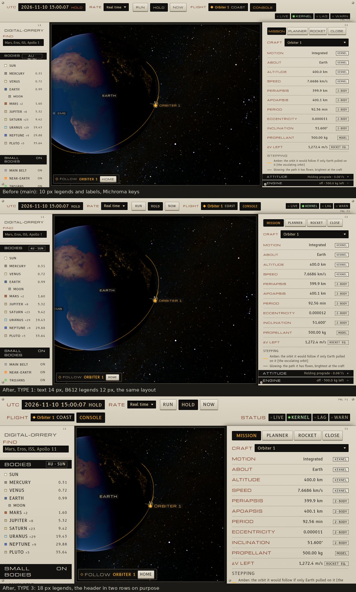

# Design System: digital-orrery

## Overview

70s flight hardware around the true-scale sky, in the NASA-punk lineage of
Space Shuttle cockpit panels and Apollo instruments. The console is three
beige sheet-metal panels with screw-head corners, framing the sky in a dark
bezel:
- a header band of instruments: the clock and rate in recessed black
  readout windows, the RUN, HOLD and NOW keys, the FLIGHT field (the
  selected craft and the CONSOLE key) and indicator lamps;
- a body rail, headed by the wordmark;
- a data plate for the body in view;
- the rail and plate stowed to their spines on the sky's edges until pinned,
  so the sky comes first;
- and, when opened, a flight console (MISSION, PLANNER, ROCKET), the app's
  own panel rather than any body's.

Labels are engraved in oxblood wide capitals. Each panel carries a small
designation code, as Shuttle panels do (PNL F1, L1, R1), and section titles
sit on black nomenclature strips. The signature is the provenance column:
every value in the data plate has a tag naming its source. Original: the
lineage is real NASA hardware, not any game's or film's interface.

### Lineage

The look sits in the "NASA-punk" lineage that Bethesda's art team named for
Starfield (art director Istvan Pely, Hypebeast, August 2023). We take its
principles, not its interface:

- over-engineered, functional hardware that makes survival believable;
- a period piece set in the future, with a 1970s–80s, pre-CGI feel;
- physical, labelled buttons you want to press, rather than holograms;
- familiarity first, so a new world reads at once.

Starfield's own logo, colour stripe, fonts and screen layouts are not used.

### What real panels do

The lineage is real hardware, so its rules are real too: NASA-STD-3001
Volume 2 [1], [2], and MIL-STD-1472 as the FAA's Human Factors Design
Standard quotes it [3].

- **Contrast is 6:1 or better, 10:1 where it can be** [1, App. F.5.10 f].
  A lit key carries a dark legend on its lit field, as a master-warning
  legend does [3, §6.2.2.2.5], so a legend reads lit and unlit
  [3, §6.2.2.2.7]. RUN lit is ink on the bright end of the key (6.6:1 or
  better), not cream on orange.
- **One colour, one meaning** [3, Exh. 6.2.2.1.27], [1, Table F.5-1]: red
  for failure or warning, yellow for caution, green for in tolerance and OK
  to proceed, white for selected, blue for advisory, grey for unavailable.
  Every coloured state also has a word [1, App. F.5.10 e].
- **A lamp reports what the system did** [3, §6.2.2.1.2–.5]. A lamp with
  nothing to report is dark, and green is never lit for nothing: the
  plotting table's DELTA-V lamp stays dark until there is a journey to
  price.
- **The primary action is marked by place, size and shape, not by colour**
  [3, §6.1.1.3.4], [1, App. F.4.3.2 j]. Aviation keeps red, amber and
  yellow for alerting [5, (f)], so RUN is the one orange key, and a flow's
  commit key is a taller key outlined in ink.
- **Guard what can't be undone** [3, §6.1.1.6.4], [1, App. F.4.3.2 c–e]:
  an irreversible command takes two steps, arm then act, without slowing
  the action beyond what it needs [3, §6.1.1.6.3].
  Here: ARM then LAUNCH (the MISSION tab and the pad), and a confirm for
  removing a ROCKET stage; ARMED is caution yellow with an ink legend,
  never the dark key of a selection. What can be undone isn't guarded:
  REMOVE CRAFT acts at once, and its notice restores the craft.
- **Size labels to the eye.** NASA sets labels at 0.4° and any text at
  0.25° or more [1, §10.4.3.3, App. F.5.1 g]. A CSS px is defined at
  710 mm [4], and Michroma's and B612's capitals are 0.75 em, so at a desk
  that is about 14 px for text, 18 px for control legends and 23 px for
  group labels, each step about 25 % up as MIL-STD-1472 grades them
  [3, §6.1.2.1.2–.5]. The console sets type by role in three TYPE steps
  (Typography, below): step 1 keeps a laptop's layout with text and
  legends at 14 px and labels at 13; a wide screen starts at step 2; step 3
  reaches 18 px legends with the panels widened. Group labels stop at
  18 px, short of 23: a strip's title at 23 px Michroma would need a rail
  near 400 px. Panel codes stay decoration.

Product truth is in [PRODUCT.md](PRODUCT.md).

## Colors

### Primary

- **phosphor** `#ffb22e`: amber numerals in readout windows and the current
  body. 10.5:1 on the window.
- **key** `#d9531f`, lit `#ff7a3d` to `#ffb48d`: the RUN key while time
  runs, the only orange surface, with an ink legend when lit (6.6:1 or
  better).

### Secondary

- **engrave** `#70220d`: engraved labels on the panel, oxblood. 7.5:1 on
  the panel, 6.2:1 at worst (panel-sunk).
- **lamp-on** `#7fe06a`: a lit indicator lamp.

### Neutral

- **Panel:** **panel** `#ddd6c6` sheening to **panel-low** `#d3cbb9`, with
  **panel-raised** `#e9e3d6` for keys and tags and **panel-sunk** `#cbc2ae`
  for hover.
- **Seams:** **seam** `#a39a86` and **seam-strong** `#7d7564`, for rules and
  seams.
- **Ink:** **ink** `#1d1b16` (11.9:1) and **ink-muted** `#433e34` (7.3:1,
  6.0:1 at worst).
- **Window and bezel:** **window** `#121110` for readout windows and strips,
  **bezel** `#1b1a17` around the sky.
- **Highlights:** **sheen** `#f5f0e4`, plus **key-low**, **key-edge** and
  **key-sheen** for the RUN key's bevel.

### Named Rules

- **caution** `#f2c230` hatched with ink, and **warn** `#c62f1c`, are for
  warning states only: no WebGL, and later the kernel falling behind.
- A lamp is lit only when it means something (RUN: time is running; LIVE:
  the sim clock is within a minute of now).
- Body swatches keep each body's own colour.
- An unlit lamp's label is **label-dim** `#b9ad92` on the window (8.5:1): a
  legend reads whether or not it is lit.

### Data encodings and lamp states

Colours that encode data in the sky's overlays, or a lamp's state in the
plotting table, kept out of the panel palette:

- **Guides:** `#ff9a66` a retrograde spin axis and the pull arrows, `#9fc9b8`
  Hill spheres, `#8dffa0` the Kp-driven auroral oval; the gravity field's
  bar runs to `#2f8fb0`, and the flow legend from `#3d5a64` to `#8fc8d8`.
- **The sky:** `#5f7f99` constellation lines, `#8fa9bf` their names and the
  Sky rail's lamps; the chosen star's ring is phosphor amber, open at four
  points so it never covers the star.
- **The chart view's tints** (docs/frontend/chart.md): a body's heights from
  indigo `#24204a` through `#2c4a7c`, teal `#2f7a86`, `#5e9c6c`, `#a8b25e`,
  sand `#d8b878` and `#ead2a8` to cream `#f8f1e4`, its lightness rising with
  height so higher always reads lighter (no rainbow); the Earth's land from
  lowland green `#6a9e5b` through `#c4c67f`, tan `#dcc083` and browns
  `#bf9260`, `#9c7658` to snow `#f6f3ef`, and its sea from shallows
  `#d6eef4` through `#74b3d4` and `#255693` to the deeps `#0c1d3d`. The paper
  is panel-raised `#e9e3d6`; the sheet grid is engraving oxblood.
- **Plotting-table lamps:** go `#1f3a1b`, caution `#4a3c0e` and warn
  `#4b130b` fields, with **lamp-ink-off** `#c9bfa6` for an unlit lamp's
  legend (6.5:1 on lamp-dark, so it reads lit or unlit); `#3a3328` for the
  rules between their rows.

## Typography

- **Michroma**, wide extended capitals: the wordmark, headings, the
  nomenclature strips and the engraved labels beside values and fields.
- **B612**, the Airbus cockpit face: body text and every number, and in
  capitals the legends of controls (keys, tabs, lamps, disclosures). Its
  digits share one width, so values align and the clock never jitters.
  Michroma's wide capitals at a legend's 18 px would not fit a key; a
  narrower face on the controls is how real panels did it too.
- **B612 Mono**: codes only (source tags, panel designations, key caps).

All three are SIL OFL and self-hosted.

Equations, in a tag's detail, are MathML set by the browser in DejaVu
Math TeX Gyre: a sans math face, nearest B612, with the OpenType MATH table
a math font needs to stretch brackets and radicals (B612 has none). It is
bundled (`src/app/fonts`, 186 KB as WOFF2, Bitstream Vera licence) under
the name Orrery Math, an installed copy first, so every machine sets the
maths alike; the browser fetches it only when an equation first shows.
STIX Two Math, Cambria Math and Latin Modern Math are the fallbacks while
it loads. (Noto Sans Math is left out: Chromium doesn't stretch with it.)

### Hierarchy

Sizes are set by role (`--t-*` in `app.css`), in three TYPE steps. A
reader who has not chosen starts at step 1 on a laptop and step 2 on a
screen 1,680 px wide or more; the rail foot's TYPE keys, or + and −, choose
one, kept for the browser (`type-step.ts`). Step 3 reaches the readability
standard's 18 px legends, the plate and console widening by 15 % and 32 %
(`--w`) and the rail, whose strips' titles are long, by 28 % and 42 %
(`--wr`). Two-word engraved labels in the plate (MEAN DENSITY, SURFACE
GRAVITY) stack on two lines at step 1, as panel labels do, so the values
keep their width.

| Role | Face | Step 1 | Step 2 | Step 3 |
| --- | --- | ---: | ---: | ---: |
| Plate heading | Michroma | 26 | 28 | 30 |
| Clock | B612 | 17 | 19 | 22 |
| Values, inputs, text | B612 | 14 | 15 | 16 |
| Rail rows, lists | B612 | 14 | 15 | 17 |
| Units, notes, hints | B612 | 13 | 14 | 15 |
| Engraved labels | Michroma, 0.06em in the plate | 13 | 15 | 16 |
| Nomenclature strips | Michroma, 0.08em | 13 | 16 | 18 |
| Control legends | B612 capitals, 0.06em | 14 | 16 | 18 |
| Small keys, plotting-table lamps | B612 capitals | 12 | 14 | 16 |
| Tags | B612 Mono | 12 | 13 | 14 |
| Labels in the sky | Michroma | 11 | 12 | 13 |
| Small bodies', guides' labels | Michroma | 11 | 12 | 13 |
| Equations (tag detail) | math font | 15 | 16 | 18 |
| Panel codes | B612 Mono | 9 | 9 | 9 |
| Key height | | 36 | 40 | 44 |

Nothing is set below 10 px except the panel codes (decoration, 9 px):
Michroma's wide capitals smear at 9 px on a 1× screen. Sizes are whole
pixels, and labels in the sky sit on whole device pixels, so glyphs are
never resampled. The phone's layout (docs/frontend/phone.md) keeps its own
rules on top of these.

## Layout

- Desktop grid: a header band across the top, 64 px when it holds one row;
  the rail, the sky in the middle cell (centred on the focused body) and
  the plate. A first visit has both panels stowed: each leaves a 32 px
  spine, and the sky takes the rest. Pinned, the rail is 236 px and the
  plate 412 px, both scaled with the TYPE step (Stowed panels, below).
- The flight console docks over a pinned plate up to 1680 px wide, so the
  sky keeps its width; wider, or with the plate stowed, it hangs over the
  sky's right edge (392 px) and the 3D view moves its centre left so the
  body in view stays clear.
- The sky's bezel is a 7 px frame drawn over the canvas edge, with a 1 px lip
  and an inner shadow. The view plate sits inside it, lower left.
- 8 px spacing unit.
- The header keeps one row while its groups fit, measured, and otherwise
  takes two on purpose: the clock, rate and time keys, then FLIGHT and the
  lamps under an engraved STATUS label, with the panel code in the first
  row's free corner.
- Under 1100 px the rail and plate narrow and the panel codes go.
- Under 720 px the rail becomes a horizontal strip under the sky, the plate
  folds behind "Show data", the console takes the plate's place, the
  header's engraved labels hide (the controls keep their names), and the
  screws go. The header's first line names the app instead of the rail's
  wordmark (DIGITAL-ORRERY, and "The real solar system, now, from NASA
  ephemerides"), and a first visit shows one line over the sky on how to
  touch it, gone at the first touch.

## Elevation & Depth

This is physical, not material-design. Keys stand proud on a 2 px edge and
press down 1 px. Readout windows are recessed, with an inner shadow and a
1 px sheen on the lower lip. The sky sits behind the bezel. Panels
themselves are flat sheets separated by seams, one device pixel wide on 2×
screens. The flight console is the one panel that lies over another, so it
casts a shadow onto the sky.

## Shapes

- Square corners for panels, rows, strips and tags.
- 2 px for readout windows, 3 px for keys.
- Round screw heads.
- Square lamps and swatches.
- Slotted screw heads.

## Components

### Buttons

Keys are 36 px high (40 and 44 at TYPE 2 and 3), their legends in B612
capitals, with a raised bevel. A key that is unavailable has a flat, sunk
face and muted ink (7.3:1), not a fade. RUN and HOLD
are a radio pair (`role=radio`): RUN lights orange while time runs, HOLD
stays pressed while it is held. NOW jumps to the present and is disabled
when the clock is live. The primary key of a flow (Launch, Fly this,
Commit to the orrery) is a taller key outlined in ink, marked by shape and
place, since RUN is the one orange key; the ACK key flashes only while a warning is unacknowledged, and not
at all with reduced motion.

### The FLIGHT field and the flight console

The header's FLIGHT field holds a readout window naming the selected craft
(a diamond, its name, and COAST, BURN in key orange, or LOST in warning
red; "+2" when more craft wait in the console) and the CONSOLE key, which
latches pressed while the console is open. Pressing the window follows the
craft. The console is a sheet-metal panel (PNL C1) with MISSION, PLANNER and
ROCKET tabs and a CLOSE key; M toggles it and Escape closes it. Choosing a
body never closes it.

### The view plate

A small window in the sky's lower left names what the camera is on, with
two cues for the mode: FOCUS and a ring for a body, FOLLOW and a diamond for
a craft, as their markers are drawn in the sky. During a flight the glyph
lights and the plate reads EN ROUTE · Esc stop. Its VIEW key latches open
a small pad above it, laid out as a hand controller's: UP, DOWN, LEFT and
RIGHT turn the view a step, IN and OUT zoom, so nothing needs a drag or a
pinch.

### Stowed panels

The rail (L1) and the plate (R1) fold back to a spine until pinned
(docs/frontend/panels.md): a 32 px strip of the panel's own sheet metal,
one tall key, engraved with the panel's code and name (and the app's name
on L1, which the rail heads with), a grip of three ridges and the key cap of
its shortcut, the letters facing the sky. Pointed at, it slides the panel
out over the sky with the console's shadow, on the phone sheet's curve;
focused or pressed, it opens at once. Pressed, the spine is sunk. The
panel's PIN key, in its top corner beside the code, latches pressed while
pinned, as CONSOLE does; L and R do the same. What a key opens is never
animated, and pinning (a layout change) is not either.

### Labels in the sky

Labels are drawing aids and look it: Michroma capitals at the sky's sizes
(Typography), never larger for importance. They rank themselves so the
focus leads and the sky stays the subject:
- the focus, phosphor on a dense window plate, and the body pointed at
  (its label, or its row in the rail), phosphor-dim on the same, both over
  the rest;
- the focus's own (its parent, moons and barycentre), phosphor-dim on the
  window plate;
- the rest in label-dim on a halo of window black, without a plate;
- a name that would overprint a higher one fades to 40 % under it, and is
  full again when pointed at. It marks a body that is there; it is not
  meant to be read, the one label under 6:1.

### Focus

The focus ring is 2 px of ink, 2 px out (10.7:1 on the panel), and
phosphor wherever the control sits on black: the plotting table's scope, timeline, stack and GO board, a tag's
detail, the key sheet, FIND's list, the sky, the nomenclature strips and
the peek's readout window. Fields take the same ring as keys.

### Annunciator

The header's lamps follow the flight-deck convention (class `k-status`): green status (LIVE,
KERNEL: in tolerance, not advisories, which aviation keeps off green [5, (e)]), amber caution (LAG) and red warning (WARN). Every lamp is labelled,
so colour is never the only cue. A new warning lights WARN and flashes ACK;
acknowledging stops the flash, but the lamp stays lit while the condition
lasts, as on the Shuttle's caution and warning panel.

### Readout windows

Amber numerals carry a tight phosphor glow (a 1 px halo and a faint 10 px
one), enough to read as lit glass without blurring the digits.

### Chips

The source tag: 10 px mono in a 1 px ink box, solid for data, dashed for
values worked out in the app. It is a button: hovering it, focusing it or
tapping it opens its detail, a small readout window under the tag (above
it when there is no room). The detail says what the value is, gives the
equation in phosphor, then its source, under engraved labels. A tap or
click pins it; Escape, a press elsewhere or moving focus away closes it.
Screen readers get the same as one line of text, the button's
description.

### Inputs / Fields

The clock and rate sit in recessed black readout windows. Rate is a native
select dressed as a window, with a drawn caret.

### Tabs

The flight console's MISSION, PLANNER and ROCKET tabs are keys that stay
pressed: the selected one is window black with an amber legend.

### Number inputs

Inputs are small recessed readout windows: window black, pale-amber
numerals, an engraved label above, and the unit beside.

### Spacecraft and the porkchop

- **Craft marker:** a 9 px square turned 45° in amber; filled when
  selected, orange while burning, red and struck through after an impact.
- **Craft lines:** the osculating conic in amber (0.55); the flown trail in
  pale amber, glowing at the craft and fading with age.
- **A real mission's flown path:** pale green (`flown-line` for its legend
  swatch on the panel), so it never reads as ours (amber). Drawn relative to
  Earth, it stays put while our craft drifts off it.
- **Orbit lines:** each planet's orbit is a faint outline with a glowing
  trail behind the planet (see docs/frontend/scene.md).
- **A journey's plan:** each leg a dashed pale-amber line, the kernel's
  flown path of it solid amber. Burns are open square reticles with their
  delta-v in a window tag (orange at a capture). A burn node is the
  reticle with a diamond inside; selected, it grows stalks to small raised
  panel tabs with engraved legends (P+ P−, N+ N−, R+ R−, × in warning
  red), after a panel's guarded toggles. A flyby's aim is a phosphor ring
  on a stalk from the planet.
- **Porkchop:** shaded on the console's own ramp, from sheen through amber,
  key orange and engraving to window black, so low C3 glows. The minimum is
  outlined in ink and the picked cell in lamp green.
- **Magnetic field lines:** the same ramp, by field strength: sheen where
  the surface field is strongest, through amber and key orange to
  engraving a thousand times weaker. The dipole's axis is a brighter line
  through its own centre, tagged with its tilt.
- **Auroras:** the Earth's in their real colours, oxygen green (557.7 nm)
  low and red (630.0 nm) above, on the night side only; Jupiter's and
  Saturn's, which shine in the ultraviolet, in a pale violet false colour
  the rail's switch says is false.
- **Mars's crust:** the gravity field's diverging ramp, blue inward and
  amber outward, on a shell over the planet; its aurora in the giants'
  violet false colour.
- **A satellite's ground track:** pale amber on the Earth, its next pass
  over the chosen place bright amber, the place a small amber square. On
  the plate each pass carries a square lamp, lit green only when the pass
  can be seen, and an UP NOW window while it is above the horizon.
- **Radiation belts:** pale teal (`#7fb8c9`) shells along the L-shells,
  brightest where seen edge-on so the belt reads as a volume.

### The chart view

PNL K1 (docs/frontend/chart.md): a printed chart laid in the sky's window,
switched to from the 3D view by K or the view plate's CHART key. A strip of
sheet metal across the top carries the body's name in Michroma and the
projection, then the projection keys (N · EQ · S, a radio set like the
console's tabs), the layer keys (latching: window black with an amber
legend while on, as CONSOLE does) and 3D, back to the sky. The chart sits on
a paper border (panel-raised) with its figures in B612; below, a strip with
the recessed readout window (amber numerals: latitude, longitude, height,
sheet and the name under the pointer, each with its source tag) and the
legend (the tint ramp with its heights, the relief's exaggeration).

On the chart itself everything is printed, not lit: ink on a halo of the
paper, so it reads on dark maria and pale highlands alike. The graticule is
a hairline of ink at a third; the sheet grid is engraving oxblood, each
sheet's code in B612 Mono and its name in small Michroma capitals; feature
names are B612 in four sizes by the feature's size on the chart, regions in
Michroma's wide capitals; landing sites are small ink glyphs (a square for
a crewed landing, a triangle for a lander or rover, a cross for a crash or
an estimate), launch pads solid triangles. The lit things are the ground
tracks, on a window-black edge, as the 3D view draws them: a satellite's
pale amber, solid behind it and dashed ahead, its next pass over the chosen
place bright amber and the place an amber square; the console's craft's
amber, as its conic is, dashed ahead, the craft an amber diamond and an
amber cross where its orbit would meet the ground. The polar insets are discs in a window-black rim. Never
the film-map or game-map look: no compass-rose flourishes, no decorative
borders, no faux paper texture.

### Navigation

The body rail: list buttons with `aria-current`. The current body inverts to
amber on the window black, its swatch glowing.

## Do's and Don'ts

- Do show a value's source beside it.
- Do engrave labels; do not invent emblems, insignia or stripes.
- Do keep lamps and caution colours for states that mean something.
- Don't use glass, blur, gradients for colour, or rounded cards.
- Don't take any game's or film's interface, logo or stripe: the lineage is
  real NASA hardware.

## References

[1] NASA Office of the Chief Health and Medical Officer, "NASA Spaceflight Human-System Standard, Volume 2: Human Factors, Habitability, and Environmental Health," NASA-STD-3001 Vol. 2, Rev. F, 2026. [Online]. Available: https://standards.nasa.gov/standard/NASA/NASA-STD-3001_VOL_2

[2] NASA, "Appendix F (Vol. 2)," NASA-STD-3001 reference page. [Online]. Available: https://www.nasa.gov/reference/appendix-f-vol-2/

[3] FAA William J. Hughes Technical Center, "Chapter 6: Controls and visual indicators," in *Human Factors Design Standard (HFDS)*, 2003 ed. [Online]. Available: https://hf.tc.faa.gov/hfds/download-hfds/hfds_pdfs/Ch6_Controls_and_visual_indicators.pdf

[4] W3C, "CSS Values and Units Module Level 4," §6.2, the reference pixel. [Online]. Available: https://www.w3.org/TR/css-values-4/#reference-pixel

[5] *Code of Federal Regulations*, 14 CFR §25.1322, "Flightcrew alerting," amdt. 25-131, 75 FR 67209, Nov. 2, 2010. [Online]. Available: https://www.law.cornell.edu/cfr/text/14/25.1322
