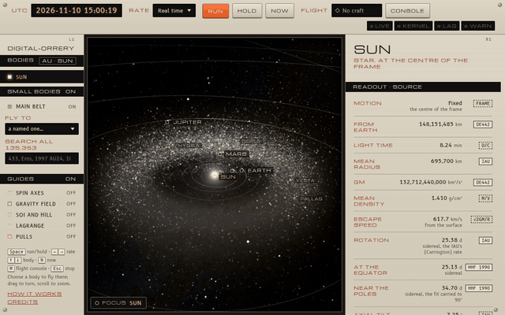
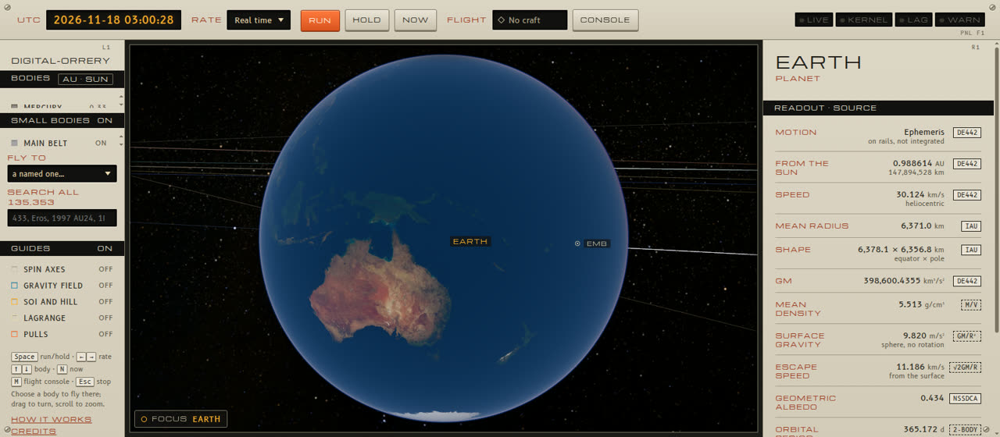
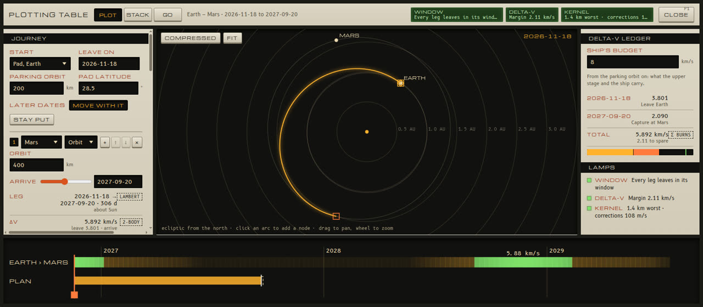
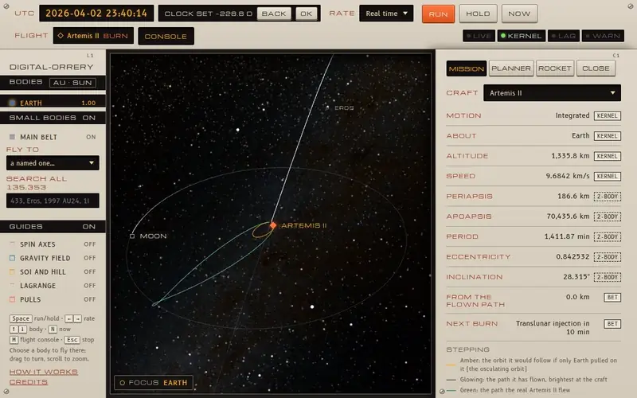
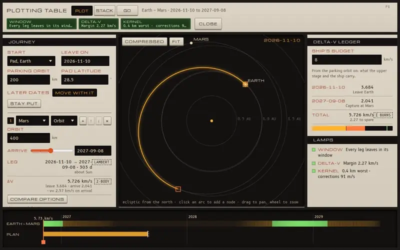
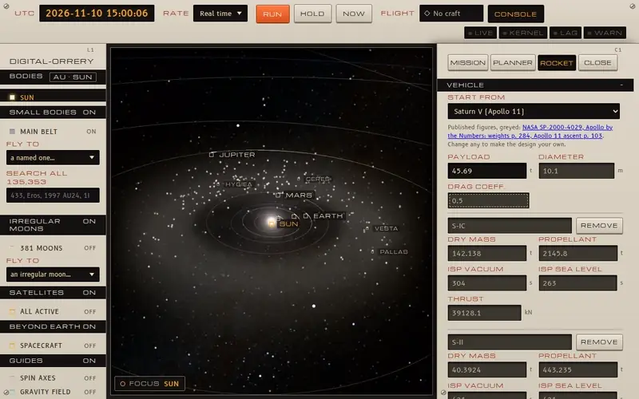
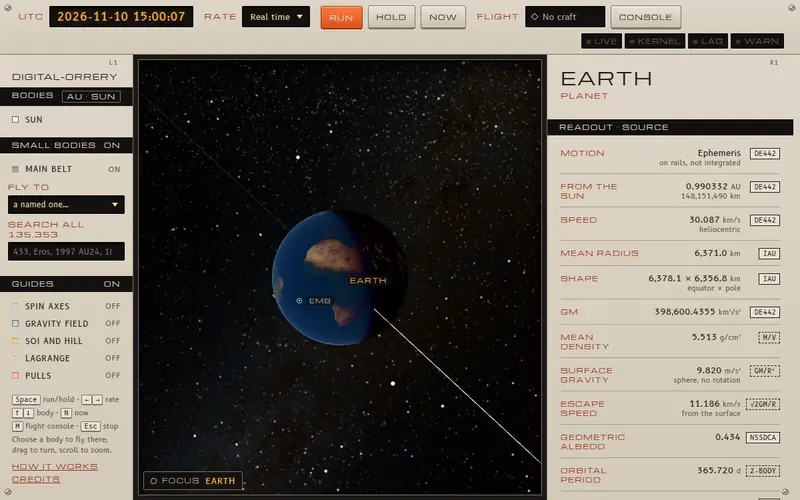

# digital-orrery

[](https://github.com/Zyzzbarth333/digital-orrery/actions/workflows/ci.yml)
[](LICENSE)

A true-scale solar system and mission simulator that runs in the browser. The physics is plain JavaScript, checked against NASA's SPICE toolkit, JPL's DE442 and satellite ephemerides, and flown missions. The front end is TypeScript, React and three.js.

<picture>
  <source srcset="docs/clips/overview-to-earth.webp" type="image/webp">
  
</picture>

| | |
| --- | --- |
|  |  |
| **Saturn**, its rings from Cassini's occultations, and its moons' orbits | **The Earth** over Australia, under a scattering atmosphere |
|  |  |
| **The plotting table**: a journey to Mars, its launch windows and its delta-v | **Guides**: spheres of influence and Lagrange points, with Jupiter's trojans at L4 and L5 |
|  |  |
| **The ROCKET tab**: Saturn V from Apollo 11's actual weights | **Jupiter** and its moons, from JPL's satellite ephemerides |

In motion (each clip is from the app as it runs, rebuilt by `npm run docs:clips`):

| | |
| --- | --- |
|  |  |
| **Time warp**: a month a second ([scene](docs/frontend/scene.md#time)) | **Artemis II** flown against its real trajectory ([missions](docs/frontend/mission.md#real-missions)) |
|  |  |
| **The plotting table**: a burn node pulled and re-aimed ([journeys](docs/physics/journey.md#the-plotting-table)) | **A launch** from LC-39B ([rockets](docs/physics/rocket.md#in-the-app)) |
|  |  |
| **Guides**: the gravity field, then SOI and Lagrange points ([gravity guides](docs/physics/gravity-guides.md)) | **Jupiter's moons** and a flight to Io ([moons](docs/frontend/moons.md)) |

New to the terms? The [glossary](docs/glossary.md) explains them, and [How it fits together](docs/architecture.md) maps the code.

## What it does

- **The sky:**
  - the Sun, planets, 76 moons and 135,353 asteroids and comets, at their real positions for any date, at true scale;
  - 16,892 Earth satellites from CelesTrak's element sets, moved by SGP4, with the ISS, Tiangong, Hubble, GPS, Galileo and the weather satellites' orbits;
  - real surface maps and relief, Saturn's rings from Cassini measurements, Earth's clouds as satellites saw them that day under a physically based atmosphere;
  - the real star field and Milky Way.
- **Bodies to visit:** fly the camera to any planet, moon, barycentre, small body or Earth satellite, with a data plate whose values open their equation and source.
- **Guides:** spin axes, Earth's and the Moon's real gravity fields, spheres of influence, Lagrange points and the strongest pulls; the planets' magnetic fields as traced field lines (IGRF-14, JRM33, Cassini, Voyager), and the auroras: the Earth's ovals for the day's Kp, Jupiter's and Saturn's main ovals and Io's footprint.
- **Missions:**
  - spacecraft fly under an n-body kernel in a Web Worker, with finite burns, the Earth's and Moon's gravity fields, drag and sunlight pressure;
  - the craft you launch carry an attitude: point them prograde, normal, radial, at a node or hold them still, and they turn in the time their thrusters' torque allows, under the gravity gradient and the air's torque, and burn along their body axis; the thrusters burn propellant, the craft turns faster as its tank empties, and it turns to each manoeuvre node by itself in time to settle ([docs/physics/sixdof.md](docs/physics/sixdof.md#attitude-in-the-app));
  - Artemis I and II fly against NASA's reconstructed trajectories, down to Orion's entry and splashdown.
- **Planning:**
  - a journey of any number of legs, each leg's transfers compared, shaped by hand on a plotting table;
  - flown by the kernel, with the rocket it needs.
- **Rockets:** build a launch vehicle stage by stage, or start from Saturn V, Falcon 9 or Electron, or open an OpenRocket design, and fly it from a real pad into orbit.

The name nods to the orrery, a mechanical model of the solar system, and in particular to the Digital Orrery, the special-purpose computer built in the 1980s to integrate the long-term dynamics of the outer planets.

## Physics and accuracy

The simulator is honest about where it sits on the fidelity scale. The goal is to move toward and beyond KSP-grade patched-conic-plus-n-body fidelity, and the codebase is being built out to get there rather than claiming to be there already.

What is high-fidelity today:

- **Gravitational parameters** are SPICE-precision GM constants for the Sun and all planets, held in `src/utils/constants.js`.
- **Planetary positions** come from JPL's DE442 for 2000–2050, through a Chebyshev table within a metre of it ([docs/physics/ephemerides-and-gm.md](docs/physics/ephemerides-and-gm.md#de442-in-the-app)), and from astronomy-engine outside those years, so the Sun and planets sit where they actually are for a given date.
- **Moons.** Seventy-six moons of Mars to Pluto (the twenty major moons; Jupiter's four inner moons; Saturn's ring, co-orbital and small moons, Hyperion and Phoebe; Uranus's fourteen inner and ten irregular moons; Neptune's seven inner moons and Nereid; Pluto's four small ones), are drawn at their real sizes about their planets, fourteen of them with USGS global mosaics. From 2000 to 2049 they come from those ephemerides as compact Chebyshev tables, within 1 km, loaded a system and a year at a time (the 29 inner moons for 2020–2035 from the repo, their other years with `npm run build:moon-tables`); outside, from astronomy-engine and JPL's mean elements. Near its planet each major moon pulls on spacecraft ([docs/frontend/moons.md](docs/frontend/moons.md)), checked on three real passes against the craft's own reconstructed tracks: Juno at Ganymede and at Io, and Cassini at Titan, followed to 0.05–0.09 km hours after closest approach ([docs/validation.md](docs/validation.md#the-moons-pull-flybys-of-ganymede-io-and-titan-flybytestmjs)).
- **Spacecraft propagation** runs in a physics kernel (`src/physics/nbody.js`) with no three.js in it, inside a Web Worker (`src/physics/kernel.worker.js`) so sub-stepping never blocks rendering; it falls back to the main thread if a Worker cannot start. Results arrive a frame or so late, so each craft is drawn at its last exact state carried forward to the sim clock along a two-body orbit about its primary, plus the other accelerations to second order. That is within a kilometre in orbit and in cruise; during a close planetary pass at very high warp the drawn position can be off by thousands of km until the next result, while the physics itself is unaffected. A craft coming down to the Earth is carried no further than the entry interface; it waits there for the kernel, which flies the entry. Each craft feels the Sun, the eight planets and the Moon at their ephemeris positions throughout every frame, and near a planet its major moons, as well as the sixteen heaviest asteroids. The kernel integrates about the solar system barycentre, with the Sun moving on DE442's own path, so it needs no indirect term ([docs/physics/nbody-kernel.md](docs/physics/nbody-kernel.md)). Yoshida's 4th-order composition of leapfrog steps advances it (symplectic at a fixed step). Inside a planet's sphere of influence, while the motion is nearly Keplerian (low orbits), Encke's method takes over: the two-body orbit is followed exactly and only the small deviation from it is integrated, with error control, which in low Earth orbit takes 30 times fewer steps and is 11 times more accurate. Each step is 1% of the shortest local dynamical time, so it sub-steps finely near a planet and coarsely in cruise; there is no error control yet. An impact is found where the step crossed the surface, on the step's dense output, to a microsecond and at its true speed ([docs/physics/nbody-kernel.md](docs/physics/nbody-kernel.md#impacts)). If a frame needs more steps than its budget, the craft falls behind the clock and catches up, with an on-screen warning, rather than taking steps long enough to pass through a planet. Launches start on the escape hyperbola, 100 planet radii out or at the edge of the sphere of influence if that is closer, with the preset delta-V as the hyperbolic excess speed.
- **Orbital-mechanics core.** `src/physics/orbital.js` provides universal-variable two-body propagation (one code path for ellipses, parabolas and hyperbolas) and a universal-variable Lambert solver with a bracketed root solve. Both are checked against worked examples from Curtis, *Orbital Mechanics for Engineering Students* (4th ed.). Propagation and the state-to-elements conversion are also checked against NAIF CSPICE (`prop2b_c`, `oscltx_c`). SPICE has no Lambert solver, so the Lambert solver is checked on the real MSL launch and arrival geometry from the DE442 ephemeris and on transfer grids flown by an independent numerical integrator. Run the checks with:

  ```bash
  node src/physics/orbital.test.mjs
  ```

What is still approximate:

- **Journeys are planned by patched conics.** Each leg uses the verified Lambert solver, and flybys a B-plane aim. The kernel then flies the plan, landings, stays and liftoffs included, and reports how close it comes to each waypoint. It is flown in the full model, with the Earth's and the Moon's gravity fields (the Moon's mascons included), drag and sunlight, so the journey's craft in the app lands where the plan's flight did. Leaving a moon for another planet is priced by where the moon is on the day, and the planner suggests the best day in the stay.
- **The ascent has no closed-loop guidance.** The ROCKET tab's gravity turn ends its orbits higher than real launches, which are steered ([docs/physics/rocket.md](docs/physics/rocket.md#real-launchers)).

In short, the constants, ephemerides, n-body integration and the Kepler/Lambert core are checked against references. The planning layers on top of them are where the remaining approximations live, and each says so in its docs.

## Documentation

[`docs/`](docs/README.md) explains the physics with the maths: frames and time, ephemerides and GM values, two-body propagation, Lambert's problem, the n-body kernel, burns and launches, and a [validation](docs/validation.md) table of every check and its result.

## Accuracy roadmap

The following changes would push fidelity further, roughly in order of impact:

- [x] Wire the Lambert core in `src/physics/orbital.js` into the porkchop delta-V grid so the planner reads directly from the verified solver.
- [ ] Add patched-conic sphere-of-influence transitions so trajectories hand off correctly between central bodies.
- [x] Replace the fixed-step integrator with a higher-order integrator whose step follows the local dynamical time.
- [ ] Add error-controlled adaptive stepping (an embedded Runge-Kutta-Nystrom pair or DOP853) and a two-body fast path for weakly perturbed orbits at high warp.
- [x] Validate propagated trajectories against flown missions: Artemis I and II against NASA's reconstructed trajectories ([validation](docs/validation.md)).

## Quick start

### Prerequisites

- Node.js 20.19+ (or 22.12+) and npm; Vite 8 needs one of these
- A modern browser with WebGL support

### Install and run

```bash
git clone https://github.com/Zyzzbarth333/digital-orrery.git
cd digital-orrery
npm install
npm run dev
```

`npm run dev` starts the Vite development server. To produce a production build:

```bash
npm run build
```

## Controls

- Drag: rotate the view about the focused body
- Scroll: zoom in and out (the zoom is kept when you move to another body)
- Click a label or a name in the list: fly there (drag, scroll or Esc stops the flight; click the body in view again to reframe it)
- Header: the RUN key runs or holds time; choose a rate (real time to one year per second), or jump back to now with NOW
- Header: FLIGHT shows the selected craft (press it to follow the craft); CONSOLE opens the flight console
- Keys: Space run or pause, ← → step the rate, ↑ ↓ move through the bodies, N jump to now, M flight console, Esc stop a flight or close the console

The data plate gives each value with its source (the provenance column): a solid tag for data, a dashed one for values worked out in the app; hover a tag for detail.

The right-hand plate shows the focused body's data. Missions, the planner and the rocket are the app's, not a body's, so they live in the flight console, opened from the header whatever is in view: MISSION (launch, readout, nodes, engine, log), PLANNER (a journey's summary, and the full-screen plotting table for planning it) and ROCKET. See [docs/frontend/mission.md](docs/frontend/mission.md).

A link can set the starting view: `?focus=moon&t=2026-03-03T11:33:40Z&view=sun` (`view=sun` puts the camera on the sunlit side).

## Project structure

```
digital-orrery/
├── src/
│   ├── app/                 # React: the console, panels, planner, rocket, clock, styles
│   ├── scene/               # three.js: bodies, sky, orbits, small bodies, guides, camera
│   ├── physics/             # orbital core, n-body kernel and Worker, ephemerides, moons,
│   │   │                    #   orientation, environment, rocket, journeys, and their tests
│   │   └── fixtures/        # reference data the tests check against (CSPICE, Horizons, NASA)
│   └── utils/constants.js
├── public/                  # surface maps, star map, ephemeris and small-body tables
├── c/                       # CSPICE programs that write fixtures and the moon tables
├── python/                  # SPICE metakernel, kernels (downloaded, not in git), offline checks
├── tools/                   # outside oracles (OpenRocket, RocketPy)
├── docs/                    # the physics and the front end, with the maths, and validation
└── .github/                 # CI, issue and pull request templates
```

## Testing

```bash
npm test            # every physics and app check, from fixtures, no network
npm run typecheck   # the TypeScript
npm run build       # the production build
```

`npm test` runs each module's checks against its references:
- the orbital core against Curtis's worked examples and NAIF CSPICE;
- the ephemerides against DE442 and JPL Horizons;
- the n-body kernel's convergence, energy and events;
- NASA's 6-DOF check cases, also through the app's attitude;
- the ROCKET tab against OpenRocket and RocketPy;
- Artemis I and II against their flown trajectories;
- the moons, asteroids, orientation and more.

[docs/validation.md](docs/validation.md) lists every check with its reference and result. CI runs all three commands on every pull request.

## Credits

Every data source, with what the app uses it for. Each map's details are in [docs/frontend/textures.md](docs/frontend/textures.md), and each dataset's in the page that uses it.

**Surfaces, sky and imagery**

| Source | Used for | Terms |
| --- | --- | --- |
| NASA Earth Observatory: [Blue Marble](https://visibleearth.nasa.gov/collection/1484/blue-marble), [Black Marble](https://earthobservatory.nasa.gov/features/NightLights) | the Earth's surface and night lights | [NASA](https://www.nasa.gov/nasa-brand-center/images-and-media/) |
| [NASA GIBS](https://nasa-gibs.github.io/gibs-api-docs/) (ESDIS) | the Earth's clouds on the sim date | [NASA](https://www.nasa.gov/nasa-brand-center/images-and-media/) |
| NOAA NCEI: [ETOPO 2022](https://www.ncei.noaa.gov/products/etopo-global-relief-model), [doi:10.25921/fd45-gt74](https://doi.org/10.25921/fd45-gt74) | the Earth's relief | NOAA, public domain |
| NASA Scientific Visualization Studio: [CGI Moon Kit](https://svs.gsfc.nasa.gov/4720/); [Deep Star Maps 2020](https://svs.gsfc.nasa.gov/4851/) ([Gaia DR2](https://www.cosmos.esa.int/web/gaia/dr2): ESA/Gaia/DPAC) | the Moon's surface and relief; the Milky Way | [NASA](https://www.nasa.gov/nasa-brand-center/images-and-media/); ESA credit |
| [ESA Hipparcos Catalogue](https://www.cosmos.esa.int/web/hipparcos/catalogues) (ESA SP-1200), via [NASA HEASARC](https://heasarc.gsfc.nasa.gov/W3Browse/all/hipparcos.html) | the stars | ESA credit |
| NASA/JPL and [USGS Astrogeology](https://astrogeology.usgs.gov/search): Viking, Galileo, Voyager and Cassini mosaics (Cassini's with the Space Science Institute; Deimos by Philip Stooke); each map's page is linked in [textures.md](docs/frontend/textures.md) | Mars and fourteen moons' surfaces | [NASA](https://www.nasa.gov/nasa-brand-center/images-and-media/), [USGS](https://www.usgs.gov/information-policies-and-instructions/copyrights-and-credits) |
| NASA/GSFC MOLA Science Team: [MEGDR](https://pds-geosciences.wustl.edu/missions/mgs/megdr.html), via the PDS Geosciences Node | Mars's relief | [NASA](https://www.nasa.gov/nasa-brand-center/images-and-media/) |
| NASA/JHUAPL/Carnegie Institution of Washington: [MESSENGER MDIS mosaic](https://astrogeology.usgs.gov/search/map/mercury_messenger_mdis_basemap_enhanced_color_global_mosaic_665m) | Mercury's surface | [NASA](https://www.nasa.gov/nasa-brand-center/images-and-media/) |
| NASA/JHUAPL/SwRI: [New Horizons mosaics](https://astrogeology.usgs.gov/search/map/pluto_new_horizons_lorri_mvic_global_mosaic_300m) | Pluto's and Charon's surfaces | [NASA](https://www.nasa.gov/nasa-brand-center/images-and-media/) |
| NASA/JPL/Space Science Institute: Cassini, [PIA07782](https://photojournal.jpl.nasa.gov/catalog/PIA07782) | Jupiter's map | [NASA](https://www.nasa.gov/nasa-brand-center/images-and-media/) |
| [NASA PDS Ring-Moon Systems Node](https://pds-rings.seti.org/): Cassini UVIS occultations | Saturn's ring profile | [NASA](https://www.nasa.gov/nasa-brand-center/images-and-media/) |
| [Solar System Scope](https://www.solarsystemscope.com/textures/) | Venus's clouds; Saturn, Uranus and Neptune maps | [CC BY 4.0](https://creativecommons.org/licenses/by/4.0/) |

**Ephemerides, gravity and reference data**

| Source | Used for |
| --- | --- |
| [NASA JPL](https://ssd.jpl.nasa.gov/planets/eph_export.html) and [NAIF SPICE](https://naif.jpl.nasa.gov/naif/data_generic.html): DE442, the satellite kernels, `pck00011`, [`sb441-n16`](https://ssd.jpl.nasa.gov/ftp/eph/small_bodies/asteroids_de441/), Earth orientation kernels | the planets', moons', Sun's and asteroids' positions; body shapes and rotation; the Earth's UT1 and polar motion |
| JPL Solar System Dynamics: [satellite mean elements](https://ssd.jpl.nasa.gov/sats/elem/); [JPL Horizons](https://ssd.jpl.nasa.gov/horizons/); the [Small-Body Database](https://ssd.jpl.nasa.gov/tools/sbdb_query.html) | moons outside their tables' years, radii, GMs and albedos; the 135,353 asteroids and comets |
| [astronomy-engine](https://github.com/cosinekitty/astronomy) (MIT) | positions outside 2000–2050, and the Galilean moons' fallback |
| EGM2008 (NGA), via [GFZ ICGEM](https://icgem.gfz-potsdam.de/); GRAIL GL0660B (NASA/JPL), via the [PDS Geosciences Node](https://pds-geosciences.wustl.edu/missions/grail/default.htm) | the Earth's and the Moon's gravity fields |
| [CelesTrak](https://celestrak.org/SpaceData/) (NOAA SWPC, GFZ) | space weather for the upper atmosphere's density; the Kp index for the auroras |
| [IGRF-14](https://www.ngdc.noaa.gov/IAGA/vmod/igrf.html) (IAGA V-MOD, via NOAA NCEI); JRM33 ([Connerney et al. 2022](https://doi.org/10.1029/2021JE007055), its supporting tables via [Caltech](https://authors.library.caltech.edu/records/dds0z-2vx98)); Cassini 11 ([Cao et al. 2020](https://doi.org/10.1016/j.icarus.2019.113541)), via [libinternalfield](https://github.com/mattkjames7/libinternalfield) (MIT); Voyager's dipoles ([Ness et al. 1986](https://doi.org/10.1126/science.233.4759.85), [1989](https://doi.org/10.1126/science.246.4936.1473)) as tabled in [JPL Publication 15-7](https://ntrs.nasa.gov/citations/20160009378) and [17-2](https://ntrs.nasa.gov/citations/20170006886); Starkov's auroral oval as [Sigernes et al. 2011](https://folk.uib.no/st07350/papers/sigernes2011OPA599.pdf) give it | the planets' magnetic fields and auroras ([magnetic fields](docs/physics/magnetic-fields.md)) |
| [CelesTrak GP data](https://celestrak.org/NORAD/elements/) (T. S. Kelso), from the US Space Force via [Space-Track.org](https://www.space-track.org/); fetched under CelesTrak's [usage policy](https://celestrak.org/usage-policy.php) | the 16,892 active Earth satellites' element sets (a dated snapshot, and the Latest key) |

**Missions and validation**

| Source | Used for |
| --- | --- |
| NASA JSC/FOD/NAV, via [NAIF](https://naif.jpl.nasa.gov/pub/naif/ARTEMIS/kernels/spk/) | Artemis II's reconstructed trajectory |
| NASA/JSC navigation, via [JPL Horizons](https://ssd.jpl.nasa.gov/horizons/) | Artemis I's as-flown trajectory |
| JPL navigation: Juno's reconstructed trajectory and Cassini's final post-mission reconstruction, via [JPL Horizons](https://ssd.jpl.nasa.gov/horizons/) | Juno's passes over Ganymede and Io and Cassini's over Titan, the checks on the moons' pull |
| NASA Engineering and Safety Center, [NASA/TM-2015-218675](https://ntrs.nasa.gov/citations/20150001263) ([check-case data](https://nescacademy.nasa.gov/flightsim/2015)) | the 6-DOF check cases |
| ArianeGroup, [*Chemical Bi-Propellant Thruster Family*](https://ariane.group/app/uploads/2024/09/ArianeGroup_Chemical_Bipropellant_Thruster_Family.pdf) (the 10 N thruster's 292 s) | the class of the app's craft's attitude thrusters, and their Isp |
| NASA Ames Research Center, [Trajectory Browser](https://trajbrowser.arc.nasa.gov/) | transfer optima to compare against |
| D. A. Vallado, P. Crawford, R. Hujsak and T. S. Kelso, [*Revisiting Spacetrack Report #3*](https://celestrak.org/publications/AIAA/2006-6753/) (AIAA 2006-6753): its verification set and TEME example | the SGP4 checks |
| [JPL Horizons](https://ssd.jpl.nasa.gov/horizons/): the ISS (−125544) | the satellites' independent check |
| NASA SP-2000-4029, [*Apollo by the Numbers*](https://history.nasa.gov/SP-4029.pdf); SpaceX's [*Falcon User's Guide*](https://www.spacex.com/assets/media/falcon-users-guide-2025-05-09.pdf); Rocket Lab's [*Electron Payload User's Guide*](https://rocketlabusa.com/assets/Electron-Payload-User-Guide-7.0-v6.pdf); Crew Dragon Demo-1 webcast telemetry ([shahar603/Telemetry-Data](https://github.com/shahar603/Telemetry-Data), public domain) | the ROCKET tab's real launchers and their flights |

**Fonts and software**

| | Licence |
| --- | --- |
| [B612 and B612 Mono](https://github.com/polarsys/b612) (Airbus), [Michroma](https://fonts.google.com/specimen/Michroma) (Vernon Adams), via [Fontsource](https://fontsource.org/) | [SIL Open Font License 1.1](https://openfontlicense.org/) |
| [DejaVu Math TeX Gyre](https://ctan.org/pkg/tex-gyre-math-dejavu), the equation font ([licence](src/app/fonts/LICENSE-DejaVuMath.txt)) | Bitstream Vera; [DejaVu](https://dejavu-fonts.github.io/) and math additions public domain |
| [three.js](https://threejs.org/), [React](https://react.dev/), [astronomy-engine](https://github.com/cosinekitty/astronomy), [satellite.js](https://github.com/shashwatak/satellite-js) (SGP4) | MIT |
| [Lucide](https://lucide.dev/) icons | [ISC](https://lucide.dev/license) |

## Contributing

[CONTRIBUTING.md](CONTRIBUTING.md) has the setup, the ground rules (every physics claim checked against a cited reference, and data credited with its licence) and how changes are merged. [CHANGELOG.md](CHANGELOG.md) lists what has changed. Report security problems privately, as [SECURITY.md](SECURITY.md) says.

## Citing

If you use it in your work, please cite it: [CITATION.cff](CITATION.cff) has the details, and GitHub's "Cite this repository" gives them as text.

## Licence

MIT. See [LICENSE](LICENSE). The data and maps keep their own licences, listed under Credits.
