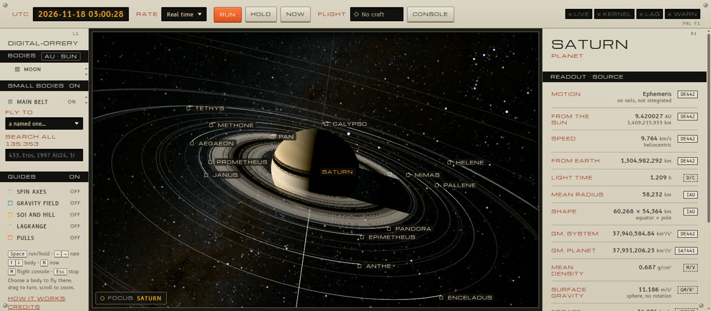
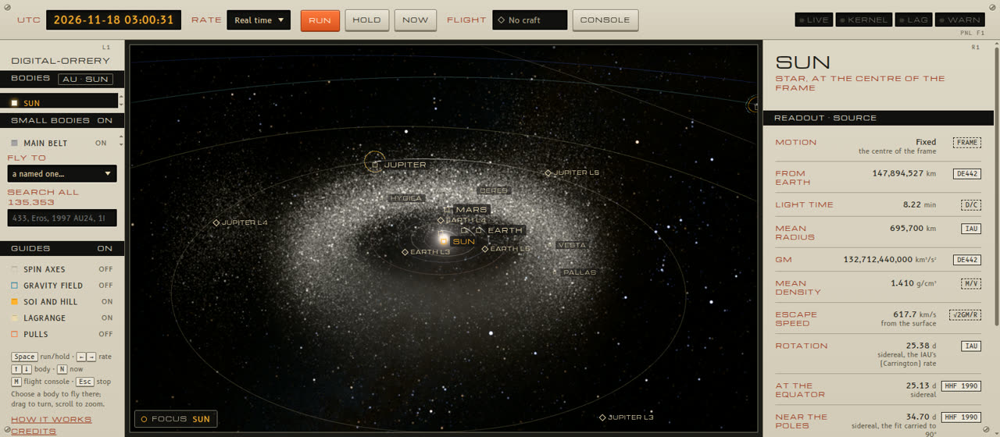
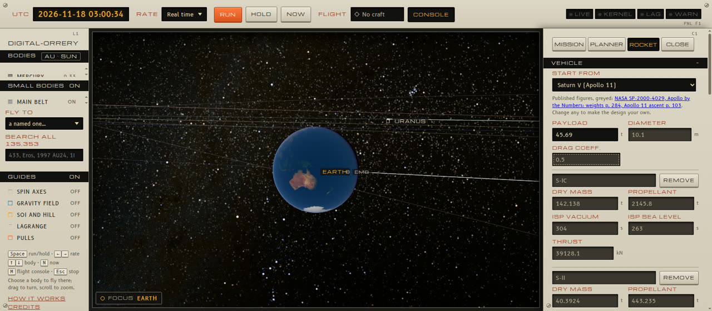
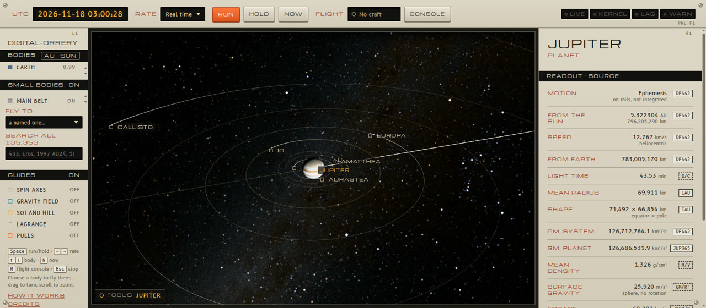
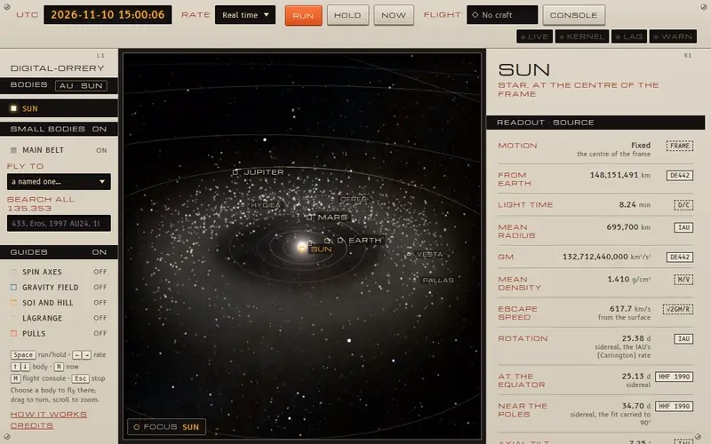
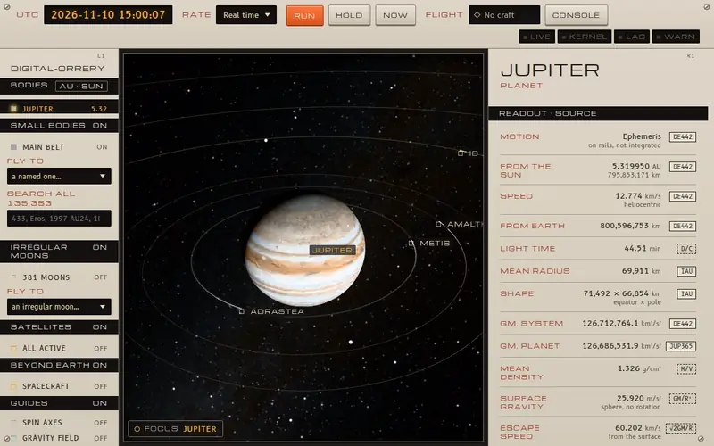
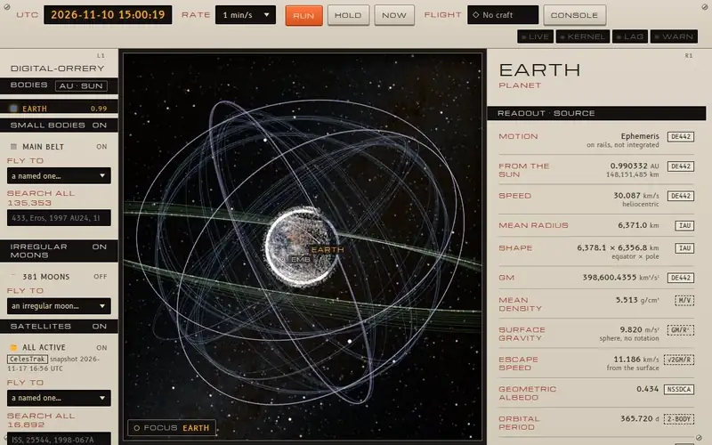

# digital-orrery

[](https://github.com/Zyzzbarth333/digital-orrery/actions/workflows/ci.yml)
[](LICENSE)

A true-scale solar system and mission simulator that runs in the browser. The physics is plain JavaScript, checked against NASA's SPICE toolkit, JPL's DE442 and satellite ephemerides, and flown missions. The front end is TypeScript, React and three.js.

<picture>
  <source srcset="docs/clips/overview-to-earth.webp" type="image/webp">
  
</picture>

| | |
| --- | --- |
|  |  |
| **Saturn**, its rings from Cassini's occultations, and its moons' orbits | **The Earth** over Australia, under a scattering atmosphere |
|  |  |
| **The plotting table**: a journey to Mars, its launch windows and its delta-v | **Guides**: spheres of influence and Lagrange points, with Jupiter's trojans at L4 and L5 |
|  |  |
| **The ROCKET tab**: Saturn V from Apollo 11's actual weights | **Jupiter** and its moons, from JPL's satellite ephemerides |

In motion (each clip is from the app as it runs, rebuilt by `npm run docs:clips`):

| | |
| --- | --- |
|  |  |
| **Time warp**: a month a second ([scene](docs/frontend/scene.md#time)) | **Artemis II** flown against its real trajectory ([missions](docs/frontend/mission.md#real-missions)) |
|  |  |
| **The plotting table**: a burn node pulled and re-aimed ([journeys](docs/physics/journey.md#the-plotting-table)) | **A launch** from LC-39B ([rockets](docs/physics/rocket.md#in-the-app)) |
|  |  |
| **Guides**: surface gravity, then the gravity field turning with the Moon ([gravity guides](docs/physics/gravity-guides.md)) | **Jupiter's moons** and a flight to Io ([moons](docs/frontend/moons.md)) |
|  |  |
| **Satellites**: all 17,000 active ones ([satellites](docs/frontend/satellites.md)) | **Magnetic field** and auroras ([magnetic fields](docs/physics/magnetic-fields.md)) |

New to the terms? The [glossary](docs/glossary.md) explains them, and [How it fits together](docs/architecture.md) maps the code.

## What it does

- **The sky:**
  - the Sun, planets, 76 moons (and 381 irregular moons of Jupiter, Saturn and Neptune as a layer) and 135,353 asteroids and comets, at their real positions for any date, at true scale;
  - 16,892 Earth satellites from CelesTrak's element sets, moved by SGP4, with the ISS, Tiangong, Hubble, GPS, Galileo and the weather satellites' orbits;
  - the spacecraft at Mercury, the Moon, Mars and Jupiter, about the Sun-Earth L1 and L2 points and in cruise, on JPL Horizons' trajectories for 2026 and 2027;
  - real surface maps and relief, Saturn's rings from Cassini measurements, Jupiter's, Uranus's and Neptune's from occultations and ring tables (their faint dust bright in forward scattering, Neptune's arcs where they were last measured), Earth's clouds as satellites saw them that day under a physically based atmosphere; the planets' and moons' maps load GPU-compressed (KTX2), in a quarter of the video memory, where the GPU can take them;
  - the real star field and Milky Way.
- **Bodies to visit:** fly the camera to any planet, moon, barycentre, small body, Earth satellite or spacecraft, with a data plate whose values open their equation and source.
- **Guides:** the gravity field of every body as flowing field lines, in four frames, the rotating one with its zero-velocity curves; spin axes and which way each body turns; Earth's and the Moon's real gravity fields, spheres of influence, Lagrange points and the strongest pulls; the planets' magnetic fields as traced field lines (IGRF-14 with the T89 magnetosphere, JRM33, Cassini with its ring current, Voyager, MESSENGER, and Ganymede's from Juno inside Jupiter's field), the Earth's, Jupiter's and Saturn's magnetopauses and bow shocks, the Sun's field from the Wilcox Solar Observatory with its current sheet and Parker spiral, and Mars's magnetised crust; the auroras: the Earth's ovals from NOAA's live OVATION Prime map when the clock is near now, otherwise for the day's Kp, Jupiter's and Saturn's main ovals, the footprints of Io, Europa, Ganymede and Enceladus, Uranus's, Neptune's and Ganymede's zones, and Mars's aurora; and the radiation belts of the Earth and the four giants along their L-shells.
- **Missions:**
  - spacecraft fly under an n-body kernel in a Web Worker, with finite burns, the Earth's and Moon's gravity fields, drag and sunlight pressure;
  - the craft you launch carry an attitude: point them prograde, normal, radial, at a node or hold them still, and they turn in the time their thrusters' torque allows, under the gravity gradient and the air's torque, and burn along their body axis; the thrusters burn propellant, holding included (the limit cycle within a deadband), the craft turns faster as its tank empties, a stage launched from the ROCKET tab gets the inertia and thrusters of its own size, and it turns to each manoeuvre node by itself in time to settle ([docs/physics/sixdof.md](docs/physics/sixdof.md#attitude-in-the-app));
  - Artemis I and II fly against NASA's reconstructed trajectories, down to Orion's entry and splashdown;
  - Juno's deep-space burns and Earth flyby (2012–13), DART's last five weeks to its impact on Dimorphos (2022), and LRO's capture into a low lunar orbit (2009) fly against their navigation teams' reconstructions.
- **Planning:**
  - a journey of any number of legs, each leg's transfers compared (a deep-space burn where a leg runs nearly 180° round the Sun), shaped by hand on a plotting table;
  - a long stay in a planet's orbit turns the orbit's plane (the planet's $J_2$): the planner prices leaving out of it and suggests the day it holds the way out ([journeys](docs/physics/journey.md#the-parking-orbits-plane));
  - flown by the kernel, with the rocket it needs; the planets' major moons (Europa, Titan and the rest) with their own gravity, reached through their planet's well, captured, landed on (Titan through its air) and left.
- **Rockets:** build a launch vehicle stage by stage, or start from Saturn V, Falcon 9 or Electron, from the stack the planner sized for your journey, or from an OpenRocket design, and fly it from a real pad into orbit.

The name nods to the orrery, a mechanical model of the solar system, and in particular to the Digital Orrery, the special-purpose computer built in the 1980s to integrate the long-term dynamics of the outer planets.

## Physics and accuracy

The physics is checked against references, and each model's page says how and how well. [Physics and accuracy](docs/accuracy.md) gives the whole picture and what is still approximate; [validation](docs/validation.md) lists every check with its result.

- **Where things are:** the planets from JPL's DE442 (2000–2050) to within a metre, 76 moons and 381 irregular moons from JPL's satellite ephemerides to within a kilometre, and SPICE-precision GM values.
- **How craft move:** an n-body kernel in a Web Worker, with error-controlled Dormand–Prince steps and Encke's method near a planet. It includes the major moons with their $J_2$ and $C_{22}$, the heaviest asteroids, the Earth's and Moon's gravity fields, drag and sunlight pressure. It is checked against Artemis I and II, and against Juno's, Cassini's and Voyager 2's passes of the outer planets and their moons.
- **The orbital core:** two-body propagation and Lambert's problem, checked against Curtis's worked examples and NAIF CSPICE.
- **Still approximate:** journeys are planned by patched conics (then flown in the full model), and the ROCKET tab's ascent has no closed-loop guidance.

## Documentation

| Read | For |
| --- | --- |
| [docs/](docs/README.md) | every page: the physics with its maths, the front end, performance |
| [Physics and accuracy](docs/accuracy.md) | what is high-fidelity, what is approximate, and the roadmap |
| [Validation](docs/validation.md) | every check, its reference and its result |
| [How it fits together](docs/architecture.md) | the code's layers, a diagram, and the project's folders |
| [Glossary](docs/glossary.md) | the terms |
| [Credits](docs/credits.md) | every data source, map, font and library, with its licence |

## Quick start

### Prerequisites

- Node.js 20.19+ (or 22.12+) and npm; Vite 8 needs one of these
- A modern browser with WebGL support

### Install and run

```bash
git clone https://github.com/Zyzzbarth333/digital-orrery.git
cd digital-orrery
npm install
npm run dev
```

`npm run dev` starts the Vite development server. To produce a production build:

```bash
npm run build
```

## Controls

- Drag: rotate the view about the focused body
- Scroll: zoom in and out (the zoom is kept when you move to another body)
- Click a label or a name in the list: fly there (drag, scroll or Esc stops the flight; click the body in view again to reframe it)
- Header: the RUN key runs or holds time; choose a rate (real time to one year per second), or jump back to now with NOW
- Header: FLIGHT shows the selected craft (press it to follow the craft); CONSOLE opens the flight console
- Keys: Space run or pause, ← → step the rate, ↑ ↓ move through the bodies, N jump to now, M flight console, Esc stop a flight or close the console

The data plate gives each value with its source (the provenance column): a solid tag for data, a dashed one for values worked out in the app; hover a tag for detail.

The right-hand plate shows the focused body's data. Missions, the planner and the rocket are the app's, not a body's, so they live in the flight console, opened from the header whatever is in view: MISSION (launch, readout, nodes, engine, log), PLANNER (a journey's summary, and the full-screen plotting table for planning it) and ROCKET. See [docs/frontend/mission.md](docs/frontend/mission.md).

A link can set the starting view: `?focus=moon&t=2026-03-03T11:33:40Z&view=sun` (`view=sun` puts the camera on the sunlit side).

## Testing

```bash
npm test            # every physics and app check, from fixtures, no network
npm run typecheck   # the TypeScript
npm run build       # the production build
```

`npm test` runs each module's checks against its references, from Curtis's worked examples and NAIF CSPICE to flown missions. [docs/validation.md](docs/validation.md) lists every check with its reference and result. CI runs all three commands on every pull request.

## Credits

The app is built on public data: JPL's DE442, satellite ephemerides and Small-Body Database; NAIF's SPICE kernels; NASA, USGS and ESA maps and star catalogues; Solar System Scope's planet maps ([CC BY 4.0](https://creativecommons.org/licenses/by/4.0/)); NOAA's relief; CelesTrak's element sets; and NASA's and JPL's mission trajectories. [docs/credits.md](docs/credits.md) credits every source, map, font and library, with a link to each and its licence.

## Contributing

[CONTRIBUTING.md](CONTRIBUTING.md) has the setup, the ground rules (every physics claim checked against a cited reference, and data credited with its licence) and how changes are merged. [CHANGELOG.md](CHANGELOG.md) lists what has changed. Report security problems privately, as [SECURITY.md](SECURITY.md) says.

## Citing

If you use it in your work, please cite it: [CITATION.cff](CITATION.cff) has the details, and GitHub's "Cite this repository" gives them as text.

## Licence

MIT. See [LICENSE](LICENSE). The data and maps keep their own licences, listed in [docs/credits.md](docs/credits.md).
