# How it fits together

The app is three layers. The **data** is ephemeris tables, catalogues and
maps, built offline from JPL, NAIF, NASA and USGS sources and shipped in
`public/`. The **physics** is plain JavaScript in `src/physics/`, with no
three.js in it, so every module also runs in Node and in its tests. The
**front end** is React for the console and three.js for the sky.



Each box is a module, and each arrow a call or import in the code at
the commit the diagram was drawn from. The
[explorable page](diagrams/architecture.html), opened in a browser from a
clone, links every box to its source lines. The legend gives each colour's folder.

**Each frame:**
1. **The clock:** `OrreryScene`'s animation frame ticks `SimClock`
   (`clock.ts`), which gives the sim time.
2. **The craft:** the scene calls `Mission.frame` through `onFrame`.
   Mission moves each craft's clock on and hands the crafts to
   `KernelClient`, which posts one step to the kernel worker. While a step
   is out it sends no other.
3. **The worker:** `kernel.worker.js` passes the step to `kernelHost.js`,
   which steps each craft under every force to that time
   ([the n-body kernel](physics/nbody-kernel.md)). The reply comes back a
   frame or more later and updates each craft.
4. **The bodies:** the scene asks the ephemeris for every body's position
   at that time, and draws them about a camera kept at the render origin
   ([the 3D scene](frontend/scene.md)). Each craft is drawn at its last
   exact state, carried forward to the clock.
5. **The plates:** at most ten times a second the clock tells React. Each
   plate then asks the ephemeris for its own body at the clock's time.


([explorable page](diagrams/frame.html))

**Off the main thread:**
- **The kernel worker** steps the spacecraft.
- **The journey worker** flies a plan from the planner to check it, with
  its own copy of `kernelHost.js`.
- **The satellites worker** runs SGP4 for every satellite in the catalogue.
- **The belt worker** bins 1.45 million faint asteroids for the haze.
- **The porkchop worker** fills the planner's grid of Lambert arcs.
- **The passes worker** finds a satellite's passes over a place.
- **The gravity field worker** works out a body's gravity anomaly map.
- **The decode worker** fetches and decodes the surface maps.

The page stays responsive while they run. If the kernel worker fails,
`KernelClient` runs `kernelHost.js` on the main thread instead.

**Redrawing the diagrams:** each page is built from its JSON beside it in
`docs/diagrams/` by the [Archify](https://github.com/tt-a1i/archify) skill:
`archify finalize architecture docs/diagrams/architecture.archify.json
docs/diagrams/architecture.html --repo-root .` (and `sequence` for
`frame.archify.json`). The SVGs are the page's **Export → SVG (light)**.
Update the `revision` in each JSON to the commit you drew from.

**The folders:**

```
digital-orrery/
├── src/
│   ├── app/                 # React: the console, panels, planner, rocket, clock, styles
│   ├── scene/               # three.js: bodies, sky, orbits, small bodies, guides, camera
│   ├── physics/             # orbital core, n-body kernel and Worker, ephemerides, moons,
│   │   │                    #   orientation, environment, rocket, journeys, and their tests
│   │   └── fixtures/        # reference data the tests check against (CSPICE, Horizons, NASA)
│   └── utils/constants.js
├── public/                  # surface maps, star map, ephemeris and small-body tables
├── c/                       # CSPICE programs that write fixtures, the DE442, moon and
│                            #   asteroid tables, and the Earth orientation samples
├── python/                  # SPICE metakernel, kernels (downloaded, not in git), offline
│                            #   checks, and the texture build (python/textures)
├── tools/                   # outside oracles (OpenRocket, RocketPy)
├── docs/                    # the physics and the front end, with the maths, and validation
└── .github/                 # CI, issue and pull request templates
```

**Where to start reading:**

| To understand | Read |
| --- | --- |
| Frames and time scales | [Frames, units and time](physics/frames-and-time.md) |
| Where positions come from | [Ephemerides, barycentres and GM](physics/ephemerides-and-gm.md) |
| How a craft moves | [The n-body kernel](physics/nbody-kernel.md), [The space environment](physics/environment.md) |
| How a journey is planned | [Journeys](physics/journey.md), [Lambert's problem](physics/lambert.md) |
| How the sky is drawn | [The 3D scene](frontend/scene.md), [Lighting](frontend/lighting.md) |
| What a term means | [Glossary](glossary.md) |
