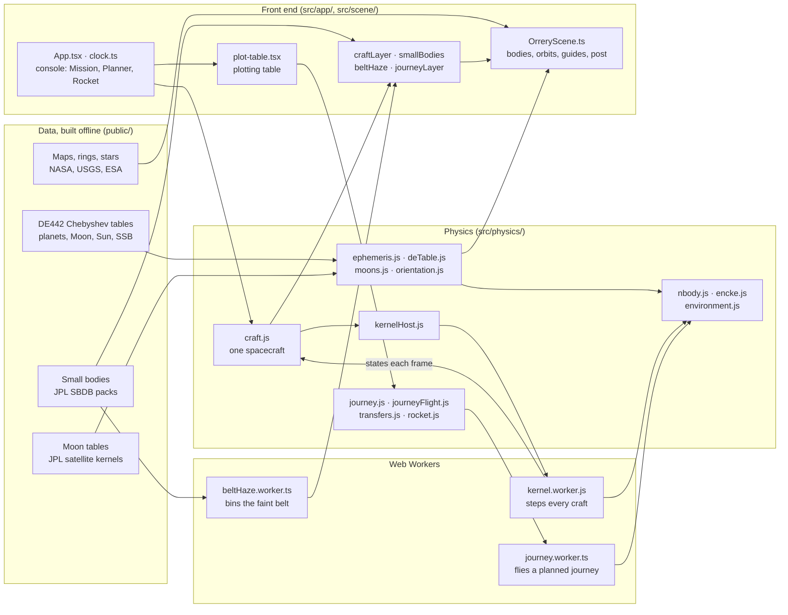

# How it fits together

The app is three layers. The **data** is ephemeris tables, catalogues and
maps, built offline from JPL, NAIF, NASA and USGS sources and shipped in
`public/`. The **physics** is plain JavaScript in `src/physics/`, with no
three.js in it, so every module also runs in Node and in its tests. The
**front end** is React for the console and three.js for the sky.

**Each frame:**
1. **The clock** (`clock.ts`) gives the sim time.
2. **The bodies:** the scene asks the ephemeris for every body's position
   at that time, and draws them about a camera kept at the render origin
   ([the 3D scene](frontend/scene.md)).
3. **The craft:** each sends its state and its burns to the kernel worker.
   The worker steps it under every force to that time
   ([the n-body kernel](physics/nbody-kernel.md)).
4. **Drawing:** results come back a frame later. Each craft is drawn at
   its last exact state, carried forward to the clock.

**Off the main thread:**
- **The kernel worker** steps the spacecraft.
- **The journey worker** flies a plan from the planner to check it.
- **The belt worker** places 1.45 million faint asteroids for the haze.

The page stays responsive while all three run.

**Where to start reading:**

| To understand | Read |
| --- | --- |
| Frames and time scales | [Frames, units and time](physics/frames-and-time.md) |
| Where positions come from | [Ephemerides, barycentres and GM](physics/ephemerides-and-gm.md) |
| How a craft moves | [The n-body kernel](physics/nbody-kernel.md), [The space environment](physics/environment.md) |
| How a journey is planned | [Journeys](physics/journey.md), [Lambert's problem](physics/lambert.md) |
| How the sky is drawn | [The 3D scene](frontend/scene.md), [Lighting](frontend/lighting.md) |
| What a term means | [Glossary](glossary.md) |
