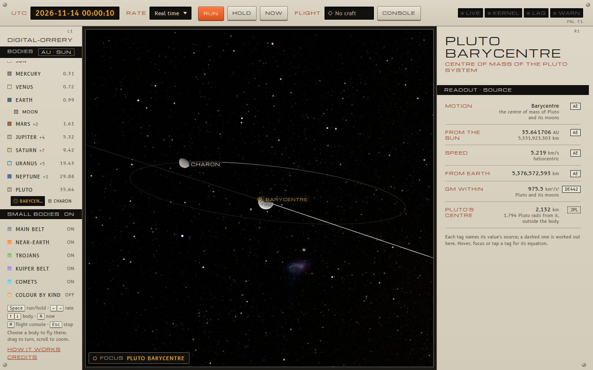
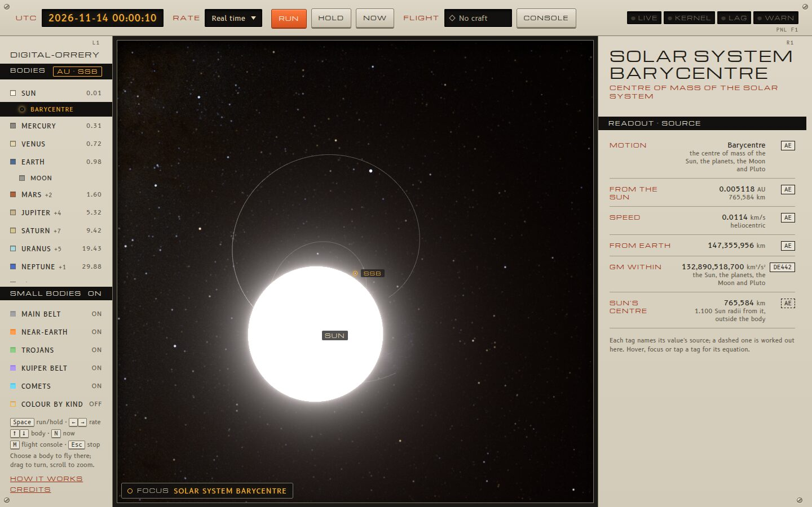

# Barycentres and the SSB frame

A barycentre is a centre of mass: the point that a planet and its moons, or
the Sun and everything orbiting it, all go round together. The app shows
eight of them, and can give orbits and distances about the solar system
barycentre instead of the Sun's centre.

Code: `src/physics/barycentres.js` (positions), `BARYS` in
`src/scene/catalogue.ts`, the scene's `baryState` and `setFrame` in
`src/scene/OrreryScene.ts`, `BaryPlate` in `src/app/panels.tsx`; checked by
`src/physics/barycentres.test.mjs` and `src/physics/moons.test.mjs`.

## The barycentres

| Barycentre | Of | Position |
| --- | --- | --- |
| Solar system (SSB) | the Sun, every planet system, Earth, the Moon, Pluto | DE442's own (2000–2050); outside it, $\sum_i \mu_i \mathbf r_i / (\mu_\odot + \sum_i \mu_i)$ over heliocentric positions, DE442 GMs |
| Earth-Moon (EMB) | Earth and the Moon | $(\mu_\oplus \mathbf r_\oplus + \mu_☾ \mathbf r_☾)/(\mu_\oplus + \mu_☾)$, DE442 |
| Mars to Pluto | each planet and its moons | the planet's ephemeris position (DE442's, astronomy-engine's outside 2000–2050), which is this barycentre |

Inside 2000–2050 the SSB is DE442's: the table's series for the Sun about
the SSB, negated ([ephemerides](../physics/ephemerides-and-gm.md#de442-in-the-app)).
Outside it, astronomy-engine's own SSB counts only the Sun and the four
giants, which leaves out the inner planets' pull on the Sun (Earth's alone
moves it 450 km); summing every body here brings it from 1,485 km of JPL
Horizons to about 120 km. That the ephemeris's Mars to Pluto are the system
barycentres, not the planets' centres, is shown in
[Moons](moons.md#which-point-each-position-is).

Against JPL Horizons (`barycentres.test.mjs`):

| Barycentre | Nov 2026, daily | 2000–2050, yearly |
| --- | ---: | ---: |
| SSB about the Sun | 0.22 km | 0.24 km |
| EMB about the Sun | 0.11 km | 0.07 km |

The EMB figures are the fixture's rounding. The SSB's are that rounding
and the gap between DE442 and Horizons' DE440, which moved Uranus and
Neptune and with them the SSB. Before the DE442 table starts (J2000, noon
on 1 January 2000) every body, and so each barycentre, is
astronomy-engine's: the EMB 2,179 km out at midnight that day, the summed
SSB 121 km.

## In the app

- **Markers.** Each barycentre has a marker (a ring with a point) and a
  label, hidden while it sits on its body's marker unless it is the focus.
  They are drawn over the discs they lie inside: the SSB is often within
  the Sun.
- **Choosing one** flies the camera there through the same `focusOn` and
  [camera](camera.md) path as a body, arriving far enough out to frame the
  system about it (60,000 km for Pluto's, 5 million km for Jupiter's). The
  camera then turns about the barycentre, so a system's bodies go round a
  still point: Pluto and Charon on either side of theirs.
- **The rail** lists the SSB under the Sun, the EMB under the Moon, and a
  planet's barycentre first in its moon grid, when that system is in view.
  `?focus=ssb`, `emb` or `jupiter-bary` in the URL starts there.
- **The plate** gives where it is, its speed, the GM of everything it
  holds, and how far its body's centre is from it: the Sun's 765,584 km
  (1.10 solar radii) on 14 November 2026, Earth's 4,928 km, Jupiter's
  209 km, Pluto's 2,132 km (outside Pluto).

## The SSB frame

The rail's distance column (`AU · Sun`) switches the app between the Sun's
centre and the SSB (`AU · SSB`; `&frame=ssb` in the URL). In the SSB frame:

- the planets' orbit lines are their paths about the SSB, and the Sun gets
  one too: its path about the SSB over two of Jupiter's years;
- the rail's distances and the plate's distance and speed are from the SSB,
  the Sun's included;
- the moons' orbit lines stay about their planets.

The scene keeps every position heliocentric; only the lines and readouts
change, since the two frames differ by a translation. Each orbit line's
samples take the SSB from the four giants alone (within about 700 km of
the full SSB, unseen at an orbit's scale, and a quarter of the cost of the
full sum 360 times over), and the line is centred on that same point so it
still passes through its body. A planet's line then costs about 9 ms to
sample, against 3 ms about the Sun, paid when the frame changes and as
lines are resampled.

The small bodies (asteroids and comets) stay drawn about the Sun in either
frame.
