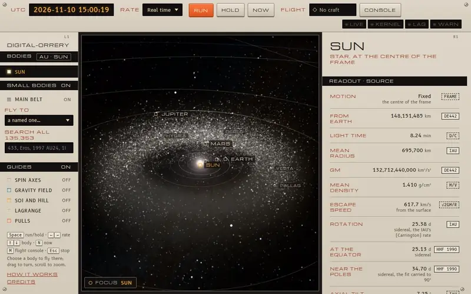

# Camera

How the view moves: an orbit camera about the focused body or craft, and
flights between them. Code: `src/scene/cameraRig.ts`, used by
`OrreryScene`. Research and sources: [UX research](../ux/research.md#4-camera-transitions).

## The orbit camera

The camera looks at a pivot and sits `dist` km from it, at an azimuth and
elevation in the ecliptic frame. Dragging turns it (0.005 rad per pixel; on touch, one finger turns and two
pan and zoom, below);
the wheel zooms by e^(0.0015 Δy) per event and the distance eases to the
new value over about a quarter of a second, in log distance, so a zoom
reads as one motion rather than steps. Without a drag, wheel or pinch
(WCAG 2.2's 2.1.1, 2.5.1 and 2.5.7; [accessibility audit](../ux/accessibility.md)),
Shift and the arrow keys turn and tilt it 15° a press, `[` and `]` zoom by
1.25, and the view plate's VIEW key opens a pad of the same steps as word
keys (UP, DOWN, LEFT, RIGHT, IN, OUT). The pivot is the target's live
position (a body from the ephemeris, a craft from the kernel) plus a
settling offset, described below.

About a landing site on the Moon the azimuth and elevation are in the
site's own frame (east, north, up) instead, and the camera's up is the
site's vertical, so it turns about the local vertical and goes round
with the Moon ([landing sites](landing-sites.md#flying-to-one)).

### Close to the ground

Following a craft a kilometre or two up, turning the camera could swing
it below the ground. Inside a body its surface isn't drawn, because its
inside faces are culled, so the stars showed through. Each frame, a
camera inside any body's ellipsoid is moved straight out from the body's
centre to 5 m above the surface, still looking at its pivot
(`packages/physics/src/surfaceClamp.js`; `surfaceClamp.test.mjs` checks this on the
WGS-84 Earth, at the pole as at the equator and with the body turned).

Above the ground, the bodies' 96 × 48 spheres were too coarse up close.
Each flat face sags below the true surface, up to 6.8 km on the Earth.
From a few kilometres up, the horizon showed gaps of sky between facets.
So within half a radius of a body's surface, a finely divided patch is
drawn over the sphere (`src/scene/surfacePatch.ts`):
- **Shape:** a polar grid centred under the camera, reaching 1.3 times
  the horizon's angle.
- **Spacing:** 96 rings, the first at 5 % of the height from the point
  below and the rest opening out geometrically, and 256 sectors.
- **Material:** the body's own, with the same ellipsoid, maps and
  lighting.

A chord's sag stays under 0.4 % of the camera's height:

| Height | Patch reaches | Worst sag |
| --- | --- | --- |
| 2 m | 0.06° | 1 cm |
| 1.6 km | 1.7° | 4 m |
| 100 km | 13° | 140 m |
| 3,000 km | 61° | 1.4 km |

The patch is rebuilt when the height changes by a tenth. Otherwise it is
only turned to follow the point below.

### Close to a craft

The camera follows a craft from as close as 50 m, and an Earth satellite
from 20 m. The near plane was a fixed kilometre, so everything nearer than
that was clipped: the craft's conic and trail stopped a kilometre short of
it, and a 3D model of the craft would not have been drawn at all. Each
frame the near plane is now a tenth of the camera's distance from its
pivot, between 1 m and 1 km (`fitNear` in `src/scene/OrreryScene.ts`).

Two other ways were weighed:
- **A fixed near plane of a metre.** It would do as well, because the
  logarithmic depth buffer's precision does not depend on the near plane
  ([Scene](scene.md#floating-origin)). But it changes every view, while the
  adaptive one leaves the near plane at 1 km for anything followed from
  beyond 10 km.
- **A second pass for the craft with its own near and far planes.** It
  would also give a 3D model its own depth precision. It costs a pass and
  a depth clear every frame, and lines in it would not be hidden by the
  Earth.

On the ground (above), the camera is 5 m up but its pivot, the craft, is
kilometres away, so the near plane stays at hundreds of metres. That is
no worse than before. The ground within it is clipped, as it was within
the kilometre.

The near plane alone did not bring the lines to the craft: their samples
and their float32 positions about the primary missed it by up to 500 m.
Close up, they are drawn relative to the craft
([Mission](mission.md#the-readout)).

In the scene's 24-bit depth buffer, the logarithmic depth resolves
$\Delta w \approx 2^{-24} \ln 2 \, \log_2(\text{far} + 1)\,(1 + w)$, with $w$
in render units: about 1.4 m anywhere within a few hundred kilometres. Lines don't write depth, so this
doesn't matter for them. A 3D model of the craft seen from 50 m would
need its own pass (the second way above) for parts closer together than
that.

### Panning

A right-drag, a middle-drag or a Shift-drag pans: it moves the pivot off
the body, so the sky can be crossed freely while a body stays in focus. The
point under the pointer stays under it at the pivot's depth (the drag in
pixels times 2 tan 22.5° times the camera's distance, over the view's
height, along the camera's right and up). On touch, two fingers pan by
their midpoint and pinch-zoom by their spread; lifting one goes back to
turning from where the other is.

The pan is an offset from the body, in the ecliptic, so a panned view still
rides with the body under time warp. The way back:
- **C**, a double-click on the sky, or the view plate's CENTRE key (shown
  while panned): the offset eases back to zero through the settle's spring
  (about 0.6 s);
- choosing the body again (the rail, its marker, FIND) reframes it;
- any flight starts from the panned pivot and clears the pan.

A pan during a flight stops it where it is, with the aim kept there rather
than settling on the new body.

### HOME

**H**, or the view plate's HOME key, flies back to the view a first visit
opens on: the Sun, 1.6 × 10⁹ km out, azimuth −1.2 and elevation 0.5 rad
(the inner planets from above). The azimuth and elevation are eased along
the flight. The zoom carried from body to body is forgotten. The clock and
the rail's switches stay as they are.

### Across a refresh

A refresh in the same tab comes back to where the user was
(`src/app/remember.js`, checked by `remember.test.mjs`):
- **The view**, in `sessionStorage`, so a new tab starts at home: the body,
  what the camera is on when it is not the body itself (an irregular moon, a
  landing site or a named small body, which the camera goes to once the
  named ones have loaded), the azimuth, elevation, distance and pan, and the
  clock's time, rate and whether it runs. It is kept every second and as
  the page goes.
- **The clock**: held, it comes back to the same instant. Running, it goes
  on by the time the refresh took, capped at a second as the clock caps a
  background tab's pause, so a refresh at a year a second does not leap
  years; a live clock (real time, within a minute of now) comes back live.
- **The rail's switches**, in `localStorage`, for this browser: the small
  bodies and their colours, the irregular moons, the landing sites, the
  satellite sets, the spacecraft, every guide and magnetic layer, the
  gravity field's frame and plane, and the distances' Sun or SSB frame.
- **Which side panels are pinned**, in `localStorage` too: the rail and the
  plate, each pinned beside the sky or stowed to its spine
  ([panels.md](panels.md)); both stowed until chosen.
- **Not kept:** a followed craft, satellite or spacecraft (a mission or a
  catalogue would have to load first): a refresh frames the body instead,
  the Earth for a satellite. Mid-flight, the destination is kept and framed
  afresh.

Any view parameter in the URL (`focus`, `t`, `view`, `phase`, `craft`,
`mission`, `plan`) wins: the kept view is not used. `&frame=` wins over the
kept frame switch. Storage that is off (a private window, a blocked site)
is no storage: every read and write is in try/catch, and a field that does
not read back as the kind written falls back to its default alone.

### The rail holds still

Choosing a planet below an open moon grid closed that grid, so the row
just chosen jumped up from under the pointer: Uranus after Neptune by
362 px at 1440 × 900, leaving the Comets switch where Neptune was. On a
phone, where the rail is one scrolling row, Uranus chosen after Saturn
ended 618 px off the screen's left edge. Now, while the mouse is over the rail, a grid that was
open stays open until the mouse leaves; and a row chosen by touch or a key
is kept where it was by scrolling the list by as much as it moved.

## Flights

Choosing a body (the rail, its FIND field, a marker in the sky, the arrow
keys) or a craft flies the camera there instead of cutting.

**The path** is van Wijk and Nuij's optimal zoom-and-pan path (2003). In
the space of (u, w), where u is how far the pivot has moved along the line
between the two targets and w is the width of the view (2 tan 22.5° times
the distance), the path that minimises perceived motion zooms out, crosses
and zooms in. With ρ = 1.42 (their users' preference) and
bᵢ = (w₁² − w₀² ± ρ⁴u₁²) / (2wᵢρ²u₁):

$$
r_i = -\operatorname{asinh} b_i, \qquad S = \frac{r_1 - r_0}{\rho},
$$

$$
u(s) = \frac{w_0}{\rho^2}\left(\cosh r_0 \tanh(\rho s + r_0) - \sinh r_0\right),
\qquad
w(s) = w_0 \frac{\cosh r_0}{\cosh(\rho s + r_0)} .
$$

The −asinh form is the paper's ln(√(b²+1) − b) written so that it stays
exact when b is large (a planet seen from across the solar system).

**Moving ends.** Both ends are read live every frame and the path is
recomputed from them, so the camera lands on a body that moved during the
flight, even at a year per second.

**Duration** grows with the path's length S: T = 0.5 + 0.17 S seconds,
clamped to 0.8–3 s. Some values:

| Flight | S | T |
| --- | --- | --- |
| Earth to the Moon | 5.0 | 1.35 s |
| Overview to Earth | 7.3 | 1.75 s |
| Earth to Saturn | 14.0 | 2.9 s |
| Earth to Neptune | 16.3 | 3.0 s |

The path parameter is eased in and out (cubic). On arrival the camera is
at the target's framing distance.

**Arrival distance.** The default frames a planet or moon at 8 radii
(at least 20,000 km) and the Sun at the overview, 1.6 × 10⁹ km. Once the
user zooms, the distance is remembered in the target's radii (1.6 to 80)
and carried to the next body, so a close look at Mars stays a close look
at Jupiter; the Sun's view and the distance to a craft are remembered
separately. Choosing the body already in view reframes it at the default.

## Control during a flight

- **Another choice** starts a new path from wherever the camera is, eased
  out only (it is already moving), so the motion does not restart from
  rest.
- **A drag, a scroll or Escape** ends the flight on the spot (a pan too, see
  [Panning](#panning)). The target
  becomes the new body; the aim, which was between the two, settles onto it
  through a critically damped spring (ω = 7 rad/s, no overshoot, about
  0.6 s), while the user's drag or zoom applies at once. Stopped while still
  closer than 1.2 times the new body's largest semi-axis (early in a flight toward
  something bigger), the zoom eases back out to that distance, so the
  camera never ends inside a body.
- **Choosing the body a flight is already heading for** changes nothing.
- **A body with no position yet** (a link's `?focus=` before the first
  frame) is reached by a cut.
- **Reduced motion** (`prefers-reduced-motion: reduce`): a flight is a cut.

## Maps on the way

A flight starts loading the target's surface maps at once, ahead of any
other full-size map, and bodies passed on the way load nothing. They are
decoded in a worker and uploaded 4 MB per frame
([textures](textures.md#loading)), so the flight never stalls; over a
slow link each map shows a 2048-wide preview first
([over the network](textures.md#over-the-network)).
