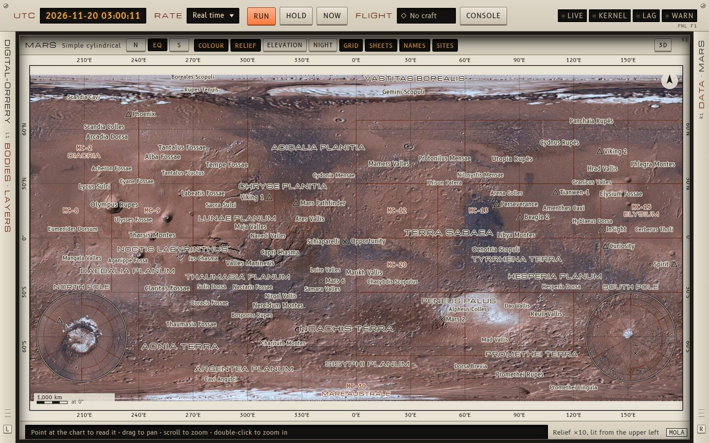
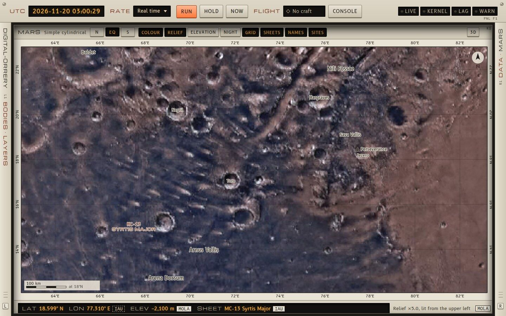
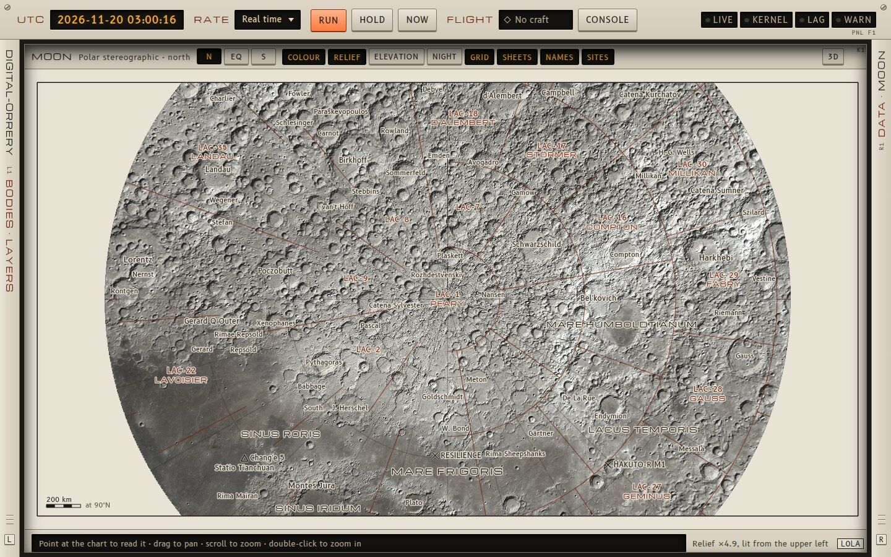
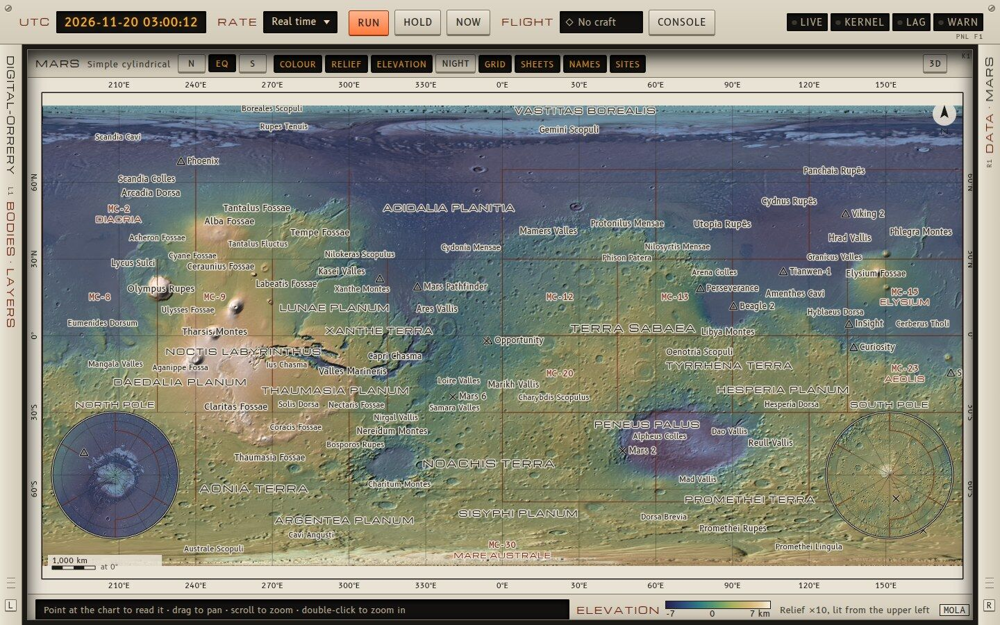
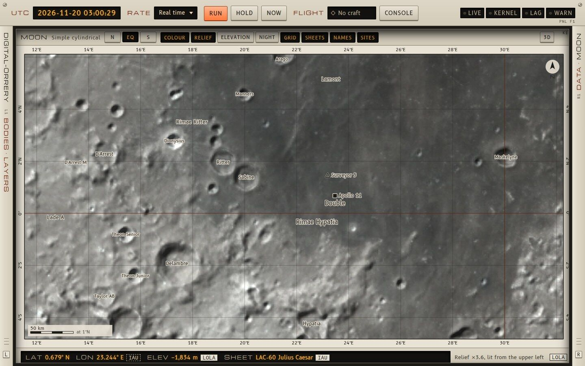
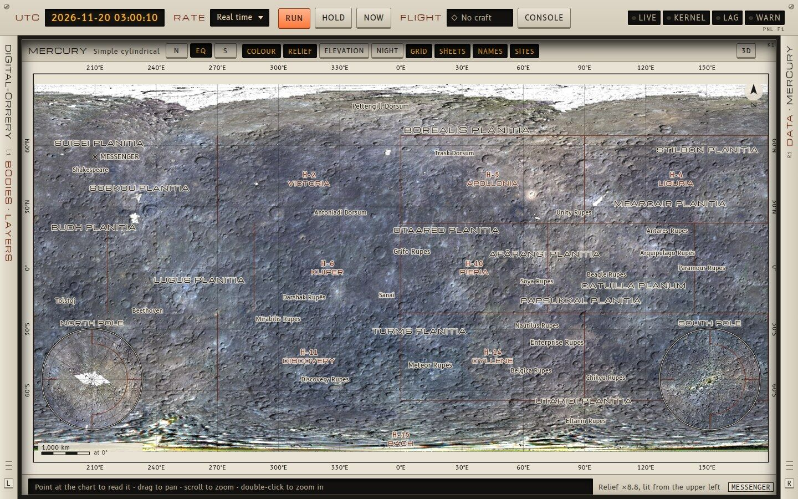
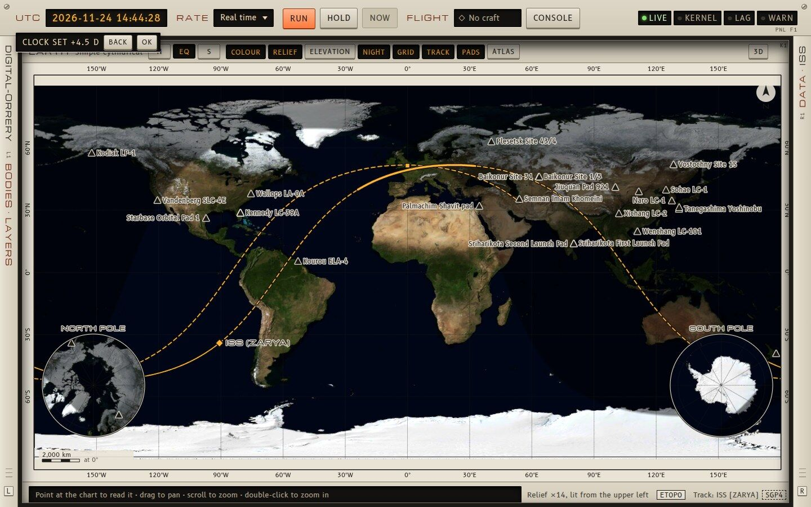
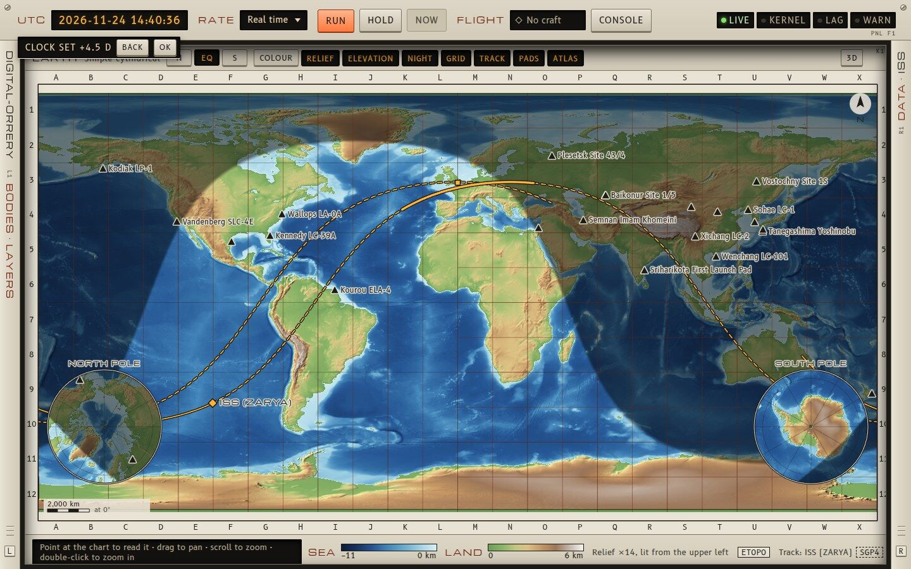
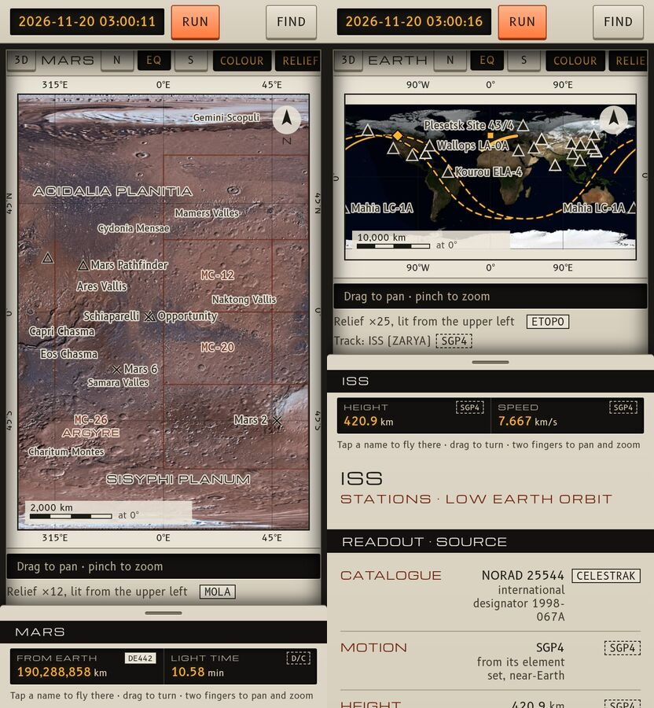

# The chart view

A flat chart of the body in view, switched to from the 3D sky, in the
tradition of the USGS planetary charts and the Apollo-era Lunar
Astronautical Charts: shaded relief and elevation tints from the real
elevation models, a graticule and the body's standard sheet grid, the IAU's
feature names sized by the feature, and the app's landing sites. Its layers
switch as NASA's Solar System Treks' do [1]. On the Earth it doubles as a
planning map: the ground track of the satellite on the plate, the orbital
launch sites, an atlas grid round the border, and a road-atlas look with
land tinted by height and the sea from pale to deep blue by its real depth.



*Mars at 1440 × 900 on the Intel GPU: simple cylindrical with the polar
insets, the 30 MC quadrangles, the IAU's names sized by the feature and the
landing sites.*

Code: `src/app/chart-view.tsx` (the panel), `src/chart/` (projections,
sheets, elevation, the shader and the lettering),
`python/charts/build_charts.py` (the data).

## Opening it

- **K**, or the view plate's **CHART** key, charts the body in view: the
  focused planet or moon, a barycentre's body, a landing site's body, or the
  Earth for a satellite or a debris cloud. The Sun has no chart, and nor
  does a body with neither a map nor an elevation model (Titan, the Uranian
  moons), so the key is off there.
- **3D**, **K** or **Escape** goes back to the sky.
- Choosing another body in the rail while the chart is up charts that body.

The chart takes the sky's cell: the rail, the plate, the band and the flight
console stay where they are. While it is up the 3D sky is not drawn, as
behind the plotting table, and the clock, the mission and the map uploads
run on (`OrreryScene.setChart`). The chart draws with the sky's own WebGL
renderer, so the colour maps the 3D view has uploaded are used as they are,
and nothing is added to the 3D frame ([performance](#performance)).

The panel is **PNL K1**: a sheet-metal strip of keys above the chart, and
the readout window and legend below it, the chart between on its paper
border, in the console's own look ([DESIGN.md](../../DESIGN.md#the-chart-view)).

| Key | What it does |
| --- | --- |
| N · EQ · S | the north polar, simple cylindrical and south polar projections |
| COLOUR | the day map the 3D view draws (on the Earth, the month's Blue Marble) |
| RELIEF | shaded relief from the elevation model |
| ELEVATION | tints by height; on the Earth, land and sea ramps either side of 0 m |
| NIGHT | the night side at the clock's time |
| GRID | latitude and longitude |
| SHEETS | the standard map sheets, with their codes and names |
| NAMES | the IAU's names |
| SITES | the app's landing sites; a pressed site opens its plate |
| TRACK, PADS, ATLAS | on the Earth: the ground track, the launch sites, and the road-atlas look |
| 3D | back to the sky |

A key with nothing to show for the body is unavailable (flat, with the
reason in its tip). The keys' states are kept for the browser
(`orrery.chart.v1`), one set for the Earth and one for the other bodies.

Pointing at the chart reads it out: latitude and longitude, the height
there with its source and grid, the sheet, and the name or site under the
pointer, each with its source tag. Drag pans, the wheel or a pinch zooms
about the pointer, a double click zooms in; with the chart focused, the
arrow keys pan, **[** and **]** zoom, and **0** resets the view.



*Zoomed in on Jezero (Intel GPU): the 16 px/deg tiles are in, and the
readout names the point under the pointer: 18.599° N, 77.310° E, −2,100 m
above the areoid (MOLA), on MC-13 Syrtis Major.*

## Projections

Both are on the sphere, as the USGS's planetary charts are at these scales
(J. P. Snyder's formulas [2, §§12, 21]):

- **Simple cylindrical** (equirectangular), $x = s(\lambda - \lambda_0)$,
  $y = s(\phi - \phi_0)$: the layout every map is stored in
  ([textures](textures.md#one-layout-for-every-map)), so the chart is the
  map itself. It pans freely in longitude.
- **Polar stereographic** about either pole,
  $\rho = 2\tan(c/2)$ for the angle $c$ from the pole, true to scale at the
  pole and conformal, with 0° longitude down the page from the north pole
  and up it from the south, as the USGS's polar sheets have it. East is
  anticlockwise round the north pole and clockwise round the south, seen
  from outside. It reaches 60° from the pole.

On a desktop the simple cylindrical chart carries both poles as **insets**
in its lower corners, polar stereographic to 55° (USGS's polar sheets reach
65°, so they overlap the main chart by 10° as theirs do); pressing one makes
it the chart. On a phone there is no room for insets, and the N · EQ · S
switch is the way to the poles.



*The Moon from the north pole to 30° N (Intel GPU): LAC 1 Peary at the
pole, the rings of LAC sheets about it, Chang'e 5's landing site, and
where ispace's two landers crashed (crosses), Resilience in Mare Frigoris.*

`projection.ts` holds the formulas; the shader (`chartMaterial.ts`) inverts
the same ones per pixel, and `chart.test.mjs` checks that forward and
inverse agree everywhere and that the polar views face the right way.

## Elevation

Real heights from each body's own elevation model, not rebuilt from the
normal maps:

| Body | Model | Source grid | Datum | Credit |
| --- | --- | --- | --- | --- |
| Mars | MOLA MEGDR, MEG016 [3], [4] | 16 px/deg (3.7 km) | the MOLA areoid | NASA/GSFC MOLA Science Team, via the PDS Geosciences Node |
| Moon | LOLA LDEM 16 px/deg, from the CGI Moon Kit [5], [6] | 16 px/deg (1.9 km) | a 1,737.4 km sphere | NASA/GSFC LOLA Science Team; NASA's Scientific Visualization Studio |
| Mercury | USGS MESSENGER global DEM 665 m v2 [7], [8] | 64 px/deg (665 m) | a 2,439.4 km sphere | NASA/JHUAPL/Carnegie Institution of Washington; USGS Astrogeology |
| Venus | USGS Magellan global topography 4,641 m v02 [9], [10] | 22.8 px/deg (4.6 km), 8.2 % no data | a 6,051 km sphere | NASA/JPL; USGS Astrogeology |
| Earth | ETOPO 2022 15″ surface elevation [11], as the textures' 8192-px grid | 22.8 px/deg (4.9 km) | the geoid (EGM2008), the sea floor below 0 m | NOAA National Centers for Environmental Information |

The Mercury and Venus models were downloaded for this view with Isaac's
approval on 24 November 2026 (531 MB and 67 MB); the others were already
in the texture sources. All are US-government work, public domain.

**Grids.** `build_charts.py` area-averages each model, ignoring no data, to
two grids in the textures' layout (west edge at −180° E, top row at +90°):
4 px/deg (1440 × 720), loaded with the chart, and 16 px/deg (5760 × 2880),
cut into 32 tiles of 720 × 720 (45° square) that load one at a time through
the [load queue](textures.md#over-the-network) once a 4 px/deg cell is more
than 1.5 device pixels across, those in view first. Heights are whole
metres, −32,768 no data.

**Files.** Each height is stored as its difference from the prediction
left + up − upper-left (zero off the grid), as int16 wrapping, zigzag-coded,
the grid's low bytes and then its high bytes, gzipped without a time stamp,
so the same input always gives the same bytes. That is a quarter smaller
than row differences alone. The browser's own `DecompressionStream` undoes
the gzip (`elevation.ts`); `chart.test.mjs` checks the decoder against a
copy of the encoder, extremes and no data included.

| | 4 px/deg | 16 px/deg (32 tiles) |
| --- | ---: | ---: |
| Mars | 1.1 MB | 14.9 MB |
| Moon | 1.3 MB | 15.7 MB |
| Mercury | 1.2 MB | 13.1 MB |
| Venus | 1.0 MB | 13.5 MB |
| Earth | 1.1 MB | 14.9 MB |

**Orientation.** Each grid's sense was checked against features, not
assumed (`chart.test.mjs`): Olympus Mons above 18 km and Hellas below
−6 km; Everest above 4.5 km and the Challenger Deep below −8 km on the
Earth's 4 px/deg grid (its cells are 28 km across, so peaks read low);
Maxwell Montes above 7 km on Venus; the South Pole–Aitken basin below −5 km
and the far-side highlands above 5 km on the Moon; Caloris's floor below
its rim on Mercury.

**What the readout says.** The height under the pointer is bilinear between
the four nearest cells of the finest grid loaded there, above the model's
own datum, which its source tag names. A cell is the mean over it, so a
peak or a pit narrower than a cell reads lower or shallower than the
source's own extreme.

## Drawing

The raster is one quad per view, its fragment shader turning each pixel
into latitude and longitude by the inverse projection and composing:

- **COLOUR**: the day map, sampled with the derivatives of whichever of
  $u$ and $u + \tfrac12$ is continuous, as the 3D shader does, so there is
  no seam at 180°.
- **ELEVATION**: a body's ramp from indigo through teal, green and ochre to
  cream, its lightness rising with height so higher always reads lighter (no
  rainbow), stretched over the body's 1st to 99th percentile heights
  (area-weighted) with 4 % to spare. The Earth's land ramp is the atlas
  greens through tans and browns to snow by $\sqrt{h/6000\,\text{m}}$, and its
  sea ramp from pale shallows to deep blue by $\sqrt{d/11{,}000\,\text{m}}$, from
  ETOPO 2022's depths, not from image colour. With COLOUR on, the tints are
  laid over the map at 55 %.
- **RELIEF**: hillshade from the heights at true scale. On a sphere of
  radius $R$ the slopes east and north are
  $\partial h/\partial E = (\partial h/\partial\lambda)/(R\cos\phi)$ and
  $\partial h/\partial N = (\partial h/\partial\phi)/R$ (as the normal maps
  are made, [textures](textures.md#putting-a-map-on-a-body)), times an
  exaggeration $k = 2.6\sqrt{\max(g, g_{16})}$ between 1.5 and 25, with $g$
  the ground per CSS pixel and $g_{16}$ a 16 px/deg cell, both in km: a
  whole-body view needs more for relief only a few pixels high. The legend
  states it. Light comes from the screen's upper left, 45° up, as
  cartographers light relief, whatever way the projection turns north; the
  shade multiplies the colour, a flat surface unchanged. On the Earth the sea
  floor is shaded flat at sea level, as the 3D view does.
- **NIGHT**: the side away from the Sun at the clock's time, half as
  bright, across a terminator the Sun's width at 1 AU (the Sun's direction
  in the body's frame from DE442 and the body's rotation model).
- **No data** (Venus's gaps) is hatched on the paper.



*ELEVATION over COLOUR on Mars (NVIDIA GPU): the ramp runs from the 1st to
the 99th percentile of MOLA's heights, −7 to 7 km; Olympus Mons, at 21 km,
is off its top.*

Heights are integer textures (R16I) read with `texelFetch` and interpolated
in the shader: the 4 px/deg grid, and the 16 px/deg tiles in a texture
array, with a bit per tile saying which are in. A pixel uses the fine grid
where its tile and its neighbours' are loaded.

## Lettering

The linework and names are drawn in a 2D canvas over the raster
(`overlay.ts`), in ink on a halo of the paper, as a printed chart is, so
they read on the dark maria and the pale highlands alike: the graticule
(spaced so lines are about 90 px apart), the sheet grid in engraving oxblood
with each sheet's code and, where it is wide enough, its name, the names, the
sites, then the sheet's furniture: figures in the border, the scale bar
(true at the view's centre, along its parallel) and the north arrow
(pointing to the pole in a polar view). Longitudes are east and west on the
Earth and the Moon, and 0–360° east elsewhere, as current IAU maps give them.

**Names** are the IAU's approved names from the Gazetteer of Planetary
Nomenclature [12], from its centre-point shapefiles [13] (downloaded with
Isaac's approval on 24 November 2026: 19 bodies, 40 MB of zips, 15,143
names; the 12 rows the shapefiles list twice, such as Mercury's Discovery
Rupes, are kept once). A name is lettered where its feature is at least 30 px across on the
chart (48 px for the Moon's lettered satellite craters; an albedo feature,
which has no diameter, as if 600 km), in four sizes by its size there; the
regions (planitiae, terrae, maria, regiones, tesserae and the like) in
Michroma's wide capitals, the rest in B612. The largest are placed first,
and a name that would overprint one already placed is left out.

The shapefiles' metadata says their longitudes run west for Mercury and the
synchronous moons, but their values are east-positive (Pele on Io is at
104.72 there; the Gazetteer's page gives 255.28° W). So the build checks one
known feature per body against the Gazetteer's page, within a degree (Pele,
Pwyll, Tros, Valhalla, Herschel, Odysseus, Inktomi, Stickney, Voltaire,
Leviathan Patera, Kubrick Mons, Copernicus, Jezero, Caloris Planitia and
Maat Mons), and stops if one is off.

## Sheet grids

| Body | Series | Sheets | Bands (latitude edges) | Numbering |
| --- | --- | ---: | --- | --- |
| Mars | MC, 1:5,000,000 [14] | 30 | 65°, 30°, 0°: 1, 6 × 60°, 8 × 45° each side | eastward from 180° E |
| Mercury | H, 1:5,000,000 [15] | 15 | 65°, 22°: 1, 4 × 90°, 5 × 72° | westward from 0° |
| Venus | V, 1:5,000,000 [16] | 62 | 75°, 50°, 25°, 0°: 1, 6 × 60°, 12 × 30°, 12 × 30° each side | eastward from 0° |
| Moon | LAC, 1:1,000,000 [17], [18] | 144 | 80°, 64°, 48°, 32°, 16°, 0°: 1, 8 × 45°, 12 × 30°, 15 × 24°, 18 × 20°, 18 × 20° each side | eastward from 280°, 280°, 274°, 270°, 270° E |

USGS's quadrangle index pages for these series are images, so the layouts
were checked against the Gazetteer itself, which files every named feature
under the quadrangle it is on (its `quad_code` and `quad_name`): in
`sheets.json`, which both the build and the app read, every one of the
13,693 named features the Gazetteer files under a sheet on the four bodies falls in its sheet, but for 11 of
Mars's that sit exactly on a sheet's edge (the classical albedo names at 0°,
90° and 180°) and are filed on the other side. Mercury's equatorial band
fits the assignments with edges at 22° (at 22.5° three features fall
outside), and its sheets are numbered westward, as Mariner 10's were mapped.
The names are the Gazetteer's: Mercury's are its classical albedo names
(Liguria, Apollonia, Solitudo Criophori, Pieria, Solitudo Persephones,
Cyllene) where newer USGS maps use the large craters' names, and the
Gazetteer's field cuts two of them at 16 characters, which the build
completes from its own albedo-feature records; Venus's V-62 is unnamed
there and shows its code alone. The 1:1,000,000 LAC series' projections are
Mercator to 16°, Lambert conformal to 80° and polar stereographic beyond
(36, 106 and 2 sheets) [17].



*Apollo 11's site (Intel GPU): on LAC 60 Julius Caesar, as the Gazetteer
files it, at −1,834 m on the 16 px/deg grid there (the LROC team give
−1,926 m at the lander itself).*



*Mercury (Intel GPU): the 15 H quadrangles, numbered westward, Victoria
(H-2) west of 0° and Apollonia (H-5) east of it.*

**Not drawn yet:** the Galilean moons' sets (Ji, Je, Jg, Jc). The Gazetteer
files no quadrangle for any of their features, and their layouts could not
be confirmed from USGS sources (Batson et al.'s Voyager series [19] and
the later 1:15,000,000 controlled mosaics differ), so they are left out
rather than guessed.

## The Earth

- **Ground track (TRACK).** The satellite on the plate (chosen from the
  rail's Satellites or FIND), from a quarter of an orbit ago to one and a
  half ahead: SGP4 from its element set, as the 3D view's track is
  ([satellites](satellites.md)), turned into the Earth's frame (TEME to
  ITRF by GMST and polar motion) and taken down the ellipsoid's normal to a
  geodetic latitude, the stretch behind solid and the stretch ahead dashed,
  amber on a window-black edge so it reads on land, sea and ice. The next
  pass over the place chosen on the plate is drawn brighter, and the place
  as an amber square. A craft of our own flown in the console has no track
  here yet.
- **Launch sites (PADS).** The 25 pads in use for orbital launches, one or
  two a site, from Jonathan McDowell's General Catalog of Artificial Space
  Objects (GCAT) [20], its launch points table read on 25 November 2026:
  geodetic latitude and longitude to 0.0001° for most, 0.02° at Plesetsk.
  GCAT is CC BY 4.0. They are in `src/chart/launchSites.ts` with GCAT's
  codes.
- **Atlas grid and the road-atlas look (ATLAS).** Columns A to X of 15°
  from 180° W and rows 1 to 12 of 15° from the north, lettered in the
  border as a road atlas's are, with the land tinted by height and the sea
  by depth instead of the colour map. Isaac's reference for the look was a
  promotional tourist map; nothing of it is used but the idea of elevation
  tints, blue seas and a lettered grid, in the console's own type and
  colours.
- **Night (NIGHT)** is on by default on the Earth.



*The ISS on the Earth's chart (Intel GPU), chosen with FIND: its next pass
over the plate's place (Greenwich) is the bright stretch over Europe; the
night side is at the clock's time.*



*ATLAS (NVIDIA GPU): land by height and the sea by depth from ETOPO 2022,
with the atlas grid round the border; Kennedy is in square G5.*

The Earth has no IAU names, so its chart has no NAMES or SHEETS layer.

## Performance

- **The 3D view's frame is unchanged.** Nothing the chart does runs while
  the sky is drawn: the scene's frame loop has one more test, and the
  chart's code is its own chunk (47 kB, 18 kB gzipped), fetched the first time the chart
  opens. `npm run bench:frames` on both GPUs, main against the branch,
  found no change ([results](../performance.md#the-chart-view)).
- **The chart draws only when something changes:** the view, a layer, the
  data, the pointer, or the clock by 3 s of sim time while a satellite is
  tracked and 60 s while the night side is shown (at most every 120 ms). The
  sky's frame loop calls it each frame and it returns at once otherwise. A
  redraw at 1920 × 1080 takes 9 to 12 ms on the Intel GPU for a whole body
  and about 20 ms zoomed in onto the fine tiles; 3 to 10 ms on the RTX.
- **Memory.** The 4 px/deg grid is 2 MB on the GPU; the tile array, made
  once the first tile is wanted, 33 MB. The colour map is the 3D view's own.

## On a phone

The chart takes the sky above the sheet, the keys scroll in one line under
the title, and the readout and legend sit in the strip under the chart. One
finger pans, two pinch, a tap on a site opens its plate. There are no
insets: N · EQ · S switches to a pole.



*At 390 × 844 (NVIDIA GPU, touch emulated): a tall view opens filling more
of the height and pans east and west, and zooms out to the whole body.*

## Limits

- The finest grid is 16 px/deg: 1.9 km a cell on the Moon, 3.7 km on Mars,
  6.9 km on the Earth. LOLA, MOLA's later grids, MESSENGER's own DEM and
  Copernicus GLO-30 on the Earth go far finer; a deeper tile pyramid would
  take them.
- On the Earth, land below sea level (the Dead Sea, the Caspian's shores,
  the Qattara Depression) is tinted as sea: ETOPO gives heights, not a land
  mask.
- The sheet grid is drawn in the chart's own projection, so its sheets'
  edges are straight lines of latitude and longitude, not the curves of
  the sheets' own Lambert conformal projections.
- Names are placed at their features' centres; a printed chart places each
  by hand.
- The Galilean moons' sheets are not drawn ([above](#sheet-grids)).

## Rebuilding

```bash
python3 python/charts/build_charts.py              # all: elevation tiles, names, sheet checks
python3 python/charts/build_charts.py --only mars,moon
python3 python/charts/build_charts.py --names-only # names and sheet checks, no elevation
npm run data:manifest                              # then list the files in public/manifest.json
```

It reads `~/.cache/digital-orrery/textures-src` (MOLA, LOLA, ETOPO) and
`~/.cache/digital-orrery/charts-src` (`mercury-dem/`, `venus-dem/`,
`gazetteer/<BODY>_nomenclature_center_pts.zip`), and writes
`public/charts/`, the `charts` data set (76 MB). Run it in a capped scope
(`systemd-run --user --scope -p MemoryMax=8G`); the Mercury model is read
in bands of rows.

## References

[1] NASA Solar System Treks Project, "Solar System Treks." [Online]. Available: https://trek.nasa.gov/

[2] J. P. Snyder, *Map Projections: A Working Manual*, U.S. Geological Survey Professional Paper 1395, 1987, doi: 10.3133/pp1395.

[3] D. E. Smith et al., "Mars Orbiter Laser Altimeter: Experiment summary after the first year of global mapping of Mars," *J. Geophys. Res.*, vol. 106, no. E10, pp. 23689–23722, 2001, doi: 10.1029/2000JE001364.

[4] NASA PDS Geosciences Node, "MGS MOLA Mission Experiment Gridded Data Records (MEGDR)." [Online]. Available: https://pds-geosciences.wustl.edu/missions/mgs/megdr.html

[5] D. E. Smith et al., "The Lunar Orbiter Laser Altimeter investigation on the Lunar Reconnaissance Orbiter mission," *Space Sci. Rev.*, vol. 150, pp. 209–241, 2010, doi: 10.1007/s11214-009-9512-y.

[6] NASA Scientific Visualization Studio, "CGI Moon Kit," SVS 4720. [Online]. Available: https://svs.gsfc.nasa.gov/4720/

[7] K. J. Becker et al., "First global digital elevation model of Mercury," in *Proc. 47th Lunar Planet. Sci. Conf.*, 2016, abstract 2959.

[8] USGS Astrogeology Science Center, "Mercury MESSENGER global DEM 665m v2," USGS Astropedia. [Online]. Available: https://astrogeology.usgs.gov/search/map/mercury_messenger_global_dem_665m

[9] P. G. Ford and G. H. Pettengill, "Venus topography and kilometer-scale slopes," *J. Geophys. Res.*, vol. 97, no. E8, pp. 13103–13114, 1992, doi: 10.1029/92JE01085.

[10] USGS Astrogeology Science Center, "Venus Magellan global topography 4641m," USGS Astropedia. [Online]. Available: https://astrogeology.usgs.gov/search/map/venus_magellan_global_topography_4641m

[11] NOAA National Centers for Environmental Information, "ETOPO 2022 15 arc-second global relief model," 2022, doi: 10.25921/fd45-gt74.

[12] IAU Working Group for Planetary System Nomenclature and USGS Astrogeology Science Center, "Gazetteer of Planetary Nomenclature." [Online]. Available: https://planetarynames.wr.usgs.gov/

[13] USGS Astrogeology Science Center, "GIS downloads," Gazetteer of Planetary Nomenclature. [Online]. Available: https://planetarynames.wr.usgs.gov/GIS_Downloads

[14] USGS Astrogeology Science Center, "Mars 1:5,000,000-scale THEMIS quadrangle map," Gazetteer of Planetary Nomenclature. [Online]. Available: https://planetarynames.wr.usgs.gov/Page/mars1to5mTHEMIS

[15] USGS Astrogeology Science Center, "Mercury 1:5,000,000-scale quadrangle map," Gazetteer of Planetary Nomenclature. [Online]. Available: https://planetarynames.wr.usgs.gov/Page/mercuryQuadMap

[16] USGS Astrogeology Science Center, "Venus 1:5,000,000-scale radar quadrangles," Gazetteer of Planetary Nomenclature. [Online]. Available: https://planetarynames.wr.usgs.gov/Page/venus1to5m_Radar

[17] USGS Astrogeology Science Center, "1:1 million-scale maps of the Moon (LAC)," Gazetteer of Planetary Nomenclature. [Online]. Available: https://planetarynames.wr.usgs.gov/Page/Moon1to1MAtlas

[18] Lunar and Planetary Institute, "Lunar Astronautical Charts (LAC)," Lunar map catalog. [Online]. Available: https://www.lpi.usra.edu/resources/mapcatalog/LAC/

[19] R. M. Batson et al., "Mapping the Galilean satellites of Jupiter with Voyager data," *Photogramm. Eng. Remote Sens.*, vol. 46, no. 10, pp. 1303–1312, 1980.

[20] J. C. McDowell, "General Catalog of Artificial Space Objects," release 1.8.9, launch points table, 2026. [Online]. Available: https://planet4589.org/space/gcat (CC BY 4.0)
