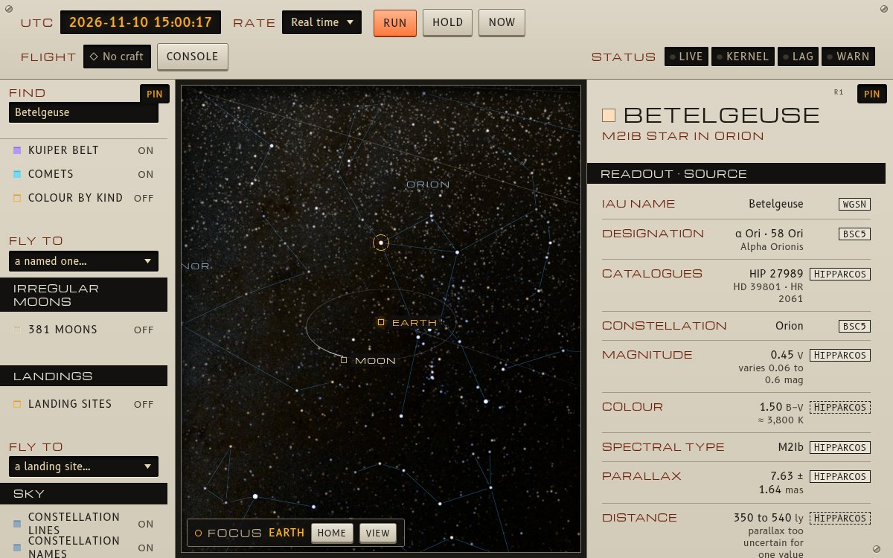
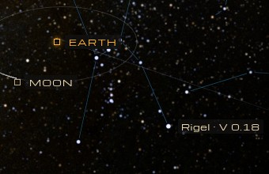
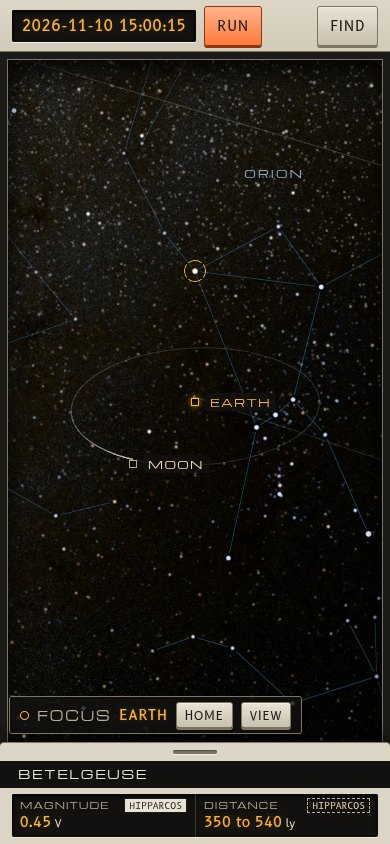

# The interactive sky

**Status:** the plan below was approved on 20 Nov 2026, and its first slice is
built: picking a star, the star plate, constellation lines and names, and FIND
for stars and constellations (section 5). The later steps (section 3) are not
started.

Today the sky is the Hipparcos point layer (83,392 stars to V 9.0,
`stars/hipparcos.bin`) over the NASA SVS Milky Way map (`src/scene/stars.ts`,
[textures.md](textures.md#credits)). None of it can be pointed at. This note
covers the data an interactive sky needs and the licence of each source, read
at the source. It then plans the first slice: picking a star, its plate, and
constellation lines and names. A ground view is a separate later step.

The aim is the planetarium apps' "point at a star and learn what it is", in the
orrery's own console look ([DESIGN.md](../../DESIGN.md)), keeping the
promises in [PRODUCT.md](../../PRODUCT.md): every value shows its source, and
an aid looks like an aid.

## 1. Data and licences

Every licence below was read on 19 Nov 2026 from the source's own file or
page, unless the row says otherwise. The repository's code is MIT. A data file
can carry its own licence beside it, as the CC BY 4.0 Solar System Scope maps
already do ([credits](../credits.md)). "Permissive" here means public domain,
or attribution only (CC BY, BSD, MIT). ShareAlike (CC BY-SA) is not
permissive: anything made from the data must carry the same licence.

### Stellarium is not used

- Stellarium's program code is GPL-licensed, so it cannot go into this MIT
  repository.
- Its sky-culture data (the constellation lines and names) is now kept apart
  in `stellarium-skycultures`. That repository's own files show:
  - the repository as a whole: AGPL-3.0 (`LICENSE-AGPL-3.0.txt`);
  - the `western` culture: "Text and data: CC BY-SA" [1];
  - `western_SnT`, the Sky & Telescope figures: "CC BY-SA 2.0" [2].
- The repository's README asks each culture for "CC BY-SA … or similar or
  more permissive" [3].

So the lines are not GPL, as first thought, but they are ShareAlike. They are
not used.

### What each need can use

| Need | Recommended source | Licence (as read at the source) | Not used, and why |
| --- | --- | --- | --- |
| Star data for the plate: HIP number, V, B−V, parallax and its error, spectral type, proper motion, HD number | The **Hipparcos main catalogue** (ESA 1997), via NASA HEASARC [4]: the file the build already uses (`heasarc_hipparcos.tdat.gz`, cached) | HEASARC: "HEASARC materials are all available freely for your use" [5]; the repository already credits ESA ([credits](../credits.md)) | — **No new download.** |
| IAU star names | The **IAU Catalog of Star Names** (WGSN), the live table on exopla.net [6] | WGSN: IAU star names "are free to use and not subject to copyright …; they are scientific standards … [and] belong to the public domain" [6]. Its etymology texts are CC BY (not used). | Mamajek's `IAU-CSN.txt` [7] says IAU products are "released under Creative Commons Attribution", but it was last updated on 4 Apr 2022. The live table has names adopted as late as 17 Sep 2026. |
| HIP → Bayer and Flamsteed designations | The **Bright Star Catalogue, 5th revised ed.** (Hoffleit and Warren 1991), HEASARC table `bsc5p` [8]: `Alt_Name` holds them ("54Alp Peg"). It is joined to Hipparcos by HD number. The IAU table's Bayer column covers named stars. | HEASARC, as above [5]. The VizieR ReadMe (V/50) states no licence. | Kostjuk's cross index (VizieR IV/27A) [9] has more Flamsteed numbers, but its ReadMe states no licence, and the CDS usage page was unavailable on 19 Nov 2026. Its use is still to be confirmed. |
| Constellation lines (the figures) | **d3-celestial** `constellations.lines.json` (Olaf Frohn) [10]: polylines in RA/Dec. Its readme credits the IAU constellation page, with "some line modifications" by Frohn [11]. These are the IAU/Sky & Telescope charts, Alan MacRobert's patterns [12]. Each vertex is matched to its Hipparcos star in the build. | d3-celestial: BSD-3-Clause [13]. The IAU charts: "released under the Creative Commons Attribution 4.0 International license" [12]. Both are permissive: credit Frohn, the IAU and Sky & Telescope. | Stellarium `western` and `western_SnT`: CC BY-SA [1], [2]. HYG: CC BY-SA 4.0 [14] (and it has no lines). |
| Constellation names and label positions | The 88 IAU names, genitives and three-letter abbreviations, from d3-celestial `constellations.json` [10]: its Latin and English fields and its label points only | BSD-3 [13]. The names are IAU standards [12]. | Its other-language names come from Wikipedia (CC BY-SA) [11]. They are left out. |
| IAU constellation boundaries (later slice) | The **IAU's own boundary files**, one per constellation (`/static/public/constellations/txt/<abbr>.txt`: RA, Dec and abbreviation per vertex, J2000) [12] | The IAU site's texts and images: CC BY 4.0, credit "IAU" [15] | Davenhall and Leggett 1989 (VizieR VI/49) [16] has the same Delporte boundaries, but its ReadMe states no licence. d3-celestial's `constellations.bounds.json` comes from it. |
| Messier objects (later slice) | HEASARC table `messier` [17] (109 objects) | HEASARC, as above [5] | d3-celestial `messier.json` comes from SEDS [11]. The SEDS data page states no licence. |
| NGC/IC deep-sky objects (later slice) | **OpenNGC** (Mattia Verga) [18] is the only open NGC/IC list found | Its REUSE file: `Files: *`, `License: CC-BY-SA-4.0` [19], so ShareAlike | NGC 2000.0 (Sinnott 1988, VizieR VII/118): "copyrighted by Sky Publishing Corporation", deposited "for scientific research" [20]. It cannot be used. |

The IAU's website was rebuilt in 2026, and its old `/public/themes/...` pages
now return 404. The IAU's constellation and copyright texts were therefore read
from the Internet Archive's copies (2022–2024) [12], [15]. The boundary files
are to be fetched from the archive or the IAU's new site.

**NGC/IC is the one need with no permissive source.** Using OpenNGC would mean
shipping a CC BY-SA data file, with its licence beside it, in the data release
(not in git, ADR-0001). The MIT code would not change. That is Isaac's call. The
first slice does not need it.

### What the build makes

These are small files in a new **`sky` data set** (`public/sky/`), so the
311 MB `textures` set is not republished. `stars/hipparcos.bin` stays as it
is, so the drawing and `bench:frames` do not change.

- `sky/stars-info.bin`: for each star, in the same order as `hipparcos.bin`:
  - HIP and HD numbers;
  - parallax and its error;
  - proper motion;
  - the variability flag;
  - an index into a table of spectral types.

  About 1 MB raw. It is fetched the first time the sky is pointed at.
- `sky/names.json`: for each star that has them, its IAU name, its Bayer and
  Flamsteed designations and its HR number, keyed by its index. It feeds FIND
  and the labels.
- `sky/constellations.json`: the 88 constellations, each with:
  - its abbreviation, Latin name, genitive and English name;
  - its label point;
  - its lines as pairs of star indices.

  The build stops if a line vertex has no Hipparcos star within 0.1°.
- A pipeline, `python/textures/sky.py` (or a `pipelines/sky.build.mjs`), with
  the sources' URLs and licences in its docstring, as `sources.py` has.

**Downloads needed for the first slice:**

| File | Source | Size |
| --- | --- | --- |
| IAU star-name table | exopla.net [6] | about 0.2 MB |
| `constellations.lines.json` and `constellations.json` | d3-celestial on GitHub [10] | 77 kB |
| `bsc5p` | HEASARC [8] | 9,110 rows, a few MB at most (to check before fetching) |

They go to `~/.cache/digital-orrery/textures-src/`, as the other masters do. The
new `sky` set then needs `npm run data:publish -- --yes`, which needs Isaac's
OK.

## 2. Interactions (first slice)

### Hovering over and choosing a star

- **Picking.** A click that does not drag goes, in order:
  1. to the journey (as now);
  2. to an orbit line within its pick distance (as now);
  3. to the nearest *visible* star within 8 CSS px.

  "Visible" uses the shader's own test (peak × 512 ≥ 1, with today's level and
  the eye's adaptation), so a star too faint to see cannot be picked. A star
  behind a body's disc cannot be picked either.
- **Searching.** The search is on the CPU, over a grid of the sky built once,
  so a pick looks only at the few cells near the pointer. Hovering does the
  same, at most once a frame.
- **Hover tag.** Hovering shows a small engraved tag beside the star, like a
  guide's tag: its name, or its designation, and V.
- **The star plate.** A click opens the plate and rings the star with a thin
  reticle, an aid that looks like one. The camera does not move.
- **The plate's rows**, each with its source tag as the other plates have
  (`Readout`, `tag-info.js` entries):

  | Row | Value | Source tag |
  | --- | --- | --- |
  | Name | IAU name, or "no IAU name" | WGSN |
  | Designations | Bayer, Flamsteed, HR, HD, HIP | BSC5, Hipparcos |
  | Constellation | from the Bayer/Flamsteed designation; from the boundaries once they land | BSC5 (later IAU) |
  | Magnitude | V, with "variable" when flagged | Hipparcos |
  | Colour | B−V, a swatch of the colour the sky draws, and the temperature it implies (Ballesteros 2012) | Hipparcos, derived |
  | Spectral type | as catalogued | Hipparcos |
  | Parallax | ϖ ± σ, mas | Hipparcos |
  | Distance | 1/ϖ in light-years and parsecs, only when ϖ/σ ≥ 5; otherwise the range the 1σ bounds give, or "more than …" when ϖ − σ ≤ 0. Never a bare 1/ϖ of a noisy parallax. | Hipparcos, derived |
  | Position | RA and Dec, ICRS, at the catalogue's epoch J1991.25 (labelled so) | Hipparcos |
  | Proper motion | mas/yr | Hipparcos |

  The 1997 Hipparcos parallaxes are what the app already has. Van Leeuwen's
  2007 reduction is better for bright stars, but it is a new VizieR download,
  so it is left for later.

### Constellation lines and names (a rail layer)

- **The rail.** A new rail group, **Sky**, with switches in the style of the
  irregular-moons and landing-sites rows:
  - *Constellation lines*;
  - *Constellation names*.

  Both are off by default and remembered with the other layers.
- **Lines.** They are drawn with `screenLines.ts` (constant width,
  anti-aliased), in a dim guide colour, below the bodies. Each segment stops a
  few pixels short of its stars, as in a printed atlas, so the lines never
  cover the stars they join.
- **Names.** The Latin name sits at d3-celestial's label point, in small
  engraved caps, from the overlay's pooled tags. Hovering over a name gives
  its genitive and English name.
- **Brightness.** The lines and names fade with the eye's adaptation, like the
  stars. They are hidden from beside the Sun, where no stars show.

### FIND for stars

- **A new group, Stars.** It matches each star's:
  - IAU name;
  - Bayer designation, written any of four ways ("α Ori", "alpha Ori",
    "alf Ori", "Alpha Orionis");
  - Flamsteed number ("58 Ori");
  - HR, HD and HIP numbers ("HIP 27989").

  It loads `names.json` on first focus, as the asteroid index loads.
- **A Constellations group** matches the 88 names and abbreviations.
- **Choosing a star** turns the view so the star sits a third of the way from
  the centre. The focused body stays in frame and so does not cover it. The
  star's plate opens and its reticle shows.
- **Choosing a constellation** turns the view to its label point and switches
  its lines on. The pick's line says so ("Constellation lines shown"), as for
  other layers.

### Phone

The plate goes in the sheet, as the other plates do. On touch, a tap picks,
with 14 px of slop, and there is no hover.

## 3. Later steps (not in the first slice)

1. **Boundaries and star labels:**
   - the IAU boundaries as a third switch [12];
   - the constellation from a point-in-polygon test in the build;
   - labels for named stars brighter than a limit.
2. **Deep sky:**
   - the Messier objects from HEASARC [17], as markers and plates, with FIND;
   - NGC/IC only if Isaac accepts OpenNGC's CC BY-SA [19].
3. **The ground view, a separate step.** Stand on a body's surface:
   - an alt-az frame from the body's rotation model (the Earth's from the
     Earth orientation data the app has, the others from the IAU WGCCRE poles
     the app uses);
   - a horizon, drawn from the terrain where the app has relief;
   - for bodies with air, refraction (Saemundsson 1986 for the Earth, scaled
     by surface pressure and temperature for Mars and Titan) and extinction
     by airmass (Kasten and Young 1989). The twinkling model the stars
     already have (`scintillation.js`) carries over.

   It needs a camera mode of its own (eye height, looking up, an horizon
   mask), so it gets its own plan and approval.

## 4. Checks for the first slice

- **Unit tests:**
  - the parallax-to-distance rule (the ϖ/σ cut, a negative parallax);
  - the Bayer parser and FIND's star ranking;
  - the pick (the nearest visible star, not a fainter nearer one; none
    behind a disc).
- **The build's own checks:**
  - every line vertex matched to a star;
  - 88 constellations;
  - a spot check: Betelgeuse is HIP 27989, α Ori, 58 Ori, HR 2061, HD 39801,
    and, in the cached Hipparcos file, V 0.45, ϖ 7.63 ± 1.64 mas and M2Ib.
- **Real-GPU screenshots** with `scripts/lib/chromium.mjs`:
  - Orion with lines and names;
  - the plate for Betelgeuse;
  - a hover tag;
  - the phone sheet.
- **`npm run bench:frames`** before and after, on the RTX 5070 Ti and the Intel
  iGPU, under the shared lock. With the layers off the frame must be level;
  with them on, the added cost is reported.

## 5. The first slice, as built

**The data** (`python/textures/sky.py`, the `sky` data set, 3.3 MB):

| File | Holds | Size |
| --- | --- | --- |
| `sky/stars-info.bin` | For all 83,392 stars, in `hipparcos.bin`'s order: HIP, HD, parallax and error, proper motion, RA and Dec (float32, the catalogue's own; the point layer's int16 directions are good only to 6″), spectral type (3,330 distinct), variability flag | 2.95 MB |
| `sky/names.json` | 9,057 stars with a name or designation: 562 of the 579 IAU names that have a HIP number (the other 17 are fainter than V 9 or not in Hipparcos), 1,518 Bayer and 2,504 Flamsteed designations, HR numbers | 343 kB |
| `sky/constellations.json` | 88 constellations, 743 lines between 757 stars | 18 kB |

- **The build checks:**
  - its stars are `hipparcos.bin`'s, star for star;
  - every line vertex is within 33″ of its Hipparcos star;
  - the Betelgeuse spot check.

  The build stops if any check fails.
- **Why RA and Dec are in the file:** the plan had no RA and Dec. They were
  added once it was clear the point layer's directions were too coarse for
  the plate.
- **Before the site can deploy it,** the new set needs
  `npm run data:publish -- --yes`. Until then, `npm run data` on a fresh clone
  cannot fetch it.

**The code:**

- `src/scene/skyCatalogue.ts`: the pure rules, tested in
  `src/scene/sky.test.mjs`:
  - decoding the files;
  - designations, and FIND's names;
  - the distance rule;
  - the pick's choice;
  - the visibility test.
- `src/scene/skyLayer.ts`: picking, the hover tag, the ring, and the lines and
  names.
- `src/app/star-plate.tsx`: the plate.
- The Sky group in `panels.tsx`, the FIND groups in `App.tsx`, and the
  switches kept in `remember.js`.
- `OrreryScene.turnTo` turns the view to a star or a constellation. It offsets
  the star by a sixth of the field of view, or by the focused body's apparent
  radius plus 3°, whichever is larger (at most 0.4 of the field), so the body
  does not cover it.

**The pick:** of the drawn stars within 8 CSS px (14 on touch), the one with
the least V + 2 (d / 8 px)². A star at the pointer beats one a magnitude
brighter at the circle's edge; one two magnitudes brighter anywhere in the
circle wins. A hover is looked for when the pointer moves, and every sixth
frame while it rests.

**On a real GPU** (headless Chromium on the RTX 5070 Ti, `scripts/lib/chromium.mjs`; 10 Nov 2026 15:00 UTC, 3 million km from the Earth; the rail and plate pinned with L and R):

- Betelgeuse, found with FIND ("alpha Ori"), has its ring and plate. The
  constellation lines and names are on. The Earth stays in frame below the
  star.

  
- Hovering over Rigel shows its tag. A click opens Rigel's plate, and a click
  on empty sky closes it.

  
- On a phone, a tap picks Betelgeuse. The sheet is named after it, and its
  peek shows the star's magnitude and distance.

  

**The frame** (`npm run bench:frames`, 20 Nov 2026, 1920 × 1080, interleaved
with a build of `main`; the new `sky` scenario has both layers on):

| Scenario | NVIDIA frame, 3 rounds | Intel frame, 5 rounds |
| --- | ---: | ---: |
| Earth close-up, 20,000 km | 6.6 → 6.4 ms | 16.1 → 16.3 ms (+1 %) |
| Overview (the Sun) | 6.4 → 6.2 ms | (3 rounds) 16.0 → 16.3 ms |
| Earth, constellation lines and names on | 6.4 ms (layers off) → 6.3 ms (on) | 16.2 → 16.2 ms |

- **Level, layers off:** both GPUs are within the rounds' spread. A first
  Intel run of 3 rounds gave +12 % for the Earth. Five rounds gave +1 %, and
  `main`'s own identical copy of the scene ranged 14.8 to 18.4 ms.
- **Layers on cost nothing measurable:** 743 segments and 88 HTML labels.

**What the plate shows for Betelgeuse:** Hipparcos 1997 gives
ϖ = 7.63 ± 1.64 mas, only 4.65σ. So the plate gives a distance range of 350 to
540 ly, not 1/ϖ = 427 ly. That is the distance rule at work.

## References

[1] Stellarium, "western/description.md", stellarium-skycultures, GitHub. https://github.com/Stellarium/stellarium-skycultures/blob/master/western/description.md (accessed 19 Nov 2026).

[2] Stellarium, "western_SnT/description.md", stellarium-skycultures, GitHub. https://github.com/Stellarium/stellarium-skycultures/blob/master/western_SnT/description.md (accessed 19 Nov 2026).

[3] Stellarium, "README.md", stellarium-skycultures, GitHub. https://github.com/Stellarium/stellarium-skycultures (accessed 19 Nov 2026).

[4] ESA, *The Hipparcos and Tycho Catalogues*, ESA SP-1200, 1997; HEASARC table `hipparcos`. https://heasarc.gsfc.nasa.gov/W3Browse/all/hipparcos.html

[5] NASA HEASARC, "Data policy". https://heasarc.gsfc.nasa.gov/docs/heasarc/data_policy.html (accessed 19 Nov 2026).

[6] IAU Working Group on Star Names, "IAU-Catalog of Star Names (CSN)", exopla.net. https://exopla.net/star-names/modern-iau-star-names/ (accessed 19 Nov 2026).

[7] E. Mamajek (WGSN secretary), "IAU-CSN.txt", last updated 4 Apr 2022. https://www.pas.rochester.edu/~emamajek/WGSN/IAU-CSN.txt (accessed 19 Nov 2026).

[8] D. Hoffleit and W. H. Warren Jr, *The Bright Star Catalogue, 5th Revised Ed.*, NSSDC/ADC, 1991; HEASARC table `bsc5p`. https://heasarc.gsfc.nasa.gov/W3Browse/star-catalog/bsc5p.html

[9] N. D. Kostjuk, "HD-DM-GC-HR-HIP-Bayer-Flamsteed Cross Index", VizieR IV/27A, 2002. https://vizier.cfa.harvard.edu/ftp/cats/IV/27A/ReadMe

[10] O. Frohn, d3-celestial, `data/`, GitHub. https://github.com/ofrohn/d3-celestial/tree/master/data (accessed 19 Nov 2026).

[11] O. Frohn, d3-celestial, "readme.md", Sources section. https://github.com/ofrohn/d3-celestial/blob/master/readme.md (accessed 19 Nov 2026).

[12] IAU, "The Constellations", iau.org/public/themes/constellations/, as archived by the Internet Archive in 2023. https://web.archive.org/web/2023/https://www.iau.org/public/themes/constellations/ (accessed 19 Nov 2026).

[13] O. Frohn, d3-celestial, "LICENSE" (BSD-3-Clause), 2015. https://github.com/ofrohn/d3-celestial/blob/master/LICENSE

[14] D. Nash, HYG Database, "LICENSE" (CC BY-SA 4.0), GitHub. https://github.com/astronexus/HYG-Database (accessed 19 Nov 2026).

[15] IAU, "Copyright: usage of images, videos and web texts", iau.org/copyright/, as archived by the Internet Archive in 2022. https://web.archive.org/web/2022/https://www.iau.org/copyright/ (accessed 19 Nov 2026).

[16] A. C. Davenhall and S. K. Leggett, "Catalogue of Constellation Boundary Data", VizieR VI/49, 1989. https://vizier.cfa.harvard.edu/ftp/cats/VI/49/ReadMe

[17] NASA HEASARC, table `messier`, "Messier Nebulae". https://heasarc.gsfc.nasa.gov/W3Browse/all/messier.html

[18] M. Verga, OpenNGC, GitHub. https://github.com/mattiaverga/OpenNGC (accessed 19 Nov 2026).

[19] M. Verga, OpenNGC, ".reuse/dep5". https://github.com/mattiaverga/OpenNGC/blob/master/.reuse/dep5 (accessed 19 Nov 2026).

[20] R. W. Sinnott (ed.), "NGC 2000.0", VizieR VII/118, ReadMe, copyright notice. https://vizier.cfa.harvard.edu/ftp/cats/VII/118/ReadMe
