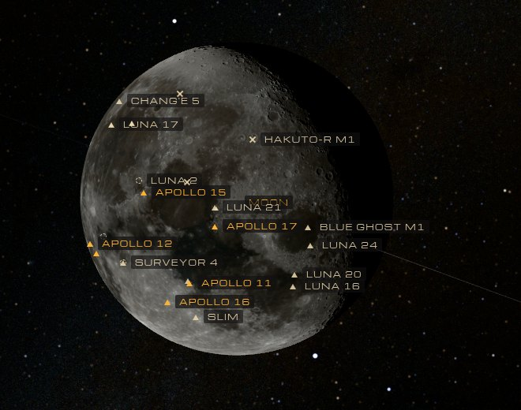
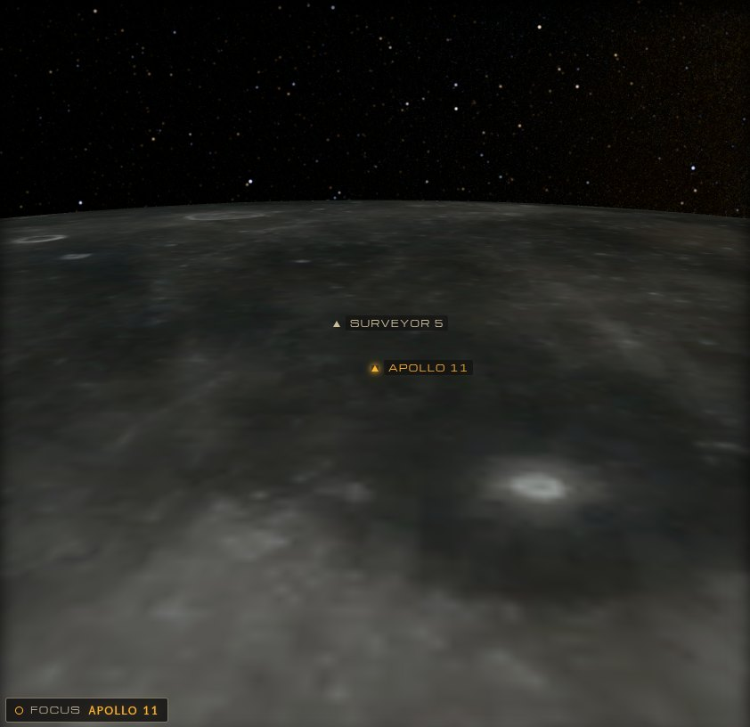
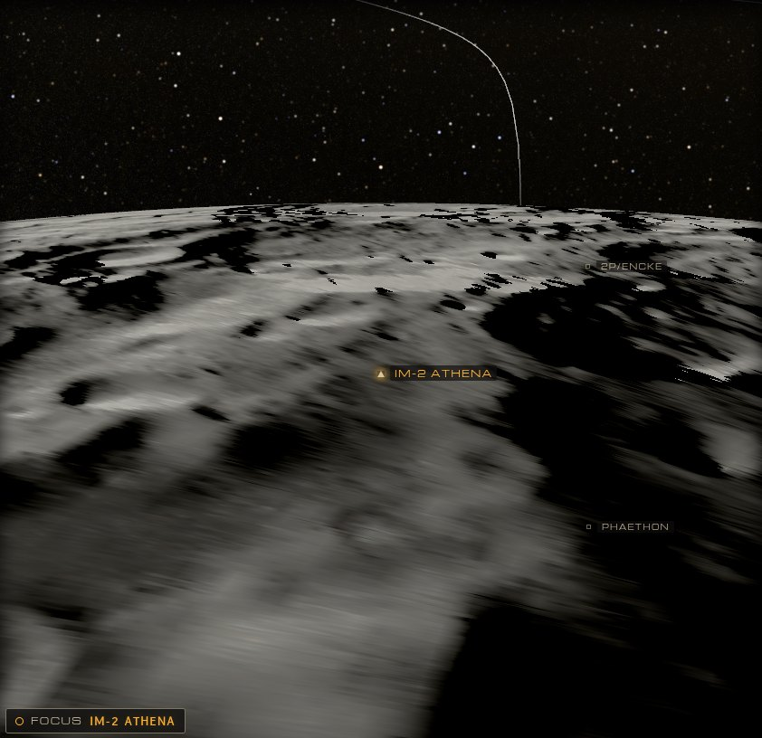

# The Moon's landing sites

Where spacecraft have come down on the Moon, as markers on its surface:
every soft landing from Luna 9 to Blue Ghost, where three rovers stopped,
the landers that crashed and were found, and the early craft that never
were. The rail's **Moon landings** section switches the layer on (it is
off until then) and flies to any site. A flight there frames the site
from low over the ground, across the sunlight, and the data plate gives
the mission, when it landed, its crew, where it is and whose measurement
that is.

| | |
| --- | --- |
|  |  |
| The near side from 9,000 km with the layer on, 25 Nov 2026 06:00 UTC: names give way where they would overlap | Apollo 11's site, flown to: the Sun 56° up |

Code: [`src/physics/landingSites.js`](../../src/physics/landingSites.js)
(the sites, their sources and where they are),
[`src/scene/landingSites.ts`](../../src/scene/landingSites.ts) (the
markers), [`landing-site-plate.tsx`](../../src/app/landing-site-plate.tsx)
(the plate), and `focusOnSite` in
[`OrreryScene.ts`](../../src/scene/OrreryScene.ts) (the flight and the
camera about a site).

## Where the coordinates come from

**The LROC team's measurements.** The Lunar Reconnaissance Orbiter
Camera's Narrow Angle Camera sees landers, rovers and the craters of
crashes. Wagner et al. [1] found each object's centre in several images
and projected it onto the GLD100 shape model with USGS's ISIS, from
LRO's position and the camera's pointing. LRO's position comes from the
LOLA team's crossover-corrected orbits, good to ±15 m, and the pointing
from the team's temperature-corrected camera kernels. Each coordinate is
the mean over its images, with an uncertainty: 0.3 m for Apollo 11's
descent stage, a few metres for most [2], [3]. Since then the team has
given each new landing's coordinates in a post on its site, to ±20 or
±30 m where it says [7]–[19].

**The frame.** Every coordinate is planetocentric latitude and east
longitude in the Moon's mean-Earth/polar-axis (ME) frame, the frame of
the LRO maps and of the Moon's body axes in the app
([orientation](../physics/orientation.md)). Longitudes the sources print
from 0° to 360° east are kept less 360° past 180°, at the printed
precision.

**Not found.** LROC has not found Luna 2's crater, the Luna 9 and 13
landers or the wrecks of Surveyor 2 and 4. For those the app gives the
estimates of the time, from their tracking, as NSSDCA lists them
[4]–[6]: they may be kilometres out, the markers are dashed rings, and
the plate says so.

**When.** Landing times are UTC: Apollo's and the Surveyors' from
NSSDCA's spacecraft pages [20], [21], the Luna missions' from NSSDCA's
list [4], IM-2 Athena's from NSSDCA's page for it [22], Blue Ghost's
from NASA [23], and the rest from the LROC posts that give the
coordinates. Where a source gives only the day, or the month, the plate
gives only that.

### The sites

| Site | Agency | Landed (UTC) | | Latitude | Longitude | Uncertainty | Source |
| --- | --- | --- | --- | ---: | ---: | --- | --- |
| Luna 2 | USSR | September 1959 | crashed, not found | 29.1° N | 0° E | km | [4] |
| Luna 9 | USSR | 3 Feb 1966 18:44:52 | not found | 7.08° N | 64.37° W | km | [4] |
| Surveyor 1 | NASA | 2 Jun 1966 06:17:36 | landed | 2.4745° S | 43.3398° W | ± 5.6 m | [1], [2] |
| Surveyor 2 | NASA | 22 Sep 1966 09:35 | crashed, not found | 5.5° N | 12° W | km | [5] |
| Luna 13 | USSR | 24 Dec 1966 18:01:00 | not found | 18.87° N | 62.05° W | km | [4] |
| Surveyor 3 | NASA | 20 Apr 1967 00:04:53 | landed | 3.0162° S | 23.4180° W | ± 2.6 m | [1], [2] |
| Surveyor 4 | NASA | 17 Jul 1967 02:02:40 | crashed, not found | 0.47° N | 1.44° W | km | [6] |
| Surveyor 5 | NASA | 11 Sep 1967 00:46:44 | landed | 1.4551° N | 23.1943° E | ± 11.9 m | [1], [2] |
| Surveyor 6 | NASA | 10 Nov 1967 01:01:06 | landed | 0.4742° N | 1.4275° W | ± 6.7 m | [1], [2] |
| Surveyor 7 | NASA | 10 Jan 1968 01:05:36 | landed | 40.9812° S | 11.5127° W | ± 3.5 m | [1], [2] |
| Apollo 11 | NASA | 20 Jul 1969 20:17:40 | crewed | 0.67416° N | 23.47314° E | ± 0.3 m | [1], [2] |
| Apollo 12 | NASA | 19 Nov 1969 06:54:35 | crewed | 3.0128° S | 23.4219° W | ± 2.2 m | [1], [2] |
| Luna 16 | USSR | 20 Sep 1970 05:18:00 | landed | 0.5137° S | 56.3638° E | ± 3.7 m | [1], [2] |
| Luna 17 | USSR | 17 Nov 1970 03:47:00 | landed | 38.23764° N | 35.00163° W | ± 0.5 m | [1], [2] |
| Lunokhod 1 | USSR | 17 Nov 1970 03:47:00 | rover stopped | 38.3150° N | 35.0081° W | ± 3.8 m | [1], [2] |
| Apollo 14 | NASA | 5 Feb 1971 09:18:11 | crewed | 3.64589° S | 17.47194° W | ± 0.4 m | [1], [2] |
| Apollo 15 | NASA | 30 Jul 1971 22:16:29 | crewed | 26.13239° N | 3.63330° E | ± 1.0 m | [1], [2] |
| Luna 20 | USSR | 21 Feb 1972 19:19:00 | landed | 3.7863° N | 56.6242° E | ± 4.3 m | [1], [2] |
| Apollo 16 | NASA | 21 Apr 1972 02:23:35 | crewed | 8.9734° S | 15.5011° E | ± 3.0 m | [1], [2] |
| Apollo 17 | NASA | 11 Dec 1972 19:54:57 | crewed | 20.1911° N | 30.7723° E | ± 3.5 m | [1], [2] |
| Luna 21 | USSR | 15 Jan 1973 23:35:00 | landed | 25.9994° N | 30.4076° E | ± 13.4 m | [1], [2] |
| Lunokhod 2 | USSR | 15 Jan 1973 23:35:00 | rover stopped | 25.8323° N | 30.9222° E | ± 7.5 m | [1], [2] |
| Luna 24 | USSR | 18 Aug 1976 02:00:00 | landed | 12.7142° N | 62.2129° E | ± 3.7 m | [1], [2] |
| Chang'e 3 | CNSA | 14 Dec 2013 | landed | 44.1214° N | 19.5117° W | ± 9.1 m | [1], [2] |
| Yutu | CNSA | 14 Dec 2013 | rover stopped | 44.1208° N | 19.5122° W | ± 12.9 m | [1], [2] |
| Chang'e 4 | CNSA | 3 Jan 2019 | landed | 45.457° S | 177.589° E | ± 20 m | [7] |
| Beresheet | SpaceIL | 11 Apr 2019 | crashed | 32.5956° N | 19.3496° E | ± 20 m | [8] |
| Chandrayaan-2 Vikram | ISRO | September 2019 | crashed | 70.8810° S | 22.7840° E | | [9] |
| Chang'e 5 | CNSA | 1 Dec 2020 15:11 | landed | 43.0576° N | 51.9161° W | ± 20 m | [10] |
| HAKUTO-R M1 | ispace | 25 Apr 2023 16:40 | crashed | 47.581° N | 44.094° E | | [11] |
| Luna 25 | Roscosmos | 19 Aug 2023 11:58 | crashed | 57.865° S | 61.360° E | ± 40 m | [12] |
| Chandrayaan-3 | ISRO | 23 Aug 2023 | landed | 69.3741° S | 32.32° E | | [13] |
| SLIM | JAXA | 19 Jan 2024 15:20 | landed | 13.3160° S | 25.2510° E | | [14] |
| IM-1 Odysseus | Intuitive Machines | 22 Feb 2024 23:23:53 | landed | 80.13° S | 1.44° E | | [15] |
| Chang'e 6 | CNSA | 1 Jun 2024 | landed | 41.6385° S | 153.9852° W | ± 30 m | [16] |
| Blue Ghost M1 | Firefly | 2 Mar 2025 08:34 | landed | 18.5623° N | 61.8103° E | | [17] |
| IM-2 Athena | Intuitive Machines | 6 Mar 2025 17:30 | landed | 84.7906° S | 29.1957° E | | [18] |
| RESILIENCE | ispace | 5 Jun 2025 18:13 | crashed | 60.4445° N | 4.5880° W | | [19] |

Uncertainties are the source's own; a blank one the source does not
state. A rover's site is where it stopped; its date is its lander's.
Times given to the minute are converted from the source's US Eastern
time where it gives that (HAKUTO-R M1, Blue Ghost). No landing after
June 2025 was found as of 18 November 2026; a new one is a row in
`landingSites.js` with its source.

## Drawing

Each site is a marker in the HTML overlay, as the bodies' are, pinned to
its point on the Moon: the unit vector of its latitude φ and longitude λ
in the Moon's body frame,

$$\hat{\mathbf n} = \cos\varphi\cos\lambda\,\mathbf X + \cos\varphi\sin\lambda\,\mathbf Y + \sin\varphi\,\mathbf Z,$$

where X, Y and Z are the body axes `bodyAxesEqj('moon')` gives this
frame (the same that turn the Moon's mesh and its maps), times the
1,737.4 km radius the Moon is drawn with. The site is drawn on that
sphere, not at its own height: the Moon is drawn as the sphere, its relief
as shading, so the marker sits on the ground the eye sees. The plate gives
the height.

- **Seen or not.** On a sphere a point is in sight when the camera is
  above its horizon plane, $\hat{\mathbf n}\cdot(\mathbf c - \mathbf p) > 0$:
  past the limb, or over the horizon from low down, the marker hides.
- **When.** With the layer on, the markers show within 25 Moon radii of
  its centre (the Moon's default framing is 20,000 km out). A site flown
  to keeps its marker with the layer off.
- **Crowding.** Names give way to one another: the site flown to first,
  then the crewed landings, then the rest in the order they landed. A
  site whose name would overlap one already placed shows its mark only,
  with its name on hover. From 20,000 km Apollo 12 and Surveyor 3,
  180 m apart, are one mark.
- **Marks.** An upright triangle standing on its ground: amber for a
  crew, pale for a robot, smaller where a rover stopped. A cross where a
  craft crashed (after a craft's struck-through marker), and a dashed
  ring for an estimate, dashed as a worked-out value's source tag is.

The markers are worked out on the CPU, 38 a frame, from one turn of the
Moon's axes; no GPU work is added.

## Flying to one

`focusOnSite` makes the site a focus as a small body is: the plate shows
it until a body is chosen. The Moon becomes the focused body, so its maps
load and the rail's guides apply to it.

- **The framing.** The camera ends 140 km from the site, 0.35 rad (20°)
  above its horizon, 48 km up, looking across the sunlight. The azimuth
  is the Sun's at the site plus 90°, so the relief casts its shadows
  sideways across the view, where its shape shows best.
- **Turning about it.** About a site the camera's azimuth and elevation
  are in the site's own frame (east, north, up), not the ecliptic's: it
  turns about the local vertical, stays at least 0.02 rad above the
  horizon, and goes round with the Moon, so at a warp the site stays in
  view and the Sun crosses its sky.
- **Up.** The camera's up eases to the site's vertical over about a
  quarter second (at once with reduced motion), and back to ecliptic
  north on leaving. At IM-2's site, 5° from the south pole, the local up
  is nearly ecliptic south; without this the horizon would be upside
  down. Opposite ups turn about the line of sight, as a roll.
- **The flight.** It follows the camera's usual zoom-and-pan path
  ([camera](camera.md)); the camera's direction from its pivot turns on
  the great circle from where it was to the site's framing as the flight
  goes, so nothing jumps.
- **Zoom.** The wheel goes down to 60 m from the site; the camera keeps
  5 m above the ground (as about a craft).

The ground is the CGI Moon Kit's LROC colour map (8192 × 4096, 1.3 km a
pixel at the equator) under the LOLA relief (16 pixels a degree, 1.9 km),
so a few kilometres is the finest detail it shows: the landers themselves,
metres across, are far below a pixel. The marker is where the hardware is
to within the source's uncertainty and the 85 m below.

## The plate

The mission, its kind, agency and place; when it landed (or came down);
the crew (commander, then lunar module pilot) or rover; latitude and
longitude at the source's printed precision; the height above the
1,737.4 km sphere; the source's uncertainty ("kilometres" for an
estimate); and the Sun's elevation at the site now,

$$h_\odot = \arcsin(\hat{\mathbf n}\cdot\hat{\mathbf s}),$$

with ŝ the direction from the Moon's centre to the Sun (DE442; the
1,737 km between the centre and the site changes it by under 0.001°).
Below zero it is night there. Every value has its source tag, and the
notes give the coordinates' citation with a link.

## How right they are

**Against SPICE** (`landingSites.test.mjs`, from
`c/landing_sites_ref.c`). CSPICE puts ten sites' published coordinates
on the 1,737.4 km sphere (`latrec_c`) and turns them from MOON_ME into
J2000 (`pxform_c`, NAIF's `moon_pa_de440_200625.bpc` and its frame
kernel [24]). The app does the same through `bodyAxesEqj('moon')`. The
sites run from Apollo 11 to IM-2, 5° from the south pole, and Chang'e 4
and 6 on the far side, at Apollo 11's landing, J2000, Chang'e 4's
landing and today:

| Site | Worst of four instants |
| --- | ---: |
| Apollo 11 | 85 m |
| Apollo 12 | 62 m |
| Apollo 15 | 69 m |
| Apollo 17 | 84 m |
| Surveyor 7 | 85 m |
| Luna 17 | 37 m |
| Chang'e 4 | 61 m |
| Chang'e 6 | 79 m |
| Chandrayaan-3 | 76 m |
| IM-2 Athena | 75 m |

The tolerance is 250 m. What is left is the app's lunar orientation,
astronomy-engine's IAU-style model, against the DE440 libration NAIF's
kernel carries (0.0036°, about 110 m, [orientation](../physics/orientation.md)).
The C program types the coordinates from the sources separately, and the
test checks the two copies agree.

**The sources.** LROC's coordinates are good to their stated
uncertainty, metres to tens of metres. The estimates for Luna 2, 9 and
13 and Surveyor 2 and 4 are not measurements: the craft may be
kilometres away.

## Performance

Measured on 18 November 2026 with `npm run bench:frames`: main and this
branch, production builds, interleaved, headless at 1920 × 1080 and DPR 1,
the Moon from 20,000 km at real time. Median frame, ms (Intel: four
rounds; RTX: three):

| Scene | Intel UHD | RTX 5070 Ti |
| --- | ---: | ---: |
| Moon, layer off: main → branch | 18.8 → 20.1 | 8.0 → 8.1 |
| Moon, layer on: main → branch | 19.9 → 19.3 | 7.9 → 7.7 |
| Apollo 11's site framed, 140 km | 20.5 | 7.5 |

Every change is within the run-to-run noise of the loaded machine: the
same build was faster with the layer on than off. The markers are 38
positions a frame on the CPU and no GPU work.
[performance.md](../performance.md#the-moons-landing-sites) has the rest.

## References

[1] R. V. Wagner, D. M. Nelson, J. B. Plescia, M. S. Robinson, E. J. Speyerer, and E. Mazarico, "Coordinates of anthropogenic features on the Moon," *Icarus*, vol. 283, pp. 92–103, Feb. 2017, doi: 10.1016/j.icarus.2016.05.011.

[2] LROC Science Operations Team, Arizona State Univ., "LROC coordinates of lunar anthropogenic features," 28 Jul. 2016. [Online]. Available: https://lroc.im-ldi.com/data/support/downloads/2016_LROC_Coordinates_of_Human_Features.pdf

[3] M. Robinson, "Spacecraft related coordinates – 2016 update," LROC, Arizona State Univ., 25 Nov. 2016. [Online]. Available: https://lroc.im-ldi.com/images/938

[4] D. R. Williams, "Soviet missions to the Moon," NASA NSSDCA, 2005. [Online]. Available: https://nssdc.gsfc.nasa.gov/planetary/lunar/lunarussr.html

[5] NASA NSSDCA, "Surveyor 2," NSSDCA/COSPAR ID 1966-084A. [Online]. Available: https://nssdc.gsfc.nasa.gov/nmc/spacecraft/display.action?id=1966-084A

[6] NASA NSSDCA, "Surveyor 4," NSSDCA/COSPAR ID 1967-068A. [Online]. Available: https://nssdc.gsfc.nasa.gov/nmc/spacecraft/display.action?id=1967-068A

[7] M. Robinson, "Chang'e 4 lander coordinates," LROC, Arizona State Univ., 11 Jan. 2019. [Online]. Available: https://lroc.im-ldi.com/posts/1087

[8] M. Robinson, "Beresheet crash site spotted!," LROC, Arizona State Univ., 15 May 2019. [Online]. Available: https://lroc.im-ldi.com/images/1101

[9] M. Robinson, "Vikram lander found," LROC, Arizona State Univ., 2 Dec. 2019. [Online]. Available: https://lroc.im-ldi.com/images/1131

[10] M. Robinson, "First look: Chang'e 5," LROC, Arizona State Univ., 4 Dec. 2020. [Online]. Available: https://lroc.im-ldi.com/images/1172

[11] E. Speyerer, "Impact site of the HAKUTO-R Mission 1 lunar lander," LROC, Arizona State Univ., 23 May 2023. [Online]. Available: https://lroc.im-ldi.com/images/1302

[12] M. Robinson, "Luna 25 impact crater," LROC, Arizona State Univ., 29 Nov. 2023. [Online]. Available: https://lroc.im-ldi.com/images/1311

[13] M. Robinson, "Chandrayaan-3 landing site," LROC, Arizona State Univ., 5 Sep. 2023. [Online]. Available: https://lroc.im-ldi.com/images/1314

[14] M. Robinson, "JAXA SLIM landing," LROC, Arizona State Univ., 26 Jan. 2024. [Online]. Available: https://lroc.im-ldi.com/images/1358

[15] M. Robinson, "Intuitive Machines IM-1 on the Moon!," LROC, Arizona State Univ., 26 Feb. 2024. [Online]. Available: https://lroc.im-ldi.com/images/1360

[16] R. Wagner, "First look: Chang'e 6," LROC, Arizona State Univ., 14 Jun. 2024. [Online]. Available: https://lroc.im-ldi.com/images/1374

[17] M. Robinson, "Blue Ghost lunar lander seen from above," LROC, Arizona State Univ., 7 Mar. 2025. [Online]. Available: https://lroc.im-ldi.com/images/1407

[18] M. Robinson, "IM-2 Athena seen obliquely," LROC, Arizona State Univ., 10 Mar. 2025. [Online]. Available: https://lroc.im-ldi.com/images/1408

[19] M. Robinson, "ispace Mission 2 SMBC x HAKUTO-R Venture Moon impact site," LROC, Arizona State Univ., 20 Jun. 2025. [Online]. Available: https://lroc.im-ldi.com/images/1456

[20] NASA NSSDCA, Apollo lunar modules: "Apollo 11 Lunar Module/EASEP" (1969-059C), "Apollo 12 Lunar Module/ALSEP" (1969-099C), "Apollo 14 Lunar Module/ALSEP" (1971-008C), "Apollo 15 Lunar Module/ALSEP" (1971-063C), "Apollo 16 Lunar Module/ALSEP" (1972-031C), "Apollo 17 Lunar Module/ALSEP" (1972-096C). [Online]. Available: https://nssdc.gsfc.nasa.gov/nmc/spacecraft/display.action?id=1969-059C (and the other IDs)

[21] NASA NSSDCA, "Surveyor 1" (1966-045A), "Surveyor 3" (1967-035A), "Surveyor 5" (1967-084A), "Surveyor 6" (1967-112A), "Surveyor 7" (1968-001A). [Online]. Available: https://nssdc.gsfc.nasa.gov/nmc/spacecraft/display.action?id=1966-045A (and the other IDs)

[22] NASA NSSDCA, "Intuitive Machines 2 (PRIME 1)." [Online]. Available: https://nssdc.gsfc.nasa.gov/nmc/spacecraft/display.action?id=PRIME-1

[23] NASA, "NASA's Lunar Reconnaissance Orbiter views Blue Ghost on Moon's surface," 25 Mar. 2025. [Online]. Available: https://www.nasa.gov/image-article/nasas-lunar-reconnaissance-orbiter-views-blue-ghost-on-moons-surface

[24] NASA NAIF, "Generic kernels: `moon_pa_de440_200625.bpc`, `moon_de440_250416.tf`," 2020, 2025. [Online]. Available: https://naif.jpl.nasa.gov/pub/naif/generic_kernels/
