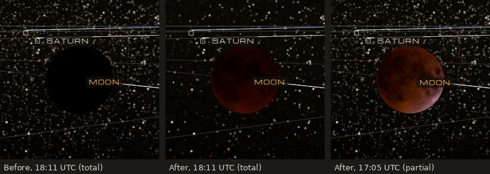
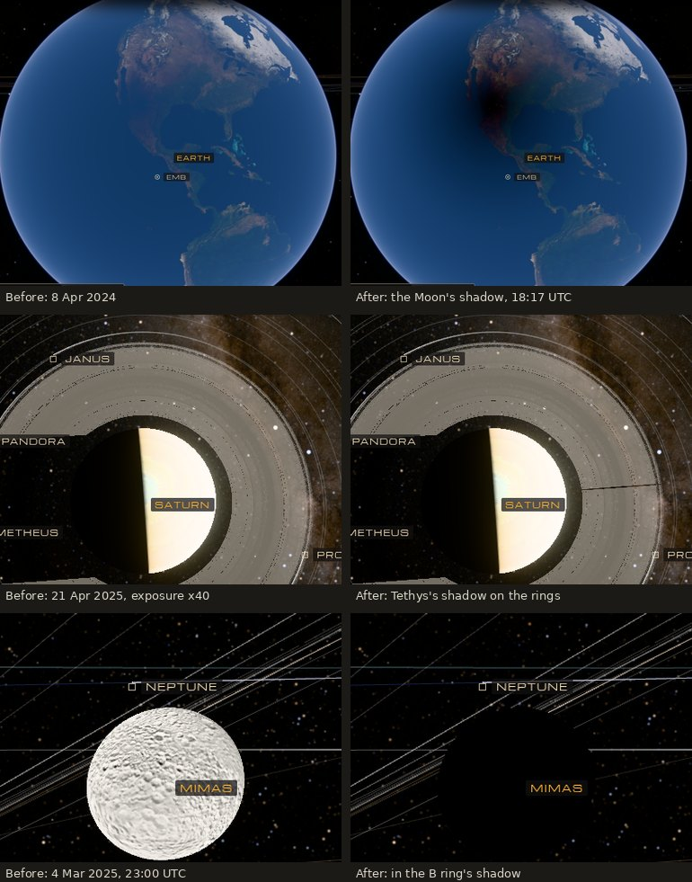

# Lighting

How sunlight is drawn: a camera's view of real illumination, not a stage
light. Code: `src/scene/bodyMaterial.ts` (the shader) and
`OrreryScene.updateLighting`.

## Sunlight and exposure

The Sun is the only light. A surface at distance $d$ from it receives

$$
E(d) = E_{1\,\text{AU}} \left(\frac{1\ \text{AU}}{d}\right)^2 ,
$$

so Jupiter (5.2 AU) gets 1/27 and Neptune (30 AU) 1/900 of the light at
Earth. There is no ambient light: night sides are black, as they are to a
camera exposed for daylight. (Earthshine on the Moon, about $10^{-4}$ of
sunlight, is not drawn.)

A camera on a spacecraft sets its exposure for the light where it is. The
scene does the same: exposure is proportional to $d_\text{cam}^2$, the
squared distance from the camera to the Sun (no closer than 0.2 AU), so a
planet looks properly exposed when you are near it, and the planets keep
their true relative brightness when you look at several from one place.

## Exposure and tone mapping

The scene renders linear light into a half-float target, multisampled 4×
where a CSS pixel is under 1.5 device pixels (`post.ts`). Bloom runs on that
light, and one final pass to the screen mixes in the bloom, adds the Sun's
glare, multiplies by the exposure, applies the tone curve and encodes sRGB.
No material tone-maps on its own any more. Everything after the scene is
that one full-screen pass: with three.js's own HDR output the bloom's mix,
the glare and the tone curve took three, about 19 ms of a 43 ms frame on the
Intel iGPU at 2680 × 2032 ([performance](../performance.md#rendering)).

The curve is Khronos PBR Neutral as three.js r187 implements it: every
channel first loses a small offset, 0.04, or for the darkest channel x
under 0.08 the amount x − 6.25x² (so a near-black x shows as 6.25x²);
below the knee at about 0.76 nothing else changes, so lit planets keep
their albedo colours, and highlights roll off to white without the hue
shifts of ACES. The quadratic toe darkens faint display-level light (the
Milky Way, stars fainter than about V 6) well below its linear value; their
gains were set by eye under this curve. Its exposure at 1 AU is 1.2,
which matches the previous ACES look on a lit planet (a scene value of 0.5
shows as 0.56 in both). `?tone=agx` or `?tone=aces` switch curves for
comparison.

Drawings that are not light (orbit and craft lines, the star background,
city lights) are written at a display level divided by the exposure, so
they look the same at any distance from the Sun.

## The Sun

The Sun's disc is a sphere of the Sun's true radius, so it is drawn at its
true angular size from anywhere, and at its true mean surface brightness
relative to a white surface lit face-on at 1 AU:

$$
\frac{L_\odot}{L_\text{white}} = \frac{E/\Omega_\odot}{E/\pi}
= \left(\frac{1\ \text{AU}}{R_\odot}\right)^2 \approx 46\,000,
$$

which saturates to white at any sensible exposure, as a real photograph of
it does. Its colour is the Sun's chromaticity, CIE xy (0.3233, 0.3326)
(about 5,772 K), which is linear sRGB (1.097, 0.977, 0.943) at luminance 1.
It is limb-darkened with the quadratic law at 550 nm,
I(μ)/I(1) = 0.3 + 0.93μ − 0.23μ², whose disc average is 0.805, so the
centre is drawn 1/0.805 brighter and the total light is unchanged. Blue
darkens more toward the limb than red; the colour of the limb is an
approximation (the channel exponents 0.8, 1, 1.25 are not fitted to Neckel
and Labs).

Granulation is not drawn: at an exposure for sunlit surfaces the disc is
pure white, so it cannot show.

### The corona

The white-light corona is always drawn, as it is always there
(`makeCorona`, `sun.ts`): a billboard around the Sun, in the plane through
its centre facing the camera, out to six solar radii, with Baumbach's mean
brightness of ten eclipses [1] (`packages/physics/src/corona.js`),

$$
\frac{I(\rho)}{I_\text{centre}} = 10^{-6}\left(0.0532\,\rho^{-2.5}
+ 1.425\,\rho^{-7} + 2.565\,\rho^{-17}\right),
$$

ρ in solar radii from the Sun's centre and $I_\text{centre}$ the brightness
at the centre of the disc, in the Sun's colour (the K corona is scattered
sunlight). At the limb that is 4.04 × 10⁻⁶ of the disc's centre, about a
quarter of white at the scene's exposure, and it falls to under a
hundredth of that by two radii. Beside the uncovered Sun it is lost in the
glare, as it is to any camera; when a body covers the disc the glare goes
with it ([glare](#glare-and-bloom)), and the corona shows. It is real light
drawn in the scene with depth, so the body in front hides the part behind
it. It is Baumbach's smoothed average: no streamers, plumes or change over
the solar cycle.

Checked at a total eclipse staged behind the Moon (the camera on the
Sun–Moon line 355,000 km out, the Moon 4.6 px in radius): with the corona
on, nothing changes inside the Moon's disc, and the ring outside it gains
37, 16, 5, 2.6 and 1.3 (of 255) at 5 to 9 px from the centre. Near the Sun,
where the billboard covers most of the screen, it costs about 0.5 ms a
frame on the Intel GPU.

**Source.** Baumbach's 1937 paper [1]; the formula as given in
R. Nelson's lecture notes, [chapter 5](https://science.gsfc.nasa.gov/671/staff/bios/cs/Nelson_Reginald/Chapter5.pdf)
(NASA GSFC) [2], and used by Turyshev and Toth (2022) [3].

## Glare and bloom

Light scatters in any eye or lens. Two parts, both before the tone curve:

- **The Sun's glare** (`sun.ts`, evaluated in the final pass) is a
  camera's, not an eye's. Its point-spread function, relative to a white
  surface under the same sunlight, is
  $G(\theta) = A/\theta^2 + B/\theta$ with θ in degrees, A = 0.15 and
  B = 0.005: the inverse-square fall-off of scatter from polished lens
  surfaces (Harvey's model) and a faint wide tail. At the exposure for the
  camera's own sunlight it is white out to about 0.4°, 10 % of white at
  1.2° and 1 % at 4°, and it scatters about 0.1 % of the Sun's light. Close
  to the Sun the disc is no point: the A term averaged over a disc of
  angular radius r is $A \ln(\theta^2/(\theta^2 - r^2))/r^2$ at θ from its
  centre, so the halo follows the limb. Faint radial needles (an eye's
  ciliary corona, kept as the sky's one honest animation of light) drift
  slowly within about 10°.

  The glare's strength is the sunlight at the camera divided by the
  exposure. Beyond 0.2 AU the exposure follows the distance, so the ratio
  is fixed and the glare keeps one apparent size as you zoom: at 10 AU the
  Sun is the same small white core and halo as at 1 AU, which is what an
  auto-exposed camera records, and its true disc shows through from about
  0.3 AU in. Inside 0.2 AU the exposure is held, so the glare grows with
  the light, (0.2 AU/d)², as a fixed exposure's would. The glare is scaled
  by the fraction of the Sun's disc that no body hides (the disc overlap
  below), so a planet in front of the Sun takes it away.

  **Checked away from the Earth and in transits** (18 November 2026, in
  the app). The glare's strength times the exposure is 1.2 seen from the
  Earth, Mars, Jupiter and Neptune alike, so its core keeps one size while
  the disc inside it shrinks (0.27°, 0.17°, 0.050° and 0.0089° in radius).
  With the Sun about 20° from the view's centre the sky dims to the same
  0.485 from all four, and when the planet itself covers the Sun the glare
  goes and the sky comes back (0.95–0.98). At the transit of Venus
  (6 June 2012, 01:29 UTC) the app leaves 0.999066 of the disc in view, a
  dip of 0.093 % (Venus's 58″ on the Sun's 1891″ gives 0.094 %); at
  Mercury's (11 November 2019, 15:20 UTC) 0.999974. The overlap itself
  (`packages/physics/src/discs.js`) is tested in `discs.test.mjs`.

  It used to be the CIE's disability glare for a young eye at 3 %
  ($\pi (10/\theta^3 + 5/\theta^2 + 0.05/\theta)$ of white): its
  $\theta^{-3}$ core stayed white out to 1.3°, so from 0.3 AU outward the Sun
  was the same 2.6°-wide white blob, its disc hidden inside.
- **Bloom** (`post.ts`) scatters 2 % of all light: Jimenez's chain (a
  13-tap downsample through five levels starting at half resolution, or a
  quarter on 2× screens where that is still a CSS pixel, Karis's average on
  the first so no lone pixel flickers, a tent upsample adding each level
  into the one above) with no threshold, mixed rather than added, so the
  image keeps its energy. What enters it is capped at 20 times display
  white: a lit limb or a bright star blooms, but the Sun's disc, whose
  scatter is the glare above, does not (and half floats overflow past
  65,504).

## Stars

The sky is drawn as an eye adapted to the dark would see it, at a display
level that does not follow the exposure (a camera exposed for sunlit
surfaces would record no stars at all). It has two layers
([textures](textures.md#stars)):

- **The light between the stars**: the Milky Way, the Magellanic Clouds
  and every star too faint to pick out, an 8192 × 4096 map (refined to
  16384 × 8192 on tall canvases; [textures](textures.md#loading-the-sky))
  looked up by each view direction's right ascension and declination, at
  half of its own brightest light.
- **The stars**: the 83,392 Hipparcos stars to V 9, each a Gaussian of
  fixed width in device pixels (σ = 0.55 + 0.35 × the pixel ratio) centred
  on its true sub-pixel position, so its light is the same wherever it falls
  and it neither shimmers nor vanishes as the view turns. Its peak is
  30 × 10^(−0.4 V) of display white in the colour of its B−V, before the
  tone curve: magnitude 0 at 30 times white (it saturates and blooms a
  little), magnitude 3 at about 1.9 times, magnitude 5 at a third,
  magnitude 7 at 5 % (just visible on a dark screen after the curve's toe).
  Each sprite is only as wide as the star's light above 1/512 of white, so
  the many faint stars cost few fragments; that cut falls at V 10.5 when
  dark-adapted, so every catalogue star (to V 9) is drawn until adaptation
  dims the sky below about a quarter. The width is held on screen when the
  adaptive render scale changes the canvas's pixels; below 0.8 of a canvas
  pixel it stays at 0.8 and the peak drops to keep the star's light. Stars do not twinkle
  in vacuum, so they don't here.

**Adaptation**, the sky's honest motion: faint stars and the Milky Way fade
when bright light is in view and come back in the dark. The light counted is
the Sun within 35° of the view's centre (weighted by how much of its disc
is visible, and tempered to a third: physically its disc in frame would
leave only the brightest stars, which is too bare for the overview) plus
twice each body's share of the view times its lit fraction; the
sky is scaled by 1 / (1 + 4 × that light), approached in 0.3 s toward light
and 2 s back toward the dark, roughly as eyes adapt. Flying past a sunlit
planet or turning toward the Sun therefore changes the sky as it would for
a person there.

### Twinkling

Stars twinkle only when seen through the Earth's lower atmosphere: in
practice, following a craft near the ground (`?craft=orbit,2`, then zoom
in). Turbulence a few kilometres up bends starlight by tiny, shifting
amounts, so the light arriving at the ground is patchy on a scale of
centimetres and a small aperture like the eye's pupil sees the star
brighten and fade. In space, and above about 20 km, stars are steady, as
astronauts see them. The model is `packages/physics/src/scintillation.js`, applied
per star in the point stars' vertex shader (`stars.ts`):

- **Turbulence.** The Hufnagel–Valley 5/7 profile [4] of the refractive-index
  structure constant, $C_n^2(h) = 0.00594 (v/27)^2 (10^{-5}h)^{10}
  e^{-h/1000} + 2.7\times10^{-16} e^{-h/1500} + A e^{-h/100}$ (h in m,
  v = 21 m/s, A = 1.7 × 10⁻¹⁴ m⁻²ᐟ³), a standard model named for the
  coherence length r₀ = 5 cm and isoplanatic angle θ₀ = 7 µrad it gives
  looking up at 0.5 µm. Integrated here, 4.96 cm and 6.90 µrad.
- **Strength.** The Rytov variance of a plane wave from the star, seen
  from height h₀ at zenith angle z: $\sigma_R^2 = 2.25 k^{7/6} \sec^{11/6} z
  \int_{h_0} C_n^2(h) (h - h_0)^{5/6} dh$, k = 2π/λ at 550 nm: 0.21 from
  the ground straight up, a tenth of that from 10 km, nothing from 30 km.
  The pupil (a few mm) is far smaller than the Fresnel zone
  $\sqrt{\lambda L}$ (about 6 cm), so the scintillation index is a point
  aperture's, by Andrews and Phillips's expression [5] for weak to strong
  turbulence, $\sigma_I^2 = \exp\!\left(\frac{0.49\sigma_R^2}{(1 + 1.11
  \sigma_R^{12/5})^{7/6}} + \frac{0.51\sigma_R^2}{(1 + 0.69
  \sigma_R^{12/5})^{5/6}}\right) - 1$: σ_R² while small, about 1 low in the
  sky. From the ground: 0.20 straight up, 0.36 at 45°, 0.59 at 60°, 0.88 at
  70°. The airmass is the plane-parallel sec z, capped at 38 (the real
  airmass at the horizon).
- **What the eye sees.** The pattern blows across a Fresnel zone in
  $\tau = \sqrt{\lambda L}/v$, a few milliseconds, and the eye averages
  over about 0.1 s, keeping about 2τ/0.1 s of the variance: 6 % straight
  up, more low in the sky where the path is longer. Each star's light is
  multiplied by a log-normal factor of mean 1, $e^{sn - s^2/2}$ with
  $s^2 = \ln(1 + \sigma^2_\text{eye})$, and n a smooth random signal with
  its own phase per star, changing over 0.1 s. Straight up a star's light
  varies by about 10 %; near the horizon by 30 to 50 %.
- **Colour.** Air bends blue light more than red (Edlén's formula [6]:
  $n - 1$ is 1.5 % larger at 450 nm than at 650 nm), so low in the sky
  the two take paths that pass the turbulence apart, by
  $(n_b - n_r)L\sec z\tan z$. Once that passes a Fresnel zone their
  twinkling no longer matches (Dravins et al. 1997, part II [7]), and a bright
  star low in the sky flickers in colour: the channels share n by
  $\sqrt{1 - d^2}$ and take their own by d, d that separation over the
  Fresnel zone, capped at 1.
- **Planets** are drawn as discs, not as these points, and do not
  twinkle: their discs are many times the turbulence's isoplanatic angle,
  which averages it out, as the eye sees.

The height is above the Earth's ellipsoid under the camera, since the
turbulence fades over the first 10 km and the mean radius is 7 km below
the equator's surface. Reduced motion turns twinkling off. With it on,
frame time did not change measurably on either GPU (Intel 40.1 against
39.7 ms, NVIDIA 7.4 against 7.5 ms, within the noise).

**Sources.** The Hufnagel–Valley profile [4] and Andrews and Phillips [5] (Rytov variance, scintillation index); Edlén's refractive index of air [6]; Dravins et al., parts I and II [7].

## Surface reflectance

Each body reflects its **geometric albedo** $p$, the brightness of the
full disc at zero phase relative to a flat white disc, from the NASA NSSDCA
planetary fact sheets [8] (Mercury 0.142, Venus 0.689, Earth 0.434, Moon 0.12,
Mars 0.170, Jupiter 0.538, Saturn 0.499, Uranus 0.488, Neptune 0.442,
Pluto 0.52). The colour in the catalogue sets only the hue, scaled to that
luminance.

With $\mu_0 = \cos i$ (incidence) and $\mu = \cos e$ (emission), two
scattering laws are used, each scaled to 1 when lit and seen face-on:

| Surface | Law | Brightness | Surface reflectance |
| --- | --- | --- | --- |
| Atmospheres, ices (Venus, Earth, Mars, giants) | Lambert | $A\,\mu_0$ | $A = 1.5\,p$ |
| Bare regolith (Mercury, Moon, Pluto) | Lommel-Seeliger | $A\,\dfrac{2\mu_0}{\mu_0 + \mu}$ | $A = p$ |

A Lambert sphere's full disc averages 2/3 of its centre, hence $1.5p$. A
Lommel-Seeliger disc at full phase is uniform, which is why the full Moon
looks flat and has no darkened limb.

## Eclipses

Every surface point checks the bodies that can shadow it: its parent other
than the Sun, its moons, and its sibling moons (the moons' mutual
eclipses). The shader takes four, chosen each frame (`pickOccluders` in
`OrreryScene.ts`): a candidate counts if it lies sunward of the body and
the body's centre is within the body's radius plus the penumbra's radius
there of the shadow's axis, $r_\text{off} < R + r + D\,(R_\odot + r)/d_\odot$
for a caster of radius $r$ a distance $d_\odot$ from the Sun and $D$ in
front of the body. With more than four (Saturn near equinox, its small
moons crossing in a row), the largest and most central go first, by
$r\,(1 - r_\text{off}/\text{reach})$, so a kilometre-sized moon on the
axis does not take Tethys's place. Before, each body kept the four largest
of its moons, so Tethys, Enceladus and Mimas never shadowed Saturn and
Miranda never shadowed Uranus. Each occluder is its triaxial ellipsoid,
worked in its frame scaled to a unit sphere ([scene](scene.md#shapes)),
where the following holds exactly. Seen from the point, the Sun is a disc of
angular radius $a = \arcsin(R_\odot/d_\odot)$, the occluder a disc of
$b = \arcsin(R/d)$, and their centres are $c$ apart, computed as
$\operatorname{atan2}(|\hat u \times \hat s|,\ \hat u \cdot \hat s)$ to keep
precision at a fraction of a degree. The light reaching the point is the
visible fraction of the Sun's disc:

$$
f = \begin{cases}
1 & c \ge a + b \\
0 & c \le b - a \quad \text{(umbra)} \\
1 - b^2/a^2 & c \le a - b \quad \text{(annular)} \\
1 - \dfrac{A_\text{lens}}{\pi a^2} & \text{otherwise (penumbra)}
\end{cases}
$$

$$
A_\text{lens} = a^2 \cos^{-1}\!\frac{c^2 + a^2 - b^2}{2ca}
+ b^2 \cos^{-1}\!\frac{c^2 + b^2 - a^2}{2cb}
- \tfrac12\sqrt{(-c+a+b)(c+a-b)(c-a+b)(c+a+b)} .
$$

This is the flat-disc overlap, accurate for angles this small; the Sun's limb
darkening is ignored. The umbra and penumbra therefore have their true
sizes and shapes. Checked visually at astronomy-engine's peak times for the
2026 eclipses: the total solar eclipse of 12 August (17:45:47 UTC, umbra on
the northern hemisphere) and the total lunar eclipse of 3 March (11:33:40
UTC, Moon fully in the umbra). Also at the triple shadow transit on
Jupiter of 24 January 2015 (06:27–06:52 UTC seen from the Earth, so
05:59 UTC at Jupiter, 36 minutes of light time earlier): Io's and
Callisto's shadows on the disc and Europa's at the limb, each where a ray
from the Sun through the moon meets Jupiter, to the pixel; and on Saturn
on 6 May 2025 12:30 UTC, the day of its equinox, Tethys's shadow.

### Light in the Earth's shadow

The eclipsed Moon is lit by sunlight the Earth's air bends into the
shadow (`packages/physics/src/umbra.js`, the shader's `UMBRA_LIGHT`), the
classical refraction-and-extinction picture [9], [10]. A ray grazing the
Earth at tangent height $h$ is bent toward the shadow's axis by

$$
\delta(h) = \delta_0\,e^{-h/H}, \qquad \delta_0 = 2 \times 34.5' \approx 1.15^\circ,\quad H = 8\ \text{km},
$$

twice the refraction at the horizon (Bennett [11]) at the ground, falling
with the air's density. A point $L$ Earth radii behind the Earth and
$\rho$ off the axis is reached from the near limb by rays bent
$(1-\rho)/L$ and from the far limb by rays bent $(1+\rho)/L$ across the
axis. Each limb's annulus spreads over a ring of radius $\rho$ and width
$L\,|d\delta/dh|\,dh = L\delta\,dh/H$, so each gives

$$
\frac{E}{E_\odot} = T(h)\,\frac{H}{\rho_\text{eff}\,L\,\delta},
\qquad \rho_\text{eff} = \sqrt{\rho^2 + (L a)^2},
$$

the axis's focus spread by the Sun's disc ($a$ its angular radius).
$T(h)$ is the transmittance of the straight grazing path through the same
medium the sky is drawn with ([atmospheres](atmospheres.md): Rayleigh
scattering, aerosols, ozone), tabulated every 2.6 km to 60 km for the
shader. At the Moon's distance this gives $3.6 \times 10^{-4}$ of
sunlight in red at the centre of the umbra and almost no green or blue
(rays at 1.5 km), rising to $1.7 \times 10^{-3}$ at 0.7 Earth radii (11
km), and toward the edge ozone's Chappuis band takes more green than blue:
the turquoise fringe photographs show. `umbra.test.mjs` checks these and
the grazing Rayleigh depth against Chapman's air mass.

That light is about 1/3,000 of sunlight, which a view exposed for sunlit
bodies draws black, so it is drawn 200 times brighter (`UMBRA_GAIN`), a
display level as the night lights are: the totally eclipsed Moon shows dark
copper, its colour and its brightening toward the umbra's edge kept. The
direct sunlight of the penumbra is drawn as it is.

**What is left out:** sunlight scattered rather than refracted into the
shadow, which García Muñoz and Pallé [10] show matters most after
eruptions, and refraction by other bodies' air (Titan's haze, Mars's thin
air). The rays are treated as straight for their transmittance.

**Danjon darkening is not modelled.** How dark a total lunar eclipse is
(the Danjon scale, L = 0 to 4) is set mainly by aerosol in the
stratosphere from volcanic eruptions, which can darken one by several
magnitudes, and by clouds along the terminator, which cut off the lowest
rays. A defensible model would need the stratospheric aerosol optical
depth for the date, a record the app does not carry (the GloSSAC
climatology would serve, a download), and cloud tops along the
terminator, which no source gives for every past date. Without them the
app draws a clear sky, so its eclipses are as bright as an atmosphere free
of clouds and volcanic aerosol allows: brighter than most real ones.

### The shadow's size

The Earth's shadow on the Moon is larger than the solid Earth's: the air
is opaque to grazing rays up to some height. Chauvenet's rule enlarged
the shadow by 2 %, Danjon's by a 75 km layer [12]; Herald and Sinnott fit
22,539 crater timings from 94 eclipses to an oblate Earth with a uniform
layer 87 km high [13], the rule current predictions use. The Earth casts
its shadow here as its ellipsoid with 87 km added to each semi-axis
(`EARTH_OCCULTING_KM`). For 7 September 2025 at greatest eclipse that
gives the umbra 0.7390° and the penumbra 1.2679° in radius, against
EclipseWise's 0.7400° and 1.2691° by the same rule [14], and without the
layer the umbra would be 1.8 % small (`umbra.test.mjs`; the rest is the
oblate figure, here a sphere of the mean radius).

### Every case

Each kind of eclipse and shadow, and where it was checked on the GPU at a
dated event:

| Case | How | Checked |
| --- | --- | --- |
| A moon's shadow on its planet | the four casters whose penumbra reaches it, each frame | Galilean triple transit 24 Jan 2015; Tethys on Saturn 6 May 2025 |
| The Moon's shadow on the Earth, a solar eclipse | the Moon as a caster on the ground, and on the air above it (below) | 8 Apr 2024, 18:17 UTC, over northern Mexico; 12 Aug 2026, 17:46 UTC, by Greenland |
| A planet's shadow on its moons | the parent as a caster | 7 Sep 2025 (the Moon, copper); Mimas in Saturn's shadow |
| Moons on each other (mutual events) | sibling moons as casters | Europa on Io, 15 Oct 2026, 15:58 UTC (608 km off centre); Ganymede on Callisto, 29 Oct 2026, 02:08 UTC |
| Pluto and Charon | each the other's caster | none in the ephemeris's range: their mutual events ran 1985–1990 and return half of Pluto's 248-year orbit later, early in the 2100s |
| Moons' shadows on rings | up to four moons on Saturn's, Uranus's and Neptune's flat rings (below) | Tethys across Saturn's rings, 21 Apr 2025, 10:00 UTC |
| Rings' shadow on moons | the ring plane through the planet's centre, on its moons too | Mimas in the B ring's shadow, 4 Mar 2025, 23:00 UTC |
| The planet's shadow on its rings | the planet as the rings' caster | Saturn's, Jupiter's, Uranus's and Neptune's |
| The Earth from the Moon, eclipsing the Sun | the Earth's disc drawn over the Sun, the glare by the share of the Sun left | 7 Sep 2025: from the Moon's place the Sun is hidden and its glare off; the lit ring of air is under a pixel at that distance |
| Craft, probes, satellites | the share of the Sun at their place (below) | `satellites.test.mjs`, `discs.test.mjs` |
| Asteroids, comets, irregular moons | a focused one's sphere takes any body's shadow that reaches it | by construction: an irregular moon or a near-Earth asteroid passing through a planet's shadow |
| Transits and occultations | the depth test and the glare's overlap | sub-pixel at the app's fixed 45° field of view: Venus in transit is 58″, a fifth of a pixel, the Moon over a planet the same |

**The air in a solar eclipse.** The Earth's atmosphere is drawn as a shell
over the ground ([atmospheres](atmospheres.md)), and its scattered light
had no shadow in it: the Moon's umbra and penumbra on the ground were
hidden under air still lit as if the Sun were whole. Each view ray's
scattered light is now dimmed by the share of the Sun the Moon leaves
where the ray meets the ground, or at its lowest point if it misses it.

**Moons on rings, rings on moons.** Saturn's, Uranus's and Neptune's flat
rings take up to four moons' shadows, picked as the bodies' are with the
rings' outer radius as the receiver's, each the overlap of the moon's disc
and the Sun's. A moon's shadow reaches the rings only when the Sun is
within a few degrees of their plane, near equinox, so it falls as a long
spike across them, as Cassini saw in 2009; the rings are then dim, lit at
a grazing angle. The rings' shadow on Saturn now uses the planet's centre
and pole for the ring plane, so it falls on Saturn's moons too: a moon
whose path to the Sun crosses the B ring near equinox goes dark, the slant
optical depth through the ring tens of times its normal one. Jupiter's
dust rings take no moons' shadows (moons of 8 to 80 km on rings thousands
of km thick), and the narrow rings of Uranus and Neptune cast none on
their moons (tens of km wide, under a pixel).

### Objects in shadow

Craft, probes and satellites are points, markers or small models, not
bodies with a surface, so they take the share of the Sun's disc left at
their place, $\nu$ (`discs.js sunlight`, Montenbruck and Gill [15]): the
overlap of the Sun's disc and each body's seen from there, the deepest
counting. The satellites take the Earth and the Moon (in the shader and
on their models); a mission craft the kernel's bodies, as its solar
pressure does; a probe beyond Earth orbit every body large enough, seen
from it, to hide a twentieth of the Sun. Markers of craft and probes in a
penumbra dim a little, in an umbra more, as the satellites' do, and their
plates and the mission readout have a **Sunlight** row: *lit*, the share
of the Sun in a penumbra (*43 % of the Sun, in the Earth's penumbra*), or
*in eclipse, the Moon's umbra*.

## Saturn's rings

The rings are a thin layer of particles in Saturn's equatorial plane, with
measured normal optical depth $\tau(r)$ ([textures](textures.md#saturns-rings)).
With $\mu_0$ and $\mu$ the cosines of the Sun's and the viewer's angles to
the ring normal, single scattering by such a layer (the classical
plane-parallel result) gives the reflectance

$$
\frac{I}{F} = A\,\frac{\mu_0}{\mu_0 + \mu}\left[1 - e^{-\tau(1/\mu_0 + 1/\mu)}\right]
\quad\text{(lit face)},
\qquad
\frac{I}{F} = A\,\frac{\mu_0}{\mu - \mu_0}\left[e^{-\tau/\mu} - e^{-\tau/\mu_0}\right]
\quad\text{(unlit face)},
$$

so the unlit face glows faintly by light passed through the layer, as it
does in Cassini images. What lies behind the rings shows through by
$e^{-\tau/\mu}$ along the line of sight, and the rings' shadow on Saturn
dims the sunlight by $e^{-\tau/\mu_0}$ where the ray to the Sun crosses the
ring plane. $A$ (single-scattering albedo times the phase factor) is 1, so
the opaque B ring has $I/F \approx 0.5$ face-on at low phase; the particles
are drawn a pale tan. Saturn's shadow on the rings uses the eclipse formula
above. Not modelled: the strong backscatter (opposition surge) and
multiple scattering in the dense rings.

Jupiter's, Uranus's and Neptune's rings use the same layer photometry with
$A$ split between dark particles and forward-scattering dust
([rings](rings.md#light)). Saturn's keeps a constant $A$ of 1.

Not modelled: the rings' shadows on Jupiter, Uranus and Neptune (their
rings are too thin to show one at the scales drawn). Earth's atmosphere is in
[atmospheres](atmospheres.md); surface maps, relief and night lights in
[textures](textures.md).

## References

[1] S. Baumbach, "Strahlung, Ergiebigkeit und Elektronendichte der Sonnenkorona," *Astron. Nachr.*, vol. 263, no. 6, pp. 121–134, 1937, doi: 10.1002/asna.19372630602.

[2] R. Nelson, "Chapter 5," lecture notes, NASA Goddard Space Flight Center. [Online]. Available: https://science.gsfc.nasa.gov/671/staff/bios/cs/Nelson_Reginald/Chapter5.pdf

[3] S. G. Turyshev and V. T. Toth, "Resolved imaging of exoplanets with the solar gravitational lens," 2022, arXiv:2204.04866. [Online]. Available: https://arxiv.org/abs/2204.04866

[4] pyBSM, "hufnagel_valley_turbulence_profile." [Online]. Available: https://pybsm.readthedocs.io/en/latest/_implementations/otf/pybsm.otf.functional.hufnagel_valley_turbulence_profile.html

[5] L. C. Andrews and R. L. Phillips, *Laser Beam Propagation through Random Media*, 2nd ed. Bellingham, WA, USA: SPIE Press, 2005.

[6] B. Edlén, "The refractive index of air," *Metrologia*, vol. 2, no. 2, pp. 71–80, 1966, doi: 10.1088/0026-1394/2/2/002.

[7] D. Dravins, L. Lindegren, E. Mezey, and A. T. Young, "Atmospheric intensity scintillation of stars. I. Statistical distributions and temporal properties," *Publ. Astron. Soc. Pac.*, vol. 109, pp. 173–207, 1997, doi: 10.1086/133872; "II. Dependence on optical wavelength," *Publ. Astron. Soc. Pac.*, vol. 109, pp. 725–737, 1997, doi: 10.1086/133937.

[8] D. R. Williams, "Planetary fact sheets," NASA NSSDCA. [Online]. Available: https://nssdc.gsfc.nasa.gov/planetary/factsheet/

[9] F. Link, *Eclipse Phenomena in Astronomy*. Berlin, Germany: Springer-Verlag, 1969, doi: 10.1007/978-3-642-86475-9.

[10] A. García Muñoz and E. Pallé, "Lunar eclipse theory revisited: Scattered sunlight in both the quiescent and the volcanically perturbed atmosphere," *J. Quant. Spectrosc. Radiat. Transf.*, vol. 112, no. 10, pp. 1609–1621, 2011, doi: 10.1016/j.jqsrt.2011.03.017.

[11] G. G. Bennett, "The calculation of astronomical refraction in marine navigation," *J. Navig.*, vol. 35, no. 2, pp. 255–259, 1982, doi: 10.1017/S0373463300022037.

[12] A. Danjon, "Les éclipses de Lune par la pénombre en 1951," *L'Astronomie*, vol. 65, pp. 51–53, 1951.

[13] D. Herald and R. W. Sinnott, "Analysis of lunar crater timings, 1842–2011," *J. Br. Astron. Assoc.*, vol. 124, no. 5, p. 247, 2014.

[14] F. Espenak, "Total lunar eclipse of 2025 Sep 07," EclipseWise. [Online]. Available: https://eclipsewise.com/lunar/LEprime/2001-2100/LE2025Sep07Tprime.html

[15] O. Montenbruck and E. Gill, *Satellite Orbits: Models, Methods and Applications*. Berlin, Germany: Springer, 2000, doi: 10.1007/978-3-642-58351-3.
