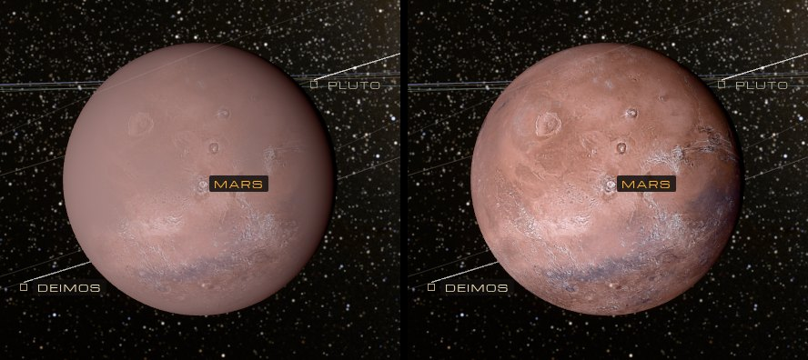
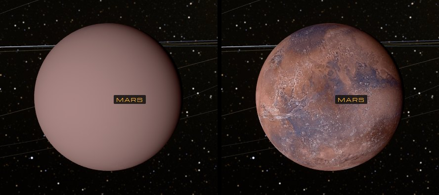
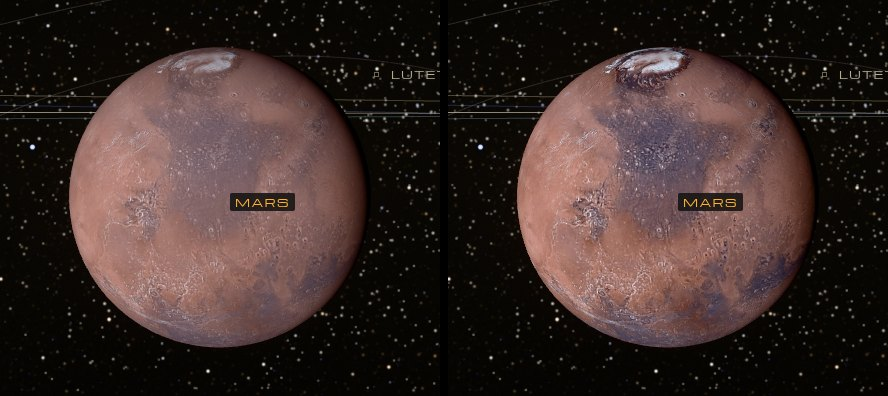

# Mars dust

Mars as the orbiters measured its dust on the sim date: each sol's map of
column dust optical depth from Montabone et al.'s climatology [1]–[3],
drawn as a haze over the Viking map. This is a record, not a live feed.
For a date outside the maps (before 3 March 1999 or after
26 December 2022) nothing is drawn, and Mars's plate says there is no
observation for that date. Code: `pipelines/marsdust.build.mjs` (the bake),
`packages/physics/src/marsTime.js` (Mars's calendar),
`src/scene/marsDust.ts` (the layer), `bodyMaterial.ts` (the haze) and
`src/app/dust-row.ts` (the plate's row).

Each still pairs the view with the haze (left) and the same view without
it (right). They were taken on the Intel iGPU through `scripts/lib/chromium.mjs`.

## The data

The Laboratoire de Météorologie Dynamique (LMD) publishes the climatology
in two forms [1]. One is gridded maps of the observations alone, with gaps
between the orbiters' tracks. The other is kriged maps, interpolated to
cover the whole planet. The scene uses the kriged maps (version 2), one per
sol on a 3° × 3° grid, for Mars years (MY) 24 to 36. They are built from
retrievals of the column dust optical depth (CDOD) made by these orbiters:

- MGS TES, nadir;
- Mars Odyssey THEMIS, nadir;
- MRO MCS, from its limb observations.

The paper checked them against the rovers' and Phoenix's measurements
[2], [3].

The value drawn is `cdodtot`, the 9.3 µm absorption optical depth of the
whole column down to the ground at each point. The scene does not use the
value normalised to 610 Pa, since a column over Hellas holds more air than
one over Olympus Mons. The LMD's note gives the visible extinction optical
depth as 2.6 times that [1], and the haze uses that factor.

MY 24's file fills Ls 0° to 105° with the average of MY 25 and 26, from
before TES began mapping; its own title says so. Those sols were not
observed that year and are left out, so the record starts at MY 24 sol
227, Ls 105.2°, on 3 March 1999.

## Mars's calendar

The sim's date is turned into Mars's season by Allison and McEwen's series
[4] (the Mars24 algorithm). Ls is the Sun's longitude seen from Mars,
counted from northern spring.

- It gives Ls 277.18759° on 6 January 2000 at 00:00 UTC, against
  Mars24's 277.18758°.
- It agrees with the Sun's direction from Mars in DE442, measured about
  the IAU pole the scene turns Mars on, to within 0.012° from 1999 to 2022
  (`marsTime.test.mjs`).

Mars years are counted from MY 1, which began on 11 April 1955 [5]. MY 24
began on 14 July 1998, MY 34 on 5 May 2017 and MY 37 on 26 December 2022.
The dust files number their years the same way: each file's calendar
year starts within 0.7 sol of the Ls 0 the series finds for that year.

The maps keep their own calendar [2, App. A]. Each file holds 669 daily
maps, and map *t* covers sols *t* to *t* + 1 after its year's start. Each
map is labelled with the Ls at its middle, worked out from a simpler orbit
than Allison and McEwen's. The years are whole numbers of sols, 668 or 669,
so a year starts up to 0.7 sol from Ls 0. A year's 669th map can be the
same sol as the next year's first; the next year's is used.

The bake places each map in time:

1. For every map of every year, it finds the instant the series reaches
   that map's Ls.
2. It fits one epoch to those instants, so that each year starts a whole
   number of sols after it.
3. It checks the result, as below.

| Check | Result |
| --- | --- |
| Every map's Ls against the series' at the map's middle | within 0.184 sol (0.12°) |
| Each year's own estimate of its start against the epoch | within 0.06 sol |
| MY 35 and 36's mean observation dates (`aveMJD`) against the maps' middles | a median 0.31 sol earlier; 95 % within 1.45 sol |

The second figure drifts by about 0.008 sol a year. That fits a calendar
year of 668.6 sols against Mars's 668.59. The last check is the files' own
record of when they were observed: a map in a gap between observations
draws on the days either side of it, so a few maps sit sols away.

## The bake

`npm run build:marsdust` reads the LMD's NetCDF files with a small reader
for classic NetCDF (`pipelines/lib/netcdf3.mjs`). It writes one file per
Mars year, `public/marsdust/my<NN>.bin`:

- one map per sol, 60 rows from the south pole up and 120 values from
  180° W eastward;
- one byte per value, 255 √(τ / 7.1), with 7.1 the largest optical depth
  in the record (MY 25, during the 2001 global storm).

The square root keeps clear days precise. The worst error is 4.7 % of the
value, or of 0.05 for clearer cells. The index, `marsdust/index.json`,
holds the grid, the encoding and each year's start, sols and version, with
the source, the licence and the changes made. All 13 years come to
61.0 MB. The app fetches only the sol shown, a 7.2 kB byte range, and keeps
the last 32 sols. While time runs it fetches the next sol ahead. While the
next sol loads, the one before or after it stays drawn, and the plate
names the sol drawn. Faster than 10 sols a second, nothing is fetched or
drawn, and the plate says so.

To rebuild, download `krigedcdod_v2.tar.gz` (591 MiB) from [1] into
`~/.cache/digital-orrery/marsdust/`, then run `npm run build:marsdust` and
`npm run data:manifest`. The download used here was 618,852,694 bytes,
SHA-256 `5f4294961f8b4c6afc74fbc1a1131e636c76a1238090ede8f5a255d89f8793ed`.

## Drawing the haze

Mars has no atmosphere shell in the scene ([atmospheres](atmospheres.md#not-yet)),
so the dust is a term in the surface shader. The haze is lit by sunlight
only ([lighting](lighting.md)). At a point where the map gives τ, with μ₀
and μ the cosines of the Sun's and the camera's angles from the local
vertical, the veil is

$$
V = 1 - \exp\!\left(-2.6\,\tau\;\frac{1/\mu_0 + 1/\mu}{2}\right),
$$

the share of light the column takes out of the direct path down and up,
with the two slant paths averaged so that the Sun overhead gives 1 − e^−2.6τ.
The cosines are kept above 0.05.

The surface's reflectance is mixed toward the dust's by V. The relief from
MOLA is flattened by the same share, since light through dust comes from
all over the sky and shows no slopes. Then the usual Lambert law
([lighting](lighting.md#surface-reflectance)) lights the mix: the haze is
lit only by the Sun, and the night side stays black. The veil is thickest
at the limb, where μ is small, and toward the terminator, where μ₀ is.

The dust's hue is the Viking map's own for the ground the dust covers.
Mars's bright regions (Tharsis, Arabia, Elysium) are bright because dust
lies on them. `python/textures/mars_dust_colour.py` takes the brightest
quarter of the map by luminance between 60° S and 60° N (leaving out the
polar caps) and averages it by area: linear (1.40, 0.90, 0.86) at unit
luminance. The haze is drawn at Mars's mean surface reflectance, 1.5 *p*
with *p* = 0.170 (NSSDCA), which is what the map itself is scaled to. So a
disc hidden by dust keeps the planet's geometric albedo. The dusty regions
are 1.68 times as bright as that, and drawn at their own brightness the
storm's disc washed out to pink in the tone curve's highlights. The haze
is in the map's grid, 3° (about 180 km at the equator) and bilinear, so it
shows a storm's extent, not its fronts.

The value drawn is the whole column to the ground, so the haze is thinner
over high ground: in June 2018 the Tharsis volcanoes stood out of the
spreading storm.

This is an upper bound on how much the dust hides the surface. Dust
scatters most of its light forward, so some of the light taken out of the
direct path still arrives close to it and keeps some of the surface's
contrast. The forward-scattering share needs the dust's phase function at
visible wavelengths, and that was not verified from a primary source, so
it is left out. The plate's source tag says it is an upper bound.

## The plate

Mars's plate has a **Dust** row (tag LMD):

- **A map drawn:** the optical depth averaged over the globe (cells
  weighted by area) and the highest cell, then the Mars year, the sol in
  the files' calendar, the Ls, and the map's version. For example: *1.1,
  optical depth, mean over the globe; up to 3.2; MY 34 sol 420, Ls
  208.6°*.
- **Outside the maps:** *No observation for this date*, with that date's
  Mars year and Ls.
- **While time runs faster than 10 sols a second:** *Not drawn*.

`src/app/dust-row.test.mjs` checks the row and how a date finds its map.

## Licence

The maps are © their authors under CC BY-SA 3.0 [1], [6]. Share-alike
covers adaptations, so the baked `marsdust` data set is CC BY-SA 3.0 as
well, not MIT. Its `index.json`, its release notes and the
[credits](../credits.md) give the authors and the changes made. The app's
code, including the bake script, stays MIT.

## Not yet

- **Forward scattering:** the haze is an upper bound (above).
- **The haze past the limb:** with no shell, the dusty limb has no glow
  beyond the disc.
- **Dust after December 2022:** the climatology stops at MY 36. A later
  version would need a new bake.
- **Storms' shapes:** MARCI's daily global mosaics show storms as
  pictures (MY 28 to MY 34). They are the next step and not in this
  layer.

## References

[1] Laboratoire de Météorologie Dynamique, "Climatologies of the Martian atmospheric dust optical depth," version 2. [Online]. Available: https://www-mars.lmd.jussieu.fr/mars/dust_climatology/. Accessed: Nov. 24, 2026.

[2] L. Montabone, F. Forget, E. Millour, R. J. Wilson, S. R. Lewis, B. Cantor, D. Kass, A. Kleinböhl, M. T. Lemmon, M. D. Smith, and M. J. Wolff, "Eight-year climatology of dust optical depth on Mars," *Icarus*, vol. 251, pp. 65–95, 2015, doi: 10.1016/j.icarus.2014.12.034.

[3] L. Montabone, A. Spiga, D. M. Kass, A. Kleinböhl, F. Forget, and E. Millour, "Martian year 34 column dust climatology from Mars Climate Sounder observations: Reconstructed maps and model simulations," *J. Geophys. Res. Planets*, vol. 125, no. 8, 2020, Art. no. e2019JE006111, doi: 10.1029/2019JE006111.

[4] M. Allison and M. McEwen, "A post-Pathfinder evaluation of areocentric solar coordinates with improved timing recipes for Mars seasonal/diurnal climate studies," *Planet. Space Sci.*, vol. 48, no. 2–3, pp. 215–235, 2000, doi: 10.1016/S0032-0633(99)00092-6.

[5] R. T. Clancy, B. J. Sandor, M. J. Wolff, P. R. Christensen, M. D. Smith, J. C. Pearl, B. J. Conrath, and R. J. Wilson, "An intercomparison of ground-based millimeter, MGS TES, and Viking atmospheric temperature measurements: Seasonal and interannual variability of temperatures and dust loading in the global Mars atmosphere," *J. Geophys. Res.*, vol. 105, no. E4, pp. 9553–9571, 2000, doi: 10.1029/1999JE001089.

[6] Creative Commons, "Attribution-ShareAlike 3.0 Unported (CC BY-SA 3.0)." [Online]. Available: https://creativecommons.org/licenses/by-sa/3.0/
