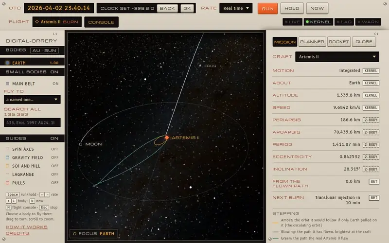
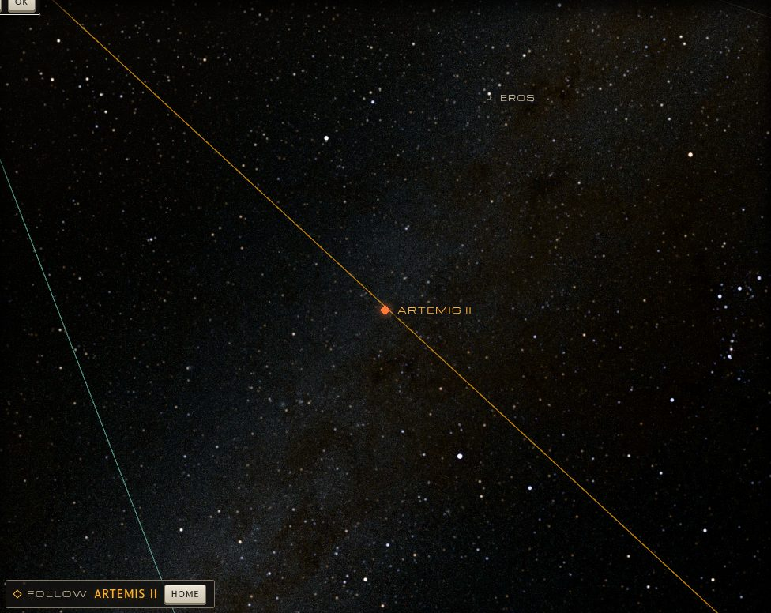
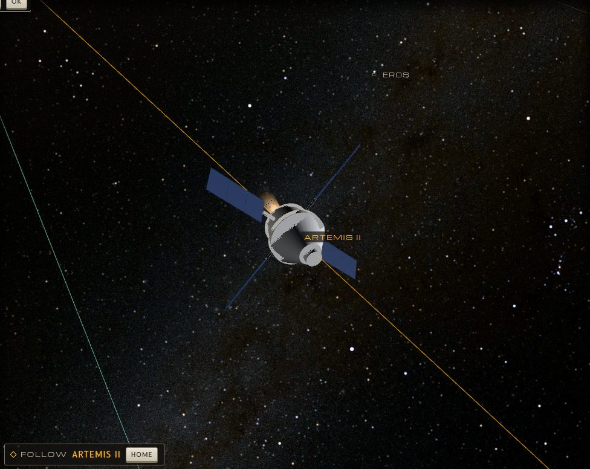
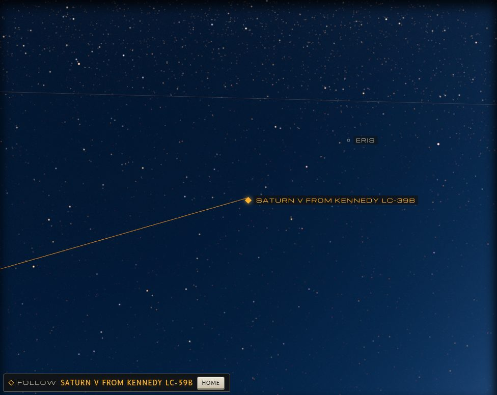
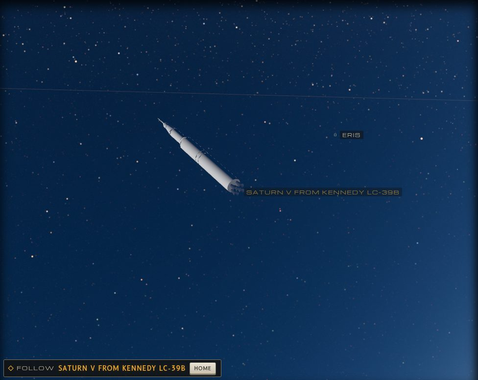
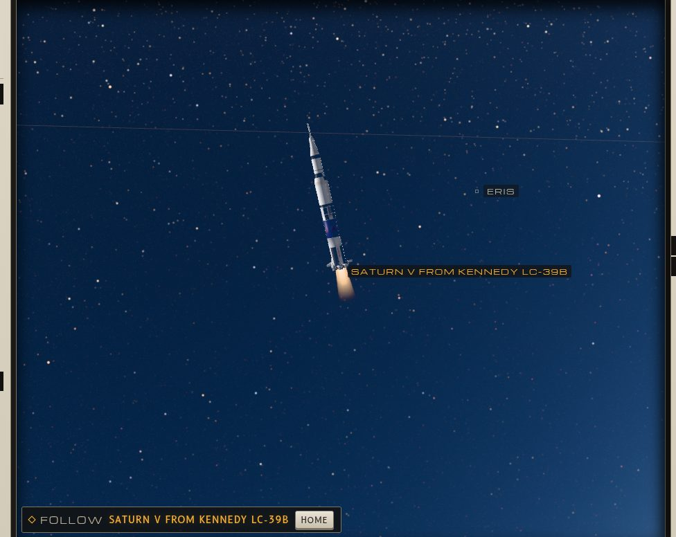
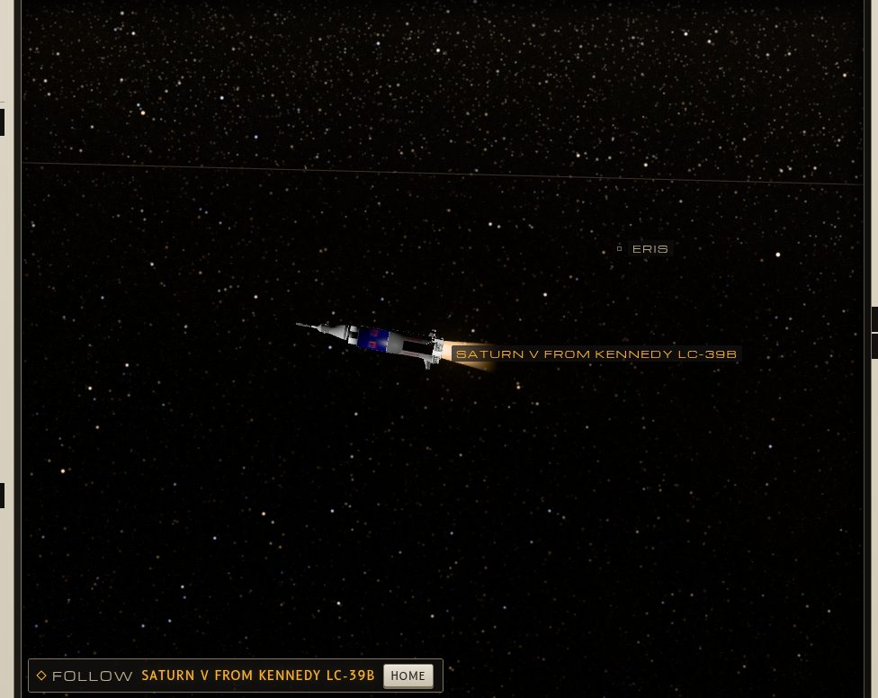
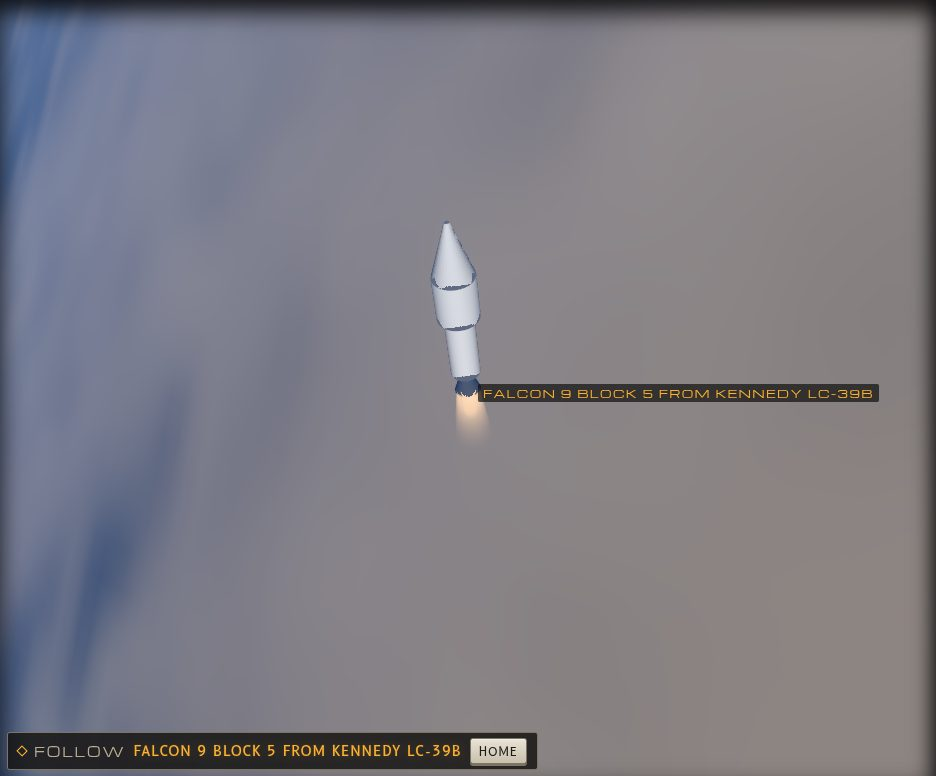
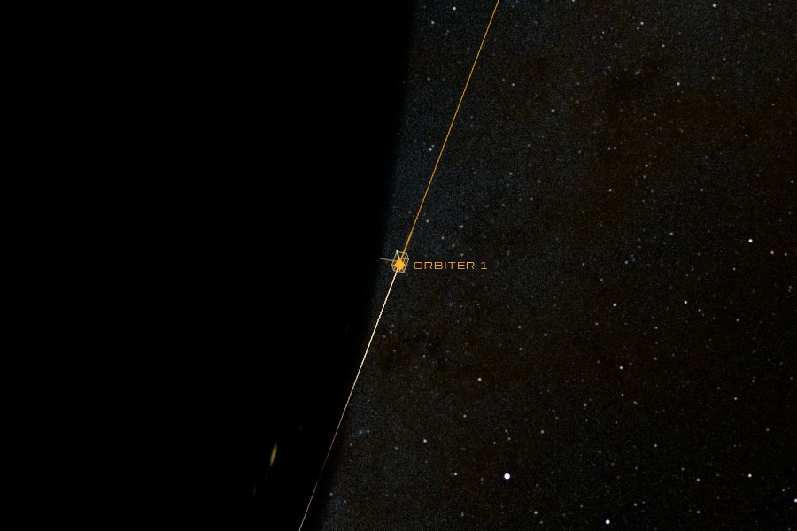

# Missions: spacecraft, launches, nodes and the planner

How the app flies spacecraft. Code: `src/physics/craft.js` (the craft model,
tested in `craft.test.mjs`), `src/physics/kernelClient.js` (the n-body
kernel in a Web Worker), `src/app/mission.ts`, `src/app/mission-panel.tsx`,
`src/app/planner-panel.tsx`, `src/app/porkchop.worker.ts`, and
`src/scene/craftLayer.ts` / `craftPaths.ts` for drawing. A craft's
attitude: `src/physics/attitude.js` and `craftAttitude.js`.

The MISSION, PLANNER and ROCKET tabs live in the flight console
(`src/app/console.tsx`), opened from the header's FLIGHT field (or M)
whatever body is in view; the header also names the selected craft and its
state, and follows it when pressed.

## The craft model

A craft's exact state is the kernel's: heliocentric J2000 equatorial km and
km/s at kernel time, stepped by the n-body kernel (Encke's method near a
planet, Cowell elsewhere; see [the kernel](../physics/nbody-kernel.md)).
Each rendered frame the mission advances every craft's clock and asks the
kernel, in its Worker, to step it to the clock; the result comes back a
frame or so later. What is drawn is that state carried forward to the clock
along a two-body orbit about the primary (plus the primary's J2, near Earth
and the Moon), with the other accelerations to second order, in pieces near a
body and with the burns between taken one by one
([drawing](../physics/nbody-kernel.md)).

The rules carried over from the earlier spacecraft code:

- **Burns are segments of absolute time.** A burn is
  $\{t_0, t_1, \hat d, F, m_0, \dot m\}$. The kernel ends its steps on
  $t_0$ and $t_1$ and applies $F/m(t)$, so a burn starts and stops at its
  own times whatever the frame rate. A request lost in flight loses
  nothing.
- **Setting the clock is a jump, not a flight.** The sim clock counts its
  `setTime` calls. When the count changes the craft keeps its state at the
  new time, results in flight are dropped, and the burn schedule is cleared,
  so a burn cut short is never flown twice.
- **Nodes check their propellant exactly first.** A node's $\Delta v$ needs
  $m_0\,(1 - e^{-\Delta v / v_e})$ of propellant. A node the tank cannot
  deliver is refused before any is spent; otherwise it burns for exactly
  that long.

The model craft has a 1,000 kg dry mass, 500 kg of propellant and a
5,000 N engine at $I_{sp}$ 320 s, which is 1,272 m/s of $\Delta v$.

**6-DOF or a point mass.** Craft launched here (the MISSION tab's Orbit and
Departure, and the ROCKET tab's launches) carry an attitude by default:
they point, turn under a torque limit and burn along their body axis
([attitude in the app](../physics/sixdof.md#attitude-in-the-app)). The
launch section's 6-DOF and POINT MASS keys choose, and a point-mass craft
can take on an attitude later (CARRY ATTITUDE). Real missions and
journeys are point masses: their burns are the real craft's or the
planner's, and their validations stay as they are.

## Launches

All launches are from Earth for now. The MISSION tab's two place a craft
straight in orbit or on a departure; the ROCKET tab's fly a rocket from a
real pad ([rocket](../physics/rocket.md#in-the-app)).

The MISSION tab's launch is armed first, as real panels guard a command
that can't be taken back ([DESIGN.md](../../DESIGN.md#what-real-panels-do)):
ARM turns into a caution-yellow ARMED key (an ink legend, unlike the dark
key of a chosen option) and says what will fly (the orbit or departure,
6-DOF or a point mass, and the time), LAUNCH fires it, and DISARM, Esc or
any change to the form stands it down. It adds one press and no waiting. REMOVE CRAFT is not guarded: it acts at
once, and the notice at the top of the tab restores the craft.

Once a craft flies, the tab is short. The craft's readout (motion,
altitude, speed, the orbit's elements, propellant and delta-v left) and
its status line stay on top. ENGINE and MANOEUVRE NODE stay open, the
controls used most; ATTITUDE, TRACKING and the LOG fold. Every section's
header says what it holds, so a folded one still reads: "Holding
prograde · 0.06°/s", "fix every 24 h · aimed", "off · 500.0 kg left",
"none planned" or "1 planned, next 14:20 UTC", and the log's count and
last line.

- **Orbit.** A circular orbit at a chosen altitude, inclined to Earth's
  J2000 equator, starting at the ascending node.
- **Departure.** The departure hyperbola from a 200 km parking orbit: its
  periapsis is on the parking orbit, its outgoing asymptote along $v_\infty$,
  in the lowest-inclination plane
  ([burns and launch](../physics/burns-and-launch.md)). $v_\infty$ is given
  as a speed along Earth's prograde, retrograde, outward or inward
  direction, or comes from the planner.
- **From the pad (ROCKET tab).** `Mission.launchAscent` takes the ascent
  as geocentric J2000 states (`rocket.js` `ascentTrack`) and the craft
  that reaches orbit, built at the start with the cutoff state. Until
  cutoff the ascent is drawn as a craft: its marker interpolated along the
  track, the climb so far as its trail, the rest of the planned ascent as
  its path, all about the Earth. It keeps the craft's id, so a camera
  following the climb follows the craft on. At cutoff the craft joins the
  kernel. The MISSION tab reads out the climb (`ascentReadout`).

## Real missions

**Real missions** on the MISSION tab flies a mission as it actually flew:
- **Artemis I** (November to December 2022), from just after translunar
  injection to just before entry: both powered lunar flybys and the
  distant retrograde orbit. Its file, `public/missions/artemis1.json`, is
  written from NASA/JSC navigation's as-flown ephemeris (through JPL
  Horizons) by `pipelines/artemis1.export.mjs`
  (`npm run export:artemis1`, after `npm run fetch:artemis1`).
- **Artemis II** (April 2026), from ten minutes before translunar
  injection to entry. Its file, `public/missions/artemis2.json`, is
  written from JSC's reconstructed trajectory by
  `pipelines/artemis2.export.mjs`.
- **Juno** (August 2012 to November 2013), from five days before its
  first deep-space burn to seven weeks after its Earth flyby. Its file,
  `public/missions/juno2013.json`, is written from JPL's navigation
  reconstruction (through JPL Horizons) by `pipelines/missions.build.mjs`
  (`npm run build:missions -- juno2013`), which builds every real mission
  beyond Artemis from its facts in `validation/missions.data.mjs`
  ([Juno 2012–13](../validation/juno2013.md)).
- **DART** (August to September 2022), its last five weeks to the impact
  on Dimorphos, ending on the final solution at the published impact
  point. Its file, `public/missions/dart.json`, is built the same way
  ([DART](../validation/dart.md)).
- **LRO** (June 2009), from the day after launch through lunar orbit
  insertion to its 30 by 216 km commissioning orbit. Its file,
  `public/missions/lro.json`, is built the same way
  ([LRO](../validation/lro.md)). It flies with a tracking fix every 6 h
  by default (`fixHours` in the file) rather than aimed burns: aimed a day
  ahead across twelve lunar orbits, the aims find costly phasing answers.
  Its four burns after insertion, which the reconstruction's samples can't
  resolve, are each one steady push fitted to the samples either side.
- **MESSENGER** (2004 to 2011), from two days after launch through six
  flybys to half a day into Mercury orbit. Its file,
  `public/missions/messenger.json`, is built the same way
  ([MESSENGER](../validation/messenger.md)). It flies with a tracking fix
  every 24 h by default: the app's one sunlight strength can't follow
  MESSENGER's solar sailing, and aims across Mercury's flybys can't make
  up for the field beyond J2 that the app leaves out. A burn in parts
  (DSM-2's main-engine burn and its trim half an hour later) is two burns
  in the file.

The app reads them all with `src/physics/realMission.js`. A file's states
are about its `centre` (the Earth, or the Sun for Juno), and it may carry
its own craft (`craftModel`: mass, sunlit area, Cr and the engine's Isp);
without one the craft is Orion. Its flown path is drawn about the same
centre. A burn about the Sun (`frame: 'eqj'`) is flown along its 10 s
intervals' measured J2000 directions: the orbital frame there barely turns
in a burn, and a burn steered in it is flown in quarter-second steps. A
file with `aimInEnvironment` has its aimed burns flown in the craft's own
environment, since over seven months sunlight moves Juno 6,000 km, and
solved for as the push they are flown as, spread over the burn: DART's
terminal guidance ends two minutes before the impact, where an impulse at
its start would miss by 0.6 km. A file with flybys aims at a flyby's
perigee rather than across it.

- **Fly it:** sets the clock to the mission's start (BACK undoes it). For
  Artemis II that's 2 April 2026, 23:39:59 UTC, ten minutes before
  translunar injection. The craft starts from its flown state.
- **Burns:** scripted as flown, each steered in the orbital frame about
  the body whose sphere of influence holds it (the Moon for Artemis I's
  flybys and the burns near them; the Earth otherwise). Each 5 seconds of
  a burn sampled that finely is a finite burn with its measured direction
  and acceleration. Artemis I's twelve small burns, which its data
  resolves only by the minute, are each one steady push over NASA's
  duration, along the change the trajectory shows. Scripted burns draw nothing from the model
  tank and survive clock jumps; they're tied to the mission's times.
  Choose **The first; correct it yourself** to fly only the injection burn
  and make the corrections with manoeuvre nodes.
- **From the flown path:** how far the craft is from where the real one was
  at this time, interpolated from the flown trajectory.
- **Next burn:** its name, when it starts, and in its detail the Δv as
  flown with what NASA published.
- **Green line:** the flown path, drawn relative to Earth.
- **Tracking:** a fix every 24, 12, 6 or 3 hours resets the craft to the
  flown state, as a navigation team's tracking would.
- **Corrections:** with **Aimed from the craft** (the default), each
  correction after the injection burn is worked out when the craft reaches
  it, from where this craft is, as NASA's were from where Orion was. The
  kernel holds at the burn's start (`Craft.holdAt`); there
  `RealMission.aimCorrection` flies the craft from its own state to the
  start of the next burn (or the end of the data), through the kernel with
  the scripted burns between, and finds by Newton's method the velocity
  change that brings it to the flown position there, within 10 m. Each
  round takes three more runs, nudged 1 cm/s each. Flying the burns in
  these runs matters: Artemis I's outbound powered flyby, aimed from a
  coast that left out its 180 m/s, took the sensitivities of another path
  and added 104 m/s instead of 9. The correction is added to the burn as
  flown, spread over it. The aim runs in the kernel's Worker
  (`KernelClient.aim`, `kernelHost.aimTo`), so the page never waits: the
  craft holds at the burn until the answer comes back, 2 to 200 ms later
  (longest for the powered flybys). In Node (the validations) the same
  `aimTo` runs at once; flown through the client a frame later, Artemis II
  comes out 0.4 m from that at entry. A correction followed within 12 hours by
  another (the first outbound trim) is flown as it was, and the later one
  aims for both. **As flown, blind** replays every correction exactly as
  Orion flew it, whatever the craft's state; the lunar flyby magnifies the
  difference, so without fixes that ends some 16,000 km off at entry.
  Aimed, with no fixes, Artemis II stays within 67 km of the flown path
  for the whole mission and reaches entry 0.3 km from it, for 4.0 m/s more
  than the flown corrections (`artemis2.validate.mjs`, part 6). Artemis I,
  over 25 days with two powered flybys and the distant retrograde orbit,
  stays within 238 km and ends 0.9 km off, for 31.8 m/s more than its 18
  burns; blind, it passes the Moon at 424 km instead of 130 and ends
  712,000 km off (`artemis1.validate.mjs`, case 5).
- **Setting the clock inside the mission** puts the craft where the real one
  was.
- **Entry.** At the mission's separation time (Artemis I 17:00 UTC on 11
  December 2022, Artemis II 23:33 UTC on 10 April 2026) the craft becomes
  Orion's crew module and flies its entry: lift banked by a guidance law to
  the splashdown point, then drogues and mains to the sea
  ([entry](../physics/entry.md)). The readout adds the bank and the
  parachutes; a capsule down under its chutes reads Splashdown, which is
  not a warning. The header's FLIGHT field then reads DOWN, in the
  advisory green; LOST, in red with the WARN light, is kept for a craft
  that crashed. One rule decides both (`src/app/craft-state.js`, tested
  in `craft-state.test.mjs`). Setting the clock back before separation makes it the
  whole spacecraft again.
- **Artemis II · our own plan** flies the simulator's own design of the
  mission instead. It's planned from the pre-TLI orbit and NASA's published
  targets only ([our own plan](../validation/artemis2.md#6-our-own-plan)),
  beside the real path, so "From the flown path" compares ours with
  theirs. Its file takes the flown path from `artemis2.json`
  (`flownFrom`).

What the craft does is checked against the real flight in
[the Artemis II validation](../validation/artemis2.md): the mission file,
flown frame by frame by the craft model, is within 0.4 km of the
validation's replay at the flyby.

The flown path is stored to the source's precision (1 mm, 1 nm/s) and
interpolated by cubic Hermite, except across gaps under a second (the
first two samples are 0.26 s apart), where the velocity is taken straight
between the samples' own: the cubic's velocity divides the positions'
rounding by the gap, and with positions to the metre that put 0.2 m/s into
a craft placed on the path just after the start (FLY IT with the clock
running), which the injection burn grew to 180 km by the next day.

The kernel learned two things for this:
- **Steered burns:** a burn can be steered in the orbital frame about a
  body (`frame: 'vnb'`). The integrator passes the craft's velocity to the
  thrust (in Encke too). Steps inside such a burn were capped at 0.25 s
  while the kernel's Cowell steps were symplectic. The error-controlled
  steps follow the turn on their own: one step to each 5-second interval
  ends the injection burn within millimetres of 0.01 s steps
  ([Artemis II check](../validation/artemis2.md#3-the-whole-mission-with-orions-burns)).
- **Tracking fixes:** `Craft.setState` takes a fix.

## Manoeuvre nodes and the engine

A node is a time and a $\Delta v$ in the primary-relative frame at that
time:

- **radial**, outward, completing a right-handed set;
- **prograde**, along the velocity relative to the primary;
- **normal**, along $\mathbf r \times \mathbf v$.

On a point mass, the engine keys burn prograde or retrograde (relative to
the primary) until cut or dry. On a 6-DOF craft there is one key, FIRE,
which burns along the body axis wherever it points; a node burns along
the body axis too. AUTO NODE TURN (on by default) turns the craft to each
node by itself, early enough to settle before it fires, and back after;
with it off, point the craft first (the NODE mode points it along the next
node's burn).

## Attitude

A 6-DOF craft's ATTITUDE section, folded above the engine:

- **Mode keys,** one radio group laid out as three opposed pairs,
  PROGRADE and RETROGRADE, NORMAL and ANTI-NORMAL, RADIAL OUT and RADIAL
  IN, then a row of the modes that aren't a direction: NODE, HOLD (the
  attitude it has now, fixed among the stars) and FREE (thrusters off). A
  new craft holds prograde. The section is folded; its header says the
  pointing and the turn rate.
- **Pointing:** "Holding prograde" once settled, or "Turning to prograde:
  42.1° to go" while turning. **Turn left:** the controller's own time for
  the turn still to go, from rest. **Turning:** the body rate.
  **Disturbance:** the gravity gradient and air torques on it, in N m.
  **Thruster fuel:** the propellant the attitude thrusters have taken
  from the engine's tank, in grams (kilograms past one). **Inertia:** the
  moments of inertia in pitch and roll now, falling as the tank empties.
  **Node turn,** while the craft waits for or is turned for a node: when
  the turn starts, how far and for how long ("Starts in 18 min, 90° in
  34 s"), or "Turned for the node". Each has its source tag (6-DOF), with
  the equations in its detail.
- **AUTO NODE TURN,** a toggle key (`aria-pressed`), on by default: the
  craft turns to each manoeuvre node by itself, 1.1 times the
  controller's time for the turn plus 5 s before it, then goes back to the
  mode it had. A node too close to settle for is noted in the log
  ([turning for a node](../physics/sixdof.md#turning-for-a-node)).

Turns take real time: a 90° turn takes 34 s at 40 N m on 1,625 kg m²
(1.41°/s²) with a 3°/s limit, against 32 s for full torque, coast and full
torque back; it costs 60 g of the thrusters' propellant. Empty, the craft
turns the same 90° in 33 s. At a day a second a turn is over within a
frame.

**In the scene.** Within 50,000 km of the camera a 6-DOF craft's marker
gets an attitude indicator (`craftLayer.ts`):
- its body drawn as a small wireframe box;
- its thrust axis in amber, its other two axes short in pale phosphor;
- an axis pointing away from the camera fainter;
- the reference it is turning to as a dashed amber stalk;
- a short orange plume aft while it burns.

It is projected from 3D at a fixed screen size, so it foreshortens as the
craft turns. It is an SVG overlay on the marker rather than lines in the
scene, so it keeps that size at any distance. A craft's marker is shown
by its depth in front of the camera, not its projected depth: followed
from under a kilometre, the marker used to vanish behind the near plane.

## Close-up models

Far off, a craft is its marker. Once the craft spans 3 pixels, it is
drawn as a model at its true size, as the ISS, Tiangong and Hubble are
([satellites](satellites.md#close-up-models)), and its marker's glyph
gives way. Orion, the Saturn V and the real missions' probes are NASA's
own models, the rest are built in code at their published sizes. The attitude indicator keeps its axes and the dashed stalk,
but drops its wireframe box and plume, which the model now shows
([`craftModels.ts`](../../src/scene/craftModels.ts), the stacks'
shapes in [`stackShape.js`](../../src/physics/stackShape.js)). The
MISSION tab's CLOSE UP section says what is modelled and what is not.

| Craft | Model | Its sizes |
| --- | --- | --- |
| Orion (Artemis I and II, and our own Artemis II plan) | NASA/JPL-Caltech's Artemis II model from NASA's Eyes on the Solar System [11]: the crew module, the European Service Module and its four wings, textured as flown; after separation the crew module alone, heat shield first | the model's own, in metres: the crew module 5.08 m across and 3.36 m high, as NASA gives it (5 m and 3.35 m [2]); the wings about 20.9 m tip to tip, where NASA gives 18.9 m [2]. The stand-in, while the model loads: the crew module and service module at NASA's sizes (4.79 m with the adapter, 7.9 m for the two [2]), each wing three 2 by 2 m panels, nearly 7 m long [3], [4], the ESM's main body about 2 m [4]; its body's width (4.1 m), the backshell and the bell taken to fit |
| Juno, DART, LRO and MESSENGER (the real missions) | NASA's own models, from NASA 3D Resources and NASA's Eyes; DART releases LICIACube, a 6U CubeSat built in code | as published, or the model's own ([spacecraft](spacecraft.md#close-up-models)) |
| The MISSION tab's craft | a 2 by 2 by 3 m box in gold foil, long along the thrust axis, with an engine bell aft | the box its attitude is sized for ([attitude](#attitude)) |
| Saturn V (ROCKET tab) | NASA's model from NASA 3D Resources [12], cut at the stages' joints below; while it loads, the S-IC, S-II and S-IVB, the instrument unit, the spacecraft-LM adapter, the service module, the command module and the escape tower as cylinders and cones | the model is stretched to the whole's 363 ft and the S-IC's 33 ft (it is 7 % longer for its width than the real one). The joints and the stand-in: the S-IC 138 by 33 ft, the S-IVB 58.4 ft by 21 ft 8 in, the adapter 28 ft tapering from 22 ft to 12 ft 10 in [5]; the S-II 24.8 m long [6] and 33 ft across; the instrument unit 3.0 by 21.7 ft [7]; the whole 363 ft [8]. The 16.5 m the total leaves above the adapter is split here between the service module, the command module and the tower |
| Falcon 9 (both presets) | two stages and the standard fairing, built in code: the first stage's nine bells, four stowed legs and four grid fins, the black interstage | 70 m with both stages, the interstage and the fairing, 3.66 m across; the fairing 5.2 m across and 13.2 m high [9]. SpaceX gives no stage lengths: the 56.8 m below the fairing is split by the stages' propellant volumes (45.0 and 11.8 m) |
| Electron | two stages, the kick stage and the fairing, in black carbon composite | 18 m long and 1.2 m across, the fairing 1.2 by 2.5 m, the kick stage 405 mm [10]; the stages split as Falcon 9's (12.5 and 2.6 m) |
| Your own stack, or a changed preset | its stages and a fairing | worked out: each stage's tanks hold its propellant at its class's density (`craftAttitude.js` `STAGE_DENSITY`) in the stack's diameter, plus a diameter for domes and engine; the fairing 1.5 diameters long |

Every engine's bells, Falcon 9's legs and grid fins are drawn to fit,
and the plate says so; the fairings' seams and the pad's tower are left
out. Neither SpaceX nor Rocket Lab publishes a free model.

**The real models** ([`craftAssets.ts`](../../src/scene/craftAssets.ts))
load the first time their craft is close enough to draw, never before:
Orion's is 112,000 triangles, Draco-compressed, with 30 KTX2 textures (24
MB in all, through the same transcoder as the planets' maps); the Saturn
V's is 35,000 triangles in 0.9 MB. Until one has loaded, or if it cannot
(a browser without the KTX2 formats), the model built in code stands in.
The Saturn V is cut where the stages join: each triangle goes with the
stage its centre lies in, so each stage still falls away when it
separates. Their materials are three.js's physically based ones, lit by
the Sun and the Earthshine as two directional lights (π times the built
models' irradiance, three's Lambertian term being the albedo over π).
With nothing round them to reflect, their metal is turned down to a
quarter, and glass is off: it would render the scene a second time.
Orion's wings stay as modelled; they do not turn to the Sun. The real missions'
other craft (Juno, DART, LRO, MESSENGER) have no model and stay markers,
as the spacecraft beyond Earth do; their plates say so.

**Attitude.** A craft carrying an attitude is turned by it, nose along
the thrust axis. Orion as the app flies a real mission carries none: it
is drawn nose along its velocity about its primary, and along the burn
while a scripted burn fires; a point-mass craft along its velocity. Each
of Orion's wings turns about its own length to face the Sun as nearly as
one axis can (the real ones gimbal on two), so a wing whose length points
near the Sun is seen edge on.

**On the pad and climbing.** The ascent is flown over a sphere of the
equatorial radius (`rocket.js`), about 5 km above the ground at Kennedy.
The stack is drawn lowered to the ground at the pad, on the WGS-84
ellipsoid, and the offset falls to nothing by engine cutoff, where the
kernel takes the state as flown (about 10 m/s, unseen). Before liftoff it
turns with the Earth, fixed where the ascent starts. Climbing, its nose
is along its velocity through the air (the Earth's turning taken off),
straight up on the pad, as the ascent flies it. At each separation the
spent stage drops off the stack and is drawn falling away for a minute:
it coasts on from where it separated on a two-body arc about the Earth,
turned as it was, while the rest of the stack burns on. Once in orbit,
the craft is drawn as what is left: the stage burning at cutoff and the
payload.

**The plume.** While its engine burns a model has a plume aft: two soft
additive cones, three diameters long, at a fixed radiance. It shows what
is firing, not how bright an exhaust is or how it spreads in thin air.

**Light.** As the satellites' models: Lambertian by the Sun at its
distance from the Sun, dimmed by the share of its disc the bodies leave
(`OrreryScene.sunlightAt`, their penumbral cones), and filled by the
Earthshine on faces turned to the Earth. Within 100 km of the ground,
where the cones (taken at the equatorial radius) do not hold, the Sun is
hidden as it sets below the horizon, across its disc.

| | |
| --- | --- |
|  |  |
|  |  |
|  |  |
|  | |

## The readout

| Value | Tag | What it is |
| --- | --- | --- |
| About, altitude, speed | kernel | n-body state relative to the primary, at the clock |
| Periapsis, apoapsis, period, eccentricity, inclination, excess speed | 2-body (dashed) | osculating elements about the primary: what the orbit would be if every other force stopped now |
| Propellant | model | the model craft's tank |
| Δv left | rocket eq. (dashed) | $v_e \ln(m / m_\text{dry})$ |
| Closest to the destination | kernel (dashed) | the smallest distance so far to the planned destination's system barycentre |

Inclinations are to the J2000 equator about a planet and to the ecliptic
about the Sun. Heights about the Earth (altitude, periapsis, apoapsis, and
the altitude asked for in LAUNCH) are above its equatorial radius,
6,378.137 km (WGS-84), as in the ROCKET tab and as orbit altitudes are
usually given; about every other body, above its mean radius. The ground
is lower than that sphere away from the equator (6,356.8 km at the poles),
so a craft about to come down away from the equator reads below zero, by
up to 21 km at the poles.

After an impact the readout gives when and where the craft came down
(latitude and longitude in the body's own frame) instead of an orbit. The
craft stays at that spot, carried with the body and turned with its spin:
left where it was in space, it would fall behind the Earth at its orbital
speed, millions of kilometres in a few days.

In the sky:
- **Marker:** a turned square, orange while the engine burns, struck
  through after an impact.
- **Amber line:** the osculating conic, sampled analytically (ellipses in
  eccentric anomaly; hyperbolas in hyperbolic anomaly out to the sphere of
  influence or 30 periapsis radii).
- **Pale line:** the path actually flown, kept relative to the primary.

Both lines run through the craft from any distance. Far off, they are
drawn as above, relative to the primary. Closer than a tenth of the
craft's distance from its primary, three things would put them off the
craft:
- **Chords.** The conic's 256 even steps in anomaly leave chords that
  bow up to 7.5 × 10⁻⁵ of that distance off the orbit: 510 m on a 400 km
  orbit, which showed 100 px beside the craft from 10 km.
- **The trail's end.** The flown path keeps a point every 0.5 % of that
  distance, so it stopped up to 34 km behind the craft.
- **float32.** Points relative to the primary are good to about a metre
  on the GPU.

So within that range both are drawn every frame relative to the craft,
from its state (`conicAround` in `src/scene/craftPaths.ts`). The conic
has the craft as a vertex, and its steps in anomaly grow as the cube of
the step count, from 24 m at the craft (in low orbit) to a tenth of a
radian on the far side. Seen from 50 m off the craft, no chord bows more
than 6 × 10⁻⁴ rad, under a pixel (checked on a low orbit, an eccentric
ellipse and a hyperbola). The trail's last stretch runs from its last
kept point to the craft along the same conic. Coasting, that is the path
flown; burning, it differs by the burn since that point, a few metres.
The camera's near plane follows it in ([Camera](camera.md#close-to-a-craft)).

The header's KERNEL lamp is lit while a craft is being stepped. LAG lights
caution yellow if a craft falls more than a minute behind the clock: the
kernel catches up rather than taking unsafe steps.

## The planner

For a destination and a departure span, the planner solves the
zero-revolution prograde Lambert arc for every (departure date, time of
flight) cell on astronomy-engine states ([Lambert's problem](../physics/lambert.md),
[porkchop](../physics/burns-and-launch.md)), in a Web Worker: about 9,000
cells in under 0.1 s. The grid is shaded by departure $C_3$, amber where it
is low, from the minimum to eight times it on a log scale. Clicking a cell
reads out:
- the departure and arrival dates;
- $C_3$ and the arrival $v_\infty$;
- the total $\Delta v$ from a 200 km parking orbit into a 400 km capture
  orbit.

"Fly this" sets the clock to the departure (a jump) and launches onto the
departure hyperbola whose $v_\infty$ is that cell's Lambert $v_\infty$. The
mission then tracks the closest approach to the destination. With no
correction burns the n-body flight misses the two-body plan (the 2026
window passes Mars at about 470,000 km, `craft.test.mjs`); targeting is
next on the physics roadmap.

## NASA's Trajectory Browser

Under the porkchop, the PLANNER tab shows what NASA Ames's
[Trajectory Browser](https://trajbrowser.arc.nasa.gov) [1] lists for the chosen
planet, rendezvous or flyby:
- **NASA's optima:** the lowest eight per-opportunity optima from 2026 to
  2040, with their route, so gravity assists such as EVM show.
- **Ours:** for each direct one, our own transfer between NASA's two dates
  (`transfer()` in `src/physics/trajsearch.js`, up to two revolutions round
  the Sun), under NASA's conventions, with the difference in percent. The
  same dates mean any difference is the modelling alone; its tooltip gives
  our C3 and the revolutions.

A row can be shown on the grid (a 120-day span around its launch) or flown:
- **Flying a row** flies our cheapest Lambert arc between NASA's dates
  (multi-revolution where that is cheaper). Flying a grid cell keeps the
  grid's direct arc.
- **"Open on NASA's site"** posts the same search to the browser in a new
  tab.

How the data gets in:
- **The browser can't be queried from a page.** It answers only form posts
  and sends no cross-origin headers.
- **So it's fetched ahead of time.** `npm run fetch:trajbrowser`
  (`pipelines/trajbrowser.fetch.mjs`) fetches its results once and writes
  `public/trajbrowser/planets.json`. It's paced 15 s apart and cached in
  `~/.cache/digital-orrery/trajbrowser`, so reruns don't repeat finished
  queries.
- **Per-planet limits matter.** The browser takes launch years 2010–2040
  and Δv up to 20 km/s. Each planet's search uses its own flight-time and
  Δv limits, because the browser's one-per-year optima depend on both.

## Links

| Parameter | Effect |
| --- | --- |
| `?craft=orbit,400,51.6` | starts with a craft in that orbit (km, °), followed |
| `?craft=departure,2.95,prograde` | starts on that departure |
| `?craft=orbit,400,51.6,point` | the same, as a point mass (without the fourth field, 6-DOF) |
| `?plan=mars` | opens the planner and computes the grid |
| `?mission=artemis2` | flies Artemis II from its start (`artemis2,first` flies only the injection burn) |
| `?mission=artemis2&t=2026-04-06T22:50:00Z&fix=12` | starts just before the lunar flyby, with a tracking fix every 12 h |
| `?mission=juno2013` | flies Juno from 25 August 2012, through its deep-space burns and the Earth flyby |
| `?mission=juno2013&t=2013-10-09T13:00:00Z` | starts six hours before Juno's Earth flyby |
| `?mission=dart&t=2022-09-26T22:00:00Z` | starts DART 74 minutes before its impact on Dimorphos, with SMART Nav steering |
| `?mission=lro&t=2009-06-23T09:30:00Z` | starts LRO 17 minutes before its lunar orbit insertion |
| `?mission=messenger&t=2008-01-14T18:00:00Z` | starts MESSENGER an hour before its first Mercury flyby |
| `?mission=messenger&t=2011-03-18T00:30:00Z` | starts MESSENGER 15 minutes before its Mercury orbit insertion |

## References

[1] NASA Ames Research Center, Mission Design Division, "Trajectory Browser." [Online]. Available: https://trajbrowser.arc.nasa.gov/

[2] NASA, "Orion by the numbers," Jan. 2026. [Online]. Available: https://www.nasa.gov/wp-content/uploads/2026/01/orion-by-the-numbers-2026b.pdf

[3] NASA, "European Service Module," Orion reference, updated Sep. 2026. [Online]. Available: https://www.nasa.gov/reference/european-service-module/

[4] European Space Agency, "European Service Module." [Online]. Available: https://www.esa.int/Science_Exploration/Human_and_Robotic_Exploration/Orion/European_Service_Module

[5] NASA, Saturn V/Apollo press kit, Washington, DC, USA, 1967, NTRS 19670031260. [Online]. Available: https://ntrs.nasa.gov/citations/19670031260

[6] R. E. Bilstein, *Stages to Saturn: A Technological History of the Apollo/Saturn Launch Vehicles*, NASA SP-4206. Washington, DC, USA: NASA, 1980, ch. 7. [Online]. Available: https://history.nasa.gov/SP-4206/ch7.htm

[7] NASA Marshall Space Flight Center, "Saturn V flight manual, SA-503," MSFC-MAN-503, Nov. 1968. [Online]. Available: https://history.nasa.gov/afj/ap08fj/pdf/sa503-flightmanual.pdf

[8] Smithsonian National Air and Space Museum, "Rocket, liquid fuel, launch vehicle, Saturn V," inv. A19790128000. [Online]. Available: https://airandspace.si.edu/collection-objects/rocket-liquid-fuel-launch-vehicle-saturn-v/nasm_A19790128000

[9] Space Exploration Technologies Corp., *Falcon User's Guide*, May 2025, sec. 2. [Online]. Available: https://www.spacex.com/assets/media/falcon-users-guide-2025-05-09.pdf

[10] Rocket Lab, *Launch: Payload User's Guide*, v7.0, pp. 12, 17. [Online]. Available: https://rocketlabusa.com/assets/Electron-Payload-User-Guide-7.0-v6.pdf

[11] NASA/JPL-Caltech, "Artemis II" 3D model, *NASA's Eyes on the Solar System*, Oct. 2026, under the JPL Image Use Policy. [Online]. Available: https://eyes.nasa.gov/assets/static/models/sc_artemis/artemis_ii.gltf

[12] NASA/M. D. Carbajal, "Saturn V" 3D model, *NASA 3D Resources*, Apr. 2025. [Online]. Available: https://science.nasa.gov/3d-resources/saturn-v/
