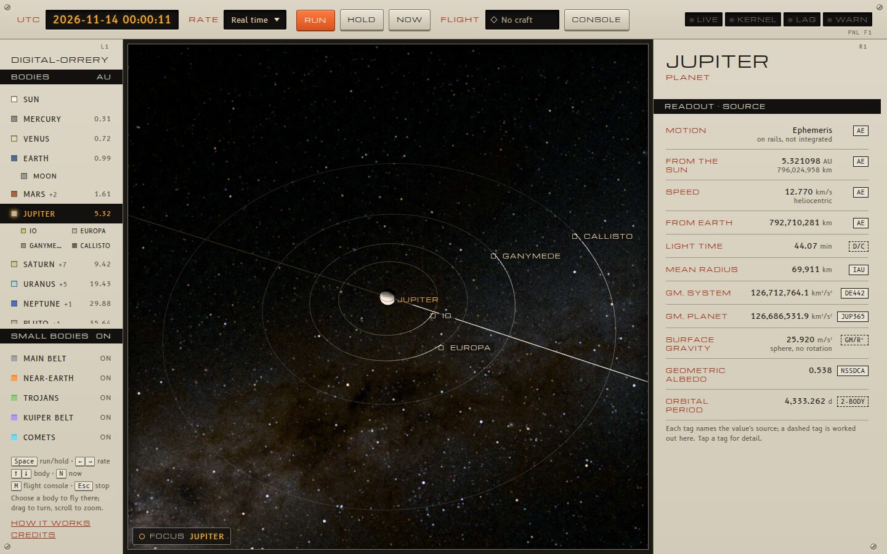
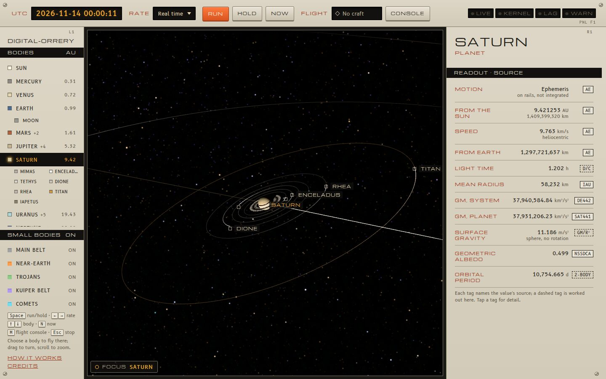

# The planets' major moons

Twenty moons besides our own are drawn as real bodies, at their real radii
and true positions about their planets:

| Planet | Moons |
| --- | --- |
| Mars | Phobos, Deimos |
| Jupiter | Io, Europa, Ganymede, Callisto |
| Saturn | Mimas, Enceladus, Tethys, Dione, Rhea, Titan, Iapetus |
| Uranus | Miranda, Ariel, Umbriel, Titania, Oberon |
| Neptune | Triton |
| Pluto | Charon |

Each has a marker and label like the planets', an orbit line about its
planet, and a place in the body rail under its planet. Choosing one flies the
camera there (the same `focusOn` and [camera](camera.md) path as a planet).
Near its planet each also pulls on spacecraft with its own GM: the kernel
splits the planet's system into the planet and its moons there
([kernel](../physics/nbody-kernel.md#moons)), from the same positions.
That is checked on Juno's 2021 flyby of Ganymede
([validation](../validation.md#the-moons-pull-junos-ganymede-flyby-flybytestmjs)).





Code: `src/physics/moons.js` (positions), `src/physics/moons.data.js` (the
data, written by `src/physics/moons.fetch.mjs`), `src/physics/moons.test.mjs`
(the checks), and the scene's `systemStates` in `src/scene/OrreryScene.ts`;
for the kernel, `src/physics/bodies.js` and `src/physics/flyby.test.mjs`.

## Positions

### Io, Europa, Ganymede and Callisto

astronomy-engine's `JupiterMoons`: Lieske's E5 theory of the Galilean
satellites as truncated in L1.2, giving jovicentric J2000 equatorial states.

### The others: JPL's mean elements

From JPL's [planetary satellite mean elements](https://ssd.jpl.nasa.gov/sats/elem/)
(fetched 14 November 2026). Each row is a precessing ellipse fitted by JPL to
the moon's numerically integrated orbit: $a$, $e$, $i$, the argument of
periapsis $\omega$, the mean anomaly $M$ and the node $\Omega$ at the epoch
2000-01-01.5 TDB, the period $P$ and the precession periods of $\omega$ and
$\Omega$. Mars's and Saturn's moons are referred to each moon's own Laplace
plane, given by its pole (right ascension and declination in the ICRF); the
Laplace plane is the plane about which the moon's orbit pole precesses.
Uranus's, Neptune's and Pluto's are referred to the planet's equator.

At $t$ days TDB after the epoch:

$$
M = M_0 + \frac{360°\,t}{P} + \delta M + \delta n\,t,\qquad
\omega = \omega_0 + \delta\omega + \frac{360°\,t}{P_\omega},\qquad
\Omega = \Omega_0 + \delta\Omega \mp \frac{360°\,t}{P_\Omega},
$$

the node regressing ($-$) for a prograde orbit and advancing for Triton's
retrograde one. Kepler's equation gives the position in the orbit plane,
which is turned by $R_z(\Omega)\,R_x(i)\,R_z(\omega)$ into the reference
plane. The reference plane's axes in the ICRF are its ascending node on the
ICRF equator, $\hat N = (-\sin\alpha_p, \cos\alpha_p, 0)$, its pole
$\hat P$ from $(\alpha_p, \delta_p)$, and $\hat P \times \hat N$; $\Omega$
is measured from $\hat N$, as JPL defines it.

The planet's equator for Uranus is taken about the pole its moons orbit
(right-handed), which is the opposite of the IAU's "north" pole for Uranus:
with the IAU pole every Uranian moon ran backwards.

Velocities, which the data plate shows, are a central difference of the
position over 10 seconds. The Galilean moons' are differenced too:
`JupiterMoons`'s own velocities differ from its positions' rate by up to
3 m/s, too much for the kernel's interpolation
([kernel](../physics/nbody-kernel.md#body-positions-between-ephemeris-calls)).

### The fitted corrections

The table's own warning says its mean elements are not meant for ephemeris
work, and as given they do not hold a moon's place:

- the periods are rounded, Phobos's to four digits (0.3187 d), which loses
  80° of Phobos's orbit every five years;
- $P$ is the period of the mean longitude in some planets' rows (Mars,
  Saturn) and of the mean anomaly in others (Jupiter);
- Saturn's and Uranus's epoch angles disagree with Horizons at the epoch
  itself, by up to 160°.

So each element moon carries four corrections, $\delta M$, $\delta n$,
$\delta\omega$ and $\delta\Omega$ (the `fit` in `moons.data.js`), fitted to
JPL Horizons planetocentric ICRF vectors: first $\delta M$ and $\delta n$ from
the along-track angle on six-hourly samples over two months of 2010 (which
cannot alias for a rate error under 720° a day), then all four by
damped Gauss-Newton on weekly samples from 2000 to 2050. $a$, $e$, $i$, the
reference planes and the precession periods stay JPL's. The fit's residual
over the fifty years is in `moons.data.js` (`rmsKm`, `maxKm`).

Mimas is left about 70,000 km out (rms; about 22° of its orbit) because it
librates by 44° over 71 years in its resonance with Tethys, which no
precessing ellipse can follow.

## Planets drawn at their centres

astronomy-engine places Mars to Pluto at their system barycentres, which is
what the kernel pulls toward far from them. With moons drawn, the scene puts
each planet at its own centre instead (and so does the kernel near it),

$$
\mathbf r_\text{planet} = \mathbf r_\text{bary} - \sum_i \frac{GM_i}{GM_\text{system}}\,\mathbf r_i,
$$

over the moons here ($\mathbf r_i$ planetocentric), and each moon at
$\mathbf r_\text{planet} + \mathbf r_i$. The offset is 2,130 km for Pluto
(Charon holds 11 % of the system's mass), so Pluto visibly swings about a
point outside itself; it is up to 310 km for Saturn, 210 km for Jupiter
and 74 km for Neptune. The data plate's orbital period for a planet still
uses the barycentre's state and the system GM.

## How right they are

`npm test` runs `moons.test.mjs` against Horizons vectors that were not used
in the fit (`src/physics/fixtures/moons_horizons.json`): daily over November
2026, and on 1 January of each year 2000 to 2050 (those dates are not on the
weekly grid but lie inside the fitted span). Largest distance from Horizons,
km:

| Moon | $a$ (km) | Nov 2026 | 2000–2050 | Source |
| --- | ---: | ---: | ---: | --- |
| Phobos | 9,375 | 595 | 606 | elements |
| Deimos | 23,457 | 38 | 155 | elements |
| Io | 421,800 | 132 | 251 | JupiterMoons |
| Europa | 671,100 | 175 | 177 | JupiterMoons |
| Ganymede | 1,070,400 | 303 | 296 | JupiterMoons |
| Callisto | 1,882,700 | 513 | 645 | JupiterMoons |
| Mimas | 186,000 | 86,476 | 136,881 | elements |
| Enceladus | 238,400 | 1,786 | 1,838 | elements |
| Tethys | 295,000 | 9,051 | 9,787 | elements |
| Dione | 377,700 | 607 | 631 | elements |
| Rhea | 527,200 | 596 | 927 | elements |
| Titan | 1,221,900 | 1,346 | 1,583 | elements |
| Iapetus | 3,561,700 | 9,941 | 10,984 | elements |
| Miranda | 129,846 | 850 | 3,767 | elements |
| Ariel | 190,929 | 338 | 1,086 | elements |
| Umbriel | 265,986 | 298 | 593 | elements |
| Titania | 436,298 | 758 | 1,629 | elements |
| Oberon | 583,511 | 1,999 | 2,175 | elements |
| Triton | 354,800 | 141 | 240 | elements |
| Charon | 19,600 | 29 | 29 | elements |

So apart from Mimas every moon is within 3 % of its orbit's radius, most
within 0.3 %, and the error does not grow across 2000 to 2050. Outside
those years the fitted rates carry on, and the error grows.

The planet's centre about its barycentre agrees with Horizons (each
planet's centre, 599 etc., about its barycentre, 5 etc.) to 0.05 km for
Jupiter, 0.4 km for Saturn, 0.9 km for Uranus, 0.07 km for Neptune and 3 km
for Pluto (Charon's 29 km times its 11 % share).

### Which point each position is

Every error above is the moon about its planet's **body centre**, on both
sides: the Horizons vectors are about the planet's centre (Titan about 699,
not the Saturn barycentre 6 nor the solar system barycentre), geometric
(no light time), ICRF, TDB, and `moons.js` gives the moon about the
planet's centre too (`JupiterMoons` is documented as jovicentric, about
Jupiter's centre). `moons.test.mjs` checks the rest of the chain:

- **astronomy-engine's planets are system barycentres.** Its error against
  JPL changes slowly over a month, so astronomy-engine minus a Horizons
  point, less a quadratic in time, leaves only what moves with the moons.
  Against the barycentre (5, 6, ...) that is 1.1–1.2 km rms; against the
  planet's centre (599, 699, ...) it is the moons' whole pull: 137 km for
  Jupiter, 274 km for Saturn, 26 km for Uranus, 73 km for Neptune, 2,116 km
  for Pluto. (Mars's moons move it by millimetres, so there the two cannot
  be told apart, and it does not matter.)
- **About the barycentre**, the moon as the scene composes it (about the
  centre, plus the centre's offset) has the same error as about the centre:
  Charon 26 km, which would be 2,139 km with the offset left out.
- **About the Sun** (the scene's origin is the Sun's centre, not the solar
  system barycentre), a moon is off by its planet's astronomy-engine error,
  16,000 km for Jupiter up to 335,000 km for Neptune, and so is its planet:
  the system moves as one. The moon about its planet there is again within
  the figures above.
- Horizons' own frames agree with one another to 0.14 km (moon about the
  barycentre against moon about the centre plus centre about the
  barycentre), the rounding of the fixture.

## Physical data

Radius, GM and geometric albedo come from each moon's JPL Horizons object
page (fetched 14 November 2026). Where Horizons gives a triaxial shape
(Phobos, Deimos, Ariel, Miranda) the radius is that of the sphere of equal
volume; where it gives a mass and no GM (Phobos, Deimos), $GM = G\,m$ with
the CODATA 2018 $G$. Charon has no albedo there, so it is drawn at 0.3.

## Drawing

- **Surfaces:** plain spheres in an approximate mean colour, lit like the
  planets ([lighting](lighting.md)), with Lommel-Seeliger scattering for all
  but Titan, whose haze is closer to Lambert. No maps yet: USGS
  Astrogeology's global mosaics (Galilean moons, Saturn's and Uranus's major
  moons, Triton, Charon) are NASA/USGS public domain and could follow.
- **Turning:** every one of these moons rotates synchronously, so its
  body-fixed frame puts 0° longitude toward the planet and its pole along
  the orbit's pole (`moonAxesEqj`), which is the IAU's prime meridian for
  them to within their small librations.
- **Shadows:** a planet takes the four largest of its moons as shadow
  casters (`MAX_OCCLUDERS`), so the Galilean moons' shadows cross Jupiter,
  and a moon is eclipsed by its planet. One moon's shadow on another is not
  drawn.
- **Orbit lines:** one period about the planet's centre, sampled straight
  from the moon's model (0.6 ms a line from elements, 1.9 ms from
  `JupiterMoons`), resampled like the planets' ([scene](scene.md#orbit-lines)).
- **Rail:** a planet's moons are listed under it, two to a row, while it or
  one of them is in view; otherwise its row shows how many it has (`+7`).
  Earth's Moon is always listed.

Computing all six systems takes about 0.1 ms a frame.

## Not yet

- **Better places for the moons.** A close flyby is now limited by where
  `moons.js` puts the moon, not by the kernel: on Juno's Ganymede pass,
  323 km off after nine hours with these moons against 4 km with JPL's.
  JPL's satellite kernels (`jup365` and the rest), as Chebyshev tables like
  the Earth's and Moon's, would bring that down; they need a download.
- **The moons' gravity fields beyond degree 2.** Io, Europa, Ganymede,
  Callisto and Titan carry their $J_2$ and $C_{22}$
  ([kernel](../physics/nbody-kernel.md#the-moons-own-fields)); the others
  are point masses.
- Surface maps for the moons (above).
- Mimas's libration, which a sinusoidal term in its mean longitude could hold.

## Updating the data

```bash
npm run fetch:moons
```

It downloads the elements page and the Horizons headers and vectors into
`~/.cache/digital-orrery/moons` (delete the folder to fetch afresh), refits,
and rewrites `moons.data.js` and `fixtures/moons_horizons.json`.
