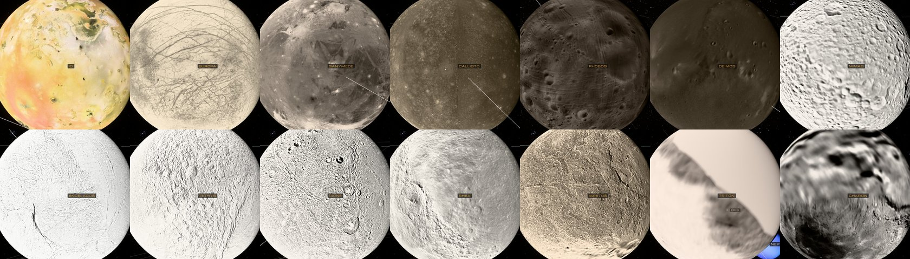

# The planets' moons

Seventy-six moons besides our own are drawn as real bodies, at their real
sizes and true positions about their planets: every moon in the JPL
satellite ephemerides used here (below). The twenty major ones are
in bold.

| Planet | Moons |
| --- | --- |
| Mars | **Phobos**, **Deimos** |
| Jupiter | Metis, Adrastea, Amalthea, Thebe, **Io**, **Europa**, **Ganymede**, **Callisto** |
| Saturn | Pan, Atlas, Prometheus, Pandora, Epimetheus, Janus, Aegaeon, **Mimas**, Methone, Anthe, Pallene, **Enceladus**, **Tethys**, Telesto, Calypso, **Dione**, Helene, Polydeuces, **Rhea**, **Titan**, Hyperion, **Iapetus**, Phoebe |
| Uranus | Cordelia, Ophelia, S/2025 U 1, Bianca, Cressida, Desdemona, Juliet, Portia, Rosalind, Cupid, Belinda, Perdita, Puck, Mab, **Miranda**, **Ariel**, **Umbriel**, **Titania**, **Oberon**, and the irregular Francisco, Caliban, Stephano, S/2023 U 1, Trinculo, Sycorax, Margaret, Prospero, Setebos, Ferdinand |
| Neptune | Naiad, Thalassa, Despina, Galatea, Larissa, Hippocamp, Proteus, **Triton**, Nereid |
| Pluto | **Charon**, Styx, Nix, Kerberos, Hydra |

Each has a marker and label like the planets', an orbit line about its
planet, and a place in the body rail under its planet. Choosing one flies the
camera there (the same `focusOn` and [camera](camera.md) path as a planet).
Near its planet each major moon also pulls on spacecraft with its own GM:
the kernel splits the planet's system into the planet and those moons there
([kernel](../physics/nbody-kernel.md#moons)), from the same positions.
That is checked on Juno's 2021 flyby of Ganymede
([validation](../validation.md#the-moons-pull-junos-ganymede-flyby-flybytestmjs)).
The small moons are drawn only; the largest of them, Proteus, Phoebe,
Hyperion and Janus, have GMs of 2.6, 0.55, 0.37 and 0.13 km³/s², about Mimas's at most.


Code: `src/physics/moons.js` (positions), `src/physics/moonTables.js` (the
satellite-ephemeris tables, fitted by `c/moon_cheb.c` into
`public/ephemeris/moons/`, loaded by `moonLoad.js` in the browser and
`moonNode.js` under Node), `src/physics/moons.data.js` (the fallback's
elements and every moon's physical data, written by
`src/physics/moons.fetch.mjs`), `src/physics/moons.test.mjs` (the checks),
and the scene's `systemStates` in `src/scene/OrreryScene.ts`; for the
kernel, `src/physics/bodies.js` and `src/physics/flyby.test.mjs`.

## Positions

### 2000 to 2049: JPL's satellite ephemerides

From 2000 to 2049 (the inner moons 2020 to 2035, [below](#the-inner-moons-span)) every moon comes from NAIF's satellite SPK kernels, the
numerically integrated ephemerides JPL fits to the observations and the
spacecraft data, and Horizons serves:

| Kernel | System | Covers |
| --- | --- | --- |
| `mar099s` | Mars, Phobos, Deimos | 1995–2050 |
| `jup365` | Jupiter and its eight inner and Galilean moons | 1600–2200 |
| `sat441` | Saturn and its fourteen major and outer moons here | 1750–2250 |
| `sat415` | Saturn's ring moons, Pan to Pallene (Methone is taken from `sat441`) | 1950–2050 |
| `ura184` (part 3) | Uranus, its five major and ten irregular moons | 1600–2400 |
| `ura184` (parts 1, 2) | Uranus's fourteen inner moons, Cordelia to Mab | 1900–2100 |
| `nep098` (parts 1–3) | Neptune, Naiad to Proteus, Triton, Nereid | 1800–2200 |
| `plu060` | Pluto, Charon and the four small moons | 1800–2200 |

The kernels themselves are 11 GB, so `c/moon_cheb.c` fits them through
CSPICE into compact Chebyshev series, one file per system per year,
`public/ephemeris/moons/<system>-<year>.bin` (300 files, 74 MB for the
fifty years), and for Saturn, Uranus and Neptune a second,
`<system>-inner-<year>.bin`, with their inner moons. Each main file holds
every other moon of the system and the planet's centre, each about the system barycentre (J2000 equatorial, km, against TDB
seconds past J2000). For each body the tool picks the number of equal
intervals a year and of coefficients per interval that store it in the
fewest bytes with every position within 0.5 km of the SPK:

- Each interval is fitted at the Chebyshev–Gauss nodes of a window 10 %
  wider than itself, and the polynomial re-expanded on the interval. A
  Chebyshev fit's derivative is worst at the ends of its window (by about
  $n^2$ against $n$ inside), and the kernel's Hermite nodes use the
  velocities, so this keeps them as good at the joins as inside: the
  velocity steps where intervals meet fell from about 1 m/s to a few cm/s.
- Each interval is then pinned to the SPK's positions at its two ends by a
  straight line (no larger than the ends' own misses), so neighbouring
  intervals, and years, meet without a step.
- Coefficients are Float32 for bodies within 300,000 km of the barycentre
  and Float64 beyond: Float32 rounds the leading coefficients to $6\times
  10^{-8}$ of themselves, 0.1 km for a moon two million kilometres out,
  which would undo the pinning. The far moons move slowly and need few
  coefficients, so it costs little.
- Every interval of the fifty years is checked against the SPK at six
  points per coefficient, position and velocity, and a body that misses
  anywhere is refitted with more coefficients (Margaret, whose eccentric
  orbit swings in to 1.7 million km, needed 45 intervals a year of 18).

The worst position error per body is 0.21 to 0.48 km. Position steps where
intervals meet are under 0.05 km, from the Float32 rounding; velocities
are within a few m/s of the SPK at worst (Phobos 6 m/s, at 2.1 km/s), and
within 0.5 m/s for most.

A moon about its planet's centre is the difference of two such series, so
it is within 1 km of the SPK; the planet's centre about the barycentre is
JPL's own, with every moon's pull in it. Velocities are the series'
derivatives, so they match the positions.

The fast inner moons cost the most, about 100 kB a year each: Phobos
146 kB, Jupiter's four inner moons 440 kB between them, Saturn's nine ring
moons 520 kB, Uranus's fourteen inner moons 1.26 MB, Neptune's seven inner
moons 520 kB. The irregular moons, which take years to go round, need a few
hundred bytes. A year of a system is 44 kB (Pluto) to 1.39 MB (Uranus,
with its inner moons).

### The inner moons' span

The 29 inner moons (Saturn's nine ring moons, Uranus's fourteen and
Neptune's six inner moons) are 2.3 MB a year between them, 115 MB for the
fifty years. So the repo carries their files for 2020 to 2035 only (48
files, 35 MB; 109 MB of tables in all), and their other years are built
locally from the kernels:

```bash
npm run build:moon-tables
```

which rebuilds every table and puts the inner moons' years outside
2020–2035 in `public/ephemeris/moons-extra/` (102 files, 75 MB), which git
ignores. Where an inner moon's file is not there, that moon quietly uses
the mean elements, as every moon does after 2049; a dev server or build
made with the folder in place serves it. `moons.test.mjs` passes either
way and checks the extra years when they are present.

**Loading.** A file is fetched only when it is wanted (both of a year's
files, where there are two): on the main thread,
for the system the camera is focused on or within 30 million km of, and
for the years its moons' orbit lines span (half the longest period either
side: up to 3.8 years for Uranus's Ferdinand; the inner moons' files only
for the year about the date, since they go round in a day); in the kernel's worker, the
first time a craft comes near enough for the system to split. Until the
year has arrived, and outside 2000–2049, the moons come from the fallback
below, and the orbit lines are redrawn when it arrives. Under Node
(`moonNode.js`, which `deNode.js` imports) each year is read synchronously
the first time it is asked for, so tests see what the app sees.

### The fallback: Io, Europa, Ganymede and Callisto

astronomy-engine's `JupiterMoons`: Lieske's E5 theory of the Galilean
satellites as truncated in L1.2, giving jovicentric J2000 equatorial states.

### The fallback: JPL's mean elements for the others

From JPL's [planetary satellite mean elements](https://ssd.jpl.nasa.gov/sats/elem/)
(fetched 14 November 2026). Each row is a precessing ellipse fitted by JPL to
the moon's numerically integrated orbit: $a$, $e$, $i$, the argument of
periapsis $\omega$, the mean anomaly $M$ and the node $\Omega$ at the epoch
2000-01-01.5 TDB, the period $P$ and the precession periods of $\omega$ and
$\Omega$. Mars's and Saturn's moons are referred to each moon's own Laplace
plane, given by its pole (right ascension and declination in the ICRF); the
Laplace plane is the plane about which the moon's orbit pole precesses.
Uranus's, Neptune's and Pluto's are referred to the planet's equator.

At $t$ days TDB after the epoch:

$$
M = M_0 + \frac{360°\,t}{P} + \delta M + \delta n\,t,\qquad
\omega = \omega_0 + \delta\omega + \frac{360°\,t}{P_\omega},\qquad
\Omega = \Omega_0 + \delta\Omega \mp \frac{360°\,t}{P_\Omega},
$$

the node regressing ($-$) for a prograde orbit and advancing for Triton's
retrograde one. Kepler's equation gives the position in the orbit plane,
which is turned by $R_z(\Omega)\,R_x(i)\,R_z(\omega)$ into the reference
plane. The reference plane's axes in the ICRF are its ascending node on the
ICRF equator, $\hat N = (-\sin\alpha_p, \cos\alpha_p, 0)$, its pole
$\hat P$ from $(\alpha_p, \delta_p)$, and $\hat P \times \hat N$; $\Omega$
is measured from $\hat N$, as JPL defines it.

The planet's equator for Uranus is taken about the pole its moons orbit
(right-handed), which is the opposite of the IAU's "north" pole for Uranus:
with the IAU pole every Uranian moon ran backwards.

Velocities, which the data plate shows, are a central difference of the
position over 10 seconds. The Galilean moons' are differenced too:
`JupiterMoons`'s own velocities differ from its positions' rate by up to
3 m/s, too much for the kernel's interpolation
([kernel](../physics/nbody-kernel.md#body-positions-between-ephemeris-calls)).

### The fitted corrections

The table's own warning says its mean elements are not meant for ephemeris
work, and as given they do not hold a moon's place:

- the periods are rounded, Phobos's to four digits (0.3187 d), which loses
  80° of Phobos's orbit every five years;
- $P$ is the period of the mean longitude in some planets' rows (Mars,
  Saturn) and of the mean anomaly in others (Jupiter);
- Saturn's and Uranus's epoch angles disagree with Horizons at the epoch
  itself, by up to 160°.

So each element moon carries four corrections, $\delta M$, $\delta n$,
$\delta\omega$ and $\delta\Omega$ (the `fit` in `moons.data.js`), fitted to
JPL Horizons planetocentric ICRF vectors: first $\delta M$ and $\delta n$ from
the along-track angle on six-hourly samples over two months of 2010 (which
cannot alias for a rate error under 720° a day), then all four by
damped Gauss-Newton on weekly samples from 2000 to 2050. $a$, $e$, $i$, the
reference planes and the precession periods stay JPL's. The fit's residual
over the fifty years is in `moons.data.js` (`rmsKm`, `maxKm`).

Mimas is left about 70,000 km out (rms; about 22° of its orbit) because it
librates by 44° over 71 years in its resonance with Tethys, which no
precessing ellipse can follow.

## Planets drawn at their centres

The ephemeris (DE442's table, and astronomy-engine outside 2000–2050)
places Mars to Pluto at their system barycentres, which is what the kernel
pulls toward far from them. With moons drawn, the scene puts
each planet at its own centre instead (and so does the kernel near it),

$$
\mathbf r_\text{planet} = \mathbf r_\text{bary} - \sum_i \frac{GM_i}{GM_\text{system}}\,\mathbf r_i,
$$

over the moons here ($\mathbf r_i$ planetocentric), and each moon at
$\mathbf r_\text{planet} + \mathbf r_i$. The offset is 2,130 km for Pluto
(Charon holds 11 % of the system's mass), so Pluto visibly swings about a
point outside itself; it is up to 310 km for Saturn, 210 km for Jupiter
and 74 km for Neptune. The data plate's orbital period for a planet still
uses the barycentre's state and the system GM.

## How right they are

`npm test` runs `moons.test.mjs` against Horizons vectors that were not used
in any fit (`src/physics/fixtures/moons_horizons.json`): daily over November
2026, and on 1 January of each year 2000 to 2050. The fixture is rounded to
0.1 km.

### From the tables

Every one of the 75 moons Horizons serves is within 0.6 km of it, about its
planet's centre (S/2025 U 1, found in 2025, is not in Horizons yet; its
table is checked against `ura184` alone):

| | Nov 2026, daily | 2000–2050, yearly |
| --- | ---: | ---: |
| worst | 0.58 km (Styx) | 0.09 km (Mimas) |
| typical | 0.25–0.45 km | 0.07–0.08 km |

The yearly samples fall on 1 January, where every interval is pinned to the
SPK, so what is left there is the fixture's rounding; the daily ones fall
anywhere in an interval. The planet's centre about its barycentre is within
0.35 km of Horizons for every system (Pluto's offset is 2,130 km).

Horizons serves the same solutions the tables are fitted to, with one
exception found on the way: for Neptune it serves `nep098` (2026), and the
older `nep097`'s Triton is 275–385 km from it, so the tables use `nep098`.

On Juno's 2021 Ganymede flyby the kernel now follows JPL's reconstruction to
20.8 km nine hours on with these moons, the same as with Horizons' own
(20.9 km); with the fallback's Ganymede it was 323 km
([validation](../validation.md#the-moons-pull-junos-ganymede-flyby-flybytestmjs)).

### From the fallback

Before 2000, after 2049, and until a year has loaded. Largest distance from
Horizons, km:

| Moon | $a$ (km) | Nov 2026 | 2000–2050 | Source |
| --- | ---: | ---: | ---: | --- |
| Phobos | 9,375 | 595 | 606 | elements |
| Deimos | 23,457 | 38 | 155 | elements |
| Io | 421,800 | 132 | 251 | JupiterMoons |
| Europa | 671,100 | 175 | 177 | JupiterMoons |
| Ganymede | 1,070,400 | 303 | 296 | JupiterMoons |
| Callisto | 1,882,700 | 513 | 645 | JupiterMoons |
| Mimas | 186,000 | 86,476 | 136,881 | elements |
| Enceladus | 238,400 | 1,786 | 1,838 | elements |
| Tethys | 295,000 | 9,051 | 9,787 | elements |
| Dione | 377,700 | 607 | 631 | elements |
| Rhea | 527,200 | 596 | 927 | elements |
| Titan | 1,221,900 | 1,346 | 1,583 | elements |
| Iapetus | 3,561,700 | 9,941 | 10,984 | elements |
| Miranda | 129,846 | 850 | 3,767 | elements |
| Ariel | 190,929 | 338 | 1,086 | elements |
| Umbriel | 265,986 | 298 | 593 | elements |
| Titania | 436,298 | 758 | 1,629 | elements |
| Oberon | 583,511 | 1,999 | 2,175 | elements |
| Triton | 354,800 | 141 | 240 | elements |
| Charon | 19,600 | 29 | 29 | elements |
| Metis, Adrastea | 128,000 | 233 | 237 | elements |
| Amalthea, Thebe | 181,400–221,900 | 277 | 1,529 | elements |
| Methone, Helene, Polydeuces, Telesto, Calypso | 194,700–377,600 | 189,656 | 191,233 | elements |
| Hyperion | 1,481,500 | 521,580 | 774,561 | elements |
| Phoebe | 12,929,400 | 441,891 | 485,781 | elements |
| Uranus's irregular moons | 4.3–20.4 million | up to 7.8 million | up to 16.4 million | elements |
| Naiad | 48,300 | 6,981 | 7,038 | elements |
| Nereid | 5,513,900 | 84,069 | 94,519 | elements |
| Styx, Nix, Kerberos, Hydra | 43,200–65,200 | 4,362 | 4,445 | elements |

So apart from Mimas the twenty major moons are within 3 % of their orbits'
radii, most within 0.3 %, and the error does not grow across 2000 to 2050.
Outside those years the fitted rates carry on, and the error grows. The
small moons' elements do worse: the co-orbital and resonant moons
(Methone, Helene, Polydeuces, Telesto, Calypso) librate, Hyperion's orbit
is chaotic in its resonance with Titan, and the irregular moons, Phoebe and
Nereid are pulled about by the Sun far more than a precessing ellipse
allows (Uranus's irregular moons' rows are referred to the ecliptic at
2020, as JPL gives them). They are a placeholder only.

The fallback's planet centre about its barycentre, from the moons' GMs,
agrees with Horizons to 0.05 km for Jupiter, 0.3 km for Saturn, 0.9 km for
Uranus, 0.07 km for Neptune and 3 km for Pluto (Charon's 29 km times its
11 % share).

### Which point each position is

Every error above is the moon about its planet's **body centre**, on both
sides: the Horizons vectors are about the planet's centre (Titan about 699,
not the Saturn barycentre 6 nor the solar system barycentre), geometric
(no light time), ICRF, TDB, and `moons.js` gives the moon about the
planet's centre too (`JupiterMoons` is documented as jovicentric, about
Jupiter's centre). `moons.test.mjs` checks the rest of the chain:

- **DE442's planets are system barycentres** by construction (NAIF 4 to 9),
  and the table's are within 0.2–1.7 km of Horizons' for Mars, Saturn and
  Pluto. Jupiter, Uranus and Neptune differ by 14, 1,231 and 352 km,
  which is DE440 (what Horizons serves for them) against DE442
  ([ephemerides](../physics/ephemerides-and-gm.md#why-it-matters)).
- **astronomy-engine's planets are system barycentres** too. Its error against
  JPL changes slowly over a month, so astronomy-engine minus a Horizons
  point, less a quadratic in time, leaves only what moves with the moons.
  Against the barycentre (5, 6, ...) that is 1.1–1.2 km rms; against the
  planet's centre (599, 699, ...) it is the moons' whole pull: 137 km for
  Jupiter, 274 km for Saturn, 26 km for Uranus, 73 km for Neptune, 2,116 km
  for Pluto. (Mars's moons move it by millimetres, so there the two cannot
  be told apart, and it does not matter.)
- **About the barycentre**, the moon as the scene composes it (about the
  centre, plus the centre's offset) has the same error as about the centre:
  Charon 26 km, which would be 2,139 km with the offset left out.
- **About the Sun** (the scene's origin is the Sun's centre, not the solar
  system barycentre), a moon is now within the figures above too: Triton
  141 km, Charon 26 km. On astronomy-engine it was off by its planet's
  error, 16,000 km for Jupiter up to 335,000 km for Neptune, and so was its
  planet: the system moves as one.
- Horizons' own frames agree with one another to 0.14 km (moon about the
  barycentre against moon about the centre plus centre about the
  barycentre), the rounding of the fixture.

## Physical data

Radius, GM and geometric albedo come from each moon's JPL Horizons object
page (fetched 14 November 2026). Where Horizons gives a triaxial shape
(Phobos, Deimos, Ariel, Miranda, Telesto, Calypso, Methone, Polydeuces) the
radius is that of the sphere of equal volume; where it gives a mass and no
GM (Phobos, Deimos), $GM = G\,m$ with the CODATA 2018 $G$. Where it gives
no albedo (Charon, Pluto's four small moons, Methone, Polydeuces, Uranus's
irregular moons) the moon is drawn at 0.3.

The small moons are less well known:

- **No GM** for Methone, Polydeuces, Nereid and Uranus's ten irregular
  moons (none has been measured). The data plate says so; none of them is
  in the kernel, and with the tables the planet's offset from its
  barycentre is JPL's own, so nothing needs one.
- **No measured size** for eight of the irregular moons: Horizons gives
  Caliban about 30 km and Sycorax about 60 km, Prospero only under 50 km,
  and the rest nothing (they are seen only as points of light; sizes in the
  literature are estimates from an assumed albedo). Those eight are drawn
  at a nominal 10 km, and the data plate says so (`radiusNote`).

JPL's [physical-parameters table](https://ssd.jpl.nasa.gov/sats/phys_par/)
lists only the moons with a measured mass, so it adds nothing here.

## Drawing

- **Surfaces:** USGS Astrogeology global mosaics on fourteen of them
  (Phobos, Deimos, the Galilean moons, Saturn's moons but Titan, Triton and
  Charon), grey maps drawn in the moon's mean colour; Titan and the Uranian
  moons stay plain spheres in that colour
  ([textures](textures.md#the-moons-maps)). All are lit like the planets
  ([lighting](lighting.md)), with Lommel-Seeliger scattering for all but
  Titan, whose haze is closer to Lambert.
  
- **Turning:** each moon turns by its IAU rotation model from NAIF's
  pck00011, pole and prime meridian with their libration terms
  ([orientation](../physics/orientation.md#the-planets-moons)), the frame
  the USGS maps are made in. All of them turn once each orbit; the
  Uranian moons and Triton turn backwards about the IAU north pole.
- **Shape:** each is its IAU triaxial ellipsoid, long axis toward the
  planet (Phobos 26 × 23 × 18 km, Mimas 416 × 393 × 381 km).
- **Shadows:** a planet takes the four largest of its moons as shadow
  casters (`MAX_OCCLUDERS`), so the Galilean moons' shadows cross Jupiter,
  and a moon is eclipsed by its planet. One moon's shadow on another is not
  drawn.
- **Orbit lines:** one period about the planet's centre, sampled straight
  from the moon's model (under 2 ms a line from the tables in Node, about
  as long as from the elements), resampled like the planets'
  ([scene](scene.md#orbit-lines)), and redrawn when a year of the tables
  arrives.
- **Rail:** a planet's moons are listed under it, two to a row, while it or
  one of them is in view; otherwise its row shows how many it has (`+14`
  for Saturn, `+15` for Uranus).
  Earth's Moon is always listed.

Computing all six systems, 76 moons, takes about 0.08 ms a frame from the
tables (0.12 ms from the fallback), measured in Node.

## Not yet

- **Before 2000 and after 2049** the moons are the fallback's. The kernels
  reach 1600 to 2400 (Mars's short file only 1995 to 2050), so the span
  could grow at about 1.2 MB a year of tables; past 2050 the planets
  themselves come from astronomy-engine (16,000 to 335,000 km out), so it
  would buy less.
- **The outer irregular moons**: Jupiter's 49 (`jup347`), Saturn's 39
  (`sat456`) and Neptune's other 5 (`nep104`) are on disk; they are to come
  as an optional layer of points and orbit lines rather than rail entries,
  in their own pull request. Saturn's Daphnis, Neptune's and Uranus's
  newest moons and the rest of Saturn's ring moons are in other kernels.
- **The moons' gravity fields beyond degree 2.** Io, Europa, Ganymede,
  Callisto and Titan carry their $J_2$ and $C_{22}$
  ([kernel](../physics/nbody-kernel.md#the-moons-own-fields)); the others
  are point masses.
- Surface maps for Titan (visible haze rather than surface) and the Uranian
  moons (no digital global mosaic; Voyager 2 saw only their southern
  hemispheres), and Iapetus's full albedo contrast, which the USGS mosaic
  flattens.
- Mimas's libration, which a sinusoidal term in its mean longitude could
  hold, for the fallback.

## Updating the data

```bash
npm run fetch:moons
```

It downloads the elements page and the Horizons headers and vectors into
`~/.cache/digital-orrery/moons` (delete the folder to fetch afresh), refits,
and rewrites `moons.data.js` and `fixtures/moons_horizons.json`.

The tables come from the kernels with `c/moon_cheb.c`
([c/README.md](../../c/README.md#the-moons-for-the-app)):

```bash
npm run build:moon-tables
```

([The inner moons' span](#the-inner-moons-span) says what it writes where.)
