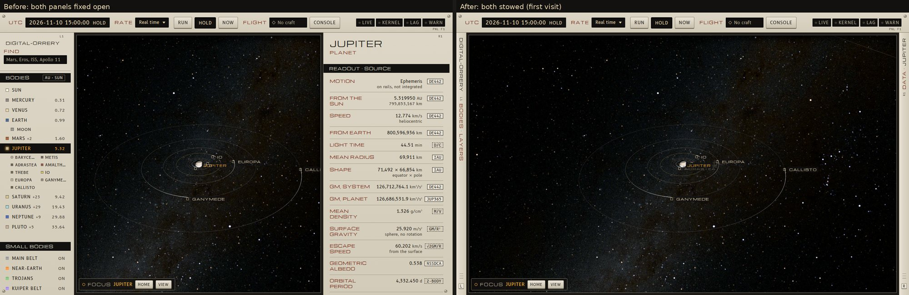
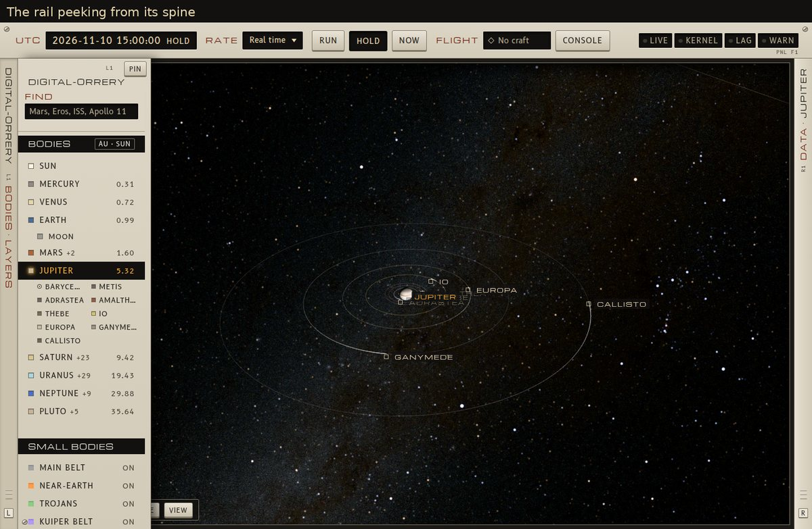
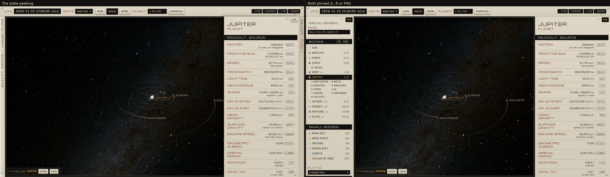
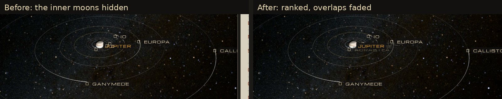

# Panels beside the sky, and labels in it

Beside the sky (not on a phone, whose sheet holds both: [phone.md](phone.md))
the body rail (L1) and the data plate (R1) are stowed until pinned, and the
labels in the sky rank themselves. Code: `src/app/stow.tsx` (the spine, the
peek and the pins), the stowed-panels section of `src/app/app.css`,
`OrreryScene.placeLabels` in `src/scene/OrreryScene.ts`, and the label rules
under `.body-marker` in `app.css`.

## Why

The two audiences in [PRODUCT.md](../../PRODUCT.md) want different first
screens. A visitor from the portfolio needs the sky first: with both panels
fixed open, the rail and plate took 648 px of a 1440 px window, 45 % of it. The engineer reads the plate's numbers and works the rail's switches,
and wants them where they left them. So both panels start stowed, and each
can be pinned, kept for this browser.

| At 1440 × 900 | Sky width | Share of the window |
| --- | ---: | ---: |
| Before (both open) | 792 px | 55 % |
| Both stowed | 1,376 px | 96 % |
| Both pinned | 792 px | 55 % (as before) |

## Stowed panels

A stowed panel folds back to its **spine**: a 32 px strip of the same sheet
metal along its edge of the sky. Engraved down it are the panel's code and
name (L1 BODIES · LAYERS; R1 DATA and the name of what is in view), with a
grip of three ridges and the key that pins it. L1's spine carries the
app's name too, which the rail heads with and would otherwise hide. The
letters face the sky on both sides.

- **Peek:** a pointer resting on the spine for 150 ms slides the panel out
  over the sky, casting a shadow as the flight console does. It slides back
  300 ms after the pointer has left both spine and panel, so a slip off the
  edge doesn't shut it. A source tag's detail, drawn on the page's body,
  counts as the panel's.
- **Focus:** keyboard focus on the spine or anywhere in the panel opens it
  and holds it open (`:focus-visible` only: a row pressed with the mouse
  keeps its focus, and would otherwise hold the panel open after the
  pointer has left). A text field is always focus-visible, so typing in
  FIND holds the rail open.
- **Latch:** a press on the spine holds the panel open until Escape, a
  press anywhere else, or the spine again.
- **Opened for you:** `/` (FIND) opens the rail before focusing its field;
  picking a guide's tag or an orbit line in the sky opens the plate it
  fills.
- **Pin:** the PIN key in the panel's top corner, or **L** and **R**, puts
  the panel back in its column beside the sky, as it was before stowing
  existed. PIN latches pressed while pinned, as CONSOLE does. The pins are
  kept in `localStorage` (`orrery.pins.v1`, `remember.js` `parsePins`, read
  field by field like the rail's switches); L and R are in the `?` sheet
  and go off with the single-key shortcuts.
- **The flight console:** with the plate stowed there is no plate to dock
  over, so the console hangs over the sky's right edge at any width (as it
  does above 1680 px), and the 3D view keeps the body clear of it. With the
  plate pinned it docks over the plate up to 1680 px, as before.

### Motion

Only the pointer's peek moves: 240 ms in and 180 ms out, a transform on
the panel, on the phone sheet's curve (`--ease-drawer`,
`cubic-bezier(0.32, 0.72, 0, 1)`), so a peek caught on its way out turns
back from where it is. What a key opens or closes (Tab, Escape, `/`) is
there at once, as a key's action should be. Pinning moves the sky's edge, a
layout change, so it isn't animated: the renderer would resize every frame.
With `prefers-reduced-motion` every peek is instant (the app's global rule).

## Labels in the sky

With every planet and moon named at the same strength, the sky read as a
list. The labels now rank themselves, so the focus leads:

| Rank | Which | Drawn |
| --- | --- | --- |
| 3 | The focus | phosphor on a dense window plate, over the rest |
| 2 | The body pointed at: its label, or its row in the rail | phosphor-dim on a dense plate, over everything |
| 1 | The focus's own: its parent, its moons, its barycentre (a barycentre's: its body's) | phosphor-dim on the window plate, as every label was before |
| 0 | Everything else | label-dim on a halo of window black, no plate |
| | A name that would overprint a higher one | faded to 40 %, under it, full again when pointed at |

With the Sun in view its own are the planets, so the overview names the
planets on plates and the asteroids, moons and barycentres lightly. Each
rank keeps DESIGN.md's rules for labels in the sky: the same sizes
(11, 12 and 13 px Michroma by TYPE step), every readable label at 6:1 or
better, and each one plainly a drawn aid, not part of the sky:

| Rank | Against | Contrast |
| --- | --- | ---: |
| 3, 2 | the plate over the sky, and over a lit disc (#f0e8d8) | 10.7:1, 7.2:1 or better |
| 1 | the plate over the sky, and over a lit disc | 14.1:1, 6.0:1 |
| 0 | its halo of window black | 8.9:1 |
| faded | the sky (2.2:1): there to say a body is there, not to be read | |

Before, an overprinting name was hidden outright; now it fades under the
name it would cover, so a crowded system still shows how many bodies are
there. Ranks 3 and 2 never fade. A label's box for the overlap test is
estimated from its name's length at the sky labels' size (`--t-sky`, read
at each resize), with no layout read in the frame.

Changes of rank fade over 120 ms (colour, plate and opacity), none with
reduced motion. Small bodies, satellites, landing sites and spacecraft keep
their own rules for crowding (`.quiet`, names on hover) and are drawn at
rank 0 unless focused.

## Checked

- Screenshots on the Intel UHD and the RTX 5070 Ti at 1440 × 900 and
  1920 × 1080 through `scripts/lib/chromium.mjs` (the images above).
- `npm run bench:frames` before and after on both GPUs: in the pull request.
- `remember.test.mjs`: pins read back as written, a bad field falls back
  alone, both stowed by default.
