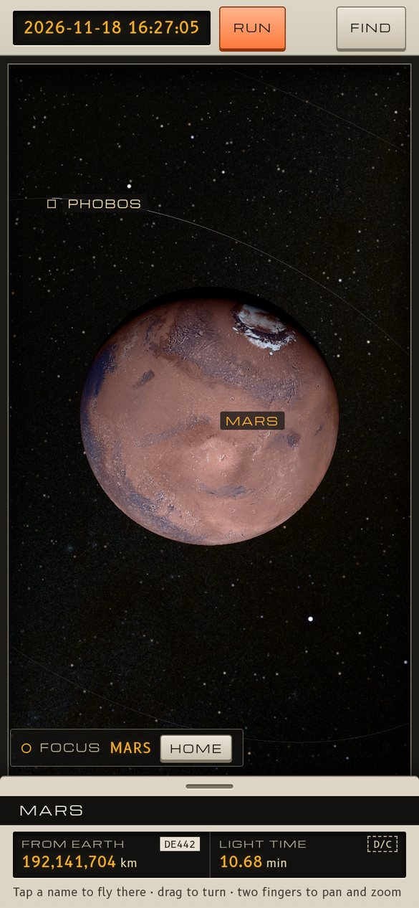
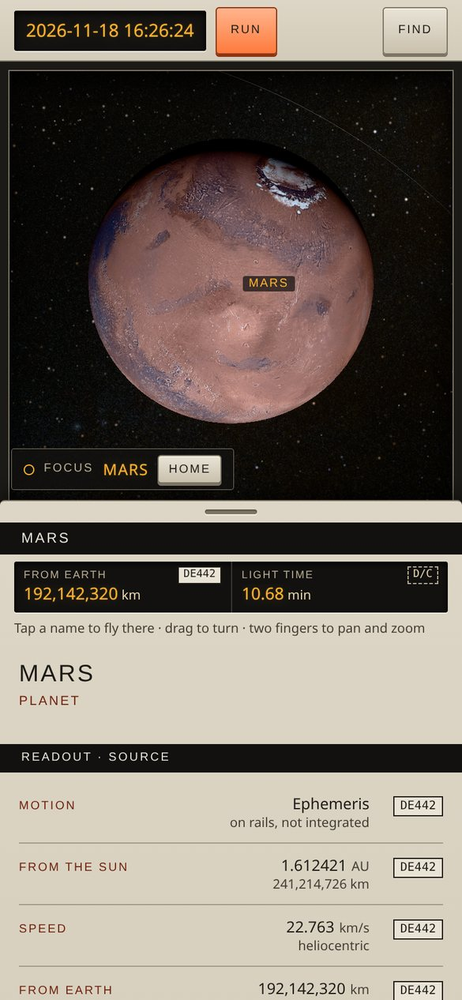
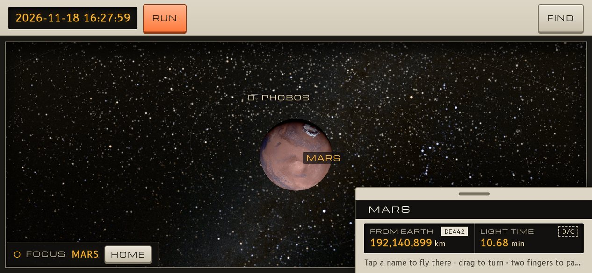

# The phone layout

On a phone the app is the sky. It fills the screen under a slim band, and one
sheet slides up over it with everything else. Code: `src/app/sheet.tsx` (the
sheet and its gesture), `src/app/peek.tsx` (the peek), `src/app/phone.ts`
(where it applies), the `.phone` section of `src/app/app.css`, and the view
offset in `src/scene/OrreryScene.ts`.

## Where it applies

- **Below 720 px wide:** the sheet runs along the bottom.
- **Short touch screens** (`max-height: 500px` and a coarse pointer, a phone on
  its side): the sheet runs up the right-hand side, 40 % wide, with the same
  stops. Below 560 px wide it stays along the bottom.

Everything wider, or with a mouse, keeps the desktop layout, unchanged. The
queries are in `phone.ts`; App sets `.app.phone` (and `.side`) from them, and
the stylesheet keys every phone rule on that class. The scene stays in the
same place in React's tree in both layouts, so a window crossing 720 px never
rebuilds it.

## The band

The band sits inside the safe area. It holds:
- the UTC clock window;
- one RUN key, lit while time runs (Space);
- FIND (`/`), which opens the sheet at full with its field focused.

The master alarm's ACK comes up here too while it sounds. The rate, NOW, FLIGHT
and the lamps are in the sheet.

## The sheet

| Stop | Height | What shows |
|---|---|---|
| Peek | its head, about 88 px (106 with the first-visit hint) | a latch bar, the name, two values |
| Half | half the screen | the plate's head and first rows, over the sky |
| Full | the screen under the band | everything, scrolling |

The sheet always opens at peek, even after a refresh that brings the view
back. Its height is not remembered.

**Contents.** The sheet holds the plate, then the rail, then the time and
flight controls (rate, NOW, FLIGHT with CONSOLE, the lamps). The rail is:
- the app's name;
- FIND, held at the top as the sheet scrolls;
- the bodies, always open;
- its lower sections (small bodies, irregular moons, landings, satellites,
  beyond Earth, guides), folded into groups. Each group's heading says in one
  line what it has on: "Main belt, Near-Earth", "none shown".

With the console open, the sheet holds the console instead and opens at half;
CLOSE brings the plate back. `#plot` (the plotting table) stays its own
full-screen mode.

**The peek** is a nomenclature strip with the name, and two values in an amber
window, each with its source tag. The values depend on the kind of object:

| In view | The two values |
|---|---|
| A planet, the Sun, a barycentre | distance from Earth, light time (the Earth: from the Sun, speed) |
| A moon | distance from its planet, orbital period |
| An Earth satellite | height, speed |
| A spacecraft beyond Earth orbit | distance from Earth, speed |
| A craft of your own | its altitude (or distance from the Sun) and speed, as the MISSION tab gives them |
| An asteroid or comet | distance from the Sun, diameter |
| A landing site | the body, the landing date |
| A debris cloud | pieces tracked, the breakup date |
| A guide or orbit line | its plate's first two values |

The plate in view chooses them from its own rows (`usePeek`), so the peek always
says what the plate says. The plate stays mounted under the console for this
reason. A followed craft's values outrank the plate's. Long names ellipsize in
the peek and wrap on the plate.

The first-visit touch hint is a line of the peek. It goes at the first touch
of the sky, and no longer sits over FOLLOW.

### Moving it

- **Drag:** the head moves the sheet, and so does the body below full. While the
  finger is down the sheet follows it 1:1, with resistance past peek and past
  full.
- **Release:** the sheet settles on the stop nearest where its speed would carry
  it in 180 ms. A flick faster than 0.45 px/ms moves on at least one stop.
- **Interrupt:** a press on a moving sheet catches it where it is.
- **Tap:** a tap on the peek toggles peek and half (from full, it goes to half).
- **Keyboard:** the latch is a button with `aria-expanded`. Pressing it steps up
  through the stops and back to peek; ArrowUp and ArrowDown step one stop.
- **Escape and Back** drop it to peek. While the sheet is above peek it holds one
  `history.pushState` entry, never more, so Back collapses it rather than
  leaving the page. Lowering it any other way takes the entry back off.
- **Choosing:** picking something from the open sheet (a body row, a FIND match)
  lowers it to half, with the plate at the top. A pick in the sky leaves the
  sheet where it is.
- **Scrolling:** the body scrolls only at full, with its overscroll contained. A
  drag on the sheet never turns or pans the sky.
- **Focus:** when the sheet opens to full, focus moves into it (FIND puts it on
  its field). At peek the body is inert.

It moves by transform only, on the iOS sheet's curve
(`cubic-bezier(0.32, 0.72, 0, 1)`, about 260 to 480 ms by the fling's speed).
At rest it sits by its `top` with no transform. FIND's matches and a tag's
detail are placed on the screen with `position: fixed`, and a transformed
ancestor would move them with it. Moves are counted, so a retired
transition's late cancel event cannot stop the next one, and a timer finishes
a move whose `transitionend` never comes. With reduced motion the sheet jumps
between stops; a drag still follows the finger.

**The keyboard.** The sheet's height is the visual viewport's, less the band. It
stays at full when the keyboard opens and fits what is left. The viewport
asks for `interactive-widget=resizes-content`, so Android shrinks the layout
too.

## The camera

When the sheet comes to rest, the view's centre moves up by half of what it
covers at peek and half, so the focused body sits in the middle of the sky
above it. Beside a side sheet, at half and full, the centre moves left by half
the sheet's width instead. The offset is the camera's `setViewOffset`, which
`setInsetRight` already used for the desktop's console. It eases over about
0.2 s (a time constant of 80 ms) and reads the size cached by `resize()`, not
the layout, each frame. At full the bottom offset is cleared, since there is no
sky to frame.

The view plate (FOCUS or FOLLOW, CENTRE, HOME) rides just above the sheet's top
edge, portalled into it, so it moves with the sheet for free. It hides at full.
Beside a side sheet it stays in the sky's lower left corner, clear of it.

## Phone basics

- `viewport-fit=cover` and `env(safe-area-inset-*)` on the band, the sheet's
  foot and its sides.
- Every field is 16 px on a phone, so iOS does not zoom the page on focus.
- The page has no tap highlight, and `touch-action: manipulation` on controls.
  The sheet's head is `touch-action: none`.
- Controls can't be selected by a long press; body text still can.
- `overscroll-behavior: none` on the page behind, so there is no
  pull-to-refresh.
- No sticky hover: every `:hover` rule in `app.css` sits inside
  `@media (hover: hover) and (pointer: fine)`, so a tap leaves no hover state.
  This applies beside the sky too, where a mouse sees no change. A quiet
  marker's hidden name no longer shows on a tap's phantom hover.

## Checks

- **Touch:** headless Chromium on the real GPU (`scripts/lib/chromium.mjs`), with
  touch emulation and CDP touch events, at 390 × 844 and 844 × 390. The checks
  cover:
  - a drag tracking 1:1;
  - a slow release settling on the nearest stop, and a flick moving on one;
  - a press catching the sheet mid-flight;
  - a tap toggling peek and half;
  - one history entry, and Back to peek;
  - FIND at full with the field focused at the top and its matches under it;
  - the keyboard (the viewport shortened to 480 px);
  - a pick lowering the sheet to half, and Escape to peek;
  - CONSOLE at half;
  - no hover media;
  - the side sheet's width and its camera offset;
  - the camera offset at each stop.
- **Real phone:** still to be done. Device emulation reproduces none of sticky
  hover, the tap delay, rubber-banding, safe areas or the software keyboard.
