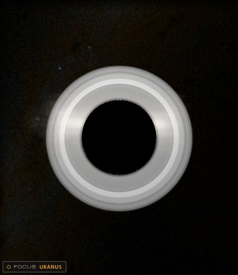
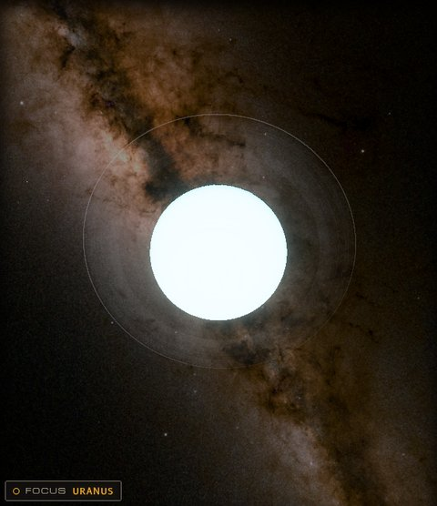
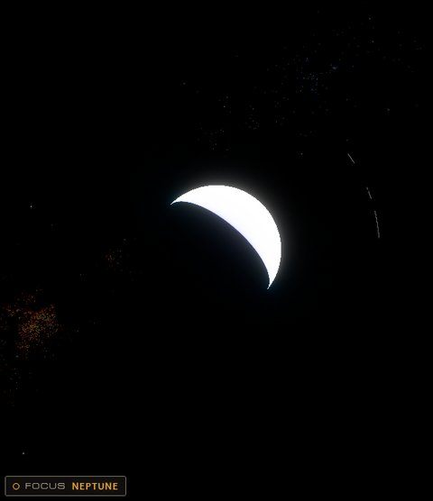
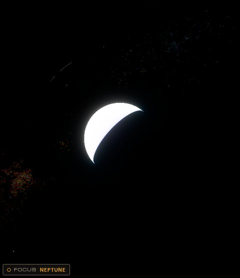
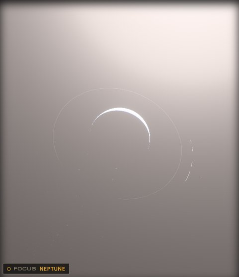
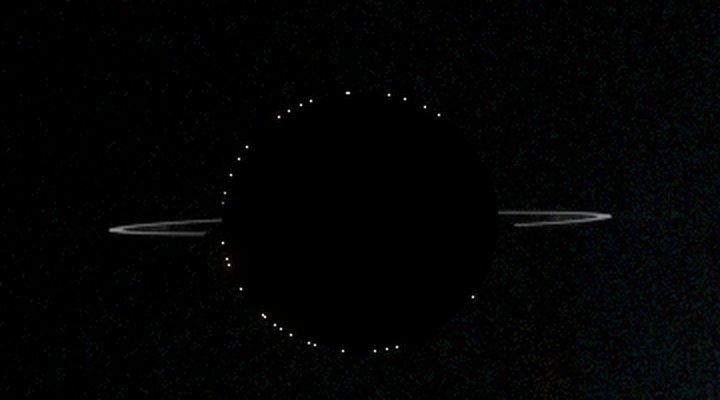

# The rings of Jupiter, Uranus and Neptune

Code: `src/physics/rings.js` (the data and geometry, no three.js),
`src/scene/rings.ts` (the shaders), `src/scene/ringSystems.ts` (building
and placing them each frame), `python/textures/fetch_rings.py` and the
`uranus_rings` recipe in `python/textures/sources.py`. Checks:
`src/physics/rings.test.mjs`. Saturn's rings, from a Cassini profile, are in
[textures](textures.md#saturns-rings) and
[lighting](lighting.md#saturns-rings); all four systems share one ring
photometry.

## What is measured and what is modelled

| | Measured, from the source | Modelled |
| --- | --- | --- |
| Uranus | every narrow ring's orbit: inner and outer edges, eccentricity, inclination, periapse and node and their precession, and all ten normal modes [1]; each ring's equivalent depth, and for α, β and ε the shape of its optical depth across it, from the Voyager 2 PPS occultation profiles [2]; the broad and dust rings' radii, widths and optical depths [3], [4], [5]; the particles' albedo [18] | the broad rings' edges (smoothed over a tenth of their width); the phase of γ's $m = 0$ mode's time term |
| Neptune | the rings' radii, widths, optical depths and dust fractions [6], [7]; the Adams ring's radius and its 29.6 km, 42-lobed distortion [6], turning with Galatea at its measured longitude [9]; Fraternité's longitude at three epochs [8], [9], [10]; the arcs' separations and lengths [6], [7], [11], [12], and their brightness and positions in 1998, 2002, 2003, 2007, 2009 and 2016 [6], [8], [9]; the arcs' reflectivity [6] | the longitudes and brightnesses between and beyond the measured dates (straight lines between them); Égalité's split into two parts; the distortion's phase, from resonance theory [1], [19] |
| Jupiter | each ring's radial extent, thickness and normal optical depth [13]; the main ring's split into dust and parent bodies, and the level of its phase curve [14]; the halo's power-law fall-off with height [13]; Amalthea's and Thebe's inclinations (JPL) | the main ring's bright outer annulus as a step (twice the depth over its outer 800 km); the gossamer rings' vertical profile from the dynamics that explains them [15]; the dust's phase function as a smooth curve fitted to the measured levels |

PDS has no tabulated radial profile of Jupiter's rings, only raw images
(Galileo SSI, New Horizons LORRI, Juno), so its shapes come from the
published fits above, and every level in them is a measured one.

## Uranus

### Orbits

French et al. [1] fitted Keplerian orbits to the ring centres and edges
from 31 Earth-based stellar occultations and three Voyager 2 occultations,
1977 to 2006 (their Table 5; epoch TDB 1986 Jan 19 12:00). Each edge has
its own semimajor axis $a$ and $ae$, so a ring's width varies round it:
the ε ring is 19.9 km wide at periapse and 97.3 km at apoapse. An edge at
true longitude $\lambda$ lies at

$$
r(\lambda, t) = \frac{a(1-e^2)}{1 + e\cos(\lambda - \varpi_0 - \dot\varpi\,t)} - A_m\cos\big(m(\lambda - \delta_m - \Omega_p t)\big),
$$

with the precession rate $\dot\varpi$ (the ε ring's periapse turns
1.363°/day), less every normal mode fitted at the ring's centre in their
Table 6: η's $m$ = 3 (0.6 km), γ's $m$ = 0, 3, 6, −2 and −1 (5.5, 0.6,
0.6, 0.7 and 1.8 km), δ's $m$ = 2 and 23 (3.2 and 0.3 km) and ε's
$m$ = 14 and −24 (0.4 km each). Each is $-A_m\cos(m(\lambda - \delta_m -
\Omega_p t))$, $\delta_m$ the longitude of a radial minimum (their Eqs.
5–6). The paper gives no separate form for $m = 0$; its limit,
$-A_0\cos(\Omega_p t + \delta_0)$, is assumed, which sets when γ is
widest. Rings 6,
5, 4, α and β are inclined to the equator by up to 0.061°, about a node
that regresses as fast as the periapse advances; in 3D that lifts ring 6
up to 45 km from the equator, so each ring is drawn in its own plane.

Longitudes run from the ascending node of Uranus's equator on the J2000
Earth equator, prograde about the rings' angular momentum. Uranus spins
retrograde, so that is the IAU south pole; French et al.'s pole agrees
with the IAU pole the scene uses to 0.002°.

### Optical depth

A narrow ring's equivalent depth $E = \int \tau\,dr$ is what an
occultation measures best, whatever its resolution and radius scale (the
PPS radius scales are offset by kilometres ring to ring). It is taken from
the Voyager 2 PPS β Persei occultation, 1 km resolution (λ from σ
Sagittarii, as β Per did not detect it), the mean of ingress and egress
[2]:

| Ring | 6 | 5 | 4 | α | β | η | γ | δ | λ | ε |
| --- | --- | --- | --- | --- | --- | --- | --- | --- | --- | --- |
| $E$ (km) | 0.45 | 0.83 | 0.76 | 3.16 | 1.76 | 0.61 | 2.08 | 2.09 | 0.21 | 45.7 |

At each longitude the ring's mean optical depth is $E/W(\lambda)$, so the
ε ring runs from τ = 0.47 at apoapse to 2.30 at periapse, as observed.
Rings resolved several times over (α, β and ε, at least 7 km wide at half
depth) keep their measured shape across the ring, the mean of the two
profiles normalised to 1; the others are drawn uniform. Three opaque bins
in ε's ingress profile are set to τ = 3.

The broad rings and dust bands (ζ and its extensions, the dust sheet, the
bands between rings 4 and α and between α and β, the dust beside η, δ and
λ, and the outer ν and μ rings) are the Ring-Moon Systems Node's radii,
widths and optical depths [3], from Nicholson et al. [4] and Showalter and
Lissauer [5]. All are dust; of the narrow rings only λ is (it is bright
only at high phase in Voyager's images [4]).

## Neptune

The rings are de Pater et al.'s Table 5.1 [6], from Porco et al. [7]:

| Ring | Radius (km) | Width (km) | Normal optical depth | Dust |
| --- | --- | --- | --- | --- |
| Galle | 42,000 | 2,000 | $10^{-4}$ | all |
| Le Verrier | 53,200 | 100 | 0.003 | 50 % |
| Lassell | 55,200 | 4,000 | $10^{-4}$ | all |
| Adams | 62,932.37 | 15 | 0.003; 0.1 in the arcs | 30 %; 50 % in the arcs |

Arago (no measured depth) is left out. Le Verrier's τ × width, 0.30 km,
agrees with the 0.25 km equivalent depth in the Voyager PPS profile [2].

The Adams ring is not circular. Galatea's 42:43 Lindblad resonance, 1.5 km
inside it, forces a radial distortion of 29.6 ± 1.5 km (a forced
eccentricity of $4.7\times10^{-4}$) with 42 lobes that turn with Galatea
[6]. Outside such a resonance a forced distortion's apoapse points at the
satellite [1], [19], so the ring is furthest out at Galatea's longitude:

$$
r(\lambda, t) = a + 29.6\ \text{km}\,\cos\big(42(\lambda - \lambda_G(t))\big),
$$

with Galatea's longitude 259.58 ± 0.30° on 2016 August 23 (moved back by
the light time) and its mean motion 839.66134 °/day [9]. That agrees with
JPL's ephemeris of Galatea to 0.65° in 2016 and 0.37° in 2026.

### The arcs

Fraternité's centre was at 251.88° at JD 2447757.0 (Voyager 2,
1989 August 18) [7], [8]; at 349.01 ± 0.60° on 2007 August 31 (VLT/NACO)
[8]; and at 217.43 ± 0.30° on 2016 August 23 (VLT/SPHERE) [9]. Both
ground-based epochs are converted to TDB and moved back by the light time
(4 h) to when the light left Neptune. The arcs' published mean motions
disagree at $10^{-3}$ °/day, a degree a decade: 820.11213 °/day from
1989–2007 [8], 820.11178 from 1989–2016 [9] (this model's 820.11204 and
820.11168). So the longitude is a straight line between the measurements,
continued at the nearest pair's rate before and after them.

The other arcs lead Fraternité as Voyager saw them. Égalité's trailing
part is 10.7° ahead, Liberté 12° ahead of Égalité's leading part, and
Courage 7.3° ahead of Liberté [3], [6]. Fraternité is 9.6° long [6];
Égalité and Liberté are about 4° and Courage 2° [11]. Égalité's 4° are
split 3° trailing and 1° leading [12], so the arcs span 38° from
Fraternité's trailing edge. In the arcs τ rises to 0.1 [6].

Voyager's PPS crossed the Adams ring on 1989 August 24 at ring longitude
191.57° (the PDS geometry file [2]), 28.6° ahead of Fraternité, and found
arc material there (an equivalent depth of 0.85 km, against 0.045 km for
the ring between arcs). That is 1.4° past Liberté's leading edge in this
layout; Porco's Voyager ranges [12] put the edge about 0.9° further ahead.
The arcs' places are known to about a degree.

The arcs have changed since Voyager [6], [8], [9], and each one's depth
follows the measurements, as a multiple of 1989's 0.1:

| Date | Fraternité | Égalité | Liberté | Courage |
| --- | --- | --- | --- | --- |
| 1989 Aug (Voyager) | 1 | 1 | 1 | 0.3 ("usually a low-intensity arc") |
| 1998 (HST/NICMOS) | | | 25 % down on Fraternité, 3° ahead | flared to Liberté's level |
| 2002 Jul (Keck) | | 1.17 × Fraternité | | |
| 2003 Oct (Keck) | 0.75 (25 % below Voyager) | 0.93 × Fraternité | 0.3, back in place | 0.3, 8° ahead |
| 2007 Aug (VLT) | unchanged (EW 65–71 m) | 0.8 × Fraternité | | |
| 2009 Jul (Keck) | | 0.8 × Fraternité | gone | gone |
| 2016 Aug (VLT) | unchanged (EW 84 ± 18 m) | 76/84 of Fraternité | gone | gone |

Between dates the depth runs in a straight line; after 2016 it holds.
Courage's 0.3 in 1989 follows from the 2003 Keck images, where Liberté had
fallen to 30 % of its 1989 brightness and both arcs to Courage's 1989
level. The later measurements are near-infrared (2.1 µm); the depths scale
by them unchanged in visible light.

## Jupiter

| Part | Radii (km) | Thickness (km) | Normal optical depth |
| --- | --- | --- | --- |
| Halo | 100,000–122,400 | ~$5\times10^4$ | $10^{-6}$ |
| Main ring | 122,400–129,100 | 30–100 | $4.7\times10^{-6}$ dust, $1.3\times10^{-6}$ parent bodies [14] |
| Amalthea ring | 122,400–181,350 | 2,532 ($2r\sin i$, $i$ = 0.4°) | $10^{-7}$ |
| Thebe ring | 122,400–221,900 | 8,520 ($i$ = 1.1°) | $10^{-8}$ |
| Thebe extension | 221,900–270,000 | 9,000 | $10^{-9}$ |

From de Pater et al.'s Table 6.1 [13] (from Ockert-Bell et al. [16] and
de Pater et al.), with the main ring's split from Throop et al. [14]. The
main ring has a bright ~800 km annulus at its outer edge [13], drawn as
twice the depth there, keeping the mean.

The gossamer rings are dust from Amalthea and Thebe that keeps their
inclined orbits as it drifts inward [15]. A grain on an orbit tilted by
$i$ sits at height $z = r\sin i\sin u$, so the time-averaged density is

$$
n(z) \propto \frac{1}{\pi\sqrt{h^2 - z^2}},\qquad h = r\sin i,
$$

thickest toward the top and bottom edges, as Galileo saw them [13], [15]
(softened so it stays finite, $1 - z^2/h^2 \ge 0.06$). The halo's
brightness falls with height as $z^{-0.6}$ near the plane and $z^{-1.5}$
several thousand km up [13]; the profile switches at 2,000 km, is
softened at 50 km, and stops at the table's ±25,000 km.

These rings are thick, so they are drawn as a volume: a cylinder about
Jupiter bounds them, and each pixel's ray is integrated through it. The
main ring, the halo and the extension are uniform in radius between their
edges, so the column along a ray is exact: its stretches inside each
cylindrical shell, times the vertical profile integrated in closed form
between the heights where it enters and leaves. The gossamer rings are
marched, 16 samples jittered per pixel. From afar the main ring (100 km
thick) and the gossamer rings' bright edges are thinner than a pixel; their
vertical profiles are widened to the pixel's footprint there, keeping
their column, so the ring stays a smooth line rather than a row of dashes.
Jupiter hides what lies behind it,
and its shadow (a hard umbra) darkens the dust in it.

## Light

Every ring is a layer of normal optical depth τ lit as Saturn's are
([lighting](lighting.md#saturns-rings)), with $A$ now a mix of two
particle populations, by the dust fraction $f$:

$$
A = (1-f)\,p\,\Phi_\text{L}(\alpha) + f\,\frac{\varpi_0 P(\theta)}{4}.
$$

- **Parent bodies:** Lambert spheres of geometric albedo $p$, phase law
  $\Phi_\text{L}(\alpha) = [\sin\alpha + (\pi - \alpha)\cos\alpha]/\pi$:
  each a measurement. Uranus's are 0.026: Voyager photometry of the ε ring
  gives Lambert surfaces of single-scattering albedo 3.9 ± 0.6 % [18], and
  a Lambert sphere's geometric albedo is 2/3 of that. Neptune's are 0.069:
  with half the arcs' depth in dust, that gives the arcs Voyager's measured
  reflectivity, 0.055 ± 0.004 at 0.5 µm and 8° phase [6]. Jupiter's are
  0.05, Adrastea's [13]. (NASA's fact sheets give 0.015 for both ice
  giants' rings [17], which these measurements supersede.) They are dark,
  and darker still lit from behind.
- **Dust:** single-scattering albedo $\varpi_0$ = 0.3 and a phase function
  of the scattering angle $\theta$ (0 when the Sun is straight behind the
  ring) that is half isotropic and half a Henyey–Greenstein lobe with
  $g$ = 0.7, averaging 1 over the sphere. It is flat from 1° to about 130°
  phase and then climbs, as Throop et al. measured [14]; with the main
  ring's dust it gives a normal $I/F$ of $3.5\times10^{-6}$ at 178° phase
  and $2.6\times10^{-7}$ at 5°, against Galileo's few $10^{-6}$ and Keck's
  and Galileo's $10^{-7}$ [13]. So dusty rings are brightest with the Sun
  behind them: Jupiter's from its shadow, Uranus's dust bands and λ ring
  as Voyager saw them leaving the planet.

Jupiter's parent bodies are drawn red, as the ring is from 0.4 to 4 µm
[13]; the rest are neutral.

### Narrow rings at a distance

Each narrow ring is an ellipse in its own plane. The shader intersects the
pixel's view ray with that plane, finds the radius $r$ and longitude
there, and the ring's edges at that longitude. A ring 2 km wide is far
below a pixel from most views, so it is filtered over the pixel's radial
footprint $F$ (the screen-space change in $r$): the pixel takes the ring's
light times the overlap of $[r - F/2, r + F/2]$ with the ring, over $F$.
Wider than a pixel, the ring is sampled with antialiased edges; narrower,
it becomes a line one pixel wide carrying its true light, its width times
its brightness. It neither vanishes between pixels nor breaks into dashes
as the camera moves.

## Seeing them

At the scene's exposure, metered for sunlight
([lighting](lighting.md#sunlight-and-exposure)), these rings are as faint
as they really are next to their planets: Uranus's ε ring has $I/F$
about 0.006 face-on, beside a disc of 0.5; Jupiter's main ring
$3.5\times10^{-6}$. The images below, like the spacecraft and telescope
images they are compared with, are long exposures: add `?exposure=N` to
the address to lengthen the exposure $N$ times. Uranus's rings show at
about 100×, Neptune's at 300–1000×, and Jupiter's, with the camera in its
shadow, at 1000–3000×.

Each view below is set to a real image's date and geometry, at the
production build's exposure times the factor given, on the Intel GPU:

| This app | The real image |
| --- | --- |
|  | Voyager 2 from Uranus's shadow, 236,000 km, a 96 s exposure: dust throughout the ring system, and dust lanes brighter than the rings ([PIA00142](https://photojournal.jpl.nasa.gov/catalog/PIA00142)). The app has the dust as the tables give it, in broad bands; Voyager resolved them into many fine lanes. |
|  | At low phase the dark narrow rings are thin, faint lines, as in Voyager 2's mosaic of them on 23 January 1986 from 1.12 million km, in which the λ ring was found ([PIA00035](https://photojournal.jpl.nasa.gov/catalog/PIA00035)). |
|  | Voyager 2's wide-angle camera, 23 August 1989: the arc region, "three distinct features" over about 35° of longitude ([PIA00053](https://photojournal.jpl.nasa.gov/catalog/PIA00053)). Here five pieces over 38°, Égalité's two parts and Courage separated. |
|  | The same view in 2026: Liberté and Courage gone since 2009, Fraternité and Égalité fainter, as Keck and the VLT measured them [6], [9]. |
|  | Two 591 s Voyager 2 exposures from 280,000 km: the Adams and Le Verrier rings complete round the planet, glare from the over-exposed crescent ([PIA01997](https://photojournal.jpl.nasa.gov/catalog/PIA01997)). |
|  | Galileo in Jupiter's shadow, November 1996, looking back at the Sun: the main ring bright in forward-scattered light ([PIA01621](https://photojournal.jpl.nasa.gov/catalog/PIA01621)). The halo and gossamer rings, ten and a hundred times fainter, need a longer exposure than the planet's limb allows here. |

## Validation

`node src/physics/rings.test.mjs`, against the tables the data come from
and independent ones:

- Uranus: each ring's radius, eccentricity and inclination against the
  Ring-Moon Systems Node table [3] (within 3 km, 3 % and 0.0015°; γ's
  tabled $e$ of $1.092\times10^{-3}$, and NSSDC's [17], is ten times
  French et al.'s fit, $ae$ = 5.3 km at 47,626 km, a slipped decimal);
  α, β and ε's widths at periapse and apoapse against NSSDC's 4–10, 5–11
  and 20–96 km [17]; ε's optical depth from the PPS equivalent depth,
  0.47 to 2.30, against the tables' 0.5 to 2.3; the other rings' mean
  depths within a factor of 2.2 of the tables' approximate values; the
  pole, the longitude frame and a year's periapse precession.
- Uranus, more: all ten normal modes, δ's minimum at $\delta_m$ as French
  et al. define it, and γ's width round the ring (2.9–3.6 km, NSSDC 1–4);
  the particles' albedo, and ε's depth at apoapse, 0.47 against Voyager
  photometry's 0.40 ± 0.05 [18] (within 0.08).
- Neptune: radii against NSSDC [17]; Le Verrier's depth against the PPS
  profile; the Adams ring's radius and its 42 lobes of 29.6 km; Galatea's
  longitude against JPL's ephemeris in 2016 and 2026 (within 0.7°);
  Fraternité at the three epochs within their errors; the 1989–2007 and
  1989–2016 rates against the published mean motions; the arcs'
  separations, their 40° span and their 1989 longitudes [12]; their depths
  in 2002, 2003, 2007, 2009 and 2016 against the measured ratios; Voyager's
  PPS crossing within 1.5° of Liberté; and the arcs' reflectivity against
  Voyager's 0.055 ± 0.004.
- Jupiter: the main ring's outer edge against NSSDC, the gossamer rings'
  ends at Amalthea's and Thebe's orbits, their thicknesses from the moons'
  inclinations against the table's (within 15 % and 5 %), the main ring's
  depth against the tables'.
- Dust: the phase function's normalisation, its flatness to 130°, and the
  main ring's normal $I/F$ at 178° and 5° phase.

## Rebuilding

```bash
python3 python/textures/fetch_rings.py          # 20 PPS profiles, 0.8 MB, from PDS
python3 python/textures/build_textures.py --only uranus_rings
```

This writes `public/textures/uranus/rings_pps.json` (each ring's
equivalent depth, the ingress and egress values, and the resolved
shapes). Everything else is in `src/physics/rings.js`.

## Not modelled

- The rings' particle colours; the modes fitted only to ring edges (each
  under 2 km, Table 6); Neptune's other rings' shapes; the arcs' clumps,
  and their state between and after the measured dates.
- Jupiter's halo bloom, the main ring's fine structure near Metis and
  Adrastea, and the gossamer rings' radial structure beyond a uniform
  depth; the moons' shadows on the rings.
- The rings' shadows on Uranus, Neptune and Jupiter (under 1 % of the
  light, in a thin band).
- The opposition surge and multiple scattering.

## References

[1] R. G. French *et al.*, "The Uranus system from occultation observations (1977–2006): Rings, pole direction, gravity field, and masses of Cressida, Cordelia, and Ophelia," *Icarus*, vol. 411, art. 115957, 2024, doi: [10.1016/j.icarus.2024.115957](https://doi.org/10.1016/j.icarus.2024.115957).

[2] NASA PDS Ring-Moon Systems Node, "Voyager 2 PPS ring occultation profiles, VG2-SR/UR/NR-PPS-2/4-OCC-V1.0," volume VG_2801. [Online]. Available: https://pds-rings.seti.org/holdings/volumes/VG_28xx/VG_2801/

[3] NASA PDS Ring-Moon Systems Node, "Vital statistics for Uranus's rings" and "Vital statistics for Neptune's rings." [Online]. Available: https://pds-rings.seti.org/uranus/uranus_rings_table.html, https://pds-rings.seti.org/neptune/neptune_rings_table.html

[4] P. D. Nicholson *et al.*, "The rings of Uranus," in *Planetary Ring Systems*, M. S. Tiscareno and C. D. Murray, Eds. Cambridge, U.K.: Cambridge Univ. Press, 2018, pp. 93–111, doi: [10.1017/9781316286791.004](https://doi.org/10.1017/9781316286791.004).

[5] M. R. Showalter and J. J. Lissauer, "The second ring-moon system of Uranus: Discovery and dynamics," *Science*, vol. 311, pp. 973–977, 2006, doi: [10.1126/science.1122882](https://doi.org/10.1126/science.1122882).

[6] I. de Pater, S. Renner, M. R. Showalter, and B. Sicardy, "The rings of Neptune," in *Planetary Ring Systems*, M. S. Tiscareno and C. D. Murray, Eds. Cambridge, U.K.: Cambridge Univ. Press, 2018, pp. 112–124, doi: [10.1017/9781316286791.005](https://doi.org/10.1017/9781316286791.005); arXiv: [1906.11728](https://arxiv.org/abs/1906.11728).

[7] C. C. Porco *et al.*, "Neptune's ring system," in *Neptune and Triton*, D. P. Cruikshank, Ed. Tucson, AZ, USA: Univ. of Arizona Press, 1995, pp. 703–804.

[8] S. Renner, B. Sicardy, D. Souami, B. Carry, and C. Dumas, "Neptune's ring arcs: VLT/NACO near-infrared observations and a model to explain their stability," *Astron. Astrophys.*, vol. 563, art. A133, 2014, doi: [10.1051/0004-6361/201321910](https://doi.org/10.1051/0004-6361/201321910).

[9] D. Souami *et al.*, "Neptune's ring arcs from VLT/SPHERE-IRDIS near-infrared observations," *Astron. Astrophys.*, vol. 657, art. A134, 2022, doi: [10.1051/0004-6361/202141598](https://doi.org/10.1051/0004-6361/202141598); arXiv: [2110.12669](https://arxiv.org/abs/2110.12669).

[10] Ref. [8], Table 1 and Sect. 3, for the 2007 epoch and Earth distance; Ref. [9], Table 1, for 2016's.

[11] S. M. Giuliatti Winter, G. Madeira, and R. Sfair, "Neptune's ring arcs confined by coorbital satellites: dust orbital evolution through solar radiation," *Mon. Not. R. Astron. Soc.*, vol. 496, no. 1, pp. 590–597, 2020, doi: [10.1093/mnras/staa1519](https://doi.org/10.1093/mnras/staa1519).

[12] C. C. Porco, "An explanation for Neptune's ring arcs," *Science*, vol. 253, pp. 995–1001, 1991, doi: [10.1126/science.253.5023.995](https://doi.org/10.1126/science.253.5023.995).

[13] I. de Pater, D. P. Hamilton, M. R. Showalter, H. B. Throop, and J. A. Burns, "The rings of Jupiter," in *Planetary Ring Systems*, M. S. Tiscareno and C. D. Murray, Eds. Cambridge, U.K.: Cambridge Univ. Press, 2018, pp. 125–134, doi: [10.1017/9781316286791.006](https://doi.org/10.1017/9781316286791.006); arXiv: [1707.00806](https://arxiv.org/abs/1707.00806).

[14] H. B. Throop *et al.*, "The jovian rings: New results derived from Cassini, Galileo, Voyager, and Earth-based observations," *Icarus*, vol. 172, pp. 59–77, 2004, doi: [10.1016/j.icarus.2003.12.020](https://doi.org/10.1016/j.icarus.2003.12.020).

[15] J. A. Burns *et al.*, "The formation of Jupiter's faint rings," *Science*, vol. 284, pp. 1146–1150, 1999, doi: [10.1126/science.284.5417.1146](https://doi.org/10.1126/science.284.5417.1146).

[16] M. E. Ockert-Bell *et al.*, "The structure of Jupiter's ring system as revealed by the Galileo imaging experiment," *Icarus*, vol. 138, pp. 188–213, 1999, doi: [10.1006/icar.1998.6072](https://doi.org/10.1006/icar.1998.6072).

[17] D. R. Williams, "Uranus rings fact sheet," "Neptunian rings fact sheet" and "Jupiter rings fact sheet," NASA NSSDCA. [Online]. Available: https://nssdc.gsfc.nasa.gov/planetary/factsheet/uranringfact.html, https://nssdc.gsfc.nasa.gov/planetary/factsheet/nepringfact.html, https://nssdc.gsfc.nasa.gov/planetary/factsheet/jupringfact.html

[18] T. Svitek and G. E. Danielson, "Azimuthal brightness variation and albedo measurements of the Uranian rings," *J. Geophys. Res.*, vol. 92, no. A13, pp. 14979–14986, 1987, doi: [10.1029/JA092iA13p14979](https://doi.org/10.1029/JA092iA13p14979).

[19] C. D. Murray and S. F. Dermott, *Solar System Dynamics*. Cambridge, U.K.: Cambridge Univ. Press, 1999, doi: [10.1017/CBO9781139174817](https://doi.org/10.1017/CBO9781139174817).
