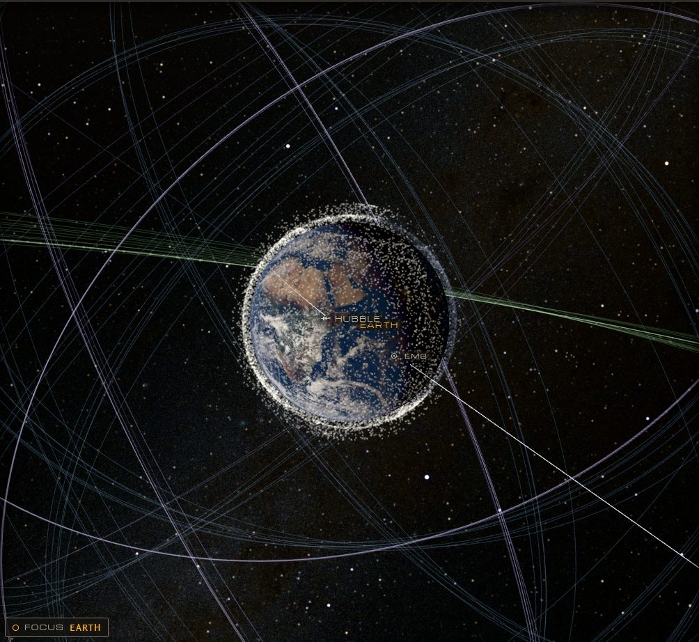
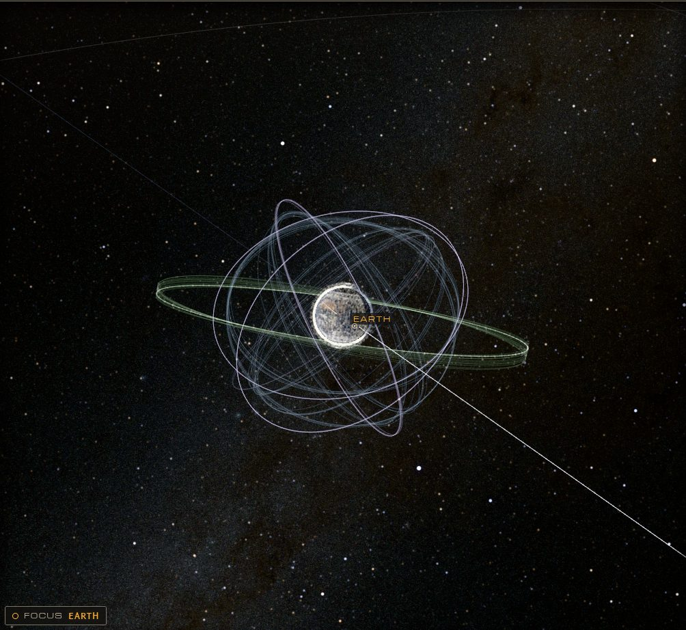
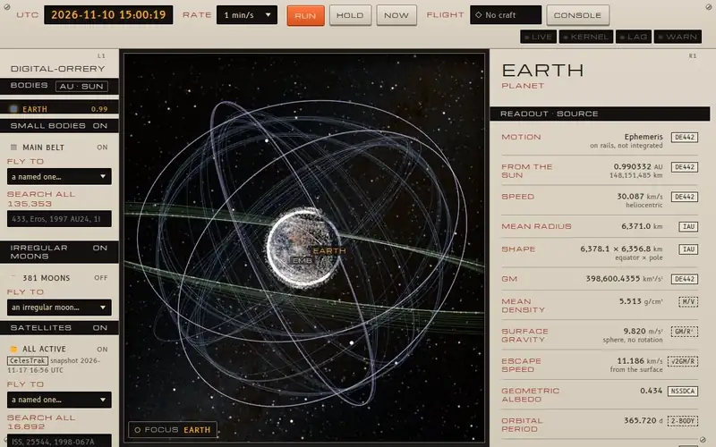
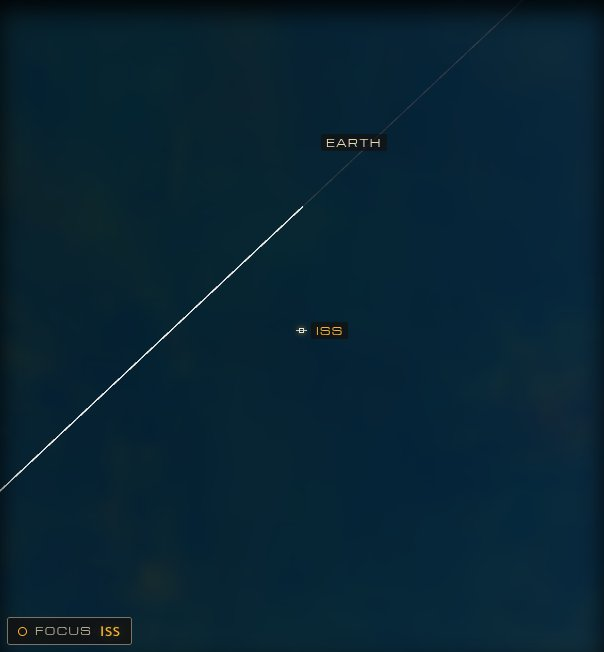
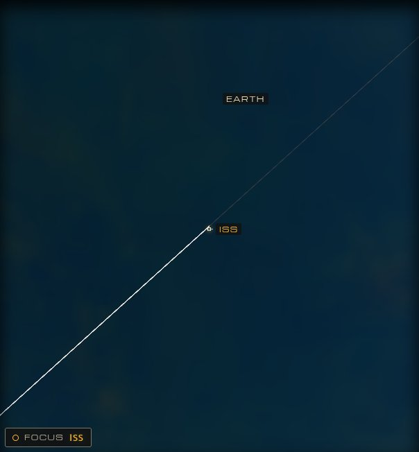
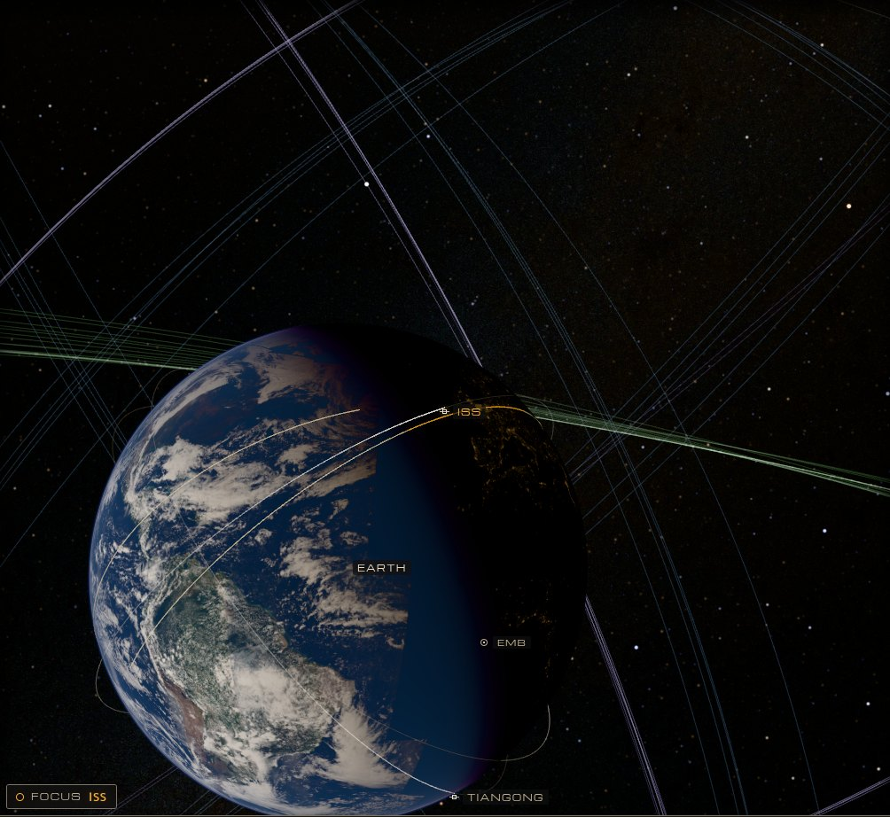
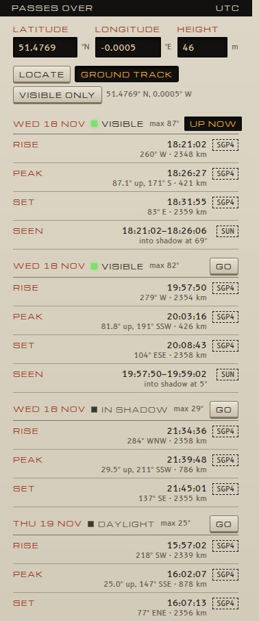

# Earth satellites

Every active satellite the US Space Force tracks, about 17,000, as points
round the Earth, moved by SGP4 from their published element sets. The
named ones carry a marker, a label and their orbit, and can be flown to.
They are the ISS, Tiangong, Hubble, the GPS and Galileo constellations
and the weather satellites in geostationary orbit, plus any found by
search. The rail's **Satellites** section switches the layer on; it is
off until then, and its data loads the first time.

| | |
| --- | --- |
|  |  |
| The Earth with all 16,892 on, 17 Nov 2026 12:00 UTC | Further out: the GPS and Galileo shells and the geostationary ring |

Code: [`src/physics/satellites.js`](../../src/physics/satellites.js) (the
physics), [`src/scene/satellites.ts`](../../src/scene/satellites.ts) and
[`satellites.worker.ts`](../../src/scene/satellites.worker.ts) (drawing),
[`satellite-rail.tsx`](../../src/app/satellite-rail.tsx) and
[`satellite-plate.tsx`](../../src/app/satellite-plate.tsx) (the rail and
the data plate); [`passes.js`](../../src/physics/passes.js) and
[`satellite-passes.tsx`](../../src/app/satellite-passes.tsx) (passes over
a place, [below](#passes-over-a-place)).

## The data

**GP element sets.** The US Space Force fits each tracked object's
observations with a "general perturbations" (GP) theory and publishes
the fit's mean elements. These are the two-line element sets (TLEs) of
old, now as an Orbit Mean-Elements Message (OMM) [1], whose keywords
CelesTrak serves as CSV and JSON [2]. Each set gives an epoch, the mean
motion and its first two derivatives, the eccentricity, inclination,
node, argument of perigee and mean anomaly, and SGP4's drag term B\*.
These are SGP4's own mean elements, not an osculating ellipse: they give
the right positions only through SGP4 [3], [4].

**The snapshot.** `npm run fetch:satellites`
([`satellites.fetch.mjs`](../../src/physics/satellites.fetch.mjs)) asks
CelesTrak for four groups: `active` (every satellite: 16,892 on
17 November 2026), `gps-ops`, `galileo` and `weather`. It writes:

- `public/data/satellites.csv`, the `active` group as CelesTrak sends it
  (2.5 MB, 0.9 MB compressed);
- `public/data/satellites.json`, with when it was fetched, the spread of
  the epochs (median 17 November 06:00 UTC), and the named ones.

The named ones are 85. Three are chosen by catalogue number: the ISS
(25544, the Zarya module), Tiangong (48274, its core module Tianhe) and
Hubble (20580). The rest are every member of `gps-ops` (32) and
`galileo` (32), and the members of `weather` in geostationary orbit
(18: GOES, Meteosat, Himawari, Fengyun, INSAT, GEO-KOMPSAT).

**CelesTrak's usage policy** [5], which the script and the browser follow:

- GP data changes once every 2 hours, so the script keeps each answer in
  `~/.cache/digital-orrery/celestrak/` and reuses it while it is under
  2 hours old.
- The CSV format, which is a third the size of JSON, compressed in transit.
  The task asked for OMM JSON. CSV carries the same OMM keywords, and the
  policy asks for it.
- Any answer but HTTP 200 stops at once, with no retry: the script prints
  CelesTrak's message for a person to read.

**Live refresh.** The rail's **Latest** key fetches CelesTrak's current
`active` CSV from the browser (2.5 MB), at most once in 2 hours from the
same browser (a timestamp in `localStorage`), and replaces the snapshot
until the page is reloaded. An answer other than 200 is reported and not
retried. Nothing else in the layer talks to CelesTrak, and SECURITY.md
lists the request.

## Moving them: SGP4

SGP4 is the theory the elements are fitted with [3]: secular gravity
(J2 and J4), drag through B\*, and short-period J2 terms, at near-Earth
periods. Above 225 minutes it becomes SDP4, with the Moon's and the Sun's
pull and the 12- and 24-hour resonances. That covers GPS, Galileo and
everything geostationary: 802 of the snapshot. The code is
[satellite.js](https://github.com/shashwatak/satellite-js) [6], a port of
Vallado's revised SGP4 [4]. It runs in AFSPC mode (`opsmode 'a'`), as the
operational code that fits the elements does and as Vallado's reference
outputs do. In its other mode case 23599 of the verification set, a
low-inclination deep-space orbit, comes out 964 m off.

satellite.js's index also exports a WebAssembly build, whose top-level
`await` the app's worker bundles cannot hold. So
[`sgp4.js`](../../src/physics/sgp4.js) imports the two plain-JavaScript
modules the app uses, the OMM reader and `sgp4`, by path. The package is
pinned at 7.1.0 so the paths stay put.

**Epochs.** EPOCH is given to the microsecond. `satrecOf` keeps it to the
microsecond for the time since epoch, so half a millisecond (4 m of the
ISS's track) is not lost. satellite.js's own reader rounds it to the whole
millisecond for SDP4's lunar-solar setup. That moves a deep-space state
by up to 35 mm in the verification set: the "deep-space" tolerance below.

### From TEME to J2000

SGP4 gives positions in TEME, the true equator and mean equinox of date:
the Earth's equator of date, with its x axis the equinox moved back along
the equator by the equation of the equinoxes. The app works in J2000. As
Vallado et al. do ("of date", [4, App. C, eq. (C-3)]):

$$\mathbf r_\text{J2000} = P^\text{T} N^\text{T} R_3(-E_{q,\text{geo}})\,\mathbf r_\text{TEME},\qquad E_{q,\text{geo}} = \Delta\psi\cos\varepsilon$$

- *P* is the IAU 1976 precession.
- *N* is the IAU 1980 nutation (the full 106-term series), the matrices
  [`earthRotation.js`](../../src/physics/earthRotation.js) builds for the
  Earth's orientation ([Body orientation](../physics/orientation.md)).
- *E*q,geo is the equation of the equinoxes without the
  kinematic terms added in 1994. Those terms belong to the Earth's rotation,
  not to TEME's equinox [4, App. C].
- The IERS corrections to the 1980 nutation (dψ, dε) are left out: SGP4's
  frame never had them (0.05", 2 m at GEO).
- *P* and *N* take TT from the leap-second table. UT1 doesn't enter,
  because TEME and the Earth-fixed frame share the pole of date.

Velocities turn with the same matrix. The frame's own turning (the
precession and nutation rates, about 10⁻¹¹ rad/s) is left out of them:
0.4 mm/s.

The turn matters: at the ISS's epoch, TEME as it is would put it 25.8 km
from Horizons' position, against 106 m after it (below).

## Drawing

**The points.** A worker
([`satellites.worker.ts`](../../src/scene/satellites.worker.ts)) runs SGP4
for the whole catalogue at a time t₀, about 8 ms once its code is warm. It
turns each state into J2000 and from there into the two-body ellipse
through it: the perifocal axes **P** and **Q**, the semi-major axis, the
eccentricity, the mean anomaly at t₀ and the mean motion (with WGS-72's
μ, SGP4's own). The vertex shader carries each point along its ellipse,
solving Kepler's equation as the small bodies' shader does
([Asteroids and comets](small-bodies.md#drawing)). Between refreshes the
CPU does nothing per satellite.

A new t₀ is asked for whenever the worker is free, the clock has moved
5 s from the last one, and at least 100 ms have passed. It is asked for
the clock's time plus the last round trip at the clock's rate, so it
arrives centred.

- **At real time** a point is never more than 5 s of clock from SGP4's
  state. The J2 acceleration the ellipse leaves out, about 0.01 m/s² in
  low orbit, moves it under a metre in that time.
- **At an hour a second** a refresh comes every 100 ms of wall clock,
  6 minutes of sim time, and the ellipse is up to a few kilometres off.
  At a day a second the low orbits are a blur.

Each refresh sends 0.7 MB to the GPU.

Each point is a Gaussian of fixed width in device pixels, as the stars'
and the small bodies' are, so it neither shimmers nor vanishes as the
view turns.

- **Brightness.** Its peak falls as 1/*d* from the camera (0.35 of white
  at 40,000 km, capped at 1.2). That is a magnitude range halved, as the
  small bodies' is. The layer fades out between 1 and 3 million km from
  the Earth, where 17,000 points would sum to a glowing dot.
- **Shadow.** A satellite in the Earth's shadow is drawn at a fifth of
  that, a dim blue-grey against the sunlit ones' warm white. The shadow is
  a cylinder of the Earth's radius behind it:

  $$\mathbf r\cdot\hat{\mathbf s} < 0\quad\text{and}\quad |\mathbf r - (\mathbf r\cdot\hat{\mathbf s})\,\hat{\mathbf s}| < R_\oplus$$

  Here ŝ is the Sun's direction from the Earth (DE442). The real umbra is
  a cone narrowing by 0.27° of its own, so at GEO it is 1,300 km under
  the cylinder's 6,378 km. The penumbra lasts a few seconds in low orbit.
  Both are left out.
- **Depth.** The points are drawn after the bodies, with the depth test on
  the logarithmic depth buffer, so the Earth hides those behind it.

Positions are camera-relative, as everything in the scene is. The Earth's
render position is worked out in double precision on the CPU, and the
shader adds each satellite's geocentric position, at most 0.4 render
units away, to it.

**The named ones.**

- **Markers.** A small square with a bar through it for its panels, in
  its group's colour: stations pale, Hubble amber-pale, GPS blue, Galileo
  violet, weather satellites green, found ones grey. They are placed by
  SGP4 itself on the main thread each frame (85 calls, under a
  millisecond), and dim in the Earth's shadow.
- **Labels.** The stations, Hubble and found ones show their names within
  60,000 km of the camera. The constellations' members show theirs on
  hover only, since dozens round the Earth would bury it. A label behind
  the Earth is hidden.
- **Orbits.** One period of each, sampled by SGP4 in the worker (129
  points) and centred on the clock, drawn with the planets' orbit shader:
  a faint outline and a glowing trail behind the satellite. They are
  resampled once the clock has moved 0.3 of a period, so a low orbit's
  turning plane (the ISS's node moves 5° a day) stays under it. The
  constellations' outlines are fainter than the stations'.
- **The focused one's orbit, close up.** The 129 samples leave each chord
  of a low orbit 330 km long, bowed 2 km off the path, so from closer than
  a few hundred kilometres the line would pass beside the satellite: 0.5
  to 1.4 km off the ISS, followed from 100 m to 700 km. Float32 about the
  Earth adds about a metre. Within a tenth of its distance from the Earth
  of the camera (680 km for the ISS), the stretch of 12 samples either
  side of it (a fifth of the orbit) is drawn every frame by SGP4 relative
  to the satellite, which is a vertex, in 32 steps each way that grow as
  the square of the step count. That keeps the chords' bow under 3 × 10⁻⁴
  rad seen from the satellite all along it, under a pixel, and the far
  line's 2 km bow outside the stretch is at least half the orbit's radius
  from the camera. The stretch ends on samples of the far line (within a
  metre), which leaves it to the stretch: the orbit shader's gap for a
  line of its own, the segments blacked out of the line set for a
  constellation's member. It is SGP4, not the osculating ellipse of the
  satellite's state now, because the ellipse strays from SGP4's path by
  the Earth's oblateness: 0.6 km a twentieth of an orbit on, 2 km at the
  stretch's ends and 10 to 20 km half an orbit on, for the ISS and Hubble,
  so it would not meet the far line. The 65 SGP4 calls take about 0.14 ms
  a frame (2.1 µs each, in Node), and only for the focused one.

| Before | Now |
| --- | --- |
|  |  |

## Flying to one

Choose a marker, the rail's **Fly to** list, or a search result. The
camera flies to the satellite, 200 km out (or the distance last zoomed
to), and follows it as it does a craft: its anchor is SGP4's position each
frame. It can come to within 20 m. Choosing a body in the rail leaves it.
A satellite SGP4 stops placing (decayed, or its element set out of the
theory's range) hands the camera back to the body in view.

**Search.** The rail's search box looks through every satellite in the
catalogue in three ways:

- by name (the app's own for the named ones: "Hubble" finds HST, and
  "Tiangong" finds CSS (TIANHE));
- by NORAD catalogue number (from 2026 some have six digits, which the
  old TLE format can't hold);
- by international designator ("1998-067A").

The one chosen joins the named ones, with a marker, an orbit and a plate.

**The data plate**
([`satellite-plate.tsx`](../../src/app/satellite-plate.tsx)) shows:

- where SGP4 puts the satellite now: height above the WGS-84 ellipsoid,
  distance from the Earth's centre and speed;
- whether it is in sunlight;
- its element set: the epoch and the clock's distance from it, perigee and
  apogee heights, period, eccentricity, the angles and B\*;
- whether the elements are the snapshot or live, and when they were
  fetched;
- its passes over a place ([below](#passes-over-a-place)).

Each value has its source tag: CelesTrak for the elements, SGP4 for what
is worked out from them.

## Passes over a place

The satellite plate lists the satellite's next passes over a place on the
Earth for three days: when it rises, culminates and sets, where it is in
the sky then, and whether it can be seen. The rail's **Passes** key shows
the ISS's, or those of the satellite in view. The ground under the
satellite can be drawn on the Earth, its next pass over the place brighter.

| | |
| --- | --- |
|  |  |
| The ISS over Greenwich, 18 Nov 2026 18:23 UTC: its ground track, the pass in bright amber | The plate's passes for the same evening |

Code: [`src/physics/passes.js`](../../src/physics/passes.js) (the
physics), [`passes.worker.ts`](../../src/app/passes.worker.ts) and
[`satellite-passes.tsx`](../../src/app/satellite-passes.tsx) (the
plate), [`groundTrack.ts`](../../src/scene/groundTrack.ts) (the line on
the Earth).

**The place.** Latitude (north positive), longitude (east positive) and
height, on the WGS-84 ellipsoid [8]. **Locate** asks the browser for its
position. The place is kept in this browser's `localStorage` and sent
nowhere. Until one is given it is the Royal Observatory, Greenwich.

**The frames.** SGP4's TEME turns into the Earth's own frame of the true
pole (PEF) by the Greenwich mean sidereal time, as Vallado et al. do [4,
eq. (1)]. Polar motion then turns it to the crust (ITRF):

$$\mathbf r_\text{ITRF} = W\,R_3(\theta_\text{GMST})\,\mathbf r_\text{TEME},\qquad W = R_1(-y_p)\,R_2(-x_p)$$

θGMST is the IAU 1982 expression [4, eq. (2)] at UT1. UT1 − UTC,
*x*p and *y*p are the day's Earth orientation
parameters, those the Earth's own orientation uses
([Body orientation](../physics/orientation.md)). This agrees with the
app's J2000 path (TEME to J2000, then the Earth's J2000-to-ITRF93 matrix)
within 1.3 m for the ISS. The rest is the IERS corrections to the 1980
nutation, which the Earth's frame has and TEME does not.

**Where in the sky.** From the place **r**s, with **ê**, **n̂**
and **û** east, north and up (the ellipsoid's normal there):

$$\boldsymbol\rho = \mathbf r_\text{ITRF} - \mathbf r_\text{s},\qquad \sin h = \frac{\boldsymbol\rho\cdot\hat{\mathbf u}}{|\boldsymbol\rho|},\qquad A = \operatorname{atan2}(\boldsymbol\rho\cdot\hat{\mathbf e},\ \boldsymbol\rho\cdot\hat{\mathbf n})$$

The elevation *h* is geometric. Refraction, which lifts a satellite on the
horizon by about 0.6°, is left out: its rise would come a few seconds
earlier.

**Finding the passes.** The search runs in a worker, from half a period
before the clock to three days after it:

- It samples the elevation every hundredth of a period (56 s for the ISS)
  and takes each local maximum.
- It refines each maximum by golden-section search to 1 ms.
- A pass is a maximum of 10° or more. Lower, the ground and the haze
  hide it, and Heavens-Above lists none.
- Each pass gets its rise and set, where it crosses the horizon, and the
  times it crosses 10°, each by bisection to 1 ms.
- A satellite that stays up or down for half a period either side
  (geostationary) has no passes. The plate says where it is in the sky.

The search reruns when the clock enters a new six hours, and when the
place, the satellite or its element set changes. Three days of the ISS
take about 50 ms. The list shows the next six passes; **Visible only**
keeps those that can be seen. **Go** sets the clock to a minute before a
pass rises.

**Visible.** A pass can be seen while both of these hold:

- the satellite is sunlit, outside the Earth's shadow (the cylinder
  above);
- the Sun is 6° or more below the place's horizon, the end of civil
  twilight [9], so the sky is dark enough for it to show.

This is judged from rise to set, as Heavens-Above judges it. The
satellite enters or leaves the shadow at most once in a pass, and the Sun
crosses −6° at most once. So each state is checked at both ends, and its
one change, if any, is found by bisection. A pass is marked **Visible**
if the two overlap, **Daylight** if the Sun is above −6° at its peak, and
**In shadow** otherwise. The plate gives the span it can be seen, and
whether it fades into the shadow or comes out of it. How bright it is
(its magnitude) is left out.

**The ground track.** The point under the satellite, down the
ellipsoid's normal, from a quarter of an orbit back to one ahead, in pale
amber. The next pass, rise to set, is in bright amber, and the place is
a small square. It is drawn in the Earth's frame, as a child of the
Earth's mesh, and lifted 19 km so that the surface and the clouds don't
cut it. The Earth hides the far side. SGP4 resamples it (241 points,
about 2 ms) once the clock has moved a two-hundredth of a period, at most
every 50 ms. The **Ground track** key switches it, remembered in the
browser.

## How right they are

**An element set's own error.** GP elements are good to about a kilometre
at their epoch in low orbit. The error grows by a few kilometres a day
either side, faster with the drag of a low or active orbit. The plate
shows the epoch's age. Satellites that manoeuvre (the ISS reboosts,
Starlink keeps station) jump to a new track with each new element set.

**Checks** (`npm test`,
[`satellites.test.mjs`](../../src/physics/satellites.test.mjs)):

- **SGP4 and SDP4 against Vallado's verification set** [4]. The test
  covers the 33 cases of `SGP4-VER.TLE`, turned into OMM records, against
  the MATLAB code's output (`tmatverDec2015.out`, 666 states, up to
  1,281 days from epoch). The cases include drag, deep space, the 12- and 24-hour
  resonances, the Lyddane choices, near-parabolic orbits and decays.
  - Near-Earth (158 states): within 1 mm and 1 µm/s (worst 0.14 mm and
    0.81 µm/s, the TLE epoch written to the microsecond).
  - Deep space (508 states): within 10 cm and 0.1 mm/s (worst 35 mm and
    15.5 µm/s, WIND, from the epoch's rounding above).
  - The set's error case (33334, mean motion 10⁻⁵ rev/day) is refused.
- **TEME to J2000 against Vallado et al.'s example** [4, App. C]:
  satellite 00005 three days after its epoch. SGP4 gives their TEME state
  to 0.01 mm. The turn gives their J2000 vector within 0.82 m (it moves it
  1,154 m) and their velocity within 0.50 mm/s. The matrix agrees with
  their eq. (C-2) to the 10⁻⁷ they print. The 0.8 m left is under the
  IERS nutation correction of that date (dψ = −0.052", 2.5 m at that
  distance), which the app leaves out of TEME.
- **The ISS against JPL Horizons** [7], an independent implementation of
  SGP4 and of the frame. The snapshot's ISS element set is propagated to
  nine times from 6 hours before its epoch to 6 hours after. All are
  within 106 m of Horizons' geocentric ICRF positions and 0.12 m/s of its
  velocities. Horizons says its ISS is "TLE-based" and revised it a day
  apart from the snapshot, so the residual is mostly the two element sets'
  difference. TEME taken as J2000 would be 25.8 km off.
- **The snapshot.**
  - Every one of the 16,892 is placed at the fetch time, between the
    ground and 2 million km.
  - 802 are deep-space.
  - All 85 named ones are in it.
  - The ISS's elements give 414 × 424 km and 92.94 minutes.
- **The shadow test:** points on and off the axis, the edge at the Earth's
  radius, and the ISS in shadow for 39 % of an orbit at its epoch.

**Pass checks** (`npm test`,
[`passes.test.mjs`](../../src/physics/passes.test.mjs)), against
Heavens-Above's predictions [10] for the same element set: the ISS's,
epoch 17 November 2026 20:24:46 UTC, as Heavens-Above's orbit page gave
it. The fixture holds every pass above 10° from 18 to 28 November 2026
over two places: Greenwich (51.4769° N, 0.0005° W, 46 m, 47 passes) and
Sydney Observatory (33.8597° S, 151.2048° E, 45 m, 43 passes). It also
holds seven of those passes in detail.

- **The passes:** all 90 found, none extra.
- **Culminations:** within 0.70 s of the instant Heavens-Above's link
  gives for each, which it rounds to the second on the page.
- **Peak elevations:** within their whole degree (worst 0.51° from it).
- **The 10° crossings:** within 1.3 s, for the 86 passes that peak at
  11° or more. A pass that peaks within a degree of 10 crosses it at
  times a hundredth of a degree moves by seconds. Heavens-Above's own
  move by 4 s between its summary and its details.
- **Directions** at 10°, the peak and 10° again: all in their 16-point
  compass sector, within 0.23° (the peaks above 85°, where the azimuth
  turns fast, are left out).
- **Visible, daylight or in shadow:** as they have it for all 90. Four
  passes over each place are sunlit only below 10°, and count as visible.
- **The detailed passes** (rise, 10°, shadow edge, peak, 10°, set: 38
  events):
  - the times, shadow edges included, within 1.2 s;
  - rises and sets at 0° within 0.85 s, so Heavens-Above's are geometric
    too;
  - azimuth and elevation at their times within their rounding (half a
    degree each, plus the satellite's motion in a second);
  - ranges within 0.4 km past a second's change;
  - the Sun's altitude within 0.06° of theirs (worst 0.051°).
- **The frames:** TEME to ITRF by GMST against the app's J2000 path, the
  ISS over 10 days, within 1.3 m. WGS-84 places back from ITRF within
  1 mm, from the pole to geostationary height.

`npm run fetch:satellites-horizons`
([`satellites.horizons.mjs`](../../src/physics/satellites.horizons.mjs))
rebuilds the Horizons fixture from the current snapshot's ISS.

## Performance

The layer costs about 3.5 ms a frame on an integrated GPU with all 16,892
on, and nothing measurable on a discrete one. It is off until switched on,
and costs nothing then. The numbers, and the two fixes the first timing
called for, are in [performance.md](../performance.md#earth-satellites).
The focused one's close-up orbit costs nothing measurable on either GPU
(the same section).
Nor do the passes and the ground track
([performance.md](../performance.md#satellite-passes-and-the-ground-track)).

## References

[1] Consultative Committee for Space Data Systems, "Orbit Data Messages," Recommended Standard CCSDS 502.0-B-3 (Blue Book), Washington, DC, USA, Apr. 2023. [Online]. Available: https://public.ccsds.org/Pubs/502x0b3e1.pdf

[2] T. S. Kelso, "A new way to obtain GP data (aka TLEs)," CelesTrak, 2020, updated 2026. [Online]. Available: https://celestrak.org/NORAD/documentation/gp-data-formats.php

[3] F. R. Hoots and R. L. Roehrich, "Models for propagation of NORAD element sets," Spacetrack Rep. No. 3, Aerospace Defense Command, Peterson AFB, CO, USA, Dec. 1980. [Online]. Available: https://celestrak.org/NORAD/documentation/spacetrk.pdf

[4] D. A. Vallado, P. Crawford, R. Hujsak, and T. S. Kelso, "Revisiting Spacetrack Report #3," in *Proc. AIAA/AAS Astrodynamics Specialist Conf.*, Keystone, CO, USA, Aug. 2006, AIAA 2006-6753 (rev. 3), doi: 10.2514/6.2006-6753. Paper, code and verification set: https://celestrak.org/publications/AIAA/2006-6753/

[5] T. S. Kelso, "CelesTrak usage policy," CelesTrak, May 2026, updated Nov. 2026. [Online]. Available: https://celestrak.org/usage-policy.php

[6] S. Kandadai *et al.*, "satellite.js," v7.1.0, MIT licence, 2026. [Online]. Available: https://github.com/shashwatak/satellite-js

[7] NASA JPL Solar System Dynamics, "Horizons system," ISS (−125544). [Online]. Available: https://ssd.jpl.nasa.gov/horizons/

[8] National Imagery and Mapping Agency, "Department of Defense World Geodetic System 1984: Its definition and relationships with local geodetic systems," Tech. Rep. TR8350.2.

[9] US Naval Observatory, Astronomical Applications Dept., "Rise, set, and twilight definitions." [Online]. Available: https://aa.usno.navy.mil/faq/RST_defs

[10] C. Peat, "Heavens-Above," Heavens-Above GmbH: ISS (25544) orbit, all passes and pass details over Greenwich and Sydney Observatory, 18–28 Nov. 2026, fetched 18 Nov. 2026. [Online]. Available: https://www.heavens-above.com/orbit.aspx?satid=25544
