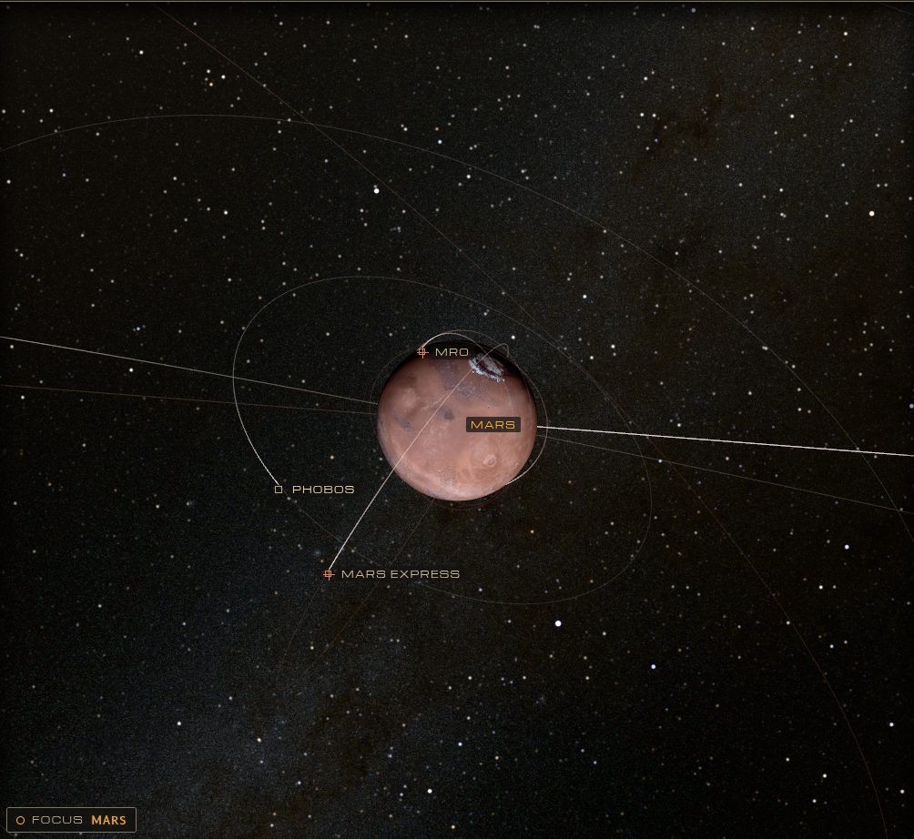

# Spacecraft beyond Earth orbit

The working spacecraft of 2026 and 2027 at Mercury, the Moon, Mars and
Jupiter, about the Sun-Earth L1 and L2 points, and in cruise, where JPL
Horizons places them [1]. The rail's **Beyond Earth** section switches them
on; each has a marker, a label and its path, and can be flown to, with a
data plate. The app flies none of them: they are on rails, as the planets
are. (The [Earth satellites](satellites.md) come from CelesTrak instead;
these have no element sets.)

Code: [`src/physics/spacecraft.js`](../../src/physics/spacecraft.js) (the
packing and the filling-in),
[`spacecraft.fetch.mjs`](../../src/physics/spacecraft.fetch.mjs) (the
fetch), [`src/scene/spacecraftLayer.ts`](../../src/scene/spacecraftLayer.ts)
(drawing), [`spacecraft-rail.tsx`](../../src/app/spacecraft-rail.tsx) and
[`spacecraft-plate.tsx`](../../src/app/spacecraft-plate.tsx).

## The craft

Twenty-eight craft, each held about the body it orbits (or the Earth for the L1 and L2 observatories, the Sun for a probe):

| Where | Craft (Horizons ID) | Days in 2026–2027 | Kept every | Worst, all checked samples | Horizons revised | Days a conic fits |
| --- | --- | ---: | --- | ---: | --- | ---: |
| Mercury | BepiColombo (MPO) (-121) | 464 | 4 min – 1 day | 1.99 km | Nov 11, 2026 | 33 |
| The Moon | Lunar Reconnaissance Orbiter (-85) | 730 | 10 min – 1 day | 2.00 km | Oct 07, 2026 | 386 |
| The Moon | Chandrayaan-2 orbiter (-152) | 344 | 10 min – 1 day | 2.00 km | Nov 03, 2026 | 1 |
| The Moon | Danuri (KPLO) (-155) | 518 | 10 min – 12 h | 2.00 km | Nov 10, 2026 |  |
| The Moon | CAPSTONE (-1176) | 225 | 10 min – 12 h | 1.98 km | Jul 20, 2026 |  |
| Mars | Mars Reconnaissance Orbiter (-74) | 333 | 20 min | 1.75 km | Nov 03, 2026 |  |
| Mars | 2001 Mars Odyssey (-53) | 389 | 20–24 min | 2.00 km | Nov 03, 2026 |  |
| Mars | MAVEN (-202) | 59 | 24 min | 1.90 km | Feb 13, 2026 |  |
| Mars | Mars Express (-41) | 730 | 4 min – 1 h | 2.00 km | Nov 03, 2026 |  |
| Mars | ExoMars Trace Gas Orbiter (-143) | 730 | 20–24 min | 2.00 km | Jan 13, 2026 |  |
| Mars | Hope (Emirates Mars Mission) (-62) | 469 | 10 min – 1 day | 1.98 km | Nov 03, 2026 | 424 |
| Jupiter | Juno (-61) | 730 | 10 min – 12 h | 1.99 km | Nov 03, 2026 |  |
| Sun-Earth L1 and L2 | James Webb Space Telescope (-170) | 730 | 1 day | 1.87 km | Nov 10, 2026 |  |
| Sun-Earth L1 and L2 | Nancy Grace Roman Space Telescope (-211) | 488 | 60 min – 1 day | 1.82 km | Nov 10, 2026 |  |
| Sun-Earth L1 and L2 | Euclid (-680) | 730 | 1 day | 0.90 km | Nov 03, 2026 |  |
| Sun-Earth L1 and L2 | Gaia (-139479) | 730 | 1 day | 0.08 km | May 16, 2025 |  |
| Sun-Earth L1 and L2 | SOHO (-21) | 347 | 60 min – 1 day | 1.99 km | Nov 03, 2026 |  |
| Sun-Earth L1 and L2 | DSCOVR (-78) | 332 | 60 min – 1 day | 1.98 km | Nov 10, 2026 |  |
| In cruise | Parker Solar Probe (-96) | 730 | 30 min – 1 day | 1.97 km | Nov 03, 2026 |  |
| In cruise | Solar Orbiter (-144) | 730 | 30 min – 1 day | 1.90 km | Nov 03, 2026 |  |
| In cruise | JUICE (-28) | 730 | 30 min – 1 day | 1.94 km | Nov 03, 2026 |  |
| In cruise | Europa Clipper (-159) | 730 | 30 min – 1 day | 1.96 km | Nov 02, 2026 |  |
| In cruise | Psyche (-255) | 730 | 30 min – 1 day | 1.99 km | Nov 03, 2026 |  |
| In cruise | Lucy (-49) | 730 | 30 min – 1 day | 0.65 km | Nov 03, 2026 |  |
| In cruise | Hera (-91) | 376 | 30 min – 1 day | 1.99 km | Nov 03, 2026 |  |
| In cruise | New Horizons (-98) | 730 | 1 day | 0.00 km | Sep 01, 2026 |  |
| In cruise | Voyager 1 (-31) | 730 | 1 day | 0.00 km | Aug 19, 2022 |  |
| In cruise | Voyager 2 (-32) | 730 | 1 day | 0.00 km | Aug 19, 2022 |  |

Where a craft has fewer days, Horizons' data end. MAVEN's reconstruction ends on 6 December 2025 and its trajectory in February 2026. DSCOVR's ends three weeks after its last tracking (30 November 2026), MRO's prediction on 30 November 2026, Chandrayaan-2's on 11 December 2026. Others end with the prediction their team delivered.

Horizons serves each craft's trajectory as its mission's navigation team
delivers it: fitted to tracking up to its latest update, then predicted.
The plate says which, by Horizons' revision date for the craft: before it,
fitted to tracking; after it, a prediction, which leaves out the manoeuvres
planned since it was made. Where Horizons' notes list the trajectories it
joins (17 of the 28), the plate's source tag names the one the clock is in. Some predictions are simplified
forecasts that follow a plain conic: on such a day a single two-body orbit
fits a low orbiter's whole day within 2 km, which no real gravity field
allows. The fetch counts those days (the table's last column), and the
plate says so.

## Holding the trajectories

`npm run fetch:spacecraft` asks Horizons for each craft's states about its
centre body (J2000 equatorial, UT) every 4 minutes for a Mercury or Mars
orbiter, 10 for a lunar orbiter and Juno, 30 for a probe and 60 for an
L-point observatory or the Voyagers and New Horizons, for 2026 and 2027.
That is about 2.5 million states. It keeps the fewest that still give
every one of them back within 2 km:

**Filling in.** Between two kept states *sa* at *ta*
and *sb* at *tb*, either

$$\mathbf r(t) = (1 - w)\,K(\mathbf s_a, t - t_a) + w\,K(\mathbf s_b, t - t_b),\qquad w = 3u^2 - 2u^3,\quad u = \frac{t - t_a}{t_b - t_a}$$

where *K* carries a state along its own two-body orbit about the centre
(universal variables, [`orbital.js`](../../src/physics/orbital.js)
`propagate` [2, Algs. 3.3, 3.4]), or the cubic Hermite curve through both
positions with both velocities. The blend is exact at both ends, and in
between it is off by what the centre's oblateness and the other bodies'
pull do in half an interval, far less than either arc alone. On a day of
MRO's (a 112-minute orbit 300 km over Mars), kept states every 20 minutes
give it within 1.8 km, where the cubic alone would be 15 km off; LRO's
hourly, 0.8 km against 440 km.

**Choosing.** For each craft and each day the fetch tries the Kepler blend
and the cubic, at every spacing that divides the day, from one state a day
down, and keeps the longest spacing that passes. For a probe it also tries
the blend about any planet it passes within 2 million km of that day
(Psyche at Mars in May 2026, JUICE at the Earth in September, Europa
Clipper at the Earth in December, Solar Orbiter at Venus in December;
Parker passes within 2 million km of Venus in February), shifted with DE442's
positions. A day nothing passes would keep every state, and say so.

**Packing.** A month's days for every craft go in one file:
`public/data/spacecraft/YYYY-MM.bin`, with an index of its segments in
`YYYY-MM.json`. A state is six float32 numbers for a craft within a
million km of its centre (4 m at 10⁵ km) and six float64 beyond. The app
loads the clock's month (and the next or last near its ends), 0.1 to
1 MB. All 28 for both years come to 194,654 states in 5.4 MB, most of it the Mars orbiters (TGO alone, 47,206).

## Drawing

- **Markers:** a small open square with a cross through it, in its group's
  colour (the user's own craft are diamonds). An orbiter's shows within a
  few hundred thousand km of its planet (Juno's and the L-point
  observatories' within 12 to 20 million km); a probe's always. Labels that
  would overlap give way.
- **Paths:** the planets' orbit shader, an outline with a glowing trail
  behind the craft: an orbiter's one period about its planet, an L-point
  observatory's half a year about the Earth, a probe's two months about the
  Sun, centred on the clock and resampled once it has moved a quarter of
  the span (at most every 250 ms of real time, which at high rates keeps a
  low orbiter's path from being resampled every frame). A probe passing a planet draws only the stretch held about the
  day's centre.
- **Flying to one:** from its marker, the rail's list, or the rail's
  FIND field ([`find.tsx`](../../src/app/find.tsx)), which fetches the
  index (21 kB) when it first takes focus, lists the craft under **Beyond
  Earth**, and switches the layer on if it is off ("Spacecraft shown"). The camera flies
  500 km out (or the distance last zoomed to), follows it and can come to
  within 20 m. A day without data hands the camera back to the body in view.
- **The plate:** distance from its centre (and height over its mean
  radius), speed about it, distance from the Sun and the Earth, light time,
  which trajectory the clock is in, Horizons' revision date, and how the
  app holds it, each with its source tag.

## Performance

About 1.6 ms a frame on an integrated GPU at real time, nothing measurable
on a discrete one, and up to 2 ms at a day a second; off until switched on,
and nothing then ([performance.md](../performance.md#spacecraft-beyond-earth-orbit)).

## How right they are

The positions are Horizons', within the 2 km of the packing: as right as
the trajectory the mission delivered. A reconstruction is good to metres or
better; a prediction drifts from the real path as the craft manoeuvres.

**Checks** (`npm test`,
[`spacecraft.test.mjs`](../../src/physics/spacecraft.test.mjs)):

- **Held-out Horizons states:** one a month a craft, from the middle of an
  interval (the furthest from both kept states), not used in the packing.
  522 of them, every craft within 2 km: worst 1.95 km (odyssey); the L-point observatories and probes within 1.3 km, the Voyagers and New Horizons exact.
- **Joins:** each day's last state and the next day's first agree (worst
  3.5 m over 8,081 joins: float32 at up to 100,000 km).
- **The files:** every craft packed within the tolerance on every day, and
  every craft carries Horizons' trajectory table.

## References

[1] NASA JPL Solar System Dynamics, "Horizons system," spacecraft trajectories (each craft's notes credit its navigation team). [Online]. Available: https://ssd.jpl.nasa.gov/horizons/

[2] H. D. Curtis, *Orbital Mechanics for Engineering Students*, 4th ed. Oxford, U.K.: Butterworth-Heinemann, 2020.
