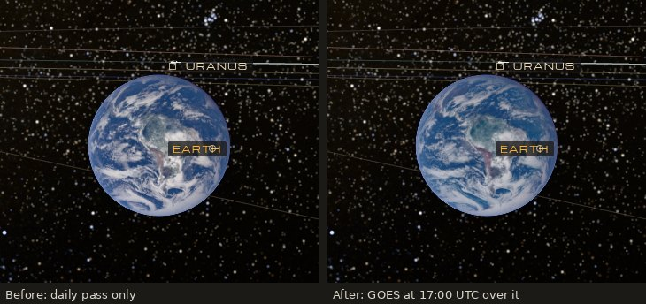
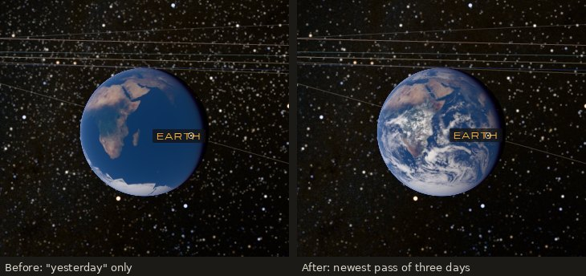
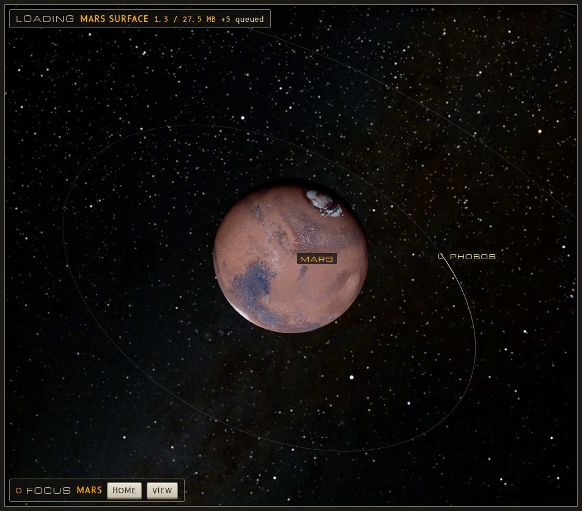
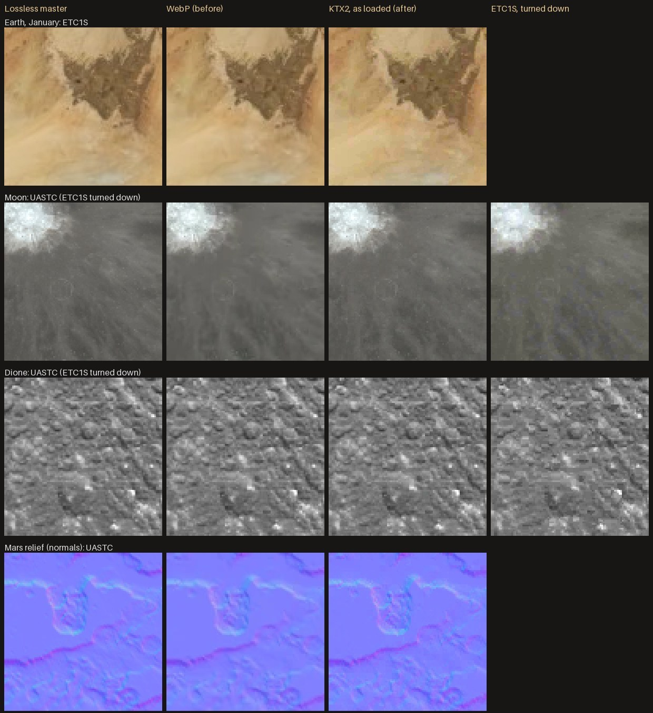

# Surface maps, rings, stars and daily Earth

Where every image the scene draws comes from, how it is turned into a
texture, and how it is put on the body. Code: `python/textures/` (the
conversion), `src/scene/surfaces.ts`, `bodyMaterial.ts`, `rings.ts`,
`stars.ts` and `clouds.ts`.

## Credits

All NASA, USGS and NOAA products are US-government public domain; the
credit lines are the ones each source asks for. Solar System Scope maps
([solarsystemscope.com/textures](https://www.solarsystemscope.com/textures/) [1])
are [CC BY 4.0](https://creativecommons.org/licenses/by/4.0/) and need their
attribution, with a link to the licence; the app's Credits list gives both.

| Body | Map | Source | Credit |
| --- | --- | --- | --- |
| Earth | Day colour, one per month (5400×2700) | Blue Marble Next Generation, 2004 base (no relief shading) | NASA Earth Observatory (Reto Stöckli) |
| Earth | Night lights (13500×6750 grey) | Black Marble 2016 | NASA Earth Observatory |
| Earth | Relief (8192×4096, 16-bit metres) | ETOPO 2022 15″ surface elevation, via the NCEI ImageServer | NOAA National Centers for Environmental Information, doi:10.25921/fd45-gt74 |
| Earth | Daily true colour for the sim date | GIBS VIIRS (NOAA-21, NOAA-20, Suomi NPP) and MODIS Terra corrected reflectance | NASA Global Imagery Browse Services (GIBS), part of NASA ESDIS |
| Moon | Colour (8192×4096) and elevation (16 px/deg) | CGI Moon Kit: LRO LROC colour, LOLA LDEM | NASA's Scientific Visualization Studio |
| Mars | Colour (8192×4096) | Viking MDIM 2.1 colour mosaic, USGS map server | NASA/JPL, USGS Astrogeology |
| Mars | Elevation (16 px/deg) | MOLA MEGDR, PDS Geosciences Node | NASA/GSFC MOLA Science Team |
| Mercury | Colour (8192×4096) | MESSENGER MDIS colour, USGS map server | NASA/JHUAPL/Carnegie Institution of Washington, USGS Astrogeology |
| Pluto | Mosaic (8192×4096) | New Horizons LORRI/MVIC, USGS map server | NASA/JHUAPL/SwRI, USGS Astrogeology |
| Jupiter | Global map (3601×1801) | Cassini PIA07782 | NASA/JPL/Space Science Institute |
| Venus | Cloud tops (4096×2048) | Solar System Scope | Solar System Scope, CC BY 4.0, based on NASA imagery |
| Saturn, Uranus, Neptune | Colour (4096, 2048, 2048 wide) | Solar System Scope | Solar System Scope, CC BY 4.0, based on NASA imagery |
| Phobos | Viking Orbiter mosaic, 40 px/deg, DLR control (2048×1024) | USGS Astrogeology GeoTIFF (Stooke) | NASA/JPL, USGS Astrogeology |
| Deimos | Viking Orbiter map (2048×1024) | USGS map server (Philip Stooke, 2001; Thomas et al. shape model) | NASA/JPL, USGS Astrogeology |
| Io | Galileo SSI and Voyager colour mosaic, 1 km/px (4096×2048) | USGS map server | NASA/JPL, USGS Astrogeology |
| Europa, Ganymede, Callisto | Galileo SSI and Voyager mosaics, 500 m and 1 km/px (4096×2048 grey) | USGS map server | NASA/JPL, USGS Astrogeology |
| Mimas, Dione, Rhea, Iapetus | Cassini ISS and Voyager mosaics, 154–803 m/px (2048×1024 grey) | USGS map server | NASA/JPL/Space Science Institute, USGS Astrogeology |
| Enceladus, Tethys | Cassini ISS mosaics, 110 and 293 m/px (2048×1024 grey) | USGS map server | NASA/JPL/Space Science Institute, USGS Astrogeology |
| Triton | Voyager 2 mosaic, 600 m/px (4096×2048, kept grey) | USGS map server (Paul Schenk, LPI) | NASA/JPL, USGS Astrogeology |
| Charon | New Horizons LORRI/MVIC mosaic, 300 m/px (2048×1024 grey) | USGS map server | NASA/JHUAPL/SwRI, USGS Astrogeology |
| Saturn's rings | Normal optical depth, 10 km bins | Cassini UVIS 126 Tau egress occultation (COUVIS_8001) | NASA PDS Ring-Moon Systems Node (Colwell et al.) |
| Uranus's narrow rings | Equivalent depth and, for α, β and ε, the shape of τ across the ring | Voyager 2 PPS β Persei (λ: σ Sagittarii) occultations, 1 km (VG_2801) | NASA PDS Ring-Moon Systems Node; orbits from French et al. 2024 ([rings](rings.md)) |
| Jupiter's main ring | Radial shape: normal I/F against radius, 14 shells | 16 New Horizons LORRI images at 11.7 and 15.3° phase (NHJULO_2001), reduced in `python/textures/lorri.py` | NASA/JHUAPL/SwRI, via the NASA PDS Ring-Moon Systems Node ([rings](rings.md#the-main-ring-from-new-horizons)) |
| Stars | The Hipparcos main catalogue: 83,392 stars to V 9 with V and B−V | ESA 1997 (SP-1200), via NASA HEASARC | ESA, *The Hipparcos and Tycho Catalogues* (1997) |
| Milky Way | Map of the light between the stars (Hipparcos and Tycho stars removed), 8192×4096, refined to 16384×8192 in tiles where the screen can show it | Deep Star Maps 2020, Milky Way layer (Hipparcos-2, Tycho-2, Gaia DR2) | NASA/Goddard Space Flight Center Scientific Visualization Studio; Gaia DR2: ESA/Gaia/DPAC |

The Venus surface is not shown: in visible light Venus is its cloud deck.
No Sun map is used, since at its true brightness the disc saturates to
white.

### The moons' maps

Fourteen of the twenty major moons have a USGS Astrogeology global mosaic,
fetched by `python/textures/fetch_moons.py`. The USGS lists each as public
domain, or with no access constraint (Europa, Charon); the credits name the
missions and USGS. Most are single requests to the USGS planetary map server [2]
(WMS `GetMap`, `EPSG:4326`, `BBOX=-180,-90,180,90`), which reprojects each
mosaic to the layout below whatever its own longitude convention. The
server's only Phobos layer is a synthetic shaded relief, so Phobos uses the
full 99 MB Viking GeoTIFF instead.

- **Colour.** Io's map is the colour mosaic. The others are grey, and are
  drawn in the moon's catalogue colour (`tint` in the manifest): the shader
  scales that colour to unit luminance, so the map's mean still sets the
  geometric albedo. Triton's mosaic is in colour, but synthesised from
  orange, violet and ultraviolet filters (green and blue-white, not the
  real pinkish white), so it is used grey too.
- **Gaps.** Where no spacecraft imaged (Triton north of about 45° N,
  Charon south of about 30° S, Galilean polar gaps), the mosaic is solid
  black or white. Blocks of that value at least 1/256 of the width across
  are filled with the imaged part's mean colour (linear light, weighted by
  area) and their edge softened, so an unseen pole shows the moon's mean
  colour.
- **Photometry.** These mosaics are normalised for mapping, so albedo
  contrasts are weaker than on the real moons. Iapetus shows it most: its
  dark leading hemisphere (Cassini Regio) is about ten times darker than the
  trailing side, but only about a quarter darker in the mosaic.
- **Not mapped.** Titan, since in visible light it is its haze (its surface
  maps are near-infrared), and the five Uranian moons. Voyager 2 saw only
  their southern hemispheres, and USGS publishes no digital global mosaic
  of them.

Sources, each read on 14 November 2026. For each moon the map server's
GetCapabilities layer abstract was read too
(`https://planetarymaps.usgs.gov/cgi-bin/mapserv?map=/maps/<planet>/<moon>_simp_cyl.map&service=WMS&request=GetCapabilities`).
The Astropedia pages give each product's resolution, longitude convention
and access constraint:

- USGS Astrogeology planetary map server (WMS):
  [planetarymaps.usgs.gov/cgi-bin/mapserv](https://planetarymaps.usgs.gov/cgi-bin/mapserv) [2]
- Phobos: [Phobos Viking Global Mosaic 5m](https://astrogeology.usgs.gov/search/map/phobos_viking_global_mosaic_5m)
  (Stooke; file [Phobos_Viking_Mosaic_40ppd_DLRcontrol.tif](https://planetarymaps.usgs.gov/mosaic/Phobos_Viking_Mosaic_40ppd_DLRcontrol.tif)) [3]
- Deimos: map server layer `VIKING` [2] (no Astropedia page found). The
  layer's abstract credits Philip Stooke, with Chris Jongkind and Megan
  Arntz, and control from Peter Thomas's Cornell shape model, released
  26 October 2001. It states no licence.
- Io: [Io Galileo SSI / Voyager Color Merged Global Mosaic 1km](https://astrogeology.usgs.gov/search/map/io_galileo_ssi_voyager_color_merged_global_mosaic_1km) [4]
- Europa: [Europa Voyager - Galileo SSI Global Mosaic 500m](https://astrogeology.usgs.gov/search/map/Europa/Voyager-Galileo/Europa_Voyager_GalileoSSI_global_mosaic_500m) [5]
- Ganymede: [Ganymede Voyager - Galileo SSI Global Mosaic 1km](https://astrogeology.usgs.gov/search/map/ganymede_voyager_galileo_ssi_global_mosaic_1km) [6]
- Callisto: [Callisto Galileo/Voyager Global Mosaic 1km](https://astrogeology.usgs.gov/search/map/callisto_galileo_voyager_global_mosaic_1km) [7]
- Mimas: map server layer `CASSINI_VOYAGER` [2]. Its abstract gives Cassini
  with Voyager fill, 216 m/px, May 2010, an update of PDS PIA11118, credit
  NASA/JPL/Space Science Institute.
- Enceladus: [Enceladus Cassini Global Mosaic 110m](https://astrogeology.usgs.gov/search/map/enceladus_cassini_global_mosaic_110m) [8]
- Tethys: [Tethys Cassini Global Mosaic 293m](https://astrogeology.usgs.gov/search/map/tethys_cassini_global_mosaic_293m) [9]
- Dione: [Dione Cassini - Voyager Global Mosaic 154m](https://astrogeology.usgs.gov/search/map/dione_cassini_voyager_global_mosaic_154m) [10]
- Rhea: [Rhea Cassini - Voyager Global Mosaic 417m](https://astrogeology.usgs.gov/search/map/rhea_cassini_voyager_global_mosaic_417m) [11]
- Iapetus: [Iapetus Cassini - Voyager Global Mosaic 803m](https://astrogeology.usgs.gov/search/map/iapetus_cassini_voyager_global_mosaic_803m) [12]
- Triton: [Triton Voyager 2 Global Color Mosaic 600m](https://astrogeology.usgs.gov/search/map/triton_voyager_2_global_color_mosaic_600m) [13]
- Charon: [Charon New Horizons LORRI MVIC Global Mosaic 300m](https://astrogeology.usgs.gov/search/map/charon_new_horizons_lorri_mvic_global_mosaic_300m) [14]
- The Uranian moons: USGS's [Foundational Data Products for Uranus and its satellites](https://fdp.astrogeology.usgs.gov/fdp/uranus/) [15]
  lists airbrush and photomosaic maps of their southern hemispheres
  (USGS I-1920 and others), but no digital global mosaic.
- Feature positions for the orientation checks: the IAU/USGS
  [Gazetteer of Planetary Nomenclature](https://planetarynames.wr.usgs.gov/) [16].
- The moons' north poles: the IAU WGCCRE 2015 report, Archinal et al.,
  *Celest. Mech. Dyn. Astron.* 130, 22 (2018),
  [doi:10.1007/s10569-017-9805-5](https://doi.org/10.1007/s10569-017-9805-5) [17].

Each map's orientation was checked by finding named features at their
gazetteer positions, and not at their mirror images (planetographic; west
longitude for the synchronous moons, east for Triton and Charon):

| Moon | Feature | Gazetteer centre | Where it is on the map |
| --- | --- | --- | --- |
| Io | [Pele](https://planetarynames.wr.usgs.gov/Feature/4638) | 18.71° S, 255.28° W | red ring at 103° E, 16° S |
| Europa | [Pwyll](https://planetarynames.wr.usgs.gov/Feature/4878) | 25.20° S, 271.40° W | rayed crater at 85° E, 25° S |
| Ganymede | [Tros](https://planetarynames.wr.usgs.gov/Feature/6091) | 11.14° N, 27.26° W | rayed crater at 29° W, 13° N |
| Callisto | Asgard ([PIA01634](https://photojournal.jpl.nasa.gov/catalog/PIA01634) [18]) | about 30° N, 142° W | bright basin near 135° W |
| Mimas | [Herschel](https://planetarynames.wr.usgs.gov/Feature/2478) | 1.38° S, 111.76° W | crater at 112° W, 5° S |
| Tethys | [Odysseus](https://planetarynames.wr.usgs.gov/Feature/4406) | 32.82° N, 128.89° W | basin at 133° W, 29° N |
| Rhea | [Inktomi](https://planetarynames.wr.usgs.gov/Feature/14671) | 14.10° S, 112.10° W | bright rays at 108–120° W |
| Phobos | [Stickney](https://planetarynames.wr.usgs.gov/Feature/5707) | 1° N, 49° W | depression near 45° W, 3° S |
| Deimos | [Voltaire](https://planetarynames.wr.usgs.gov/Feature/6431) | 22° N, 3.5° W | bright crater there, nothing at 3.5° E |
| Triton | [Ruach Planitia](https://planetarynames.wr.usgs.gov/Feature/5208), [Tuonela Planitia](https://planetarynames.wr.usgs.gov/Feature/6134), [Leviathan Patera](https://planetarynames.wr.usgs.gov/Feature/3368) | 28° N 24° E, 34° N 14.5° E, 17° N 28.5° E | smooth walled plains and the pit there; cantaloupe terrain at the mirrored spots |
| Charon | Kubrick Mons, Dorothy ([Fourmilab's copy of the gazetteer table](https://fourmilab.ch/earthview/features/CHARON_nomenclature.html) [19]) | 3.6° N 30.8° E, 58.5° N 40.6° E | the moated peak and the crater rim there |

Dione has no single feature here: its bright wispy fractures lie on the
trailing (+90° E) side, as they should. Iapetus's leading (90° W) half is the darker one even in its flattened
mosaic. Enceladus comes from the same Cassini map series and server as
Tethys, Dione and Rhea. Swift on
Deimos (12.5° N, 358.2° W) lies too near 0° to tell east from west.

## One layout for every map

Every map is equirectangular, with its west edge at −180° east longitude and
its top row at +90° latitude. Sources in other layouts are rolled to it (the
MOLA grid starts at 0° E). The USGS map server returns at most 4096 pixels a
side, so its maps are fetched as west and east halves and joined.

The moons' body frames (`bodyAxesEqj`: the IAU rotation models from NAIF's
pck00011) are the frames the USGS maps are made in, east-positive about the
IAU north pole, so the maps need no flip: see [moons](moons.md#drawing).

Conventions were checked against known features, not assumed: on the Moon
the nearside maria are dark and the farside highlands bright where expected,
and the lowest part of the LOLA grid falls in the South Pole–Aitken basin
(148° W, 62° S) with the range −8.98 to +10.69 km.

## Putting a map on a body

The shader turns each surface point into body-fixed longitude and latitude
with the body's real rotation ([body orientation](../physics/orientation.md))
and looks the map up there, so the right longitude is under the Sun at the
sim time. Near ±180° it takes the texture derivatives from whichever of
$u$ and $u + \tfrac12$ is continuous, so there is no seam.

**Brightness.** (Earth is calibrated differently; see [below](#earths-brightness).) A map gives the pattern; its scale is set so the area-
weighted mean reflectance matches the body's geometric albedo
([lighting](lighting.md#surface-reflectance)): the mean linear luminance
$\bar L$ of the map (rows weighted by $\cos\varphi$) is scaled to $1.5p$
(Lambert) or $p$ (Lommel–Seeliger).

**Relief.** Elevation $h(\lambda, \varphi)$ becomes a normal map at true
scale. On a sphere of radius $R$ the east and north slopes are

$$
\frac{\partial h}{\partial E} = \frac{1}{R\cos\varphi}\frac{\partial h}{\partial\lambda},
\qquad
\frac{\partial h}{\partial N} = \frac{1}{R}\frac{\partial h}{\partial\varphi},
$$

and the surface normal in east-north-up components is
$\hat n = \operatorname{normalize}(-\partial h/\partial E,\ -\partial h/\partial N,\ 1)$,
stored as $(\hat n + 1)/2$. The heights are first averaged down to the
output grid, so the slopes are those the grid can show. The shader rotates
$\hat n$ into the scene with the body-fixed east, north and up directions.
Relief is not exaggerated: from orbit it shows in the shading along the
terminator, as it does in real images. On Earth the sea floor is flattened
to sea level for shading, since water covers it, and clouds in the daily
image hide the relief beneath them.

**Night lights.** The Black Marble greyscale, tinted to the colour of
mostly sodium and LED street lighting, is added on the night side, fading
across the terminator. It is drawn at a display brightness, not
photometrically: a camera exposed for daylight would not record it.

## Daily Earth

For a sim date from 24 February 2000 to today, Earth's day side shows
that UTC day's GIBS true-colour mosaic (4096×2048), the newest satellite
whose record covers the day first. It is one image per day from polar
orbiters crossing the equator at about 10:30 (Terra) or 13:30 (VIIRS) local
time: the weather that day, not that minute. Pure-black pixels are no data
(polar night, swath gaps) and show the Blue Marble instead.

The last days are not whole. GIBS adds each pass some hours after it is
taken (four to five, NASA says), and on 18 November 2026 at 10:20 UTC
NOAA-21's mosaic for the day before covered only the Americas and the
Pacific, 41 % of the map against 84 % for a whole day; until then the
app drew "yesterday" at now, so Africa, Europe and Asia had no weather.
Within two days of now the sim's day is drawn over the two days before it
(those at 2048×1024), each place from the newest pass that has it
(`decode.worker.ts`): at now, the latest look the satellites have had at
each place, today's where they have passed since 00 UTC. At that hour this
gave 25 %, 41 % and 18 % of the map from the three days, the whole day's
84 %. A composite that includes today is fetched
again hourly while it is shown, as the day fills in. Older days are whole
and drawn alone.

**The geostationary frame.** Over the Americas and the Pacific the clouds
are those of the sim's minute: GIBS's GOES-East (75.2° W) and GOES-West
(137.2° W) GeoColor, a full-disc frame every 10 minutes, drawn over the
days above (`layerComposite.js`). GIBS answers a time with the frame at
or before it, and a time past its newest frame (40–60 minutes behind)
with an empty image, so the app asks for the sim time but never within an
hour of now. A frame is used where the Sun was more than 6° up at its
time (GeoColor's night side is infrared cloud over a picture of city
lights, which would hide the app's own) and within 70° of the satellite's
nadir (past that the limb is smeared), fading over the last 10° of reach
and as the Sun climbs to 20°, so a frame of one minute blends into a pass
of another hour without a seam. It is followed while time runs at most 10
minutes a second, fetched at most once a minute (two JPEGs of about
0.8 MB), and dropped above that rate. At 17:00 UTC on 17 November 2026
GOES-East gave 28 % of the globe and GOES-West 5 % more; near now, at dawn over the
Americas, much less. The shares are of the globe's area (pixels weighted
by the cosine of latitude). Asia, Africa, Europe and Australia keep the
polar orbiters' daily look: GIBS carries Himawari's view of Asia and
Australia only as infrared and red-band greyscale, not in colour, and no
Meteosat.





The Earth's readout has a **Clouds** row naming what is drawn: the GOES
frame's time where there is one (*17:00 UTC, 2026-11-17, GOES; elsewhere
11-17 and before*), else the newest day and the days under it, with each
layer's share of the globe on its source tag (GIBS). Where GIBS's images
held no data at all the row is left out, and where only the GOES frame
did, the row gives the frame and says no day was drawn under it
(src/app/clouds-row.test.mjs). The image is
calibrated like the base map (below), dropped when the sim moves more than
about a day from it, and not fetched while time runs faster than
a day per second.

### Earth's brightness

Earth's images are not normalised to its geometric albedo like the other
maps: a cloud-free base map scaled to the whole planet's albedo (clouds
included) would make the ground several times too bright. NASA publishes no
inverse of the true-colour stretch, so the images are calibrated to a known
bright target: the brightest 0.5 % of each image (fresh snow, thick cloud
tops) is set to reflectance 0.9, and the rest scales linearly. For the Blue
Marble that scale is 0.98, so the map is already close to linear
reflectance. Bare ocean then reflects a few per cent and looks near-black,
as it does without an atmosphere: the blue of Earth from space is Rayleigh
scattering, which the corrected-reflectance imagery also removes and the
[atmosphere model](atmospheres.md) adds back.

## Saturn's rings

The profile is the Cassini UVIS stellar occultation of 126 Tau (egress,
2005), 70,385 to 141,372 km in 10 km bins. Its optical depth $-1$
("unconstrained") is used for three things, handled separately:

| Case | Where | Value used |
| --- | --- | --- |
| Signal flagged missing | 81,928–84,188 km (C ring) | interpolated from either side |
| Signal at or above the unocculted star | the Colombo, Maxwell, Huygens, Encke and Keeler gaps | 0 |
| Inside the C ring's inner edge | 70,385–74,490 km (D ring) | 0 |

Where the measured depth reaches 95 % of the maximum detectable depth the
star was fully blocked (37 % of the B ring core): the true depth is only
known to exceed about 1.9, so those bins are set to 5, effectively opaque.
Taking 1.9 literally would leave the B ring 14 % transparent face-on.

The ring photometry, transparency and shadow on Saturn are in
[lighting](lighting.md#saturns-rings).

## The other planets' rings

Jupiter's, Uranus's and Neptune's rings come from published ring tables
and occultations, not maps: their sources, what is measured and what is
modelled, and how they are drawn are in [rings](rings.md). Two files are built
for them: `uranus/rings_pps.json`, from 20 Voyager PPS profiles (0.8 MB)
that `python/textures/fetch_rings.py` downloads into the source folder, and
`jupiter/rings_lorri.json`, Jupiter's main ring measured in 18 New Horizons
LORRI images (about 190 MB) that `python/textures/fetch_jupiter_rings.py`
downloads.

## Stars

The sky is two layers, both downloaded with the user's approval on
14 November 2026 and kept as originals in the texture source folder (the
8k and 16k Milky Way the same afternoon; the 4k one is kept as the white
reference):

| Layer | Source | Download | Shipped |
| --- | --- | --- | --- |
| The light between the stars | NASA SVS Deep Star Maps 2020 ([SVS 4851](https://svs.gsfc.nasa.gov/4851/) [20]), Milky Way layer `milkyway_2020_8k.exr` and `milkyway_2020_16k.exr` (the full star map with the Hipparcos and Tycho stars taken out); `_4k.exr` for the white | 137.3 MB, 434.0 MB (4k: 36.4 MB) | `stars/milky-way-8k.webp`, 8192 × 4096 8-bit sRGB, 14.9 MB; `stars/milky-way-16k/`, 128 tiles of 1024 × 1024 (1028 with their edges), 58 MB in all |
| The stars | The Hipparcos main catalogue (ESA 1997) [21], 118,218 stars, from NASA HEASARC (`heasarc_hipparcos.tdat.gz`) | 14.8 MB | `stars/hipparcos.bin`, the 83,392 stars to V 9.0, 0.83 MB |

**The Milky Way map** is plate carrée in ICRF (J2000 equatorial), centred on
RA 0h with RA increasing to the left, in linear half-float light. Its
pixels hold light per pixel, not per steradian: each doubling of the
resolution quarters them (an 8k map averaged down to 4k matches the 4k map
to within 1 %). So the 8k map is multiplied by 4 and the 16k by 16, and
both are written as sRGB with the 4k map's white, its brightest 0.01 %
(0.013 % of the 8k pixels then clip, 0.1 % of the light). The scene draws
it at half that (lighting.md), as before. Stars fainter than Tycho's limit stay in it as
unresolved light, so the Milky Way's grain is real; stars between V 9 and
Tycho's limit (about V 11.5) are in neither layer, which at the scene's
display level is below visibility anyway.

**The star file** holds, per star, five int16: x, y, z of the J2000 unit
vector times 32,767 (about 6″ resolution), V × 1,000 and B−V × 1,000
(−32,768 for the 131 stars without one, drawn at the Sun's 0.65). The
catalogue's positions are ICRS at epoch J1991.25; proper motion since then
(under 1′ for all but a handful) is not applied.

**Colour** comes from B−V in the app (`stars.ts`, `bvToRgb`): a temperature
from Ballesteros's (2012) formula [22],
T = 4600 (1/(0.92 (B−V) + 1.7) + 1/(0.92 (B−V) + 0.62)) K, a Planck spectrum
at that temperature integrated over 380–780 nm with the CIE 1931
colour-matching functions (Wyman, Sloan and Shirley's 2013 multi-lobe fit [23]),
and the XYZ-to-linear-sRGB matrix, at luminance 1. As a check, B−V 0.65
gives 5,778 K and (1.11, 0.98, 0.91), against (1.10, 0.98, 0.94) from the
Sun's measured chromaticity ([lighting](lighting.md#the-sun)).

**Credits**, as the SVS page asks (checked 14 November 2026; it states no
licence terms beyond credit; the 8k and 16k maps are the same product): NASA/Goddard Space Flight Center Scientific
Visualization Studio; Gaia DR2: ESA/Gaia/DPAC. Hipparcos: ESA 1997, *The
Hipparcos and Tycho Catalogues*, ESA SP-1200, via NASA HEASARC; ESA makes the
catalogue freely available with this acknowledgement.

An earlier stopgap split the SVS combined star map into points and
background on the machine (commit 4a660fe); it is replaced by these.

## Loading

A body's maps load the first time its disc is more than three pixels
in radius (six across), or when a flight to it starts ([camera](camera.md#maps-on-the-way)).
Maps run to 8192 × 4096, about 180 MB of video memory each with mipmaps,
and loading them used to freeze the page for up to two seconds. Now:

- **Decoding** happens in a worker (`decode.worker.ts`): it fetches the
  file, decodes and flips it with `createImageBitmap`, and transfers the
  bitmap back. Doing that on the main thread still blocked it for 59 ms (no
  options) to 246 ms (flipped, not premultiplied) per 8k map after the
  decode itself. Body maps are opaque, so they are premultiplied, which
  changes no value; the cloud mosaic has alpha and is not.
- **Uploading** happens 4 MB per frame at the top of the frame
  (`TextureUploader` in `surfaces.ts`): an immutable texture
  (`texStorage2D`) is filled in strips with `texSubImage2D`, mipmapped once
  and handed to three.js as an `ExternalTexture`. One `texImage2D` of an 8k
  map blocked for 0.41–0.55 s; a 128-row strip takes 2–3 ms, so the map goes
  up over about 32 frames.
- **GPU-compressed copies** load instead where the GPU takes them, a
  quarter of the memory and transcoded in workers, then uploaded the same
  way ([below](#gpu-compressed-maps)).
- **Earth's months**: only the current month's day map is kept; the
  previous one (78 MB) is freed when the month changes.
- **A lost WebGL context** takes these textures with it, so on restore the
  maps load again.

### Over the network

On the live site every map comes over the network, and on a slow link
the files share it: on a first visit over fast 4G the sky's 0.6 MB
preview came about 6 s after the first frame, beside the full sky (15 MB) and
the faint belt (17 MB), and Mars's maps were in 66–82 s after a flight
there started ([performance](../performance.md#loading-over-the-network)).
So:

- **A preview first.** A KTX2 map wider than 2048 px shows its 2048-wide
  levels first. KTX2 stores its levels smallest first, so that small ones
  can be sent first [24, §3.7]: the first bytes of the file, up to the end
  of the 2048-wide level, hold every level from it down (Mars's day map:
  2.1 of 29.5 MB). `ktx2.ts` asks for the first 4 KB (the header and level
  index), then that much with an HTTP byte range, makes those levels a
  KTX2 file of their own (`ktx2Range.js`: the size, level index and, for
  ETC1S, the codebook's image descriptors cut to match) and shows it, then
  asks for the rest and puts the whole map in its place. No byte is
  fetched twice, and no file is added: `ktx2Range.test.mjs` checks that a
  preview transcodes to exactly the levels the whole file does, for UASTC
  and ETC1S maps. A server that ignores ranges sends the whole file, which
  loads as before.
- **One queue** (`src/browser/loadQueue.js`). Previews start at once; the
  full maps, the full sky, the faint belt and the day's clouds wait until
  no preview is downloading, then go one at a time: the focused body's,
  then the sky, then bodies seen, then the belt and clouds. A download
  gives up its place when its bytes are in, so it decodes while the next
  one downloads.
- **All of a body's maps at once.** The day map no longer waits for the
  relief and night maps.
- **Only the flight's goal.** A body seen only in passing during a flight
  (the Moon, leaving the Earth for Mars: 37 MB) loads nothing; once the
  flight ends, bodies in view load as before.
- **The app's code alongside the ephemerides.** `main.tsx` waits for the
  DE442 tables (3 MB) before it runs the app; a `modulepreload` link
  (`vite.config.js`) now fetches the app's code at the same time.
- **What is loading is shown**: a readout window at the sky's top left
  names the most urgent download, its megabytes so far and how many more
  wait, and is gone when nothing is loading.



*Mars 1.5 s after a flight from the Earth ended, over a shaped fast 4G
link (`npm run bench:load`'s proxy): the 2048-wide preview is on, and
1.3 of the full day map's remaining 27.5 MB are in.*

### Loading the sky

The field of view is fixed at 45° vertically, so the sky's magnification
depends only on the canvas's height in device pixels. The 8k Milky Way has
22.8 texels a degree: about one a pixel on a 1080-line canvas (24 px a
degree), and it loads at start like the other maps (179 MB with mipmaps,
against 45 MB for the old 4k). On a taller canvas (a 1440-line screen, or
a 2× display) its texels are magnified, and the full 16k map would take
0.7 GB of video memory with mipmaps, more than an integrated GPU should
give a backdrop. So the 16k map is cut into 1024-px tiles, each stored
with 2 px of its neighbours on every side (wrapped in RA, repeated at the
poles) so filtering never sees a seam, and `skyDetail.ts` keeps only those
in view:

- **When.** The tiles are used while a pixel, at the canvas's full
  resolution (not the adaptive render scale's), is under 0.8 of a base
  texel: canvases taller than about 1,300 device pixels. Otherwise their
  memory is freed.
- **Which.** Each frame 25 × 15 view directions are mapped to tiles, and
  only directions where a pixel is under two 16k texels count (near the
  poles the map is stretched across, and the 8k map suffices). The most
  wanted tiles are fetched and decoded in the worker, three at a time, and
  uploaded one a frame (4.2 MB) into a texture array of 24 layers (101 MB,
  one level). A tile out of view gives its layer to a new one, the longest
  unseen first.
- **How.** The shader treats a tile as the base map's missing finer mip
  level: from the base's own derivatives it finds the 16k level of detail
  λ and mixes in the tile by 1 − λ (all tile at λ ≤ 0, all base at λ ≥ 1).
  Where a tile has not arrived the base shows, slightly softer.

## GPU-compressed maps

Every body's map also ships as a KTX 2.0 file [24] of Basis Universal
data [25], and the app loads that where the GPU can take it (`ktx2.ts`). A WebP
decodes to 8-bit RGBA, so an 8192 × 4096 map with its mipmaps takes 179 MB
of video memory. The KTX2 is transcoded in the browser, by three.js's
`KTX2Loader` [27] in its workers, to a block-compressed format the GPU
samples as it is, at one byte a texel: BC7 on desktop GPUs, ASTC or ETC2 on
phones. The same map then takes 45 MB.

**The sky stays WebP.** The Milky Way and its 16k tiles were encoded and
measured too (below), but they ship as WebP only. In UASTC, the one codec
that kept them looking the same, they took a quarter of the video memory
(43 MiB, not 171, and the tiles' array 25 MB, not 101), but the 8k map
went from 15 to 34 MB and the tiles from 59 to 97 MB. Every visitor
downloads the sky at start, while the Milky Way costs about a millisecond
a frame on the Intel GPU ([performance](../performance.md#the-belts-haze-and-the-load)),
so the download won (the user's choice, 18 November 2026).
`build_ktx2.py --sky` encodes them again, and the app takes them,
tiles included, wherever the manifest lists them.

**Two codecs.** Basis has two kinds of data:

- **ETC1S** (supercompressed with BasisLZ). Files about the size of the
  WebP, but the colour is coarse: each 4 × 4 block holds two shades of one
  colour, from a shared codebook.
- **UASTC** (with rate-distortion optimisation and Zstandard). Close to
  BC7's own quality, but the files are 2.5 to 4 times the WebP's.

**Which map gets which.** Each colour map was encoded as ETC1S at its
highest quality (`--qlevel 255`) and compared with its lossless master,
beside the WebP compared with the same master. ETC1S is kept where its luma
SSIM is within 0.015 of the WebP's and its PSNR at least 35 dB; elsewhere
the map is UASTC. The crops were looked at as well: the Moon passes the
numbers but ETC1S puts blue blotches on its grey ground, so it is UASTC
too. Normal maps are UASTC throughout: they are data, not colour, and
ETC1S's shared colours would bend them. `build_ktx2.py` lists the UASTC
maps in `UASTC`. The sky's 2048-wide preview has no KTX2: it is there to be
on screen fast, a WebP of it is decoded before the transcoder has loaded,
and it is freed a few seconds later, when the full map is up.



| Map | Size | Codec | Download, MB (WebP → KTX2) | PSNR, dB (WebP / KTX2) | SSIM (WebP / KTX2) | ETC1S tried |
| --- | --- | --- | ---: | ---: | ---: | --- |
| earth/day-01 … 12 | 5400 × 2700 | ETC1S | 1.10 → 1.26 each | 43.4–43.8 / 35.4–37.5 | 0.986–0.988 / 0.974–0.978 | |
| earth/night | 8192 × 4096 | ETC1S | 0.68 → 0.64 | 46.9 / 43.6 | 0.997 / 0.998 |  |
| earth/normal | 8192 × 4096 | UASTC | 0.35 → 4.92 | 49.0 / 52.7; normals 0.53° / 0.12° mean | 0.997 / 0.997 |  |
| moon/day | 8192 × 4096 | UASTC | 5.51 → 24.87 | 39.4 / 42.3 | 0.946 / 0.969 | 36.8 dB, SSIM 0.931 |
| moon/normal | 5760 × 2880 | UASTC | 2.81 → 11.73 | 36.7 / 39.2; normals 1.78° / 1.55° mean | 0.981 / 0.963 |  |
| mars/day | 8192 × 4096 | UASTC | 7.84 → 29.53 | 39.6 / 40.4 | 0.973 / 0.976 | 31.9 dB, SSIM 0.928 |
| mars/normal | 5760 × 2880 | UASTC | 0.97 → 8.17 | 42.8 / 45.3; normals 0.90° / 0.61° mean | 0.987 / 0.986 |  |
| mercury/day | 8192 × 4096 | UASTC | 8.15 → 30.31 | 38.3 / 39.3 | 0.976 / 0.974 | 30.4 dB, SSIM 0.934 |
| pluto/day | 8192 × 4096 | UASTC | 3.07 → 14.47 | 43.9 / 44.9 | 0.987 / 0.992 | 32.7 dB, SSIM 0.971 |
| venus/day | 4096 × 2048 | ETC1S | 0.20 → 0.81 | 45.1 / 40.8 | 0.979 / 0.983 |  |
| jupiter/day | 4096 × 2048 | ETC1S | 0.43 → 1.29 | 43.8 / 40.5 | 0.984 / 0.982 |  |
| saturn/day | 4096 × 2048 | ETC1S | 0.14 → 0.53 | 46.2 / 42.2 | 0.992 / 0.992 |  |
| uranus/day | 2048 × 1024 | ETC1S | 0.01 → 0.01 | 48.4 / 45.3 | 0.998 / 0.998 |  |
| neptune/day | 2048 × 1024 | ETC1S | 0.02 → 0.10 | 46.9 / 42.8 | 0.992 / 0.993 |  |
| phobos/day | 2048 × 1024 | UASTC | 0.41 → 1.77 | 40.7 / 41.5 | 0.973 / 0.982 | 35.5 dB, SSIM 0.939 |
| deimos/day | 2048 × 1024 | ETC1S | 0.12 → 0.31 | 44.8 / 44.3 | 0.977 / 0.976 |  |
| io/day | 4096 × 2048 | UASTC | 1.62 → 8.14 | 33.7 / 40.0 | 0.937 / 0.975 | 32.3 dB, SSIM 0.919 |
| europa/day | 4096 × 2048 | UASTC | 1.53 → 6.32 | 41.5 / 42.1 | 0.981 / 0.988 | 34.0 dB, SSIM 0.939 |
| ganymede/day | 4096 × 2048 | UASTC | 1.21 → 6.13 | 41.5 / 43.7 | 0.966 / 0.981 | 36.7 dB, SSIM 0.940 |
| callisto/day | 4096 × 2048 | UASTC | 1.18 → 5.94 | 41.2 / 44.0 | 0.965 / 0.981 | 37.7 dB, SSIM 0.946 |
| mimas/day | 2048 × 1024 | ETC1S | 0.23 → 0.40 | 42.2 / 37.6 | 0.984 / 0.972 |  |
| enceladus/day | 2048 × 1024 | UASTC | 0.84 → 2.05 | 40.6 / 40.8 | 0.994 / 0.995 | 26.0 dB, SSIM 0.900 |
| tethys/day | 2048 × 1024 | UASTC | 0.73 → 2.03 | 40.5 / 38.8 | 0.993 / 0.991 | 28.1 dB, SSIM 0.921 |
| dione/day | 2048 × 1024 | UASTC | 0.81 → 2.06 | 40.5 / 39.3 | 0.994 / 0.993 | 26.4 dB, SSIM 0.918 |
| rhea/day | 2048 × 1024 | UASTC | 0.54 → 1.89 | 40.7 / 40.4 | 0.983 / 0.988 | 32.6 dB, SSIM 0.928 |
| iapetus/day | 2048 × 1024 | UASTC | 0.59 → 1.93 | 40.8 / 40.1 | 0.988 / 0.988 | 30.3 dB, SSIM 0.935 |
| triton/day | 4096 × 2048 | ETC1S | 0.44 → 0.77 | 45.0 / 41.8 | 0.986 / 0.979 |  |
| charon/day | 2048 × 1024 | ETC1S | 0.23 → 0.29 | 42.7 / 37.7 | 0.983 / 0.968 |  |
| stars/milky-way-8k (not shipped) | 8192 × 4096 | UASTC | 14.99 → 34.00 | 39.7 / 39.1 | 0.992 / 0.987 | 30.1 dB, SSIM 0.869 |
| stars/milky-way-16k, 128 tiles (not shipped) | 1028 × 1028 each | UASTC | 59.0 → 97.1 in all | 38.7 / 37.5 mean | 0.993 / 0.984 mean | two tiles: 27.2 and 32.4 dB, SSIM 0.892 and 0.937 |

Measured on 18 November 2026 with `build_ktx2.py --measure`, each against
the lossless master: PSNR over the three channels; SSIM of the Rec. 709
luma, with an 11 × 11 Gaussian window (σ 1.5) [28]; for normal maps also the
angle between the normals, the mean shown (99th percentiles 2.6° → 2.2°,
7.6° → 7.2° and 4.9° → 3.7° for the Earth, the Moon and Mars). The KTX2
side is level 0 decoded by KTX-Software's transcoder (`ktx extract
--transcode rgb8`); the GPU's BC7 from the same data matches it closely. By
these measures every UASTC map is about as close to its master as the WebP
is, and most closer (the WebP smooths fine grain, which UASTC keeps). The
ETC1S maps measure up to 8 dB below their WebP; at three times their size
they look the same, the Earth's months (the largest gap) included.

In the app, the sky through the Milky Way's core (from Pluto, at DPR 1 on
the Intel GPU) differed from the WebP's by 41.9 dB in UASTC, which could not
be told from it, and 36.5 dB in ETC1S, whose blotches of green and blue
showed at three times the size.

**Loading.** `TextureUploader` puts the transcoded levels up as it does a
WebP's bitmap: an immutable texture (`texStorage2D` in the compressed
format, sRGB for colour maps), filled in strips of whole block rows with
`compressedTexSubImage2D`, 4 MB a frame, small levels together; there is no
mipmapping to do, since the file carries its levels (box-filtered from the
master). Levels larger than the GPU takes are skipped. The rows are stored
from the south, as the WebP is flipped when it is decoded, so the shaders
need no change. KTX2 sky tiles, where listed, go into a compressed texture
array.

**Falling back.** The WebP is loaded instead when the GPU takes none of
these formats (without `WEBGL_compressed_texture_s3tc_srgb`, BC1 cannot be
used for colour), when there are no workers or WebAssembly, when a KTX2
file fails, or with `?webp` in the address, for comparing. On Linux,
three.js leaves out ETC and ASTC, which Mesa drivers emulate in software.
A WebGL extension works only on the context that enabled it, so each
renderer enables them itself: React's StrictMode makes the scene twice in
development, and the second renderer once drew Mars black.

**Costs.** The KTX2 files take 183 MB of the repository (the WebP 128 MB),
and the UASTC maps are larger downloads than their WebP: 25 MB for the
Moon against 5.5, 29.5 MB for Mars against 7.8. The start, which loads only
the sky, adds just the transcoder (0.8 MB). What this does to loading,
memory and frame time is in [performance](../performance.md#gpu-compressed-maps).

## Rebuilding

```bash
npm run build:textures                               # everything: WebP, masters, then KTX2
python3 python/textures/build_textures.py            # all bodies
python3 python/textures/build_textures.py --only moon,rings
python3 python/textures/fetch_rings.py               # Uranus's ring profiles (0.8 MB, PDS)
python3 python/textures/build_textures.py --only uranus_rings
python3 python/textures/fetch_jupiter_rings.py       # Jupiter's main ring images (about 190 MB, PDS)
python3 python/textures/build_textures.py --only jupiter_rings
python3 python/textures/fetch_moons.py               # the moons' sources (about 160 MB)
python3 python/textures/build_textures.py --only io,europa,triton
```

The sources live outside the repo in `~/.cache/digital-orrery/textures-src`
(about 535 MB with the moons'). Converted textures go to `public/textures/` with
`manifest.json`; without the manifest every body keeps its flat albedo
colour. Each WebP's lossless master goes to the source folder's
`_work/masters` (680 MB, not committed).

The KTX2 files are made from the masters by `build_ktx2.py`, which needs
the `ktx` tool of KTX-Software [26] 4.4 or later (Apache 2.0; release
4.4.2's Linux archive was used), on the `PATH` or named by `KTX=`. It
encodes only what has changed, or was made with other settings (it reads
the settings each file records), and writes the `ktx2` list into the
manifest. The UASTC maps take most of the time: under an hour in all on
this project's 32-thread machine. `build_ktx2.py --measure` prints the quality figures above, and
`ktx2.test.mjs` (in `npm test`) checks every KTX2 against its WebP: size,
whole blocks, levels, codec, sRGB or linear, and the row order.

```bash
python3 python/textures/build_ktx2.py --only moon/,stars/milky-way-8k
python3 python/textures/build_ktx2.py --measure --report quality.json
python3 python/textures/build_ktx2.py --sky        # the Milky Way and its tiles too (not shipped)
```

Each 8k map's comparison holds about 2 GB, so `--measure` runs two at a
time.

## References

[1] Solar System Scope, "Solar System Scope textures." [Online]. Available: https://www.solarsystemscope.com/textures/

[2] USGS Astrogeology Science Center, "Planetary map server (WMS)." [Online]. Available: https://planetarymaps.usgs.gov/cgi-bin/mapserv

[3] P. Stooke, "Phobos Viking global mosaic 5m," USGS Astropedia. [Online]. Available: https://astrogeology.usgs.gov/search/map/phobos_viking_global_mosaic_5m

[4] USGS Astrogeology Science Center, "Io Galileo SSI / Voyager color merged global mosaic 1km," USGS Astropedia. [Online]. Available: https://astrogeology.usgs.gov/search/map/io_galileo_ssi_voyager_color_merged_global_mosaic_1km

[5] USGS Astrogeology Science Center, "Europa Voyager - Galileo SSI global mosaic 500m," USGS Astropedia. [Online]. Available: https://astrogeology.usgs.gov/search/map/Europa/Voyager-Galileo/Europa_Voyager_GalileoSSI_global_mosaic_500m

[6] USGS Astrogeology Science Center, "Ganymede Voyager - Galileo SSI global mosaic 1km," USGS Astropedia. [Online]. Available: https://astrogeology.usgs.gov/search/map/ganymede_voyager_galileo_ssi_global_mosaic_1km

[7] USGS Astrogeology Science Center, "Callisto Galileo/Voyager global mosaic 1km," USGS Astropedia. [Online]. Available: https://astrogeology.usgs.gov/search/map/callisto_galileo_voyager_global_mosaic_1km

[8] USGS Astrogeology Science Center, "Enceladus Cassini global mosaic 110m," USGS Astropedia. [Online]. Available: https://astrogeology.usgs.gov/search/map/enceladus_cassini_global_mosaic_110m

[9] USGS Astrogeology Science Center, "Tethys Cassini global mosaic 293m," USGS Astropedia. [Online]. Available: https://astrogeology.usgs.gov/search/map/tethys_cassini_global_mosaic_293m

[10] USGS Astrogeology Science Center, "Dione Cassini - Voyager global mosaic 154m," USGS Astropedia. [Online]. Available: https://astrogeology.usgs.gov/search/map/dione_cassini_voyager_global_mosaic_154m

[11] USGS Astrogeology Science Center, "Rhea Cassini - Voyager global mosaic 417m," USGS Astropedia. [Online]. Available: https://astrogeology.usgs.gov/search/map/rhea_cassini_voyager_global_mosaic_417m

[12] USGS Astrogeology Science Center, "Iapetus Cassini - Voyager global mosaic 803m," USGS Astropedia. [Online]. Available: https://astrogeology.usgs.gov/search/map/iapetus_cassini_voyager_global_mosaic_803m

[13] USGS Astrogeology Science Center, "Triton Voyager 2 global color mosaic 600m," USGS Astropedia. [Online]. Available: https://astrogeology.usgs.gov/search/map/triton_voyager_2_global_color_mosaic_600m

[14] USGS Astrogeology Science Center, "Charon New Horizons LORRI MVIC global mosaic 300m," USGS Astropedia. [Online]. Available: https://astrogeology.usgs.gov/search/map/charon_new_horizons_lorri_mvic_global_mosaic_300m

[15] USGS Astrogeology Science Center, "Foundational data products for Uranus and its satellites." [Online]. Available: https://fdp.astrogeology.usgs.gov/fdp/uranus/

[16] IAU Working Group for Planetary System Nomenclature and USGS, "Gazetteer of Planetary Nomenclature." [Online]. Available: https://planetarynames.wr.usgs.gov/

[17] B. A. Archinal et al., "Report of the IAU Working Group on Cartographic Coordinates and Rotational Elements: 2015," *Celest. Mech. Dyn. Astron.*, vol. 130, art. no. 22, 2018, doi: 10.1007/s10569-017-9805-5.

[18] NASA/JPL, "PIA01634," NASA Photojournal. [Online]. Available: https://photojournal.jpl.nasa.gov/catalog/PIA01634

[19] Fourmilab, "Charon nomenclature" (copy of the gazetteer table). [Online]. Available: https://fourmilab.ch/earthview/features/CHARON_nomenclature.html

[20] NASA Scientific Visualization Studio, "Deep Star Maps 2020," SVS 4851. [Online]. Available: https://svs.gsfc.nasa.gov/4851/

[21] ESA, *The Hipparcos and Tycho Catalogues*, ESA Rep. SP-1200, 1997, via NASA HEASARC.

[22] F. Ballesteros, "New insights into black bodies," *EPL*, vol. 97, no. 3, Art. no. 34008, 2012, doi: 10.1209/0295-5075/97/34008.

[23] C. Wyman, P.-P. Sloan, and P. Shirley, "Simple analytic approximations to the CIE XYZ color matching functions," *J. Comput. Graph. Tech.*, vol. 2, no. 2, 2013. [Online]. Available: https://jcgt.org/published/0002/02/01/

[24] The Khronos Group, "KTX file format specification," version 2.0.4. [Online]. Available: https://registry.khronos.org/KTX/specs/2.0/ktxspec.v2.html

[25] Binomial LLC, "Basis Universal GPU texture codec." [Online]. Available: https://github.com/BinomialLLC/basis_universal

[26] The Khronos Group, "KTX-Software," release 4.4.2, Oct. 2025. [Online]. Available: https://github.com/KhronosGroup/KTX-Software/releases/tag/v4.4.2

[27] three.js authors, "KTX2Loader," three.js documentation. [Online]. Available: https://threejs.org/docs/#examples/en/loaders/KTX2Loader

[28] Z. Wang, A. C. Bovik, H. R. Sheikh, and E. P. Simoncelli, "Image quality assessment: from error visibility to structural similarity," *IEEE Trans. Image Process.*, vol. 13, no. 4, pp. 600–612, Apr. 2004, doi: 10.1109/TIP.2003.819861.
