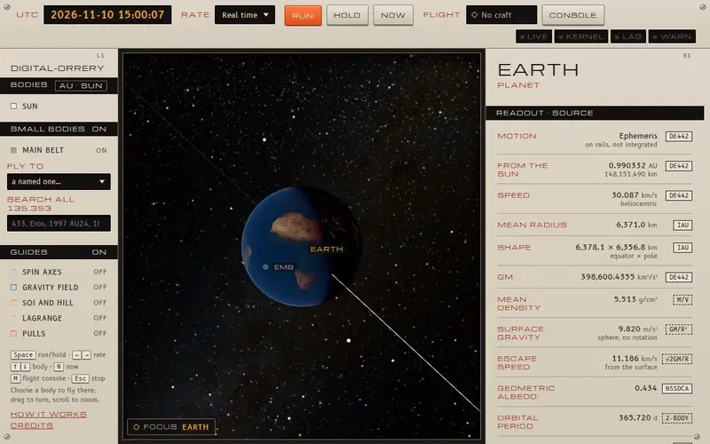
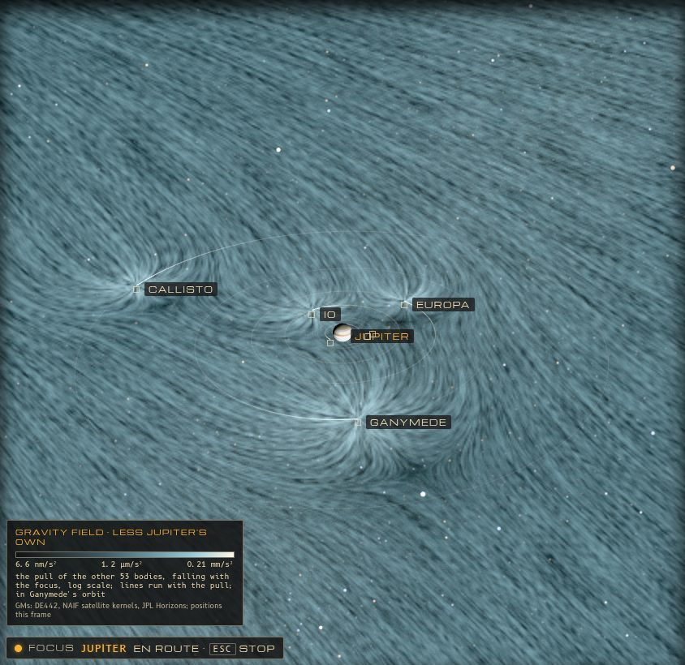
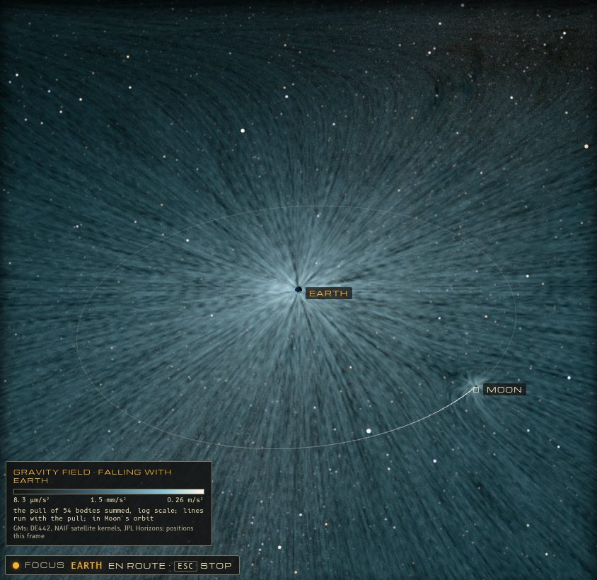
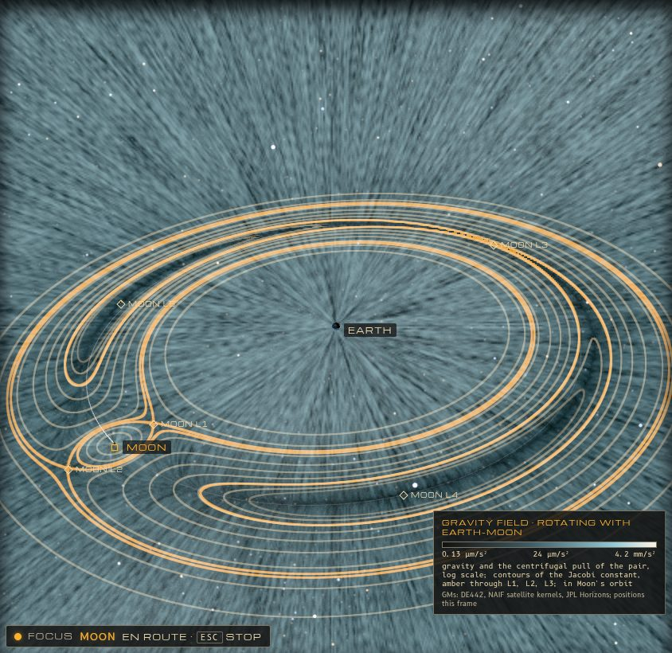
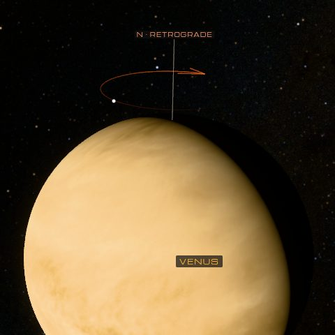
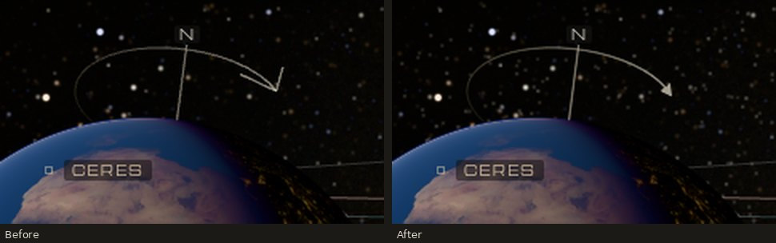

# Gravity guides

Drawing aids that show how gravity works in the scene: the field of every
body at once, each body's spin axis and the way it turns, its real gravity
field on the surface, its sphere of influence and Hill sphere, the Lagrange
points, and the strongest pulls on a body. Each has its own switch in the
rail's **Guides** section and is off until switched on. Code:
`packages/physics/src/gravityGuides.js`, `gravityFlow.js` and `spin.js` (the
physics, tested in `gravityGuides.test.mjs` and `gravityFlow.test.mjs`),
`src/scene/guides.ts`, `gravityField.ts` and `gravityFlow.ts` (the
drawing).

All of them are drawn at a display level, divided by the exposure like the
orbit lines ([lighting](../frontend/lighting.md#exposure-and-tone-mapping)),
so they read the same at any distance from the Sun.

## The field of every body

The **Gravity field** switch draws the gravitational field of the whole
solar system the way a physics textbook draws an electric one: field lines
in a plane through the focused body, running with the pull, brighter where
it is stronger. Every body with a GM is in the sum, 54 of them: the Sun,
the planets at their own centres with their own GMs, the Moon and the 43
moons that have one. At a point $\mathbf p$,

$$
\mathbf a(\mathbf p) = \sum_i \frac{GM_i\,(\mathbf r_i - \mathbf p)}{\max(|\mathbf r_i - \mathbf p|,\,R_i)^3},
$$

so inside a body of radius $R_i$ its pull is a uniform sphere's, falling to
zero at the centre. The positions are the scene's this frame (DE442, the
moons' tables), so the field moves with the bodies. The planets' system
GMs are split as the kernel splits them: the planet's own GM from its
satellite kernel at its centre, and each moon's at the moon. The 33 small
moons with no GM (Pan, Uranus's irregulars and others) are left out; the
largest, Puck, would weigh about 10⁻⁶ of Uranus.

**Frames.** The rail's **Frame** picks what is drawn (its **Plane** sits beside it):

- **Inertial:** $\mathbf a(\mathbf p)$ itself. Near the Earth the Sun's
  pull (5.9 mm/s²) outweighs the Earth's beyond 259,000 km, so at the
  Moon the field runs sunward.
- **Falling** (the default): $\mathbf a(\mathbf p) - \mathbf
  a(\mathbf r_f)$, the field as seen falling freely with the focus $f$,
  which is what moves things relative to it. The Sun's near-uniform pull
  drops out, leaving the focus's own pull and the others' tides: the Earth
  and the Moon with the saddle between them.
- **Less its own:** the same, without the focus's own pull:
  what pulls things off their orbits about it. At Jupiter its four large
  moons' wells fill the view; with its own pull in, each moon outweighs
  Jupiter only within a few of its own radii (Callisto within 14,000 km).
- **Rotating:** the circular restricted three-body problem of
  the focus and its parent (the Sun and Jupiter for the Sun), turning at
  $n^2 = G(M + m)/d^3$ about their barycentre $B$ at their present
  separation $d$, in their orbit's plane. Its effective potential is
  $$
  \Phi = -\frac{GM}{|\mathbf p - \mathbf r_P|} - \frac{Gm}{|\mathbf p - \mathbf r_S|} - \tfrac12 n^2 \rho^2,
  $$
  with $\rho$ the distance from the axis through $B$, and the lines follow
  $-\nabla\Phi$ (gravity and the centrifugal pull; the Coriolis term needs
  a velocity, which a field has none of). Contours of the Jacobi constant
  $C = -2\Phi d/G(M + m)$ are drawn every 0.2 in $\log_{10}(C - C_4)$,
  between half a decade below $C_3$ and above $C_1$, and the three through
  L1, L2 and L3 in amber: the zero-velocity curves that open the necks
  between the bodies and the outside. L1–L3 are $\Phi$'s saddles, L4 and
  L5 its peaks. The pair's GMs are the ones the Lagrange guide uses, so
  the saddles fall on its markers. The other bodies are not in this sum:
  the frame belongs to the pair.

**Plane.** In the rotating frame, the pair's orbit. Otherwise the rail's
**Plane** chooses:
- **Orbit:** the focus's system: the orbit of its largest moon (the
  Moon's for the Earth, Ganymede's for Jupiter, Titan's for Saturn), its
  own orbit about its parent for a moon or a planet without moons, and
  the ecliptic for the Sun.
- **View:** square to the line of sight, through the focus. It never
  goes edge-on, but bodies off it show only their pull at that distance.

The field is drawn in the plane, $\mathbf a$'s part along it; the
brightness is $|\mathbf a|$ on a log scale over four and a half decades,
topped by the focus's pull at 3 % of the camera's distance (or at its
surface, if that is farther). The legend gives the scale's ends and middle.

**On the GPU.** Three passes a frame, at half the screen's resolution:
1. **Field:** each pixel's ray from the camera meets the plane, and the
   sum above is worked out there in single precision. Positions are
   relative to the focus, so single precision holds at any scale: the
   largest error in the tests' six places, from the main belt to Charon,
   is 2.3 × 10⁻⁷ of the field. The pull's direction in the plane is
   carried to the screen through the projection's derivative at that
   point, and stored with $\log_{10}|\mathbf a|$ and, rotating,
   $\log_{10}(C - C_4)$, in a half-float target.
2. **Flow:** line-integral convolution (Cabral and Leedom [10]): each
   pixel averages a fixed noise texture along its own field line, 20
   pixels each way, so the grain lines up with the field. A ripple in the
   averaging kernel whose phase runs on makes the grain flow down the
   lines toward the masses, as Forssell and Cohen animate it [11]. The
   flow's speed is for display only, and it stands still with reduced
   motion.
3. **Plane:** a disc 40 times the camera's distance across, through the
   focus, depth-tested against the bodies, shows the flow and the
   brightness, and the contours in the rotating frame.

**Check.** `gravityFlow.test.mjs` compares the sum with the kernel's own
force sum (`nbody.js`, written separately) at six places, from 100 km
above Ganymede to the main belt: within 4.5 × 10⁻¹⁶ of it, and within
1.7 × 10⁻¹⁵ in the falling frame. The same sum in float32, as the GPU does
it, is within 2.3 × 10⁻⁷. In the app, the GPU's field, read back from its
target at 144 pixels, matches the same sum done in double precision from
the same uniforms in six views (Jupiter in three frames, the Earth, the
Earth–Moon rotating frame, Saturn in the view plane): $\log_{10}|\mathbf
a|$ within 0.0039 (0.0076 at the Sun's scale; the half-float target's
step, under 1 % and 2 % in $|\mathbf a|$), the direction on screen within
0.02°, $\log_{10}(C - C_4)$ within 0.001. For the rotating frame, Newton's
method on $-\nabla\Phi = 0$ from 1 % off each point finds the L1–L5 that
`lagrangePoints` solves for, to 10⁻¹⁰ of the separation or better, for
Sun–Earth, Earth–Moon, Sun–Jupiter, Jupiter–Ganymede and Saturn–Titan;
the Hessian there makes L1–L3 saddles and L4 and L5 peaks. The Earth–Moon
Jacobi constants 3.1883, 3.1722, 3.0121 and 2.9880 at L1–L4 match Koon,
Lo, Marsden and Ross [9].

**Cost.** Interleaved runs on the Intel UHD iGPU and the RTX 5070 Ti, a
1440 × 900 window, median frame:

| View | Intel, before → after | RTX, before → after |
| --- | --- | --- |
| Jupiter at 6 million km, field (falling) and spin arrows | 12.7 → 14.7 ms | 6.3 → 6.9 ms |
| Earth and Moon at 1.3 million km, field (rotating) | 13.4 → 15.2 ms | 6.4 → 6.9 ms |
| The Sun at 1.2 billion km, field (inertial) | 15.1 → 15.3 ms | 7.8 → 8.1 ms |
| Earth, Saturn and Jupiter, guides off (the orbit lines' fade) | 13.2, 12.2, 12.8 → 12.9, 11.5, 12.6 ms | 6.8, 6.1, 6.3 → 6.0, 6.0, 6.1 ms |

The field costs about 2 ms a frame on the iGPU and under 1 ms on the RTX,
and nothing while it is off.

## Spin axes and direction

A faint grey line through each body's poles, 1.5 radii from its centre each
way, the north half brighter and tagged **N** once the disc is more than 12
pixels across. The axis is the body-fixed Z of [body orientation](orientation.md):
the IAU pole for the Sun and planets (Archinal et al. [1]), Earth's of date from
precession and nutation, and the synchronous moons' own.

Over the north pole, 1.2 radii from the centre, a curved arrow 0.45 radii
across shows which way the body turns: an arc of 270° fading in from its
tail to a filled head, going round as the body does. The axis and the arc
are strokes 1.5 CSS pixels wide whatever the distance, and the head 12
pixels long and 8 across (or 30° of the arc on a small disc), drawn as
quads widened on screen with their edges smoothed by each pixel's coverage
(`screenLines.ts`), so they stay crisp and steady as the arrow turns.
Until November 2026 they were 1-pixel GL lines with a two-stroke head,
aliased and shimmering as the arc went round.

 The sense is the sign of the
IAU rate $W_1$ of the prime meridian angle $W = W_0 + W_1 d$ [1] (`spin.js`:
the Sun, planets, Moon and Pluto from the 2015 report, the planets' moons
from NAIF's pck00011), or, for a moon with no IAU model, which the app
turns with its orbit, the orbit's sense. The arrow turns at a display rate,
from 0.3 to 1.6 radians a second on a log scale of $|W_1|$, so Jupiter's
goes faster than Venus's without either being a blur or still.

A body that turns against its own orbit about its parent (the angle
between its spin and its orbit's pole over 90°) is **retrograde**: its
arrow is amber and its tag reads **N · retrograde**. Among the planets
these are Venus (177.4°), Uranus (97.8°) and Pluto (119.6°). The IAU's
"north" for planets and moons is the pole on the north side of the
invariable plane, so Venus's and Uranus's $W_1$ are negative. For dwarf
planets it uses the right-hand rule instead, the positive pole: Pluto's
$W_1$ is positive but its pole lies south of the ecliptic, so it is tagged
**+** rather than N. Triton, whose orbit is retrograde, turns with that
orbit and so is prograde by this measure. Each tag's title gives the
sidereal period and the rate.

**Check.** `gravityFlow.test.mjs` differences the app's own orientation
(`orientation.js`) a minute either side of the date to get each body's
angular velocity, $\boldsymbol\omega = \tfrac12 \sum_i \mathbf e_i \times
\dot{\mathbf e}_i$ over its axes. For all 61 bodies with an IAU rate, the
sign of $\boldsymbol\omega$ along the pole is the sign of $W_1$ and its
size is within 2 % of $|W_1|$ (the worst, Phobos at 0.65 %, is its forced
libration); the 26 moons with no model turn with their orbits; and
exactly Venus, Uranus and Pluto are retrograde.

## Gravity fields

The rail's **Surface gravity** switch: the free-air gravity anomaly on the
surface, from the same coefficients the kernel flies with, as a diverging colour map (blue low, amber high) with a
contour every half of the scale's end and a legend giving the unit, the
range and the source:

| Body | Field | Shown |
| --- | --- | --- |
| Earth | EGM2008 to degree and order 70 (Pavlis et al. 2012 [2]) | Less the WGS 84 ellipsoid's normal field (its even zonals to degree 10, NIMA TR8350.2 [3]), so what remains is the geology: −106 to +135 mGal at this degree |
| Moon | GRAIL GL0660B to degree and order 100 (Konopliv et al. 2013 [4]) | About a sphere: the mascons of the nearside maria stand out (Serenitatis +274 mGal, Imbrium +240) |
| Mercury, Venus | J2 only (sources in `bodies.js`) | The oblateness alone, said so in the legend. Craft near them feel their full fields (JGMESS160A and MGNP180U, [the space environment](environment.md#mercurys-and-venuss-gravity-fields)), but the guide doesn't draw them yet |
| Mars, Jupiter, Saturn, Uranus, Neptune | J2 only (sources in `bodies.js`) | The oblateness alone, said so in the legend: the app holds no fuller field for them |

On a sphere of the reference radius $R$, in the spherical approximation,

$$
\Delta g(\varphi, \lambda) = \frac{GM}{R^2} \sum_{n=2}^{N} (n - 1)
\sum_{m=0}^{n} \bar P_{nm}(\sin\varphi)\,
\left(\Delta\bar C_{nm} \cos m\lambda + \bar S_{nm} \sin m\lambda\right),
$$

with $\Delta\bar C_{n0}$ the coefficient less the normal field's (Earth
only) and $\bar P_{nm}$ the fully normalised Legendre functions by the
standard forward recursions (Holmes and Featherstone 2002 [5]). The sum is split
per latitude row, $A_m = \sum_n (n - 1) \bar P_{nm} \bar C_{nm}$, so a row
costs $N^2 + N \times$ columns instead of $N^2 \times$ columns. The Moon's
720 × 361 map still takes about a quarter of a second, so the maps are
worked out in a worker (`gravityField.worker.ts`) the first time each is
wanted, and the coefficient files load there only then. Degree 70 resolves about
290 km on Earth ($\pi R / N$), degree 100 about 55 km on the Moon.

Units are mGal (10⁻⁵ m/s²), or Gal (cm/s²) where the anomalies pass
5,000 mGal: Jupiter's J2 alone gives +18 Gal at the equator and −36 Gal at
the poles. GRAIL's coefficients are in the Moon's principal-axis frame and
the app draws the Moon in the mean-Earth frame; the two differ by about
0.02°, a tenth of a map cell, so the map is not rotated.

**Check.** With $(n + 1)$ in place of $(n - 1)$ the same sum is the radial
pull of the harmonics (the gravity disturbance). `gravityGuides.test.mjs`
compares it with the kernel's own acceleration (`geopotential.js`,
Cunningham's recursion, a different method) on EGM2008 to degree 30 at five
places, with and without C₂₀: they agree to 10⁻¹¹ mGal. The test also checks
that Earth's anomaly averages to zero, that Tibet stands high and Hudson
Bay low, and that GRAIL's Imbrium and Serenitatis mascons are strongly
positive.

## Spheres of influence and Hill spheres

For every body that orbits another, about its parent, from its osculating
orbit (semi-major axis $a$, eccentricity $e$, from its state relative to the
parent this frame) and the two GMs ($m$, $M$):

- **Sphere of influence** (Laplace; Curtis, *Orbital Mechanics for
  Engineering Students*, "Sphere of influence" [6]), a solid amber ring:
  $r_\text{SOI} = a\,(m/M)^{2/5}$. Inside it the body's pull, taken as a
  perturbation of the parent's, matters more than the parent's taken as a
  perturbation of the body's: where patched conics switch from one to the
  other.
- **Hill sphere** (Hamilton and Burns 1992 [7]), a dashed pale-green ring:
  $r_H = a(1 - e)\,(m/3M)^{1/3}$, at pericentre. Where the body can hold a
  satellite against the parent's tide; to first order the distance to its
  L1 and L2.

Each is drawn as a sphere's outline about 1.5 pixels wide where the surface
turns edge-on, brighter for the focused body and its moons; rings under 8
pixels across, or ones the camera is inside, are not drawn. The focused
body's radii are tagged at the top of each ring.

| Checked against | Value | Here |
| --- | --- | --- |
| Earth's SOI, Curtis's masses | 925 × 10³ km | 924.7 × 10³ km |
| Moon's SOI about Earth | 66.1 × 10³ km | 66.2 × 10³ km |
| Jupiter's SOI | 48.2 × 10⁶ km | 48.22 × 10⁶ km |
| Earth's Hill radius | 1.47 million km | 1.4714 million km |

The planets' GMs are their systems' (planet and moons, DE442), as the
barycentres they orbit by carry.

## Lagrange points

The five equilibrium points of the circular restricted three-body problem
for a pair with mass ratio $\mu = m_2/(m_1 + m_2)$. In units of the pair's
separation, from the barycentre (primary at $-\mu$), the collinear points
are the roots of

$$
x - \frac{(1 - \mu)(x + \mu)}{|x + \mu|^3} - \frac{\mu (x - 1 + \mu)}{|x - 1 + \mu|^3} = 0,
$$

solved by Newton's method from $1 - \mu \mp (\mu/3)^{1/3}$ (L1, L2) and
$-1 - 5\mu/12$ (L3) (Szebehely 1967 [8]); L4 and L5 make equilateral triangles
with the pair, L4 leading. They are placed at the pair's present separation
and in its present orbital plane (from the secondary's position and
velocity relative to the primary), so they move with the bodies, and they
are exact only for a circular orbit. Drawn for Sun–Earth, Earth–Moon and
Sun–Jupiter, and for the focused body with its parent; a marker within 14
pixels of its secondary on screen is not drawn (Sun–Earth L1 and L2 are
1.5 million km from Earth, a pixel at the overview).

Checks: Earth–Moon with $\mu$ = 0.012150585609624 gives L1, L2, L3 at
0.836915, 1.155682 and −1.005063 (Koon, Lo, Marsden and Ross 2011 [9], to the
six places they give): 326,381 km and 448,915 km from Earth at 384,400 km;
Sun–Earth L1 and L2 about 1.5 million km sunward and anti-sunward. With the
small bodies on, Jupiter's trojans sit around its L4 and L5.

## Strongest pulls

For the focused body, the four strongest gravitational accelerations on it
from the other bodies, $GM/d^2$, as faint amber lines to each puller with a
tag giving the acceleration (m/s², mm/s², µm/s² or nm/s²); the tag's title
gives the distance. On Earth: the Sun 6.06 mm/s², the Moon 29.8 µm/s²,
Venus and Jupiter a few tenths of a µm/s². On the Moon the Sun's pull
(6.06 mm/s²) is more than twice Earth's (2.42 mm/s²), which is why the
Moon's path about the Sun is everywhere concave toward the Sun. These are
the whole pulls, not the tides: what moves a body relative to its parent is
the difference of a pull across the pair, which the kernel integrates
([n-body kernel](nbody-kernel.md)).

## References

[1] B. A. Archinal *et al.*, "Report of the IAU Working Group on Cartographic Coordinates and Rotational Elements: 2015," *Celest. Mech. Dyn. Astron.*, vol. 130, no. 3, Art. no. 22, 2018, doi: 10.1007/s10569-017-9805-5.

[2] N. K. Pavlis, S. A. Holmes, S. C. Kenyon, and J. K. Factor, "The development and evaluation of the Earth Gravitational Model 2008 (EGM2008)," *J. Geophys. Res. Solid Earth*, vol. 117, no. B4, Art. no. B04406, 2012, doi: 10.1029/2011JB008916.

[3] National Imagery and Mapping Agency, "Department of Defense World Geodetic System 1984: Its definition and relationships with local geodetic systems," Tech. Rep. TR8350.2.

[4] A. S. Konopliv *et al.*, "The JPL lunar gravity field to spherical harmonic degree 660 from the GRAIL Primary Mission," *J. Geophys. Res. Planets*, vol. 118, no. 7, pp. 1415–1434, 2013, doi: 10.1002/jgre.20097.

[5] S. A. Holmes and W. E. Featherstone, "A unified approach to the Clenshaw summation and the recursive computation of very high degree and order normalised associated Legendre functions," *J. Geodesy*, vol. 76, no. 5, pp. 279–299, 2002, doi: 10.1007/s00190-002-0216-2.

[6] H. D. Curtis, *Orbital Mechanics for Engineering Students*, 4th ed. Oxford, U.K.: Butterworth-Heinemann (Elsevier), 2020. Section "Sphere of influence" (Sec. 8.4).

[7] D. P. Hamilton and J. A. Burns, "Orbital stability zones about asteroids," *Icarus*, vol. 96, no. 1, pp. 43–64, 1992, doi: 10.1016/0019-1035(92)90005-R.

[8] V. Szebehely, *Theory of Orbits: The Restricted Problem of Three Bodies*. New York, NY, USA: Academic Press, 1967.

[9] W. S. Koon, M. W. Lo, J. E. Marsden, and S. D. Ross, *Dynamical Systems, the Three-Body Problem and Space Mission Design*, 2011.

[10] B. Cabral and L. C. Leedom, "Imaging vector fields using line integral convolution," in *Proc. 20th Annu. Conf. Comput. Graph. Interact. Techn. (SIGGRAPH '93)*, 1993, pp. 263–270, doi: 10.1145/166117.166151.

[11] L. K. Forssell and S. D. Cohen, "Using line integral convolution for flow visualization: Curvilinear grids, variable-speed animation, and unsteady flows," *IEEE Trans. Vis. Comput. Graphics*, vol. 1, no. 2, pp. 133–141, 1995, doi: 10.1109/2945.468406.
