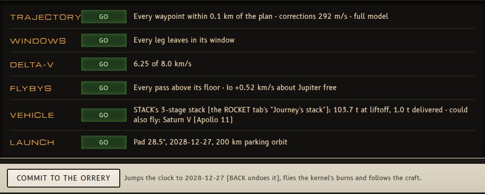
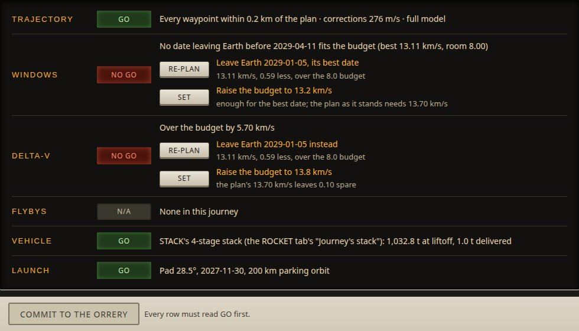
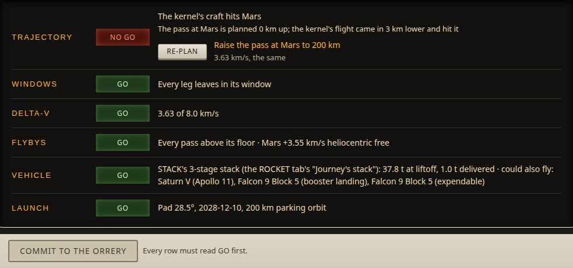
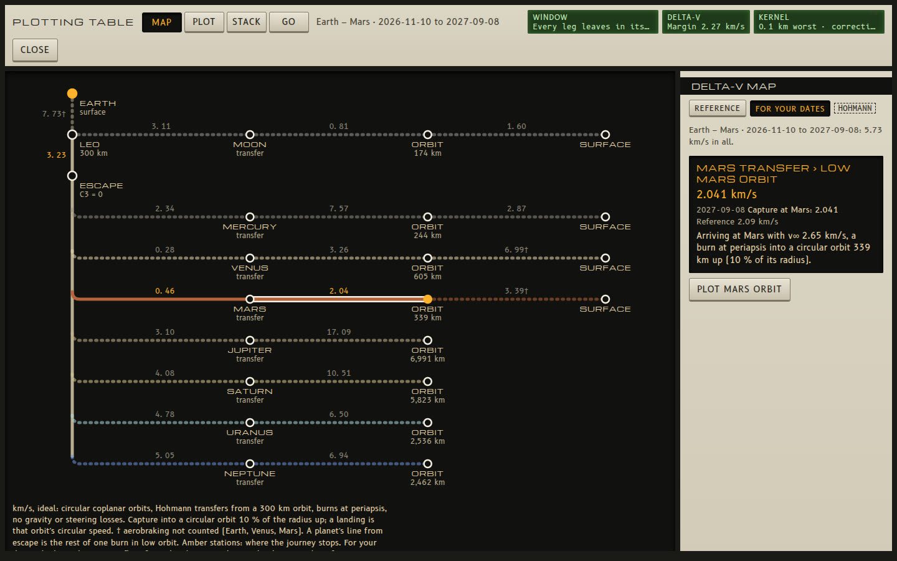
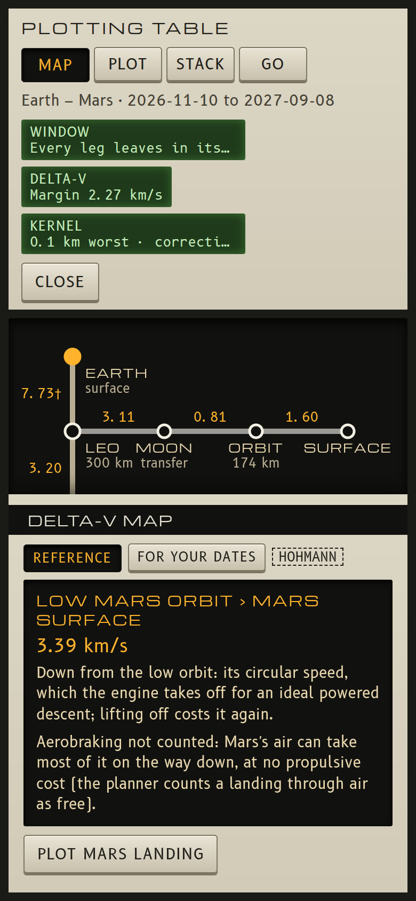

# Journeys: legs, transfers, flybys and the rocket

The PLANNER tab plans a whole journey, not just one hop. You give a start
and any number of waypoints in order. Each leg is solved by patched conics
as you edit, and the n-body kernel flies the whole journey once you let go.
Each leg's transfer options are set side by side, and you can pick one.
The journey's delta-v is then turned into a stack of stages.

The code:
- **`packages/physics/src/transfers.js`:** closed-form transfers and flyby pieces.
- **`packages/physics/src/journey.js`:** legs, chaining, options and drawing.
- **`packages/physics/src/journeyFlight.js`:** the kernel's flight.
- **`packages/physics/src/staging.js`:** the rocket.
- **`packages/physics/src/dvMap.js`:** the delta-v map.
- **The app side:** `src/app/journey.ts` holds the store,
  `src/app/journey-panel.tsx` the panel, `src/app/journey.worker.ts` runs
  the kernel off the page's thread, and `src/scene/journeyLayer.ts` draws
  the journey in the scene.

The reference throughout is Curtis, *Orbital Mechanics for Engineering
Students*, 4th edition (Butterworth-Heinemann, 2020) [1]. It is cited by
section, equation and example; staging is chapter 13 there (chapter 11 in
the first two editions).

## A journey

- **The start:** the pad (a parking orbit at a given altitude, reached by
  the rocket below), an orbit, or the selected craft's own state.
- **Each waypoint:** a body and what happens there. The bodies are the
  planets, the Moon, the planets' other twenty major moons (`moons.js`:
  JPL's mean elements, with Horizons' GM and radius) and the named small
  bodies. What can happen:
  - **flyby:** the lowest altitude it may pass at;
  - **orbit:** a circular orbit at an altitude, and a stay;
  - **land:** landing from that orbit, then a stay.
- **Dates:** each waypoint has an arrival date, and leaves when its stay
  ends. A flyby leaves the moment it arrives.

Each leg is solved about the body its two ends share:
- **About the Sun:** two planets or small bodies.
- **About a planet:** the planet and its own moon (Earth to the Moon and
  back), or two moons of one planet.
- **About the Sun, from the planet:** a moon to another planet. The leg runs
  from the moon's planet, and the moon's own escape is patched on (three
  levels of patched conics).
- **An orbit change:** the same body at both ends, with no flyby. This is a
  Hohmann transfer (or bi-elliptic, or phasing) between the two orbits, and
  it sets its own arrival. Later waypoints keep their spacing from it.
- **A return to the same body:** if either end is a flyby, the leg goes
  round the Sun and back on a resonant orbit (Galileo's two years from
  Earth to Earth; below).

### One leg, by patched conics

A leg between two bodies is Lambert's arc between their centres over the
time of flight (orbital.js `lambertRevs`, 0 to 2 revolutions; the cheapest
is kept). The excess velocity at each end is the arc's velocity less the
body's: $\mathbf v_\infty = \mathbf v_\text{arc} - \mathbf v_\text{body}$.
The burns:

- **Leaving a circular orbit of radius $r_p$** (Curtis 8.40, Examples 8.4
  and 8.9):
  $$\Delta v = \sqrt{v_\infty^2 + \frac{2\mu}{r_p}} - \sqrt{\frac{\mu}{r_p}}$$
- **Captured into a circular orbit** (Curtis 8.58, Example 8.10, with
  $e = 0$):
  $$\Delta v = \sqrt{v_\infty^2 + \frac{2\mu}{r_p}} - \sqrt{\frac{\mu(1+e)}{r_p}}$$
- **Landing:** the waypoint's altitude is the orbit before the landing,
  and the ledger says how each landing is paid for.
  - **Airless** (the Moon, Mercury, most moons, small bodies): there is no
    air to brake in, so the engine takes off the whole speed. The capture
    into that orbit, then a powered descent of its circular speed,
    $\Delta v = \sqrt{\mu / r_p}$ (1.63 km/s from 100 km over the Moon),
    ideal, with no gravity losses. The flight's own descent pays them: from
    100 km over the Moon it flies 1.87 km/s.
  - **Through an atmosphere** (Venus, the Earth, Mars, Titan; an entry
    probe at a giant): entry and parachutes, no propulsive delta-v. The
    ledger lists it as a free line with the entry speed. A last touchdown
    burn is not costed or flown. Real Mars landers need one: the thin air
    leaves them falling fast under the parachute, and they finish on
    retro-rockets or airbags.
  - **From an orbit at the same body** (an orbit, then a landing there):
    the orbit change to the landing's orbit, then the descent as above.
    Through an atmosphere, the transfer's first burn lowers the periapsis
    to the landing's height, and nothing circularises there: the ledger
    calls it a deorbit burn.
  - **Lifting off again:** an ascent to the orbit's circular speed, again
    with no losses, then whatever leaving it costs.
- **A moon of another planet:** its GM and radius are Horizons'. Titan's
  atmosphere takes a landing, as the planets' do. The kernel pulls with
  the major ones, and the flight treats them as it does the Moon (below,
  Flying it).
- **A small body:** its gravity is a guess, a sphere of its diameter at
  2,000 kg/m³. That is tiny either way, so a capture is a rendezvous, about
  $v_\infty$.
- **A moon left for another planet:** priced by where the moon really is
  on the day (below).
- **A planet's own moon:** the free end is a point on the parking orbit at
  the planet, in the moon's orbit plane. It is placed where the leg costs
  least, by 36 trial angles and then a golden-section search.

### Leaving a moon by where it is

A leg from a moon to another planet is solved about the Sun from the
moon's planet. Its excess velocity $\mathbf v_{\infty,P}$ is the planet's.
Three levels of patched conics join it to the moon
(`transfers.js asymptoteVelocities`, `moonExcess`):

- **The hyperbola about the planet:** it starts at the moon's place
  $\mathbf r_m$ on the day, and leaves along $\mathbf v_{\infty,P}$. Its plane
  holds both. The eccentricity vector, $\mu\mathbf e = \mathbf v\times\mathbf h -
  \mu\hat{\mathbf r}$ [1, Sec. 2.5], is the same at $\mathbf r_m$ as far out on
  the asymptote, where $\hat{\mathbf r}$ is $\hat{\mathbf u}$, the asymptote's
  direction, and $\mathbf v$ is $v_\infty\hat{\mathbf u}$.
- **The velocity there:** write it as $v_r\hat{\mathbf r} + v_t\hat{\mathbf t}$,
  with $\hat{\mathbf t}$ in the plane at right angles to $\hat{\mathbf r}$,
  towards $\hat{\mathbf u}$, at angle $\varphi$ from $\hat{\mathbf r}$, and
  $h = r v_t$. The two components of that equality are then
  $$r v_t\,(v_t - v_\infty\sin\varphi) = \mu(1 - \cos\varphi),\qquad
  v_r = v_\infty\cos\varphi + \frac{\mu\sin\varphi}{r v_t}.$$
- **Two roots:** the first is a quadratic in $v_t$, with one root of each
  sign. The craft swings the short way round to the asymptote, or the long
  way. Both have the energy $v_\infty^2/2$. Over 500 random states, both
  leave along $\mathbf v_{\infty,P}$ to $10^{-13}$, checked against the
  asymptote of the orbit they start.
- **The excess about the moon:** $\mathbf v - \mathbf v_m$, from the
  cheaper root. It is the departure's excess speed in Curtis 8.40 above.
- **A swing-by of the planet:** a root that is still falling inward
  (arriving, still rising) passes its periapsis $r_p$ on the way. That is
  a path like any other, unless it comes near the planet. A root whose
  periapsis is under twice the planet's radius $R$ is charged a margin on
  its excess speed (`transfers.js swingbyMargin`), with
  $u = r_p/R - 1$ its height in planet radii:
  $$\delta v = V\,\frac{(1-u)^2}{u},\qquad V = 0.1\ \text{km/s}.$$
  - **Its shape:** none from $2R$ out, where it starts flat, so its slope
    is zero there. 50 m/s at half a radius up, 810 at a tenth, and
    without bound at the surface. A root that dives into the planet is
    never taken.
  - **Why a margin and not a line:** a root given up the moment its
    periapsis crosses a line makes the price jump as the moon moves, when
    the other root is dearer. The rule this replaced refused a root under
    half the moon's distance, unless both were. Leaving the Moon for Mars
    (below) it jumped 0.69 km/s between stays of 20 and 21 days. On day 20
    the cheaper root (3.44 km/s, perigee 74,000 km) was refused. On day 21
    the dearer one's perigee came under the line too, and a 101,000 km
    perigee was taken. With the margin, the dearer root takes over
    smoothly, as the cheaper one's margin grows to the difference.
  - **Flown:** the flight aims early for a swing-by
    ([Flying it](#flying-it), step 9). Ten days into the stay below, the
    cheaper root dives to a perigee of 673 km, inside the Earth, and the
    other is taken.

**The phase.** Over a month the moon goes round, so the price swings.
Leaving lunar orbit for Mars on 31 Oct 2026, the Moon's velocity is 66°
off the way out: 2,227 m/s. The old price took the moon as moving the way
out, its best phase (the speed needed at its distance, less its own, as
scalars): 1,652 m/s. The flight, in the full model, pays 2,222: 0.2 % less.

The window strips step a day at a time for these legs, not every 8 days,
so the month's ripple shows. Two days into that week's stay, the departure
is 1,647 m/s; thirteen days in, 3,240. A day later the cheaper way out
swings by the Earth 3,700 km up (a 30 m/s margin), and it is 2,611. The
planner suggests the best day
(`journey.js phaseOption`):

- **The search:** every day's best flight time, from the arrival at the
  moon (or the start date) to the planned departure, or a whole turn of
  the moon if the stay is shorter. It is the porkchop search over that
  span, with a departure a day.
- **Where it shows:** as an option for the leg ("Best phase of the
  Moon"), as a mark under the leg's strip that can be clicked to leave
  then, and as the phase lamp when it saves more than 50 m/s and 3 %.
- **On the week's stay:** it is 26 Oct, 2.4 days in. The leg costs 3.71
  km/s, against 4.34 as scheduled; the departure is planned at 1,657 m/s
  and flown at 1,660.

Arriving at a moon from another planet is priced the same way, with time
reversed: the state $(\mathbf r, -\mathbf v)$ leaves along
$-\mathbf v_{\infty,P}$. The ideal options (Hohmann and the others) keep the
best phase, as they keep circular coplanar orbits.

The flight aims such an arrival at the moon itself: at its B-plane point,
from the excess velocity about the moon where it is on the day (`moonArr`).
The planet's own pull on the way in is in every trial run. (It used to aim
at the planet's centre plus the moon's periapsis offset, and the craft hit
the Earth.) Mars orbit to lunar orbit, leaving 11 Aug 2028:
- the Moon 1.3 km off the planned periapsis, for 65 m/s of aims;
- the capture 2,072 m/s, against the plan's 2,123;
- landing instead: down at 2.2 m/s.

The planets' major moons are reached the same way, through their planet's
well (Flying it, step 2). Earth orbit to Europa orbit, on the porkchop
option from 1 Jan 2027 (29 Nov 2027 to 10 Feb 2031, with a deep-space
burn):
- Europa 0.1 km off the planned periapsis, 6.85 km/s about it;
- the capture 5,810 m/s, against the plan's 5,787 (0.4 %);
- landing instead: down at 2.1 m/s, for 1,681 m/s of descent;
- before, with the moon taken as having no gravity: 300 km low, into
  Europa.

A flyby of such a moon is aimed at it too, by its excess velocity about the
moon (`moonArr` is worked out for a flyby as well, though nothing is priced
from it there): Europa passed 0.0 km off a planned 2,061 km periapsis,
where it was aimed at Jupiter before. Every leg that reaches a moon via its
planet carries `moonArr`: the Lambert arc, the deep-space burn and broken
plane near 180 degrees, the bi-elliptic leg and a craft's own leg. The
near-180° branch once dropped it at a flyby. Earth to an Io flyby on the
plotting table's dates for Io (30 Nov 2027 to 12 Apr 2031, 190.7° round
the Sun) was then aimed at Jupiter with Io's periapsis offset, 69,309 km
from Jupiter's centre (its radius is 71,492 km), and hit it. Aimed at Io,
it passes 0.2 km off the planned 2,221 km periapsis.

Each aim's trial runs fly the planet's pull, and a planet takes any
straight course that passes within its capture radius,
$R\sqrt{1 + 2\mu/(R v_\infty^2)}$. That is wider than the orbits of
several moons: at 6 km/s about 700,000 km for Jupiter (Io and Europa); at
3 km/s about 700,000 km for Saturn (Mimas to Rhea) and 180,000 km for
Uranus (Miranda). Mars's, Neptune's and the Earth's moons lie outside
theirs. So a run with no correction, or the first guess (a two-body arc
about the Sun straight at the moon), can fall into the planet. When every
run does, the aim had nothing to start from and found no burn. When the
run with no correction clears it but every correction falls in, the aim
kept no burn at all and came no nearer (595,700 km off, on the way to
Rhea). Either way every aim after it failed the same way, the craft flew
on into the planet, and the GO board said it had drifted in. Now such an
aim aims at the planet instead:
- **outside the planet's sphere:** at its B-plane point for the planned way
  in, without the planet, as at a planet (step 2 of Flying it). That is the
  hyperbola about the planet that comes in along the leg's excess velocity
  $\mathbf v$ and passes the moon's place $\mathbf r_m$ at
  $\mathbf v_{about}$ (`moonArr`). Its angular momentum
  $\mathbf h = \mathbf r_m \times \mathbf v_{about} = \mathbf B \times
  \mathbf v$, with $\mathbf B \perp \mathbf v$, gives
  $\mathbf B = (\mathbf v \times \mathbf h)/v^2$. It is timed to the
  hyperbola's periapsis, less the bending the planet has given by then;
- **inside it:** at the moon's point as before, from a two-body arc about
  the planet.

The next aim at the moon then starts from a course that clears the planet.
Only an aim that fails this way takes it, so flights that worked fly as
before. Swept from the pad, as orbits, landings and flybys, on the
porkchop dates with the arrival moved by up to two days:
- **Io, Europa, Ganymede, Callisto and Titan** (775 flights, six starts
  from Nov 2026 to Mar 2030): 50 hit Jupiter this way, none Saturn. Flown
  again, none of them does: 29 fly GO, 11 need too many corrections and 5
  miss (most with a deep-space burn the plan puts inside Jupiter's sphere,
  25 days out), 2 hit Io itself, and 6 are last flybys whose planned way on
  falls into Jupiter (below);
- **the moons of Mars, Saturn, Uranus and Neptune** (471 flights, three
  starts): 3 hit Saturn this way (a Rhea orbit and landing and an
  Enceladus flyby, the aims keeping no burn), and fly GO now. The aim fell
  back to the planet in 15 of them, all at Saturn. Triton was cut at 3
  flights (the porkchop's transfer takes 49 years). None hit Mars, Uranus
  or Neptune.

A journey that ends in a flyby of such a moon is flown an hour past it.
Where the plan's way on falls below the planet's cloud tops (the approach's
periapsis about the planet after the moon, under its radius), the flight is
flown on to that periapsis instead, so it meets the planet where the plan
does. CASE 24's Io flyby a day later (there 13 Apr 2031) is one. Io is half
way round, between the craft and Jupiter, so both hyperbolas through its
place dive, and the plan's reaches 2,206 km from Jupiter's centre 3 h after
Io. The craft passes Io 0.1 km off the planned periapsis and hits Jupiter
2.93 h later. It read GO.
CASE 17's Europa flyby on the porkchop dates (there 22 Jul 2031) is
another: its way on reaches 3,098 km from Jupiter's centre, and it now
reads NO GO too.

### From a planet's orbit to its moon

A leg from a planet's parking orbit to one of its moons used to leave from
the cheapest free point on a ring in the moon's plane. The flight then
waited for the craft to come round to that point, up to a turn (41 h at
344,000 km over Jupiter), and reached the moon's place well after the
moon. GO's stop in Jupiter orbit before an Io flyby (What to change) left
910 min late, missed Io by 17,441 km and needed 5.15 km/s of corrections.

Now, where the stop was reached by a capture, the plan leaves from where
the craft is (`journey.js parkedContext`, `parkingPlane.js`
`flownParking` and `parkedAt`):
- **the capture as the flight flies it:** the hyperbola from the way in,
  in the plane of the way in and the ecliptic's north, into the circular
  orbit at its periapsis, at the planned mean radius;
- **flown on in the planet's zonal field** for ten turns, as the kernel has
  it (J2, and the giant planets' J4 and J6). Its node and its argument of
  latitude move at mean rates that put the craft anywhere in the stay. Over
  17 days 36,000 km over Jupiter, J2 alone moves it 0.7 of a turn from
  where two-body motion would. Flown with J2 alone, the rates are
  first-order theory's to 0.05 % (the node, Curtis eq. (4.52)) and 0.2 %
  (the argument of latitude, $n[1 + \tfrac34 J_2 (R/a)^2 (8\cos^2 i - 2)]$);
- **the leg's porkchop** tries a departure every sixth of a turn, since
  where the craft is sets the price.

The flight phases the craft over the stay (`journeyFlight.js`, 'phase'):
a turn and a half after the capture, and again half way, it measures how
far the craft is from the plan's place on the orbit. It then makes a
tangential burn onto a phasing orbit that gains or loses that angle in
as many whole turns as the stay allows, and the burn back. At departure it
takes, within half a turn of the planned time, the point on its own orbit
that costs least onto the arc to the moon's place at the arrival.

From Jupiter orbit 344,000 km up to the late Io flyby, the first pass
finds the craft 64.6° off (the capture came hours early) and the second
0.9°. It leaves 178 min from the planned time for 2.19 km/s (the plan's
1.57), and reaches Io for 1.02 km/s of corrections in all, against 5.15.
It does not fly GO yet (Limits).

### Near 180 degrees: the broken plane

Lambert's arc lies in the plane of its two ends and the central body. When
the ends are nearly opposite, that plane is ill-defined, and Mars is a
little above or below the ecliptic. So a direct arc to it must tilt
steeply, and its price leaps as the arc sweeps through 180° [5, Sec. I,
Figs. 1–2]. Leaving lunar orbit for Mars, arriving on 20 Aug 2027, after a
23-day stay at the Moon:

- The direct arc runs 180.4° round the Sun on a plane tilted 20.1°, and
  costs 15.69 km/s.
- Its excess speed leaving the Earth jumps from 4.55 to 11.53 km/s in one
  day of stay.
- Flown, an arc a few degrees off 180° is no better. The kernel's aims,
  re-solved from where the craft is, chase a plane that turns with every
  kilometre the craft is off it. A 21-day stay (182.4°) flies with 969
  m/s of corrections, where the deep-space burn and the broken plane need
  142 and 130.

**The broken plane** (`journey.js brokenPlane`) is the way round it
[5, Sec. I]:
1. Take the target's place, turned into the departure body's orbit plane
   at its own distance.
2. Solve Lambert's arc to that point. In a plane fixed beforehand,
   180° is no trouble.
3. Fly that arc to a break point $B$.
4. At $B$, a burn turns the craft onto Lambert's arc from $B$ to the real
   target.

$B$ is placed by when it is reached: the fraction of the flight time that
makes the whole leg cheapest, on a grid of tenths, then by golden section.
It comes out near halfway, as Abilleira's do [5]. The burn there is almost
all the plane's turn $\delta$. That is a rotation of the horizontal velocity
$v_h$ about the radius to $B$, so it costs $2v_h\sin(\delta/2)$ [1, eq.
(6.20)]. The turn that reaches a target an angle $\phi$
on from $B$, at a height $\beta$ above the plane, is given by Napier's
rule for the right spherical triangle: $\sin\delta = \sin\beta/\sin\phi$.

**When a leg takes it.** A leg between two bodies about one central body
tries the broken plane within 15° of 180°, and from it the deep-space burn
(below), which it flies in its place. It takes that wherever it costs less
than the direct arc. Within 6° it takes it even where the direct arc is a
little cheaper on paper, since the direct arc doesn't fly as planned
there. At 182.4° (21 days at the Moon), flown, the deep-space burn takes
142 m/s of corrections, 47 of them its planned burn, and the broken plane
130, 61 of them its break; the direct arc takes 969 m/s.

**From a craft's own state.** A journey can start from the selected
craft, where it is: its first leg leaves from the craft's own position
and velocity, not a body's, and its first burn is the change from the
craft's velocity onto the leg's arc (`journey.js solveCraftLeg`). To a
body about the same central body (a planet, from a craft round the Sun)
near 180°, that leg goes through the same search (`journey.js halfTurn`):
the broken plane, then the deep-space burn from it, taken by the same
rules. The in-plane reference is the craft's own orbit plane, the plane of
its position and velocity. A craft where the Earth was two days before,
its orbit tilted 1° to the Earth's, leaving on 18 Nov 2026 for Mars orbit
on 20 Aug 2027 (180.4° round the Sun):
- **The direct arc** tilts 14.3° to the craft's plane and costs 12.72
  km/s.
- **The broken plane** costs 5.474 km/s. Its first arc lies in the
  craft's plane to $10^{-6}$°, 1° off the Earth's.
- **The deep-space burn**, the plan, costs 5.471 km/s, 42 m/s of it at
  $B$.
- **Over neighbouring days**, leaving 9 to 29 November, the plan is never
  dearer than either, and its price runs smoothly where the direct arc's
  leaps.
- **Flown in the full model**, the deep-space burn takes 86 m/s of
  corrections, 42 of them its planned burn, and reaches Mars 1.8 km off.
  The broken plane takes 87 m/s. The direct arc, which the craft's first
  leg always flew before, takes 973 m/s. (Before the aims at a planet left
  its bending to it, 112, 113 and 687: the direct arc's aims chase a plane
  that turns with every kilometre the craft is off it, so where they start
  from moves its cost by hundreds of m/s.)

### The deep-space burn

The broken plane keeps $B$ on the arc in the departure body's plane, so
its burn can only turn the plane. Set $B$ free, anywhere about the central
body and at any time in the flight, and its burn reshapes the transfer as
well: a deep-space manoeuvre, two Lambert arcs joined by one impulse
(`journey.js deepSpaceBurn`). $B$ is four numbers: its angle along the
departure body's orbit plane from $\mathbf r_1$, its distance and its
height off that plane (each over $|\mathbf r_1|$), and the fraction of the
flight time when it is reached. Nelder-Mead finds the cheapest leg, in
rounds until a round saves under 0.1 m/s. It starts from the broken
plane's $B$, a point of the same family, so it never costs more than the
broken plane. It takes about 200 trials, 4 ms a leg.

**Optimal, by Lawden's conditions.** The primer vector $\mathbf p$ is the
adjoint of the velocity on an impulsive trajectory [6], [7]. It obeys
$\ddot{\mathbf p} = G(\mathbf r)\,\mathbf p$, the same equation as a small
change in position, with $G$ the gravity gradient. At an end, $\mathbf p$ is
the gradient of the end's burn with its excess velocity, along it with a
magnitude $v_\infty/\sqrt{v_\infty^2 + 2\mu/r_p}$ under 1. At $B$ it is the
burn's unit direction. A trajectory is optimal only if
$|\mathbf p| \le 1$ all along. At an interior burn whose place and time
are free, $\dot{\mathbf p}$ must also be continuous and
$\mathbf p \cdot \dot{\mathbf p} = 0$ [6], [7]. The jump in
$\dot{\mathbf p}$ at $B$ is the gradient of the cost with $B$'s place [8],
[9]. Earth orbit (200 km) on 16 Nov 2026 to Mars orbit (400 km) on 20 Aug
2027, 180.4° round the Sun:

- **The deep-space burn:** 5.9151 km/s, with 58.2 m/s at $B$, 46 % of the
  way, 0.93° off the ecliptic. $\dot{\mathbf p}$ jumps by 3 % of its size
  there, and $|\mathbf p|$ peaks at 1.0001.
- **The broken plane:** 5.9414 km/s. $\dot{\mathbf p}$ jumps by 128 %,
  and $|\mathbf p|$ passes 1 (1.0076). The jump matches the cost's
  gradient with $B$'s place by finite differences to under 0.01 %
  (4.0 km/s per au).
- **A blind search** from twelve starts across $B$'s angle and time finds
  nothing cheaper.

Across the band, leaving between 11 and 27 November, the deep-space burn is
never dearer than the direct arc or the broken plane. Its burn grows from
nothing where it takes over from the direct arc to 73 m/s near 180° and
shrinks again, so the price runs on without a step.

**Priced at the Moon's mean phase.** The search prices the ends with each
moon at its best phase, and the day's phase is priced on top. Leaving the
Moon, the day's price swings with the phase, steeply where the Moon's two
hyperbolas out to the same excess velocity swap (`transfers.js
moonExcess`). It used to jump by 0.7 km/s from one day of stay to the
next, when a swing-by past the Earth was refused by a line ([leaving a
moon](#leaving-a-moon-by-where-it-is)), and a search on the day's price
rode that jump. After a 20-day stay it bent the excess velocity at the
Earth just over to the cheap side, for
4.93 km/s with a 0.39 km/s burn, against 5.38 for the broken plane. But
the excess speed then leapt by 0.2 km/s a day, and the saving was the
departure model's switch, not the transfer. On the mean price the shape is
the heliocentric optimum, smooth in the dates. Over stays of 18 to 30 days
its excess speed's second difference is at most 4.3 m/s. It saves 0 to
46 m/s at the mean phase, and on the day it is cheaper than the broken
plane on 12 of the 13 stays (22 days: the Moon's phase prices it 23 m/s
dearer). The best day in the stay for the Moon's phase is the "Best phase"
option's job (below). For legs with no moon at either end the two prices
are the same.

**The grids** (the porkchop search, the window strips) price a leg near
180° on its broken plane, a fortieth of the cost, and price the best they
find with its deep-space burn.

**Where it shows:**
- The leg's arcs are drawn broken at $B$.
- The burn list has a deep-space burn at $B$ (a plane change, on a broken
  plane).
- The leg's options list it as "Deep-space burn, as scheduled". "Broken
  plane" and "Direct, one plane" are listed beside it for comparison, and
  can be chosen (`via: 'brokenplane'`, `via: 'direct'`). Once one is
  chosen, it is the leg "as scheduled", and the other two stay listed. The
  deep-space burn is then listed as the planner's choice, and choosing it
  hands the leg back to the planner. Each row's price is the leg that
  row gives.
- The plane lamp says where the burn is (below).

The porkchop search, the window strips and the best day in a stay all
price each leg through the same solver. So the ridge of high cost along
180° that a ballistic porkchop plot shows [5, Figs. 3–4] isn't in them.

**In flight**, the craft leaves on the first arc. Its first aim, near the
departure, is at $B$ (the break point, or the deep-space burn's), not the
target. If the departure waits for the parking orbit's plane, the way out
is re-solved to $B$ too. From a craft's own state, the first burn is an
impulse onto the first arc, and its first aim is at $B$ two hours later.
The burn at $B$ is the next aim, from where the craft is, to the
target.

### Resonant returns

Lambert's problem can't do a return to the same body after whole years. Its
two ends are nearly one point, so the plane it finds is the ecliptic,
whatever the flyby needs. Lambert between Galileo's two Earth flybys
gives 5.0 km/s, in the ecliptic, against the 8.9 km/s the flyby brings in.

The leg is instead a resonant orbit (`transfers.js resonantCone`,
`resonantVinf`; Strange and Longuski 2002 [2]). Its period is N/M of the
body's, so the craft comes back to the body after N of the body's orbits
(M of its own):
- **The cone:** with the excess speed $v_\infty$ fixed by the flyby, the
  period fixes the craft's speed at the body's distance by vis-viva, and so
  the angle $\theta$ between the excess velocity and the body's velocity
  $v_B$:
  $$a = \left(\mu\left(\frac{N T_B}{2\pi M}\right)^2\right)^{1/3},\quad v^2 = \mu\left(\frac{2}{r} - \frac{1}{a}\right),\quad \cos\theta = \frac{v^2 - v_B^2 - v_\infty^2}{2 v_B v_\infty}.$$
  The excess velocity lies on a cone of half-angle $\theta$ about $v_B$.
- **The clock angle:** its angle round the cone is free. It is chosen, by
  72 trials and then golden section, so the flybys either side cost least
  (powered flybys from the inbound leg, and to the next leg).
- **The return:** the leg ends when the body comes back nearest where it
  was, within 20 days of N of its periods, rather than at its osculating
  period on the day. The Moon swings the Earth enough for that to be a day
  wrong in two years. The craft's period is set from it, and later
  waypoints keep their spacing.
- **The ratio:** the waypoint's own (`resonance: [N, M]`), else the one
  whose flight time is nearest its date. The leg's options list every
  ratio the excess speed allows (N and M up to 6), each costed with the
  flybys either side.

On Galileo's dates the planner picks 2:1, as flown [3]. It returns on 8 Dec
1992 with the same excess speed it left with, and the two Earth flybys
need 0 and 70 m/s. Lambert between the same dates needed kilometres a
second.

In the kernel, the first aimed correction of a return to the body just
left waits until a quarter of the way round. The aims fly without the
target's gravity, and that target is also the body the craft is still
climbing away from.

### Chaining legs, and the gravity assist

Leg $k+1$ leaves waypoint $k$ at its arrival date (a flyby) or after its
stay. A flyby joins the two legs either side of it. It must turn the
incoming excess velocity $\mathbf v_{\infty,\text{in}}$ (leg $k$'s arrival)
onto the outgoing one (leg $k+1$'s departure). A hyperbola of periapsis
$r_p$ turns the excess velocity by (Curtis 8.75, Example 8.6)
$$\delta = 2\sin^{-1}\frac{1}{e},\qquad e = 1 + \frac{r_p v_\infty^2}{\mu}.$$

When the speeds differ, the flyby is two half-hyperbolas joined at
periapsis, with a burn there for the change of speed (a powered flyby):
$$\delta = \sin^{-1}\frac{1}{e_\text{in}} + \sin^{-1}\frac{1}{e_\text{out}},\qquad
\Delta v_p = \left|\sqrt{v_{\infty,\text{out}}^2 + \frac{2\mu}{r_p}} - \sqrt{v_{\infty,\text{in}}^2 + \frac{2\mu}{r_p}}\right|.$$
The periapsis that makes the turn is found by bisection. If it is below the
waypoint's lowest pass, the flyby passes at that height, and the turn still
missing is a burn at the edge of the sphere of influence,
$2v\sin(\Delta\delta/2)$. The panel flags it.

The aim point is the B vector, in Kizner's B-plane:
- **S:** along the approach.
- **T:** in the ecliptic, $\mathbf S \times \hat z$ normalised.
- **R:** $\mathbf S \times \mathbf T$.
- **Its size:** the aiming radius (Curtis 8.71, Examples 8.5 and 8.6),
  $$B = r_p\sqrt{1 + \frac{2\mu}{r_p v_\infty^2}}.$$
- **Its direction:** the part of $\hat u_\text{in} - \hat u_\text{out}$
  across the approach, the side away from the turn.

`flybyFromB` goes the other way: from an aim point $(B\cdot T, B\cdot R)$ to
the periapsis $r_p = \frac{\mu}{v^2}\left(\sqrt{1 + (Bv^2/\mu)^2} - 1\right)$
and the outgoing excess velocity, turned by $\delta$ about $\mathbf B \times \mathbf S$.

#### What a flyby gives: a credit, not a cost

An unpowered flyby costs nothing. About the planet, the hyperbola keeps
its energy, so the excess speed is the same out as in; only its direction
turns. About the Sun, the planet's own velocity is the same either side
of the pass (patched conics), so the craft's heliocentric velocity changes
by the excess velocity out less in [1, Sec. 8.9]:
$$\Delta\mathbf v_\odot = \mathbf v_{\infty,\text{out}} - \mathbf v_{\infty,\text{in}},\qquad
|\Delta\mathbf v_\odot| = 2v_\infty\sin\frac{\delta}{2}\ \text{(unpowered)}.$$
The planet pays for it: its orbit changes by an immeasurable amount. An
engine would have to burn $|\Delta\mathbf v_\odot|$ for the same change.

So the ledger shows each flyby as a credit line ("Gravity assist at
Venus"): the heliocentric change (for a moon, the change about its planet:
below), and the credit, which is that change less
the flyby's own burn, $|\Delta\mathbf v_\odot| - \Delta v_\text{burn}$.
The flyby's leg readout has an Assist row, and GO's Flybys row lists what
each one gives. The credits are summed beside the total ("Assists"), not
taken off it. The total is already lower because of them, since the legs
either side are cheaper than a direct route.

**What a powered flyby pays for.** The pull turns the path but cannot
change the excess speed. When the legs either side need different speeds
(5.78 km/s in, 6.76 out at Venus, say), the difference is a burn at
periapsis, $\Delta v_p$ above. It costs less than the 0.98 km/s of excess
speed it changes, because the burn is made deep in the planet's well
(the Oberth effect). A turn wider than the lowest pass can give is
steered at the edge of the sphere of influence. The burn's ledger line
says which applies.

When the legs are solved in order, a leg that leaves a flyby prefers arcs
whose departure excess speed matches the arrival's. A chain of flybys then
picks arcs that join. Each option for such a leg is costed with the flyby
it needs.

#### A moon's flyby: the excess about the moon

A leg to a planet's moon from another planet is solved about the Sun to
the planet, so its arrival excess velocity $\mathbf v_{\infty,\text{in}}$
is about the planet. That is the craft's velocity at the edge of the
planet's sphere of influence, which the moon's pull never sees. Down the
planet's well the craft meets the moon at the moon's distance, and its
velocity there less the moon's own is the excess about the moon
(three-level patched conics, `moonEnd`, as [Leaving a moon by where it
is](#leaving-a-moon-by-where-it-is) works it out for a departure). The
flyby turns that one, so every flyby number uses the excess velocity about
the body flown by (`excessIn`, `excessOut`): the leg's `moonArr.vinf`
arriving via the planet, the next leg's `moonDep.vinf` leaving via it, and
a leg's own excess when it stays in the planet's system (Io to Europa).
The turn, the B-plane aim, the periapsis of a powered flyby, its burn,
the gain, the credit, a resonant return's clock angle and the matching
excess speed a leg leaving the flyby prefers all take it. The flight
already aimed the flyby by it (`periapsisOffset`).

The gain is then the change in the craft's velocity about the planet: the
moon's own velocity cancels, as the planet's does about the Sun. A change
of velocity is the same vector in any frame, but the craft is on an orbit
about the planet there, and that is the orbit it changes, so the ledger
and GO name it so ("0.60 km/s of change about Jupiter"). A planet's
(or a small body's) flyby stays heliocentric. Each flyby records the body
its gain is about (`about`: the Sun, or the moon's planet), and the
credit carries it with the gain (`gainDv`).

For Earth to an Io flyby 400 km up (leaving the pad 30 November 2027,
at Io 12 April 2031, CASE 24's dates), the arrival excess is 5.81 km/s
about Jupiter and 8.64 km/s about Io. Io's pull ($\mu$ = 5,960 km³/s²,
$r_p$ = 2,221 km) turns the 8.64 km/s by 3.98°, a change of 0.600 km/s
about Jupiter. Taken from the 5.81 km/s about Jupiter, the old record
said 8.45° and "0.86 km/s heliocentric": neither the turn about Io nor a
heliocentric change. CASE 17's Europa flyby (500 km up, the porkchop
option from Earth orbit on 1 January 2027) meets Europa at 24.17 km/s,
nearly head on, and is turned only 0.30°, 0.128 km/s about Jupiter; the
old record had 4.55° and 0.49 km/s from the 6.13 km/s about Jupiter.
`journey.test.mjs` CASE 25 checks both against the hyperbola's own
formulas above.

One case still turns the planet's excess: a flyby of a moon **aimed by
hand** whose next leg leaves the moon via its planet. Its outgoing excess
about the moon would have to be carried back out of the planet's well to
an excess about the planet (the inverse of `moonEnd`), which is not
worked out yet (Limits).

### The parking orbit's plane

A capture leaves the craft in a circular parking orbit whose plane holds
the way in and the next leg's way out (as the flight flies it, step 4
under [Flying it](#flying-it)). A stay turns that plane. The planet's
oblateness regresses its node about the pole while the inclination holds
(Curtis Sec. 4.7, eq. (4.52) [1]):
$$\dot\Omega = -\frac{3}{2}\,\frac{\sqrt{\mu}\,J_2R^2}{(1-e^2)^2\,a^{7/2}}\cos i.$$
Here $i$ is the orbit's inclination to the planet's equator of date
(`orientation.js`), and $J_2$ and $R$ are the kernel's own (`bodies.js`
`ZONAL`). A prograde orbit's node goes west and a retrograde one's east.
400 km over Mars, the node turns about 9° a day, so after a long stay the
plane may no longer hold the way out. `parkingPlane.js` and
`journey.js` `planeAt` price that.

- **The rate.** Eq. (4.52) is the rate of the mean orbit. A circular
  orbit started at the capture's radius is not quite that orbit. Its mean
  semi-major axis differs by about $J_2(R/r)^2r$, depending on where it
  starts, and J2's second-order terms add a little more. 400 km over Mars
  the kernel's node turns 0.15 to 0.6 % faster than eq. (4.52), and over a
  year that is 5 to 20° of node. So `flownNodeRate` flies the capture's
  orbit for ten turns in the planet's zonal field as the kernel has it
  (`zonal.js` `addJ2`: J2, eq. (10.30) [1], and the giant planets' terms
  beyond it as `bodies.js` `ZONAL` holds them, J4 and Jupiter's J6 to J12,
  which turn the node too; RK4, 240 steps a turn, about 10 ms). It reads
  the node where the orbit crosses the equator going north, so the terms
  that come and go within a turn cancel.
- **The trial orbit, at the mean radius.** The flight leaves the capture
  circular at the planned *mean* radius (the osculating semi-major axis
  averaged over a turn; [Flying it](#flying-it), step 4). A circular
  start at the capture's periapsis point is not that orbit: its mean
  semi-major axis is off the start by J2's terms within a turn, as where
  it starts, and 400 km over Mars its node's rate is 0.2 % off with it.
  So `flownNodeRate` also gives the mean semi-major axis over the turns it
  flies, and the trial starts at the radius moved by its difference from
  the planned one, flown again (twice: to 1 m). Started circular at 0 to
  135° past the node, the rates were 0.46 % apart. Started so, they are
  0.06 % apart (CASE 13). What is left is J2's term in the inclination
  within a turn: the starts at the node and 90° past it, tilted 0.03°
  either way, give the rate from 45° to 0.001 %. That is about 1° of node
  over a year at Mars, and is not corrected. The plan's rate
  is eq. (4.52) at the planned radius, scaled by that flight's rate over
  it.
- **The plane on the day.** The capture's plane (normal
  $\hat{\mathbf n}_0 \propto \mathbf v_{\infty,\text{in}} \times \mathbf v_{\infty,\text{out}}$)
  is turned about the pole by $\dot\Omega\,t_\text{stay}$. The angle off
  the way out is $\sin^{-1}|\hat{\mathbf n}\cdot\hat{\mathbf v}_{\infty,\text{out}}|$.
- **The burn out of the plane** (`leaveCircularDv`). This is the cheapest
  single burn from the circular orbit onto the way out. At 72 points round
  the orbit it takes the cheaper of the two hyperbolas through the point
  that leave along the excess velocity (`asymptoteVelocities`, exact, as
  the flight burns), then refines by golden section about the best point.
  In the plane it is the tangential burn at periapsis (eq. (8.42) [1]), and
  out of it the burn costs more. The leg's departure is priced so, and the
  extra over the burn in the plane is added to it.
- **Up to 30 days, no extra.** For a stay of up to 30 days the flight
  aims the capture so that the turned plane holds the way out on the day
  (step 3, *allowing for the stay*). The plan marks the plane "held".
- **The day it holds** (`planeOption`). This looks up to 30 days either
  side of the planned day, in half days, keeping the arrival date. It
  takes the day the leg costs least with the plane as a stay to that day
  would turn it (a later departure is a longer stay, and the capture holds
  that day's way out). It is an option for the leg, a mark on the strip,
  and the **parking orbit lamp** when the planned day is dearer than 50 m/s and
  3 % of the leg. It also carries what the flight does as planned: from
  the capture's plane, waiting for the cheapest moment within 30 days (the
  cheapest half day, refined by golden section within half a day either
  side), where it saves more than 2 %, as the flight waits.
- **The window strip** prices each date with the plane as a stay to that
  date would turn it. It steps every 2 days where the plane comes round
  in under two months (Mars's in 40 days), not every 8.

**Where it holds.** It holds about a planet, low enough that J2 rules the
plane. The plane is not priced where another body's tide on the orbit is
more than 5 % of J2's pull, $\mu_3 r/d^3 > 0.05 \cdot \tfrac{3}{2}\mu J_2R^2/r^4$.
That other body is the Sun, the Earth's Moon, or one of the planet's moons
beyond the orbit. A moon within the orbit counts by the $J_2$ it adds,
$\tfrac{1}{2}(\mu_3/\mu)(d/R)^2$, against the planet's own. These are
order-of-magnitude rules, not a theory of those pulls. The plane is priced
up to about 19,600 km over Mars and 21,000 km over the Earth (the limits
set by the Sun and the Moon), and 320,000 km over Jupiter (by Io). The leg
says why when it is not priced.

**At the Moon** the plane is priced another way:
[below](#the-plane-at-the-moon).

The case in the tests is a year in Mars orbit, then home: 400 km up,
arriving 7 Sep 2027, a 364-day stay. The orbit is 150.6° to Mars's
equator, and its node turns 9.051° a day (eq. (4.52) alone gives 9.012).
On the planned day its plane is 23.1° off the way out, and the departure
costs 2,829 m/s instead of 2,000 in the plane. The lamp suggests leaving
6 days later, for 2.01 km/s. As planned, the plan has the flight waiting
13.2 days, for 2,027 m/s.

| | The plan | Flown (full model) |
| --- | --- | --- |
| On the planned day | 23.1° off, 2,829 m/s | 2,840 m/s (0.4 %) |
| The flight's wait for the plane | 13.24 d, 2,027 m/s | 13.23 d, 2,022 m/s (0.2 %) |
| Re-timed 6 d later (a 370-day stay) | 0.9° off, 2,008 m/s | leaves on time, 2,004 m/s (0.2 %) |

Three things brought the flight and the plan together. First, the capture
leaves the orbit circular at the planned mean radius (e 0.0016;
[Flying it](#flying-it), step 4). Before it did, the capture left e 0.046,
and the flight paid 3,043 m/s on the planned day. Second, the plan's trial
orbit is at that mean radius too. Started circular at the periapsis point,
it gave 9.066° a day, 0.17 % fast. Third, the trims at the approach aim
the node for the planned day (step 3). Before, they held only the way out
in the plane. The kernel's way in is not quite the patched conics', so
the plane through it and the way out was 0.5° steeper to the equator than
the plan's (151.1° for 150.6°). Its node turned 0.3 % faster, 11° over the
year, and the departures were 3.5 % (planned day) and 4.3 % (lamp's day)
over the plan. The rate model itself was right: `flownNodeRate` from the
flown orbit gives the kernel's rate over the year to 0.0001° a day.

### The plane at the Moon

About the Moon, J2 alone does not turn a low orbit's plane. The Moon's
J2 is a tenth of the Earth's, its $C_{22}$ is a tenth of its J2 and turns
with the Moon once a month, its field is lumpy (the mascons), and the
Earth's tide is a few per cent of J2's pull 100 km up. When the flight
first tried a J2-only rate there, a week turned the plane 4° the other
way. So `lunarPlane.js` flies the plane through the stay, averaged over
each turn of the orbit, in the Moon's whole field and the Earth's and the
Sun's tides.

- **The averaged motion.** For a circular orbit of radius $a$ and unit
  normal $\hat{\mathbf n}$, the force function $U$ ($\mathbf F = \nabla U$)
  averaged over a turn is a function of $\hat{\mathbf n}$ alone,
  $\bar U(\hat{\mathbf n})$. The torque on the orbit,
  $\langle\mathbf r\times\nabla U\rangle$, turns its angular momentum
  $\sqrt{\mu a}\,\hat{\mathbf n}$:
  $$\frac{d\hat{\mathbf n}}{dt} = \frac{1}{\omega a^2}\,\hat{\mathbf n}\times\nabla_{\hat{\mathbf n}}\bar U,\qquad \omega = \sqrt{\mu/a^3}.$$
  This is the secular equation for the angular momentum vector of
  Tremaine, Touma and Namouni [10, eq. (19)] at zero eccentricity, there
  for J2 and a tide, here for any field.
- **The field.** Averaged round a great circle, a spherical harmonic
  $Y_{nm}$ is $P_n(0)\,Y_{nm}$ at the circle's pole (the addition theorem
  for spherical harmonics [11, Sec. 3.6]). So
  $$\bar U_\text{field}(\hat{\mathbf n}) = \frac{\mu}{a}\sum_{n\ \text{even}} P_n(0)\Big(\frac{R}{a}\Big)^n\sum_m \bar P_{nm}(\sin\phi)\,(\bar C_{nm}\cos m\lambda + \bar S_{nm}\sin m\lambda),$$
  at the normal's latitude $\phi$ and longitude $\lambda$ in the Moon's
  principal axes: the field itself, its odd degrees gone ($P_n(0) = 0$)
  and each even one weighed by $P_n(0)(R/a)^n$. Its gradient over the
  sphere is that field's acceleration (`geopotential.js`) at radius $R$
  along $\hat{\mathbf n}$, times $R^2/a$; the radial part drops out of the
  cross product. The field is GRAIL GL0660B [12] to degree 30, in the
  kernel's frame (`environment.js`: the principal axes from the
  mean-Earth ones of `orientation.js`). With J2 alone it is Curtis
  eq. (4.52) [1] (CASE 20, to $10^{-9}$).
- **The tides** of the Earth and the Sun, $\mu_3$ at $\mathbf d$ from the
  Moon:
  $\bar U_\text{tide} = -\tfrac{\mu_3 a^2}{4d^3}\big(3(\hat{\mathbf d}\cdot\hat{\mathbf n})^2 - 1\big)$,
  the quadrupole tide [10, Sec. 2] averaged round the circle (CASE 20,
  against the torque summed round it, to $10^{-6}$).
- **Flown through the stay** by RK4 in 12-hour steps (the fastest part,
  $C_{22}$ and the Earth's tide as the Moon turns, has a period of half a
  month: 3-hour steps give the same plane to 0.001° over 90 days). The
  Moon's axes and the Earth and the Sun are taken from the ephemeris at
  each half step and kept, so every trial plane of one stay shares them.
  A journey with a 75-day stay solves in about 10 ms (60 ms the first
  time).
- **The price** is then as at a planet: the angle off the way out on the
  day, the cheapest burn from the circular orbit in that plane
  (`leaveCircularDv`), and the day near it the plane holds the way out
  (`planeOption`, about 0.2 s, in the worker). Leaving the Moon for
  another planet (via the Earth), the flight does not wait for the plane,
  so neither does the plan's estimate of it. Up to 30 days the flight
  still aims the capture for the stay (`stayTurned`), and the plan marks
  the plane held.
- **Quick, for the searches.** The window strip, the porkchop and the
  best phase price thousands of days and flight times, each with its own
  capture plane. They take the field's degree 2 and the tides alone, one
  3 × 3 tensor a step shared by every trial: 0.5 ms for 120 days, against
  8 ms at degree 30 (degree 2 is within 0.7 to 2° of the kernel over 90
  days, the table below). `planeOption` scans its days so, and prices its
  three cheapest and the planned day again at degree 30. Leaving the Moon
  for Mars, the leg's options take 3.9 s instead of 2.7 (23 s with
  degree 30 throughout).
- **Up to 120 days.** Beyond, the eccentricity the stay raises (which the
  model leaves out) has grown to several hundredths, many low orbits have
  fallen, and the plane is not priced.
- **The capture's plane.** The trims at the approach put the capture in
  the plan's plane, or the nearest to it that holds the craft's position
  ([Flying it](#flying-it), step 3). The kernel's way in at the Moon is
  close to the patched conics': in the case below its plane was 0.06° off
  the plan's, and the trims brought it to 0.05°, the nearest that holds
  the position.

Against the kernel, a circular orbit flown in the full model (Earth's and
the Moon's fields, GRAIL to degree 50, the tides, sunlight), its plane
compared with the averaged one at degree 30:

| The orbit (from 10 Jan 2027, or 5 Dec 2026) | The plane moved | Degree 30 off the kernel's, at most | Degree 2 (quick) |
| --- | --- | --- | --- |
| 100 km up, 60° to the equator, 90 d | 48.3° | 0.08° | 0.66° |
| 100 km up, 85°, 90 d | 7.6° | 0.05° | 2.1° |
| 100 km up, 30°, 90 d | 45.4° | 1.9° | 2.2° |
| 200 km up, 173° (as Earth to the Moon comes in), 90 d | 9.8° | 0.73° | 1.1° |
| 300 km up, 173°, 90 d | 8.7° | 0.24° | 0.73° |

Each row is one run of `lunarPlane.js` against a kernel flight, made
while building it, not in the tests (the kernel takes a minute a row);
CASE 20 checks the first row's kind for 30 days at degree 10 in both.
Keeping only the zonal terms beyond degree 2 does not do: the 60° orbit
is then 0.70° off, so the tesseral terms matter.

What it leaves out is the eccentricity the field's odd degrees raise, to
0.01 to 0.07 over three months, and what that couples into the plane,
most where the orbit is near the equator. Near the equator, 100 km up,
that eccentricity brings the orbit down within weeks; the plan flies it
too, for whether the orbit falls ([a low orbit at the
Moon](#a-low-orbit-at-the-moon)), but does not price its plane with it.

The case in the tests is the Earth to the Moon, 75 days 200 km up from
5 Dec 2026, and home. A journey from the Earth comes in near the Moon's
orbit plane, so the orbit is 172.9° to the Moon's equator (retrograde).
Its node turns 0.927° a day on average (J2 alone: 0.990), and its
inclination comes to 172.5°. On the planned day the plane is 8.04° off
the way out (J2 alone: 8.40°), and the departure costs 921 m/s instead
of 831 in the plane.

| | The plan | Flown (full model) |
| --- | --- | --- |
| The plane on the planned day | 8.04° off the way out | 8.09° off |
| The departure on the planned day | 921 m/s | 908 m/s (1.4 %) |
| Re-timed a day earlier (planeOption) | 7.72° off, 913 m/s | on time, 7.80° off, 899 m/s (1.5 %) |

Before, the plan said "not priced" and charged the burn in the plane,
831 m/s: 9 % under the flight. What is left is the eccentricity: the
flight leaves an orbit the stay has made eccentric (e 0.044), which the
plan's circular orbit does not have.

### A low orbit at the Moon

A low lunar orbit does not stay circular. The field's odd degrees, the
mascons near the equator above all, raise its eccentricity until the
periapsis reaches the ground, as they did Apollo 16's subsatellite
([environment](environment.md)). A journey from the Earth arrives near
the Moon's orbit plane, so near its equator (the leg's free end is in
that plane), where it is quickest: 100 km up at 7° to the equator the
orbit falls in 13 days. So `lunarPlane.js` flies the orbit's mean
eccentricity through the stay as well as its plane, averaged over each
turn in the same way, and the plan says when the orbit falls.

- **The averaged motion.** The eccentricity vector
  $\mathbf e = \mathbf v\times\mathbf h/\mu - \hat{\mathbf r}$
  [1, Sec. 2.5] and $\mathbf j = \sqrt{1-e^2}\,\hat{\mathbf n}$ move under
  the averaged force function $\bar U(\mathbf j, \mathbf e)$ as
  $$\frac{d\mathbf e}{dt} = \frac{1}{\sqrt{\mu a}}\left(\mathbf j\times\nabla_{\mathbf e}\bar U + \mathbf e\times\nabla_{\mathbf j}\bar U\right)$$
  (Milankovitch's equations, as Tremaine, Touma and Namouni write them
  [10, eq. (16)], with the potential energy $-\bar U$). The orbit is near
  circular until it falls, so this is taken to first order in $e$.
- **The forcing** is the part at $e = 0$. An orbit of small $e$ has
  $\mathbf r = a\big((\cos E - e)\,\hat{\mathbf p} + \sin E\,\hat{\mathbf q}\big)$
  and $dM = (1 - e\cos E)\,dE$, so round the circle
  $$\nabla_{\mathbf e}\bar U = -\frac{1}{2\pi}\oint \big(a\nabla U + U\hat{\mathbf r}\big)\,dE$$
  in the plane. For the field's degree $n$, $U_n = (\mu/a)(R/a)^n Y_n$,
  the radial and along-track parts sum (by parts) to
  $\tfrac{n-1}{2\pi}\oint U_n\hat{\mathbf r}\,dE$. Round a great circle, a
  degree-$n$ harmonic's first Fourier harmonic is $P_n'(0)/P_n'(1)$ times
  its gradient over the sphere at the circle's pole (the addition theorem
  [11, Sec. 3.6] again, now for order 1 about the pole; $P_n'(1) =
  n(n+1)/2$). So
  $$\nabla_{\mathbf e}\bar U\big|_{e=0} = \sum_n \frac{(n-1)\,P_n'(0)}{n(n+1)}\,\nabla_S U_n(\hat{\mathbf n}):$$
  the field with its even degrees gone ($P_n'(0) = 0$) and each odd one
  weighed so, its gradient at the normal. As for the plane, that is
  `geopotential.js`'s acceleration at radius $R$ along $\hat{\mathbf n}$,
  times $R^2/a$. GRAIL GL0660B [12] to degree 50, the kernel's: at
  degree 30 the 150° orbit below falls on day 87, not 65. Against
  Gauss's equations, $\mathbf e$'s rate from the force
  differentiated, averaged over 3,600 points round the circle, it is
  exact (CASE 21, to $10^{-14}$).
- **The terms in $e$.** J2 turns $\mathbf e$ about the normal at
  $\tfrac34\,\omega J_2 (R/a)^2(3\cos^2 i - 1)$: the argument of
  periapsis' rate, Curtis eq. (4.53) [1], and the node's (eq. (4.52)) part
  about the normal. The Earth's and the Sun's tides, the quadrupole $T$
  of the plane's model, averaged over the orbit
  [10, eqs. (7), (9)], are
  $\bar U = \tfrac{a^2}{2}\big(\tfrac52\,\mathbf e^\mathsf T T\mathbf e - \tfrac12\,\mathbf j^\mathsf T T\mathbf j\big)$,
  so they add $\tfrac{a^2}{2\sqrt{\mu a}}\big(5\,\hat{\mathbf n}\times T\mathbf e - \mathbf e\times T\hat{\mathbf n}\big)$
  (their eq. (19) at small $e$). The rest of the degree 2 and the higher
  even degrees, which turn $\mathbf e$ a little faster or slower, are
  left out.
- **Flown on the plane's track:** RK4 on the plane's 12-hour grid, the
  forcing at each step and half step, the vector kept in the plane the
  track flies. About 15 ms for 100 days (24-hour steps give the same
  falls to 0.3 days).
- **Falling.** The orbit falls when its mean periapsis $a(1-e)$ reaches
  the ground, the sphere the kernel's impacts use (1,737.4 km).

Against the kernel, circular orbits from 10 Jan 2027 flown in the full
model (GRAIL to degree 50), the mean eccentricity over a turn at the end
of each day:

| The orbit | The kernel | The model | Its e, most off the kernel's |
| --- | --- | --- | --- |
| 100 km up, 7° to the equator | falls on day 12.5 | 12.5 | 0.0014 |
| 100 km up, 173°, its node 90° on | falls on day 30.5 | 30.7 | 0.0021 |
| 100 km up, 173° | falls on day 48.0 | 47.8 | 0.0021 |
| 100 km up, 150° | falls on day 65.4 | 65.5 | 0.0013 |
| 100 km up, 30°, 100 d | holds; mean periapsis down to 3 km | 10 km | 0.0069 |
| 100 km up, 60°, 100 d | holds; 13 km | 22 km | 0.0052 |
| 150 km up, 173°, 100 d | holds; 17 km | 22 km | 0.0032 |
| 200 km up, 7°, 100 d | holds; 78 km | 81 km | 0.0029 |
| 200 km up, 173°, 100 d | holds; 92 km | 94 km | 0.0014 |

Each row is one run made while building it (a few seconds to a minute a
row), not in the tests; CASE 21 flies the first. The model's periapsis
is up to 9 km high where the orbit is inclined (the terms of second order
in $e$ grow as the periapsis comes down over the lumps), so a stay whose
mean periapsis comes within 20 km of the ground is flagged too.

**In the plan.** Each stay in lunar orbit before a leg (`moonStay`, on the
leg as `stayOrbit`) is flown from the capture, circular in the plane of
the way in and the way out, to the departure (at most a year): the
highest mean $e$, the lowest periapsis and when, and the day it falls.
Where it falls or comes within 20 km, the lowest orbit 50 km higher at a
time (up to 400 km more) that holds the stay with 20 km to spare. The
leg's panel has an "Orbit" row, and the [low orbit lamp](#the-flags)
lights.

The case in the tests is CASE 20's journey, Earth to the Moon, 75 days
in orbit from 5 Dec 2026 at 172.9° to the equator, and home, 100 km and
200 km up:

| | The plan | Flown (full model) |
| --- | --- | --- |
| 100 km up | falls on day 29.6 (e 0.056); the lamp: stay under 28 d, or 200 km up | hits the Moon on day 29.3 |
| 200 km up | holds: e up to 0.064, the periapsis down to 77 km; no lamp | home; it leaves an orbit of e 0.044 |

## The options for a leg, compared

For each leg, every transfer that applies is listed with its delta-v (every
burn of the leg), its flight time and its departure:

- **Lambert, as scheduled:** the leg at the waypoints' dates.
- **Hohmann** (Curtis 6.2; Example 6.1; 8.13–8.16): two tangent burns
  between circular, coplanar orbits at the bodies' mean distances. Its
  window is the next date when the target leads by
  $\phi_0 = \pi - n_2 t_{12}$. The wait for it is the phase still to
  gain, at the rate $n_2 - n_1$ (Example 8.2 waits 453.8 days at Mars).
  About a planet, the craft can burn anywhere in its parking orbit, so any
  day will do.
- **Bi-elliptic** (Curtis 6.3, Example 6.3): out to a far apoapsis $r_B$,
  then down. About the Sun $r_B$ is three times the outer orbit; about a
  planet it is half the planet's sphere of influence. It is flagged where
  it beats Hohmann, which needs $r_C/r_A$ above 11.94 (Curtis Fig. 6.8). It
  flies two Lambert arcs through the apoapsis point, with a burn there.
- **Hohmann with a plane change** (Curtis 6.21, Examples 6.11 and 6.12):
  the angle between the two orbits is split between the two burns, each
  combined with its speed change,
  $\Delta v = \sqrt{v_1^2 + v_2^2 - 2v_1v_2\cos\Delta i}$. The split that
  costs least is found by golden section. 28° from a 300 km LEO to GEO
  puts 2.18° at the first burn: 4.221 km/s, against 4.245 for all of it at
  GEO.
- **Porkchop optimum:** a grid of departure by flight time, refined by
  Nelder–Mead (shared with `trajsearch.js`).
  - The departures run from the earliest across a synodic period. After a
    flyby the departure is fixed, so only the flight time varies.
  - The flight times run from 0.5 to 1.6 of Hohmann's (for a return to the
    same body, 0.8 to 2.2 of its period).
  - Each cell is the leg's full patched-conic cost: one Lambert solve
    (with up to one revolution about the Sun), or, for a leg to a planet's
    own moon, the trial angles of its free end too.
- **Phasing** (Curtis 6.4, Examples 6.4 and 6.5): for an orbit change that
  keeps its altitude and moves along the orbit by a lead angle. A phasing
  orbit of period $T_2 = T_1 - \Delta t/n$ is flown $n$ times, with a burn
  each way.
- **Best phase of the moon:** for a leg leaving a moon for another planet,
  the best day in the stay (above).
- **The gravity assist:** for a leg that ends at a flyby, not an
  alternative but the flyby's numbers: the turn, the periapsis, the B-plane
  aim, the change it gives, $|\mathbf v_{\infty,\text{out}} -
  \mathbf v_{\infty,\text{in}}|$ (heliocentric for a planet, about the
  planet for its moon), and the burn it needs.

Choosing an option re-times the journey to it. The leg leaves at the
option's departure (the stay before it, or the start date, takes up the
difference) and arrives at its arrival. Later waypoints keep their spacing.
The ideal options (Hohmann, bi-elliptic, plane change) set the dates, and
the leg is then flown as Lambert's arc between those dates on the real
orbits. A new waypoint starts at its leg's porkchop optimum.

## Flying it

The plan is patched conics; the kernel is the n-body truth
(docs/physics/nbody-kernel.md). `planFlight` turns a solved journey into a
schedule, and `flyJourney` flies it. The worker does the same in the app,
and "Fly this journey" gives a new craft the burns the kernel made, as
scripted burns on the same kernel, with its landings.

**The model.** The flight is worked out in the full model, as the app's
Craft flies (`flyJourney`, `model: 'full'`). That is the kernel's point
masses and zonal terms, with `environment.js` on them
(docs/physics/environment.md):
- the Earth's field beyond J2 (EGM2008 to degree 20), and its tides;
- the Moon's beyond J2 (GRAIL GL0660B to degree 50, mascons and all);
- Mercury's and Venus's beyond J2 (JGMESS160A and MGNP180U to degree 20);
- drag, sunlight pressure with the shadows, and relativity.

The craft is the app's default one, `JOURNEY_CRAFT`: 1,500 kg and 5 m²,
with Cr 1.3 and Cd 2.2. Its scripted burns draw nothing from its tank, so
the mass the environment sees stays the same headless and live.

**Why it matters.** A descent is flown open loop in the app, its burns
worked out headless. Worked out in the bare model (point masses and zonal
terms alone) and flown live with the mascons on, the Moon landing below
hits the ground at 39 m/s. Worked out in the full model, the live Craft
comes down 56 m from the headless flight's site.

**The fallback** (`flyPlanned`). A flight with trouble falls back to the
bare model. Trouble is any of these:
- an aim with no burn, or a leg's last aim ending more than 50 km from its
  point;
- a departure, descent or ascent it could not work out;
- a crash, or a landing not made;
- a waypoint missed by more than 50 km or 2 % of its periapsis;
- a flight that takes more than a minute to work out (a long stay in a low
  lunar orbit, at degree 50, can take minutes).

If the bare flight has none, it is the one kept. The craft is then flown
bare too. Its Model row reads "Planner's (fallback)", and says what the
full model could not do. So do the planner's kernel line and the GO
board's trajectory row. If both models have trouble, the full one is
kept.

**The cost.** The full model makes the flight slower: the Moon landing
trip takes 4.5 s, the week in lunar orbit then Mars 7 to 8 s (in Node,
against 0.4 s bare). Most of it is the Moon's field at degree 50 in a low
orbit. Looking ahead takes the fields to degree 10: a departure's wait for
its plane, and a stay's trial orbits (step 3, for stays up to a month). An aim's sensitivities take
degree 4, and every run it keeps is flown at full degree. The window
profiles now run in a worker of their own, so the strips need not wait
for the flight, and an edit made while a flight is still under way stops
it and starts again.

Each step, in time order:

1. **The start:** at the periapsis of the departure hyperbola in the
   parking orbit (as the planner's launches already do,
   `launch.js departureHyperbola`). For the Moon, the start is on the
   leg's Lambert arc.
2. **Aimed corrections** (`kernelHost.aimTo`, Newton on the end position):
   - **The first:** once the craft is half again clear of the body it left,
     $1.5\,r_\text{SOI}/v_\infty$ after departure.
   - **The second:** three sphere-crossing times out from the target.
   - **What they aim at:** each is flown without the target's own gravity,
     at the B-plane point (the planet's position plus the planned B vector)
     at the planned arrival. The target's pull is the hyperbola, not an
     error to cancel; aiming at the periapsis point itself, with the pull,
     fails, because the craft reaches periapsis early, pulled in.
   - **Less the bending so far** (at a planet, `bentAim`): the craft is on
     the hyperbola long before the sphere. It is bent a little already, and
     faster than the excess speed by about $\mu/(r v_\infty)$ at distance
     $r$, so its straight line runs ahead of the asymptote's by about
     $(\mu/v_\infty^2)\ln(r_1/r_2)$ between $r_1$ and $r_2$. That is 78,000
     km coming home to Earth from Mars between the first aim and the
     second. Aimed at the B-plane point itself, each aim cancelled the
     speed the planet had given the craft since the last, and the next gave
     it back: the second aim coming home from Mars was 125 m/s, and the
     flybys came in 40 minutes to an hour early. So each aim is at the
     point the planned hyperbola's state at the aim's time would reach by
     the arrival in a straight line, with the planet's pull switched off.
     That hyperbola is the incoming one through the B-plane point with the
     planned periapsis radius, at its periapsis at the planned time (Curtis
     8.71 and 8.75). Months out the two-body hyperbola is a rough guide,
     because the craft and the planet go round the Sun on different orbits.
     So the first aim measures the planet's pull up to the second aim
     instead, from two side runs after its burn (one with the planet, one
     without), carried on in a straight line to the arrival, and aims again
     for the second's point less that. The second aims then cost 0.1 to 10
     m/s, where they cost 34 to 165, and the flybys come in on the planned
     minute. (Not about the Earth, at the Moon: there the Earth's pull is
     most of the bending, and a hyperbola about the Moon a day out is no
     guide to it. Aimed that way, the Moon round trip's corrections
     doubled.) A point aim with the planet's pull instead, at the planned
     hyperbola's point where the trims start, misses the periapsis badly:
     two-body about the Earth is no guide there either, with the Sun's tide
     and the Moon. Coming home from Mars it brought the craft in at 29,000
     km, and the trims then paid 199 m/s.
   - **Without one moon:** for a planet's major moon, that is the kernel's
     bodies with that moon left out of its planet's split system
     (`bodies.js`, `omit`). The planet still moves about the barycentre
     with it.
   - **Down a planet's well to its moon** (Europa, Titan and the rest): a
     miss grows fast in the planet's well, so the aims are at 3, 0.5, 0.1
     and 0.02 of the planet's sphere-crossing time out ($r_\text{SOI}/v_\infty$,
     99 days at Jupiter from Earth), in place of the second. The last, two
     days out at Jupiter, is at the planned periapsis point itself, with
     the moon's pull. A small moon bends the way in for days before its
     sphere (Europa's, 10,000 km across, is 25 minutes out), and the
     planet's tide moves the periapsis that an aim without the moon puts
     there. Aimed without it from 70 minutes out, as for a planet, Europa's
     last aim cost 53 m/s. Aimed at the point, it costs 2 m/s, and the
     trims 2 more. (Not the Moon: its sphere is a sixth of its distance from
     the Earth, and a point aim with its pull from a day and a half out
     does not converge.)
   - **The parking orbit's plane, set there:** into an orbit the craft will
     leave again, that last aim's point is made afresh. A side run without
     the moon gives the way in as the craft now has it, and the planned
     way out is turned back by the stay's turn of the plane (`stayTurned`,
     flown from the planned periapsis). The point is then where the
     hyperbola in the plane of the two has its periapsis. At Europa the six
     days' stay turns the plane ten degrees (Jupiter's pull and Europa's own
     field). Left to the trims inside the moon's sphere, minutes out, the
     plane stayed ten degrees off the way out: turning it there would cost
     169 m/s, more than the departure saves. Set two days out, it costs
     2 m/s more on the aim, the plane ends 0.04° off, and the departure
     from Europa is 31 m/s cheaper.
   - **Trouble:** an aim that ends more than 50 km from its point is
     trouble only if it is the leg's last. The aims after it correct what
     it leaves: Earth to Europa's first aim, four years out, comes within
     370 km.
   - **Newton's start:** the two-body Lambert arc to that point gives the
     first guess, and a step that misses by more is halved.
   - **In the full model:** the trial runs are flown with the environment,
     and the sensitivities with the fields to degree 4 (`aimTo`'s `envJ`).
3. **Two periapsis trims inside the target's sphere:** a burn along the B
   vector, with the radius found by the secant method on the two-body
   hyperbola about the target. The second trim comes halfway to the
   predicted periapsis.
   - **The plane, for an orbit it will leave:** the trim also turns the
     hyperbola's plane to hold the next way out. It is Newton on the two
     components across the velocity, for the periapsis and the plane
     together.
   - **Allowing for the stay:** a stay turns the orbit's plane. The Moon's
     J2 regresses the node, and the Earth's pull and the mascons move it
     too. A J2 rate alone made it worse: a week in lunar orbit turned the
     plane 4° the other way. So the stay is flown: a trial circular orbit
     at the planned periapsis, in the kernel, to the departure. The way out
     is turned back by the rotation that took the plane from start to end.
     The plane that ends nearest is kept, of up to three tries.
   - **The node, over a longer stay:** where the plan prices the plane
     (more than 30 days at a planet, [above](#the-parking-orbits-plane)),
     holding the way out is not enough. The kernel's way in is not the
     patched conics', so the plane through it and the way out is turned
     about the way out from the plan's plane. A year at Mars it was 0.5°
     steeper to the equator, so its node turned about 0.5 % faster (as
     $\cos i$), 16° over the year. No burn here can give the orbit the
     plan's plane itself. The plane always holds the craft's position, and
     two planes that both hold the way out meet only along it. So the trim turns the plane about the
     position. Far out that is cheap, because the velocity across the
     position is small (about 1 m/s a degree at 340,000 km over Mars). The
     condition is that the node, turned at the orbit's own rate over the
     planned stay, comes to the plan's on the planned day. That rate is
     the plan's times $\cos i/\cos i_0$ [1, eq. (4.52)]. The plan's plane
     $\hat{\mathbf n}_0$, the pole and the rate come with the approach
     event. Over a year, the inclination's share of the node is 30° of
     node a degree, so an inclination within a few hundredths of a degree
     of the plan's does it. It is Newton on the same two components, for
     the periapsis and the node. A year at Mars, the trims come to 0.44 m/s
     (holding the way out, 0.59), and the node on the planned day is
     within 0.001° of the plan's.
   - **The plane, over a long stay at the Moon:** there the plan flies the
     plane through the stay from its capture's plane
     ([above](#the-plane-at-the-moon)), so the trim turns the plane about
     the position to the nearest to the plan's: the plan's normal less its
     part along the position. It is Newton on the same two components.
   - **Taken only if worth it:** the plane is changed only if that costs
     less extra than the same turn of the circular orbit's plane would,
     about the circular speed times the angle [1, eq. (6.20)] (holding the
     way out, the angle off it). (Newton can land on a far root: 150 m/s
     to fix 0.07°.)
4. **Captures** (`landing.js designCapture`, `planCapture`):
   - **Where it starts:** at the predicted periapsis, worked out again from
     the craft's own state five minutes short of it. Not centred on it:
     braking before periapsis would drop a 6 km/s capture into Mars.
   - **Why it is steered:** impulsive, the capture is
     $v_p - \sqrt{\mu/r_p}$ at the periapsis [1, eq. (8.58)]. Finite, it
     takes 101 s for 2,026 m/s at Mars at 20 m/s². Held retrograde from
     the periapsis, the craft climbs while it is still faster than
     circular and falls after. The orbit ends at e 0.047, and a year
     on the departure from it cost 3.8 % more than the plan's, which
     prices a circular orbit.
   - **Near impulsive, as the plan prices it:** the burn sweeps no more
     than 10° of the orbit. Where 20 m/s² would sweep more, it burns
     harder, steered as above. On the first Europa trip measured (arriving
     16 Oct 2031), a 5.8 km/s capture 300 km over Europa swept 65° at
     20 m/s², and held retrograde it left the periapsis 400 km under the
     ground; at 128 m/s² it left a 288 by 313 km orbit. The planets' and
     the Moon's captures sweep 12° at most (2 km/s at the Moon from Mars,
     burned at 24 m/s²).
   - **The burn:** two halves, each held at its own pitch from retrograde
     in the orbit's plane. Newton on the two pitches and the length puts
     the two-body orbit at its end on a circle (e = 0, three conditions,
     three unknowns), with RK4 about the body.
   - **The radius:** holding a radius within the burn is dear. Lowering
     the end by 2 km within a 40 s burn at the Moon takes 14° of pitch
     and 3 % more. So the circle the burn ends on is chosen for the least
     delta-v of the burn plus a Hohmann transfer [1, Sec. 6.2] from it to
     the planned radius. That is a scan over −0.5 to 2 times the burn's
     own height scale $a\,t^2/8$, then golden section. At Mars the burn
     ends 4 km up, and burn and transfer together cost 0.5 % over the
     impulse (holding the radius in the burn, 0.9 %). At the Moon it is
     0.2 %, and at Jupiter for Galileo 0.3 %.
   - **The transfer, on the mean radius:** in the body's J2 field the
     osculating radius of a circular orbit swings by about 2 km round each
     turn (as $\cos 2u$ from the node, 400 km over Mars). The node's rate
     goes as $a^{-7/2}$ [1, eq. (4.52)], so 2 km is 0.2 % of it, 13°
     over a year at Mars. So the transfer is worked out on the orbit's
     mean semi-major axis: the osculating one averaged over a turn, on a
     side run. Its two burns go along the velocity, half the transfer's
     period apart, not at apsides from the two-body orbit, which J2 makes
     meaningless for a few kilometres. A second pass tidies what J2 left.
     The transfer is skipped under 100 m, or if the next event comes first
     (an orbit change straight after). If no steered burn is found, the
     burn is held retrograde, as before.
   - **What it leaves:** the log and `captures` give the orbit's mean
     radius and its eccentricity from the radius over a turn,
     $(r_\text{max} - r_\text{min})/(r_\text{max} + r_\text{min})$.
     A year at Mars: 2,038 m/s for an impulse of 2,027, the mean radius
     3,789.9 km for 3,789.9, e 0.0016, and still 0.0016 at the departure.
   - **The orbit's plane:** the arrival hyperbola's plane holds the next
     departure's excess velocity too, so the parking orbit already contains
     it. Leaving a moon via its planet, that is the excess velocity about
     the moon, not the planet's.
5. **Departures from an orbit:** the burn onto the outgoing asymptote from
   wherever the craft's orbit now is.
   - **The burn:** at each of 72 points round the orbit, the two
     hyperbolas through it that leave along the excess velocity (exact, as
     above). The cheaper burn is refined by golden section about the best
     point, and its full vector is burned, sweeping no more than 10° of the
     orbit (as a capture; 5.7 km/s from 300 km over Europa, at 122 m/s²).
   - **Waiting for the plane:** a long stay turns the orbit's plane (a
     planet's J2 precesses the node, about 9° a day at 400 km over Mars;
     the plan prices it, [above](#the-parking-orbits-plane)).
     So, as a mission would, the departure may wait up to 30 days, in
     half-day steps, for the plane to hold the way out, when that saves
     more than 2 %. It takes the cheapest of the half days, then golden
     section within half a day either side: the plane turns 4.5° in half a
     day there, which costs per cent. The log gives the planned day's burn
     beside the one made. The excess velocity is re-solved for the later date (a
     Lambert arc about the leg's central body to the planned arrival).
     The days ahead are looked at on a side run, and only the wait chosen
     is flown. Leaving a moon via its planet, there is no wait: the phase
     prices every day differently, and the plan has chosen the day.
6. **Home through the air:** the aim is at the planned arc half an hour
   before the end, so no trial run meets the ground first. The kernel's
   perigee after that point is its own (the Moon's and the Sun's pulls over
   the days home move it by about 100 km), so for a landing two trims after
   the point bring it to the planned entry height, about 60 m/s home from
   the Moon.
7. **Landings** (`landing.js`):
   - **Through an atmosphere:** the drag-free path is flown to its
     perigee, at the waypoint's height (120 km at Earth), and the craft is
     set down on the ground beneath it. The entry itself (heat shield,
     parachutes) is not flown, as the plan does not cost it. A path that
     meets the ground before its perigee is a crash.
   - **On an airless body**, from the low orbit the capture left:
     - **The descent orbit:** retrograde, onto the ellipse down to 15 km,
       the first burn of a Hohmann transfer (17 m/s from 100 km over the
       Moon). It is worked out from the orbit the craft is really in
       (circular to a few thousandths, its osculating radius swung by the
       body's J2). So the burn is the one that puts the two-body periapsis
       15 km up, by bisection.
     - **The braking burn:** from that periapsis, steered against the
       velocity. Its thrust is found by bisection so that the speed is gone
       1.5 km up, on a two-body run from the craft's own state two minutes
       before (the Earth's pull and the Moon's J2 move the periapsis by
       kilometres over the half orbit).
     - **Across the ground:** the braking stops the craft in space, and the
       ground beneath moves with the body's spin (4.6 m/s on the Moon's
       equator), so a sideways burn matches it.
     - **The last fall and stop:** a fall, then thrust straight up at 2.5
       times the surface gravity until the craft is coming down at 1.5 m/s
       a metre up, where the engine is cut so it settles on. The fall's
       length is found by bisection. It is designed on the radial pull the
       flight's model has at the craft, not the body's point mass: over a
       1.5 km fall, the few tenths of a percent the mascons add are metres,
       and the engine was cut 6 m up.
     - **Touchdown:** the kernel's impact, at the point where its step
       crossed the ground. Faster than 10 m/s over the ground is a crash
       (`landing.js TOUCHDOWN_SPEED`; the flown descents touch down under
       3).
   - **On a body without the kernel's gravity** (a small body): set down
     from the rendezvous.
   - **The stay:** the craft is held at the body-fixed site, turning with
     the body (`orientation.js` axes), and its path follows the site.
   - **In the app** (`Craft.addLandings`): the craft flies the planned
     burns, and an impact on the landing's body within an hour of the
     planned touchdown is the landing only if it is slower than 10 m/s over
     the ground, where the craft crossed it (stepped back from the end of
     the kernel's step, which can be 100 m down). Faster, it is a crash.
     For an entry, or a descent that never quite touches, the craft is put
     on the planned site at its time only if it is where the plan has it:
     a descent within 100 m of the ground and as slow, an entry no higher
     than its planned perigee and 50 km. Otherwise the landing is missed
     and the craft flies on. A landed craft is not stepped; it is drawn at
     the site until its liftoff. Like every craft, it keeps its state
     across a clock jump: set the clock back before the touchdown, and it
     stays on the ground until its liftoff time.
8. **Lifting off:** three hours before the departure, from the site's
   state (the body's spin included):
   - **The plane:** the one holding the site and the next departure's
     excess velocity, turned the way the body spins.
   - **The climb:** ten seconds tilted from the vertical towards the way
     the orbit goes, then prograde (a gravity turn), both at five times the
     surface gravity, until the coast's apoapsis is the parking orbit. The
     tilt is chosen for the least delta-v: a scan from 2° to 86°, then a
     golden-section search.
   - **Circularising:** at the apoapsis, from the craft's own state. The
     departure from that orbit is step 5.
9. **Leaving a moon for another planet:** the plan's excess velocity is
   the planet's. The flight takes the excess velocity about the moon as
   the plan does (`moonExcess`, at the moon's place at each trial burn
   time: the cheaper root with its margin), and step 5 flies it. The burn point is looked for from half a
   turn of the parking orbit before the planned time to half a turn after:
   Europa moves 10° round Jupiter in one turn, and the price with it (3 %).
   The first aim waits until the craft is clear of the planet.
   - **A planet's major moon:** three levels of patched conics are rough so
     deep in the planet's well. Europa's sphere is 1.4 % of its distance
     from Jupiter, and its velocity turns 1.6° while the craft crosses it.
     The burn from `moonExcess` left Europa 0.76 km/s off the planned excess
     about Jupiter, and the first aim, months on, cost 830 m/s. So the burn
     is set on side runs in the kernel. First, Newton on it until the
     osculating asymptote about the planet three days on, past its outer
     major moons, is the planned excess. Then it is aimed (`aimTo`, three
     rounds from there) at the leg's aim point, for what is left: the
     Sun's pull over the months out of the planet's sphere. That is
     cheapest in the burn itself. An aim half a day on cost 120 m/s;
     folded into the burn, 5.
   - **Europa to Earth** (the best phase in a 30-day stay, 16 Feb 2031,
     with a deep-space burn): flown at 5,575 m/s against the plan's 5,557
     (0.3 %; 0.9 % before the plane was set down the well). On a leg of two arcs the burn is aimed at the break point, as
     the leg's first aim is; the aim after it is 1.3 m/s, then the
     deep-space burn (179 m/s planned, 348 flown as the aim from there) and
     the last aim at the Earth, 0.1 m/s (62 before the aims at a planet
     left its bending to it); the Earth 3.8 km off.
   - **A swing-by of the planet** (a root that falls inward to a
     periapsis closer to the planet than the radius of the moon's sphere
     of influence, 66,000 km for the Moon): one more aim comes first,
     aimed where the next one is (the break point, on a leg of two arcs).
     It comes once the craft is clear of the moon, at half again the time
     to cross the moon's sphere at the excess speed about it, and before
     half the fall to the periapsis. Leaving the Moon, that is about eight
     hours out. Not when burn nodes shape the way, or from a planet's
     major moon, whose burn is aimed itself (above).
   - **Why:** patched conics take the moon as a point, so the craft leaves
     its sphere off the planned hyperbola. Leaving the Moon for Mars after
     a pass 10,000 km from the Earth's centre, it is 1.3 million km off
     course for Mars eight hours out. The pass makes the way out sensitive
     to a burn before it, so the aim there costs 12 m/s; five days out,
     past the Earth, the same miss costs 131.
   - **Why the sphere's radius:** the craft leaves the moon's sphere up to
     that far from the planned point, so a pass that close is where the
     error matters. Leaving the Moon for Mars (Earth orbit 20 Oct 2026, the
     Moon from 24 Oct, Mars 20 Aug 2027), stays of 14 to 19 days pass
     10,000 to 53,000 km from the Earth's centre. Their aims cost 131 to
     290 m/s without the early one and 89 to 121 with it. At 73,000 km (20
     days) it is even, 144 m/s either way; at 99,000 km (21 days) it costs
     more, 245 against 167.
   - **Stays of 14 to 30 days, flown in the full model:** each leaves on
     the cheaper root and reaches Mars within 1.2 km, for 89 to 253 m/s of
     aims, with no trouble.

The burns are finite, at 20 m/s² (3 km/s in two and a half minutes), or
harder for a capture or a departure that would sweep more than 10°. The
closest approach to each waypoint is watched over a window about its date.
The osculating conic between samples gives the periapsis itself.

What the kernel does not yet fly: a plane change between two orbits about
one body (planned, not flown).

**The phase of a moon left for a planet** is priced now (above). Leaving
lunar orbit for Mars on 31 Oct 2026, the flight pays 2,222 m/s against the
plan's 2,227. On the suggested day, 26 Oct, it pays 1,660 against 1,657.

**The descent and the ascent flown cost more than the plan's ideal**
(the low orbit's circular speed), by the gravity losses a real descent
pays: over the Moon from 100 km, 1,867 m/s down and 1,758 up, against
1,634 (in the full model).

What the flight costs beyond the plan is its corrections. The cruise aims
fly without the target's own gravity (its pull near arrival is the
hyperbola), but at the point the planned hyperbola would carry the craft
to, so they leave the planet's far-field tug to it instead of cancelling
it ([Flying it](#flying-it), step 2). Before, the last aim took the tug
up: on the Mars round trip, 159 m/s of its 210 went to the second aims.
Now the round trip's corrections are 71 m/s. Most of that is the first
aim out of each planet, 21 m/s leaving the Earth and 47 leaving Mars: the
departure burns' own errors against the plan's patched conics. The second
aims cost 0.1 and 2.4 m/s, and the trims under 2 m/s together.

## The rocket it needs

`staging.js` sizes the stack for the journey's delta-v. It adds the climb
from the pad to the parking orbit when the journey starts there
(`rocket.js deltaVToOrbit`: the circular speed, less the Earth's turn
along the azimuth, plus 1.5 km/s of losses). Every burn of the journey is
the stack's, and the payload is what arrives.

Optimal staging is Curtis §13.6, in `rocket.js optimalStaging`. Given each
stage's exhaust speed $c_i = I_{sp,i} g_0$ and structural ratio
$\varepsilon_i$, the Lagrange multiplier $\eta$ solves (13.84)
$$\sum_i c_i \ln\frac{c_i\eta - 1}{c_i\varepsilon_i\eta} = \Delta v,$$
and then the stage mass ratios and masses follow, top down:
$$n_i = \frac{c_i\eta - 1}{c_i\varepsilon_i\eta},\qquad m_i = \frac{n_i - 1}{1 - n_i\varepsilon_i}\,m_\text{above}.$$

`sizeLauncher` tries one to four stages:
- **The stages:** stage 1 of one technology, the rest of another.
- **The pick:** the fewest stages whose liftoff mass is within 10 % of the
  lightest, since each stage beyond that adds engines and separations for
  little saving.
- **When none is possible:** a count is beyond what its stages can give
  ($\sum c_i \ln(1/\varepsilon_i)$), or its optimum would leave a stage
  empty, so fewer stages do it better ("no gain").

Against real launchers (`launcherFor`): a launcher's stack (`launchers.js`,
the ROCKET tab's presets) by the rocket equation with each stage's vacuum
Isp gives the payload a delta-v. That is set against the job, the climb
with its 1.5 km/s of losses plus the journey. Bisection on the payload
gives the most it could carry. It is a delta-v comparison: thrust, drag
and a booster's landing reserve enter only through the stage figures.

The stage technologies:
- **Isp:** Curtis Table 6.1's typical values: solid 290 s, nitric acid and
  MMH 310 s, LOX and LH2 455 s.
- **Structural ratio:** 0.1, the lower limit Curtis §13.4 gives for
  current materials.

Both can be edited, and they are not any one vehicle's. The ROCKET tab
offers the stack STACK sizes as "Journey's stack", to fly its ascent beside
the real launchers, with the journey as its job
([the journey's stack](rocket.md#the-journeys-stack)).

With identical stages, the Lagrange optimum is restricted staging (Curtis
13.56):
$$v_{bo} = N c \ln\frac{1}{\pi^{1/N}(1-\varepsilon) + \varepsilon}.$$
The tests check both against Examples 13.4 and 13.5.

## Shaping it by hand

In the sky, the journey can be shaped with the pointer. Every change
re-solves it by patched conics at once, and the kernel flies it again when
the pointer is let go.

- **A burn node:** a click on a leg's dashed arc adds one there.
  - Dragging its reticle slides it along the arc to the point nearest the
    pointer.
  - Selected, it grows three pairs of tabs on stalks along its local axes:
    prograde and retrograde (P+, P−), normal and anti-normal (N+, N−),
    radial out and in (R+, R−).
  - Dragging a tab along its stalk adds delta-v that way, 1 m/s a pixel
    (0.1 with Shift).
  - The × tab or Delete removes it. Nodes at the same time add up.
- **A node's frame** (`nodeFrame`), the same as the app's manoeuvre
  nodes, about the leg's central body:
  - $\hat T = \mathbf v / v$;
  - $\hat N = \mathbf r \times \mathbf v / |\mathbf r \times \mathbf v|$;
  - $\hat R = \hat T \times \hat N$, radial outward.
- **A leg with nodes is flown free** (`shapeLeg`):
  - it leaves on its Lambert arc, and Kepler's two-body motion
    (`propagate`) takes it from node to node, each burn added there;
  - it arrives wherever that takes it at the arrival date;
  - the miss from the waypoint is shown, and the leg counts as reaching
    the waypoint inside its sphere of influence;
  - the arrival is costed with the velocity it has.
  
  A node with no burn leaves the leg as it was. **Aim last node** sets the
  last node's burn to the Lambert arc from its place to the waypoint, so
  the leg reaches it again.
- **A leg of two arcs** (a deep-space burn, a broken plane, or bi-elliptic)
  keeps its burn at the break under nodes:
  - at the break the craft is put on the planned second arc's velocity,
    whatever it comes in with, so that burn costs what the nodes before it
    left it to do;
  - a node before the break is aimed at the break point, not the waypoint,
    and the burn there takes the craft on;
  - in flight, a node before a deep-space burn's or a broken plane's break
    also drops the early aim at the break point, which would undo it. A
    two-arc leg's departure, if it waits for the parking orbit's plane, is
    re-aimed at its break point, not the waypoint.
- **A flyby's aim:** selecting a flyby's mark shows a ring on a stalk out
  from the planet, toward its B vector.
  - Dragging the ring out or in scales $|B|$ (doubling over a stalk's
    length), raising or lowering the pass.
  - Dragging it round turns the B vector about the approach.
  - With the aim set by hand, the flyby is unpowered: $r_p$ from $B$, and
    the turn $\delta$ about $\mathbf B \times \mathbf S$
    (`flybyFromB`).
  - The leg after it is flown free from it, downstream legs included
    through each flyby they reach.
  - **Planner aims the flyby** goes back to the joining powered flyby.
- **In the kernel:** a leg's node burns are flown as planned vectors, and
  the aimed corrections begin after the last of them. A hand-shaped leg
  that misses its waypoint is brought to it by the corrections, and their
  total is shown.

The handles are the app's own: a node is a square reticle with a diamond
inside, and its tabs are small raised panel tags with engraved legends on
stalks, after the guarded toggles of 1970s flight panels. They are not
drawn from any game's interface.

## The plotting table

The journey gets a full-screen room of its own, the plotting table
(`src/app/plot-table.tsx`). It opens from the PLANNER tab ("Open the
plotting table") or the `#plot` link; Escape closes it. While it is open
the sky stops drawing (`OrreryScene.setPaused`), and the clock and the
mission run on.

Its PLOT station has five parts:
- **The editor:** the journey's editor from the PLANNER tab, on the left.
- **The scope:** the journey from above the ecliptic, about the Sun (or
  about its planet, for a journey that never leaves one).
  - What it shows: range rings, the visited bodies' orbits and their
    places on the time cursor's date, the arcs, the burns, the kernel's
    flown path, and the craft.
  - Where the bodies are and will be: each visited body has a ghost ring
    at its place on every date of the journey, tagged L (the launch) and
    each waypoint's number. The ring is amber and larger where the craft
    meets that body. Its path over the journey is drawn bright from the
    departure to the time cursor and dashed on to the end, so moving the
    cursor sweeps the planets round their orbits with the craft.
  - Why the window opens: for the leg under the cursor, lines from the
    centre to the body left and to the target on the departure day, with
    the angle between them, and a dashed line to where the target will be
    at the arrival. A note on the scope says it in words (below).
  - "Compressed" squeezes the radius (its square root about the centre),
    so the inner and outer planets fit together.
  - A click on an arc adds a burn node there, and dragging a node slides
    it along its leg.
  - The selected node has spring-loaded tabs: P+ P−, R+ R− along their
    directions on the scope, N+ N− to the side (the scope looks down on
    the plane). Pulling a tab adds delta-v at a rate that grows as the
    square of the pull, up to 240 m/s a second at the stalk's full length.
    Letting go stops it, and the wheel over a tab adds 1 m/s (0.1 with
    Shift).
  - The same numbers can be typed in the ledger.
- **The lamps** (below), in the station's head and listed in full on the
  right.
- **The delta-v ledger:** every burn against the ship's budget (from the
  parking orbit on), with the margin. Each line says what the burn pays
  for: a landing's capture and powered descent, an ascent, or why a flyby
  is powered. Lines that cost nothing are listed among them with a dashed
  rule: each flyby's gravity assist as a credit, and each landing through
  an atmosphere as "free". The flybys' credits are summed under the total.
- **The timeline:**
  - each leg's window profile as a strip, green where the date fits what
    the budget leaves that leg, amber where it does not; clicking a date
    leaves on it, at that date's best flight time;
  - the plan's legs, stays and burns;
  - the time cursor, which the scope follows.

### Why a window opens: the phase angle

A transfer leaves when the target stands at the right angle ahead of (or
behind) the body left, so that it reaches the meeting point when the craft
does. On circular coplanar orbits of radii $a_A$ and $a_B$ about a central
body of $\mu$, a Hohmann transfer takes half an orbit, and the target must
lead by the angle it does not cover in that time [1, Sec. 8.3]:
$$t_H = \pi\sqrt{\frac{(a_A + a_B)^3}{8\mu}},\qquad
\phi_H = \pi - n_B t_H,\qquad n_B = \sqrt{\mu / a_B^3}.$$
The same angle comes round once a synodic period,
$T_\text{syn} = 1 / \left|1/T_A - 1/T_B\right|$.
- **Earth to Mars:** 259 days, with Mars 44.3° ahead, every 780 days.
- **Earth to Venus:** 146 days, with Venus 54° behind, every 584 days.

`journey.js legPhase` gives, for a leg between two bodies about one
central body:
- the target's real lead on the departure day, from the ephemeris (in
  the ecliptic, prograde);
- $\phi_H$ and $t_H$ from the bodies' mean distances;
- the synodic period;
- how far the target moves in the flight.

The scope's note reads, for example: "On 2028-03-25 Venus is 43° behind
Earth. A Hohmann transfer (146 d, half an orbit) wants it 54° behind
Earth: 11° off, so the leg flies another arc, 231° round instead of 180°,
and it costs more the further off it is."
- **Near $\phi_H$:** the window is open, and the leg's strip on the timeline
  is at its low.
- **Far from it:** the leg costs more. On 1 Mar 2026 Mars is 160° ahead,
  and the leg costs 22.3 km/s against 6.0 in November.

## STACK and GO

The table's other two stations:
- **STACK** (`src/app/plot-stack.tsx`): the rocket the journey needs (below).
  - Its stages are drawn as a stack.
  - A delta-v waterfall sets the journey's parts (the climb, then each
    burn) beside the stages that pay for them. Where a stage ends mid-burn,
    the next finishes it.
  - The published launchers from `launchers.js` (Saturn V as flown on
    Apollo 11, Falcon 9 with and without the booster landing, and Electron)
    are set against the same job, read-only: what each gives the payload,
    and the most it could carry (`staging.js launcherFor`).
- **GO** (`src/app/plot-go.tsx`): a go/no-go poll, one row for each of the
  following:
  - **trajectory:** the kernel flew it to every waypoint within 50 km,
    without hitting anything, and with corrections under 250 m/s or a
    tenth of the plan;
  - **windows** and **delta-v:** from the lamps;
  - **flybys:** none underground, with what each one gives (its
    heliocentric change, or for a moon its change about the planet, and
    for a powered one, its burn and credit); or
    N/A, unlit, when the journey has none (a lamp with nothing to report
    stays dark);
  - **landings** (only when there is one): how each is paid for: the
    powered descent's delta-v, or entry and parachutes;
  - **orbits** (only when the low orbit lamp is lit): no-go where a stay
    in lunar orbit falls;
  - **vehicle:** a stack exists, and which real launchers could fly it;
  - **launch:** no-go when the parking orbit is below 120 km, inside the
    air's dense part, as the MISSION tab's launch floor.

  When every row reads GO (or N/A), "Commit to the orrery" jumps the clock to the
  departure (BACK undoes it), gives a new craft the kernel's burns, and
  follows it.

### What to change

A row that reads NO GO says why and offers what to change
(`packages/physics/src/remedies.js`). Each option is the journey changed
and solved again by patched conics, so the delta-v beside it is the plan's
own figure, not an estimate. A change that only re-plans the journey is one
press away (RE-PLAN), as a click on a date in PLOT's timeline is; a budget
is set with SET. The kernel then flies the new plan, and the board polls
it again. The options are worked out in the profiles' worker once the
profiles and the kernel's flight are in, about half a second to a second
and a half for a moon of Jupiter.

- **Trajectory, the craft hits a body.** The leg it hits it on, and how
  the planned path meets that body, even one the user never listed:
  - through a planet's well to its moon: the approach's periapsis about the
    planet against its cloud tops (or surface), on the way in or past the
    moon ("Io is reached through Jupiter's gravity: past Io, the approach
    falls on to 52,794 km below its cloud tops");
  - at the stop itself: the planned height, and how far lower the kernel's
    flight came in ("The pass at Mars is planned 0 km up; the kernel's
    flight came in 3 km lower and hit it");
  - in passing: the planned path's closest approach to it, sampled along
    the leg's arcs, and its date.

  Where the plan keeps clear and the kernel's flight drifted in, it says
  so. The options, at most three:
  - **a stop in the planet's orbit before its moon,** inserted as PLOT adds
    a waypoint (its porkchop optimum, the moon timed again from it), tried
    half a radius up, a radius up and near the moon's distance, the
    cheapest taken;
  - **another departure date** from the leg's window profile, the cheapest
    whose plan keeps a tenth of the body's radius clear of it;
  - **a higher pass or orbit** at the stop, by twice what the kernel missed
    it by (at least 200 km);
  - **the flyby skipped,** when it is one in the way.
- **Trajectory, a miss or too many corrections:** the last burn node
  aimed (for a miss), and the departure date that saves most.
- **Windows:** the leg's best date; with no date under the budget, the
  budget that date needs.
- **Delta-v over the budget:** the departure that saves most, a flyby
  skipped where that is cheaper, and the budget raised to the total (up to
  the next tenth of a km/s).
- **Shaping:** the last node aimed, or taken out.
- **Orbits** (a low lunar orbit that falls in the stay): a stay a day
  short of the fall, or the orbit the lamp found safe.
- **Flybys** (a pass underground, from an aim set by hand): the aim
  cleared, or the flyby skipped.
- **Launch** (a parking orbit inside the air): 120 km.

Earth to Io orbit from the pad on 20 Nov 2026, against the default budget
of 8 km/s, reads NO GO on Windows and Delta-v. Leaving Earth on 5 Jan 2029
instead (13.11 km/s, 0.59 less) and setting the budget to 13.2 km/s takes it
to GO in two presses.

A real hit: CASE 24's Io flyby a day late (above), flown in the full
model, hits Jupiter 2.93 h after Io. The board says "Io is reached through
Jupiter's gravity: past Io, the approach falls on to 67,705 km below its
cloud tops" and offers:
- a stop in Jupiter orbit 344,000 km up first, 14.21 km/s (7.81 more);
- leaving Earth on 27 Dec 2028 instead, 6.25 km/s (0.14 less).

Each total is the plan solved again. Leaving on 27 Dec 2028 flies GO: Io
0.1 km off the planned periapsis, for 0.29 km/s of corrections. The stop in
Jupiter orbit is priced from where the craft is on its parking orbit
(From a planet's orbit to its moon). It does not fly GO yet: it reaches Io
for 1.02 km/s of corrections, where it used to miss Io by 17,441 km for
5.15, but comes in 400 km low and hits it (Limits).

In the app the same: NO GO, RE-PLAN on the new date, GO. RE-PLAN on the
stop in Jupiter orbit gives the priced total, 15.72 km/s, and the board
reads "The kernel's craft hits Io", with a higher pass and another day at
Jupiter to try. (The app puts the way on past Io 3 km higher than Node,
67,702 km below the cloud tops against 67,705.)

The PLANNER tab is now a summary of the journey (route, dates, delta-v
and lamps) with the key to the table. The porkchop and NASA's list are in
the table, under the journey's editor. A `?plan=` link opens the table
with that porkchop computed.

## The delta-v map

The table's MAP station (`src/app/plot-map.tsx`) draws the solar system as
a metro map of delta-v (`packages/physics/src/dvMap.js`). Each station is a
state a craft can be in, and each line the delta-v between two, in km/s.
- **The Earth's trunk**, down the left: the ground, low Earth orbit
  (300 km) and escape (C3 = 0).
- **The Moon's line** leaves from low Earth orbit: its transfer, a low
  orbit and the surface.
- **Each planet's line** leaves from escape: the Hohmann transfer to it, a
  low orbit, and the surface for Mercury, Venus and Mars (the giants have
  none).

### The reference

`referenceMap()` takes the planner's own body data (`journey.js bodyInfo`,
`bodies.js MU_SUN`) and these assumptions, which the map's footnote and
source tag state:
- circular, coplanar orbits, at each planet's semi-major axis (the Moon's
  mean distance, 384,400 km, about the Earth);
- a Hohmann transfer between them [1, Sec. 6.2], whose two burns about the
  Sun are the excess speeds v∞ at either end [1, Sec. 8.2–8.3];
- every burn at periapsis, impulsive: no gravity or steering losses;
- leaving the Earth, one burn in a 300 km circular orbit [1, Eq. 8.40];
- arriving, a capture into a circular orbit 10 % of the body's radius up
  [1, Eq. 8.58];
- landing, that orbit's circular speed (an ideal powered descent), and the
  same again to lift off;
- no aerobraking. The Earth's, Venus's and Mars's landing lines carry a †,
  "aerobraking not counted": through the air the planner itself counts a
  landing as free, so the map's figure is what an engine alone would pay.

Departing the Earth is one burn, so a planet's line from escape is its
rest: the burn from low orbit less escape's share (escape speed less
circular speed, 3.20 km/s at 300 km). Mars's transfer reads 0.39 from
escape, 3.59 from low orbit. Burnt from escape itself, the rest would cost
the whole v∞ (2.94 km/s for Mars); deep in the well the Oberth effect
makes it 0.39. The Moon's transfer is the Hohmann transfer about the Earth
out to its distance, and its excess speed there is the Moon's circular
speed less the transfer's at apogee.

| Line | Δv (km/s) |
| --- | ---: |
| Earth surface › LEO (†) | 7.73 |
| LEO › Earth escape | 3.20 |
| LEO › Moon transfer › low orbit › surface | 3.11 · 0.81 · 1.60 |
| Mercury: from LEO · capture · landing | 5.55 · 7.57 · 2.87 |
| Venus: from LEO · capture · landing (†) | 3.48 · 3.26 · 6.99 |
| Mars: from LEO · capture · landing (†) | 3.59 · 2.09 · 3.39 |
| Jupiter: from LEO · capture | 6.30 · 17.09 |
| Saturn: from LEO · capture | 7.28 · 10.51 |
| Uranus: from LEO · capture | 7.98 · 6.50 |
| Neptune: from LEO · capture | 8.25 · 6.94 |

The giants' captures are large because their low orbits are deep in their
wells: 10 % of Jupiter's radius is 6,991 km up.

### For your dates

With a journey that solves, "For your dates" prices the same lines from
the planner's solution for its dates (`journeyMap(journey, sol)`). Each of
the solution's burns goes on the line it flies, where its leg runs between
the Earth and a body on the map:
- **leaving the Earth:** the escape share of the departure, from the
  parking orbit's own height, on the LEO–escape line, and the rest on the
  route's transfer line (all of it, to the Moon);
- **mid-course, deep-space and node burns:** on the transfer line;
- **at the body:** the capture on its capture line, and an airless
  landing's powered descent on its surface line. Leaving it, and back at
  the Earth, the same lines the other way.

A landing through air reads 0 on its surface line, as the planner's entry.
A line flown twice (out and home) adds both burns, listed in the readout
with their dates. Burns no line holds (a leg between two other bodies, a
flyby's burn, an orbit change, a body off the map) are listed under "Not
on the map", so the lines and that list add up to the journey's total.
Lines the journey does not fly stay at the reference, dim and dotted.

A click (or Enter) on a line or station picks it. The readout beside the
map says what the line costs and why, and its PLOT key adds the station
as the journey's next stop (a transfer as a flyby, a low orbit as an
orbit, a surface as a landing) and opens PLOT. The key needs a deliberate
second press, so a tap while scrolling the map on a phone changes nothing.
On a phone the map is one column under the head, and a picked line's
readout is held at the foot of the screen, its key in reach.

## The flags

`packages/physics/src/feasibility.js` answers whether the journey can be flown, and
if not, when. It works from the window profile of each leg that can choose
its departure (`legProfile`). That profile is the cheapest delta-v for
each departure date, from when the leg can first leave, across 1.25
synodic periods (at most 1,100 days), in 8-day steps. A leg leaving or
reaching a moon via its planet, whose price ripples with the moon's phase
over a month, is stepped a day at a time. A leg leaving a planet's orbit
whose plane comes round in under two months is stepped every 2 days, each
date with its plane ([the parking orbit's plane](#the-parking-orbits-plane)).
Each date's best
flight time is found from 0.5 to 1.6 times Hohmann's. A leg after a flyby
has no profile: the flyby fixes its departure. A leg leaving a moon for
another planet also carries the best day in its stay (`phaseOption`), and
one leaving a planet's orbit after a long stay the day its plane holds the
way out (`planeOption`). A
worker of their own computes the profiles when an edit settles.

The lamps (`assess`), each lit only when it means something:
- **Window** (caution): the leg furthest above its cheapest date, where
  that is more than 10 % or 0.2 km/s dearer and more than 3 days away.
  It says when to leave and what that costs instead.
- **Phase** (caution): a leg leaving a moon on a day its phase makes dear,
  when the best day in the stay saves more than 50 m/s and 3 %.
- **Parking orbit** (caution): a leg leaving a planet's orbit whose turned plane
  makes the planned day dearer by more than 50 m/s and 3 %. It names the
  day near it when the plane holds the way out (within 30 days, the
  arrival kept), or, until the profile comes, the angle and the extra. A
  window lamp for a date within those 30 days gives way to it.
- **Low orbit:** a stay in lunar orbit whose eccentricity, raised by the
  field, brings it down within the stay (warning), or its mean periapsis
  within 20 km of the ground (caution) ([a low orbit at the
  Moon](#a-low-orbit-at-the-moon)). It says when, how short a stay holds,
  and how high an orbit holds it. The GO board's "Orbits" row is no-go
  on the warning.
- **Wait** (caution): the longest stay over 30 days.
- **Delta-v:** the total against the budget, with the margin, or by how
  much it is over. It stays dark until the journey has a waypoint: with
  nothing to price, a green lamp would claim a go for nothing.
- **No window** (warning): a leg with no date in its profile under what
  the budget leaves it (the budget less every other burn).
- **Plane** (caution): a leg near 180° round its central body, flown with
  a deep-space burn (or on a broken plane). It says when the burn is (or
  the plane breaks), what that costs, and what the direct arc would cost
  and how far it tilts. A leg
  within 6° of 180° flown direct (chosen by hand, or with no broken plane
  found) lights it as a warning.
- **Miss** (warning): a shaped leg that ends outside its target's sphere
  of influence.
- **Flyby:** a pass that needs to go lower than its floor (caution), or
  whose periapsis is underground (warning).
- **Kernel:** the worst miss of the n-body flight, its corrections, and
  the model it was flown in (full, or the planner's as a fallback).

The Mars round trip in the tests shows the point. It arrives on 7 Sep 2027
and plans to leave 30 days later. The window lamp says the cheapest date
home is 9 Sep 2028, 368 days after arriving, at 2.00 km/s, instead of
20.1 km/s. The delta-v lamp says that is over an 8 km/s budget. With a
5 km/s budget, no date home fits at all. Curtis's Example 8.2, on circular
orbits, waits 454 days.

## In the scene

- **Each leg's arc:** a dashed pale-amber line about its central body,
  placed at that body each frame. A leg about Earth moves with Earth.
- **The kernel's flown path:** a thin solid amber line about the journey's
  frame (the Sun, or Earth for a journey that never leaves it).
- **Each burn:** an open square reticle with a centre dot (orange for a
  capture or landing, dashed for a flyby), with its delta-v in a window
  tag. Burn nodes and flyby aims are the shaping marks above.

## Validation (`journey.test.mjs`)

The delta-v map has its own checks (`dvMap.test.mjs`): every reference line against the figures above, the transfer line against the departure from LEO less escape worked by hand, and journeys (to Mars and home, a Moon landing, a Mars landing, Earth–Venus–Mars) whose lines and off-map burns add up to the planner's total to 10⁻⁹ km/s.

| Check | Reference | Result |
| --- | --- | --- |
| Hohmann from an elliptical orbit's perigee | Curtis Ex 6.1 | 1.7225 + 1.3297 = 3.0522 km/s; 1,291.3 kg of propellant |
| Bi-elliptic against Hohmann | Ex 6.3 | 4.0285 km/s in 5.66 d against 4.0463 in 65,942 s |
| Where bi-elliptic wins | Fig. 6.8 | never below rC/rA 11.94; any rB above 15.58 |
| Phasing | Ex 6.4, 6.5 | 0.4970 km/s, T₂ 8,756.3 s; GEO drift 22.5 m/s |
| Plane change, either end and split | Ex 6.11, 6.12 | 4.2448, 6.3908; 2.1751° and 4.2207 km/s |
| Synodic period, Hohmann window, wait at Mars | Ex 8.1, 8.2 | 778.65 d (Ex 8.1 prints 777.9; its own figures and Ex 8.2 give 778.65); 258.8 d, 44.56°, 453.8 d |
| Departure, optimal capture, aiming radius | Ex 8.4, 8.5, 8.9, 8.10 | to the book's four figures |
| Venus flyby, dark side and sunlit | Ex 8.6 | 103.6°, 18,343 km, 31.78 and 37.27 km/s after |
| A Lambert leg on real ephemerides | Ex 8.8 | v∞ 3.1620 and 2.8847 km/s (book 3.1656, 2.8852 on its Algorithm 8.1 ephemeris) |
| B-plane round trip; a flyby needing no burn | geometry | 10⁻⁹ |
| Restricted and optimal staging | Ex 13.4, 13.5 | 5.657, 7.407, 7.928 km/s; 200,000 kg and the stage masses to the book's figures |
| Legs chained, stays, orbit changes, options, choosing one | the journey's own rules | all hold |
| Jupiter's orbit to Europa, then to Ganymede | geometry; Europa at 671,100 km and 13.74 km/s | legs about Jupiter; within 1 % and 2 % |
| Mariner 10, flown by the kernel (NASA's dates) | the plan | Venus 0.4 km, Mercury 0.2 km off the planned periapsis |
| Earth to Mars, captured | the plan | 1.5 km |
| Round the Moon and home | the plan | Moon 17 km; home 3 km from the aimed point |
| Earth orbit, Moon orbit for 3 days, home | the plan | Moon 2.4 km; home 0.2 km |
| A burn node with no burn; a node's frame | Lambert's arc; geometry | on target to 1 m, the same delta-v; orthonormal, radial out |
| A 200 m/s node halfway to Mars, then aimed | Lambert from the node | misses by 3.28 million km; aimed, on target to 1 m |
| Mariner 10's Venus aim set by hand to the plan's B point | the planned flyby | the same periapsis, unpowered; Mercury missed by 194,000 km without its 29 m/s |
| An aimed node on the way to Mars, flown | the plan | Mars 1.5 km off the planned periapsis; corrections 118 m/s (142 before the aims left the planet's bending to it) |
| A node with no burn on a deep-space burn's leg (before and after the break) and on a bi-elliptic leg | Lambert's arcs, as planned | on target to 1 m (the bi-elliptic leg 54 m in 1,821 d, within 1 km); the break burn the same to 10⁻⁹ km/s (bi-elliptic 10⁻⁶) |
| A 50 m/s node before the break, then aimed | the break point by Lambert | misses by 855,000 km and the break grows from 60.9 to 83.4 m/s; aimed, on target to 1 m and the plan's delta-v to 10⁻⁶ km/s |
| A deep-space burn's leg with a 20 m/s node before the break, flown | the plan | no early aim at the break; Mars 1.3 km off the planned periapsis |
| The 2:1 resonance cone at 8.9 km/s about a circular 1 AU orbit | geometry | a = 2^(2/3) AU, 61.98°, back in two years; every clock angle on the cone and back to the start (two-body) |
| Galileo's Earth to Earth (8 Dec 1990 to 8 Dec 1992) | NASA's dates: PDS mission catalogue [4] | 2:1 chosen, back within a day of 8 Dec 1992, 8.871 out and 8.864 km/s back; Earth flybys 0 and 70 m/s |
| Galileo's whole route flown by the kernel | the plan | Venus 2.3, Earth 1.5 and 17.8 km off (within 20 km); Jupiter 503 km off a 270,000 km periapsis (0.2 %, within 2 %); corrections 460 m/s over six years (1,131 before the aims left the planets' bending to them; under a tenth of the plan's 13.6 km/s) |
| The return window from Mars (arrive 7 Sep 2027) | Curtis Ex 8.2 (454 d on circular orbits) | 9 Sep 2028, 368 d later, 2.00 km/s; each profile point is the leg solved there |
| The lamps: leaving Mars after 30 days, at 8 and 5 km/s; leaving at the window | the rules above | window and delta-v lamps lit, then no window; at the window, green with a 368-day wait |
| Saturn V, Apollo 11's 45.7 t to 185 km and on to the Moon (TLI 3.13 km/s) | the flight | needs 12.03, gives 12.87 km/s: it can, with 0.84 to spare |
| Falcon 9 expendable, 22.8 t to 200 km; Electron, 300 kg to 500 km | the user's guides | 8.88 needed, 9.43 given; Electron 0.02 km/s short with its kick stage carried as payload (it burns, in fact) |
| The capture burn, two-body: 2,026 m/s 400 km over Mars at 20 m/s² | Curtis eq. (8.58) and Sec. 6.2; an independent integration of the retrograde burn | near-impulsive (2 km/s²) to 10⁻⁴ of eq. (8.58); held retrograde from the periapsis, e 0.047; steered, e 2 × 10⁻¹¹ at the radius, never more than 0.12 km below the periapsis, for 0.9 % over the impulse; the cheapest way in (circular 4 km up, then Hohmann) 0.5 % |
| A year in Mars orbit, then home, flown | the plan | the capture 2,053 m/s for an impulse of 2,043, its mean radius 3,789.9 km for 3,789.9, e 0.0016 (held retrograde: 0.046); departs 13.2 d late for the turned plane, 2,023 m/s against 2,000 in the plane (held retrograde: 2,070); Mars 0.8 km, Earth 33 km (within 50; the entry's perigee); corrections 71 m/s (within 250; 210 before the aims left the planets' bending to them) |
| The same: the trims at Mars aim the node for the planned day | the plan's node on the planned day (0.01°, under 1 m/s) | 0.000° off, for 0.59 m/s |
| The same: the plane on the planned day, priced and flown | the flight's departure (within 1 %) | 23.1° off, 2,829 m/s; flown 2,819 (0.4 % under; 3.5 % with the trims holding only the way out, 4.5 % before the capture was circular) |
| The same: the flight's wait for the plane, planned and flown | the flight's departure (half a day, 1 %) | 13.24 d and 2,027 m/s; flown 13.18 d and 2,023 (0.2 %) |
| The same, leaving on the parking orbit lamp's day (6 d later) | the plan (on time, 1 %) | leaves 1.2 h after the planned time, 2,009 m/s against 2,008 (0.05 %; 4.3 % with the trims holding only the way out); Mars 0.6 km, Earth 35 km; corrections 43 m/s (191 before the aims left the planets' bending to them) |
| The plane at the Moon, averaged (`lunarPlane.js`): J2 alone; GRAIL's degree 2 as one tensor; the Earth's tide | Curtis eq. (4.52); the addition theorem's averaged field; the tide's torque summed round 3,600 points | the node to 10⁻⁹ (0.59947° a day at 60°, 100 km up), the inclination held; the tensor the field's gradient to 10⁻¹⁵; the tide to 10⁻¹⁴ |
| The same, against the kernel: 100 km up at 60°, 30 days, both at degree 10 | the kernel (0.1°, a tenth of J2 alone's miss) | the plane moved 16.08°; the model 0.018° off, J2 alone 0.58° |
| 75 days 200 km over the Moon from 5 Dec 2026, then home, flown | the full-model flight (the plane 0.5°, the burn 2 %) | the plan 8.04° off the way out on the planned day (J2 alone 8.40°), 921 m/s; flown 8.09°, 908 m/s (1.4 %); the capture's plane 0.05° off the plan's; Earth reached |
| The same, leaving on the plan's day for the plane (1 d earlier) | the plan (on time, 0.5°, 2 %) | 7.72° off, 913 m/s; flown on time, 7.80°, 899 m/s (1.5 %) |
| A low lunar orbit's eccentricity (`lunarPlane.js`): the forcing at e = 0, six orbits 100 and 200 km up, degree 50 | Gauss's equations averaged over 3,600 points round the circle | to 6 × 10⁻¹⁵ (tolerance 10⁻⁹) |
| The same, against the kernel: 100 km up at 7° from 10 Jan 2027, flown to its impact | the kernel (e within 0.003 a day; the fall within a day) | e within 0.0014 each day; the plan's fall day 12.48, the impact 12.43 |
| 75 days over the Moon from 5 Dec 2026 and home (CASE 20's), 100 km up | the full-model flight (the fall within a day); the lamp | the plan falls on day 29.59, warns (stay under 28 d, or 200 km up); flown, it hits the Moon on day 29.33 |
| The same, 200 km up (CASE 20's flight) | the full-model flight; the lamp | the plan holds, e up to 0.064, the periapsis 77 km; no lamp; flown home |
| The node's J2 regression, 280 by 400 km at 51.43° | Curtis Ex 4.8, eq. (4.52) | −1.0465 × 10⁻⁶ rad/s, 5.181° a day west |
| The node 400 km over Mars at 150.6°, ten days in the kernel, from the node and 90° past it | the kernel | eq. (4.52) 0.58 and 0.15 % slow (within 1 %); flown ten turns in the J2 field, 0.06 and 0.04 % (within 0.25 %) |
| The same orbit, the trial at the mean radius, started 0 to 135° past the node | its mean semi-major axis; the starts tilted 0.03° | the mean semi-major axis the planned one to 1 m; node rates 0.06 % apart (within 0.1 %; started circular, 0.46 %); the rest the inclination's term within a turn (tilted, 0.001 %, within 0.005 %) |
| The node 1.5 Jupiter radii out at 30°, three days in the kernel (its field to J12, its moons), averaged over a turn at each end | the kernel | flown in the same zonal field, 0.03 % (within 0.25 %); in J2 alone, 2.5 % slow |
| A stay 36,000 km over Jupiter, priced with and without the terms beyond J2 | the plan's own rate | ×1.076 of eq. (4.52) in the full field, ×1.026 in J2 alone: the planner takes the field |
| The burn from a circular orbit 400 km over Mars onto 2.48 km/s, 0 to 45° out of its plane | Curtis eq. (8.42); a scan of 7,200 points; burning at the planes' node | 2,000.4 m/s in the plane (eq. (8.42) to 1 mm/s); 2,057, 2,420, 2,931, 4,044 m/s at 5, 15, 25, 45°, the scan to 0.1 m/s, never over the node bound |
| Where the plane is priced | the rules above | a month at Mars and 3 d at the Moon held; 40 d at the Moon priced by its field; 30,000 km over Mars not priced, and why |
| The strip leaving Mars after a year, and the parking orbit lamp | the leg solved there | every 2 days, each point with its plane; the lamp at the day the profile names |
| The descent orbit burn, 100 to 15 km over the Moon | a Hohmann transfer's first burn (Curtis 6.2) | equal to 10⁻¹² |
| An entry periapsis at 3 km/s over Mars | geometry (h = R v_R cos γ) | the hyperbola meets the ground at 12° to 10⁻⁹ |
| Braking from 15 km over the Moon; the ascent to 100 km (two-body) | stops where asked; more than the speed taken off or given | 1.5 km up, 1,762 m/s for 1,692; 1,763 m/s for 1,634 |
| Earth orbit, down to the Moon for 3 days, up, home through the air, flown in the full model (GRAIL to degree 50) | the plan | no fallback; down at 2.2 m/s, 1,867 m/s for the descent; up for 1,758; home 1.7 km from the aimed point, the entry perigee 118 km for 120 |
| The same, flown live by the app's Craft in the full model | the headless flight | down on the Moon 56 m from the headless site, held, up, down at Earth, never crashed |
| The same journey's bare-model burns, flown live in the full model | why the craft no longer flies bare | hits the Moon at 39 m/s |
| A Craft meeting the Moon at 1 km/s near a planned touchdown; one still in orbit at it | the 10 m/s limit | a crash, not a landing; the landing missed, flying on |
| Mars orbit to lunar orbit, and to a landing, flown (porkchop optimum, 11 Aug 2028 to 23 Jul 2029) | the plan, the Moon reached via the Earth | aimed at the Moon: 1.3 km off the planned periapsis; capture 2,072 m/s against 2,123 (within 5 %); landed at 2.2 m/s |
| Earth orbit, a week in lunar orbit, then Mars, flown in the full model | the plan, priced by where the Moon is | leaves the Moon for 2,222 m/s against the plan's 2,227 (0.2 % under, within 3 %; the best-phase price was 1,652); Mars 1.5 km off; corrections 149 m/s |
| The hyperbolas from a point onto a given excess velocity, 500 random states | the asymptote from the eccentricity vector [1, Sec. 2.5] | both leave along it to 1.2 × 10⁻¹³ |
| The same journey's strip leaving the Moon | the Moon's month | a point a day; 3.71 to 5.28 km/s; its lows on days 2 and 28 |
| The best day in its stay | the strip | 26 Oct 2026, 3.706 km/s for the leg against 4.339 as scheduled; an option and the phase lamp |
| Flown on that day | its price | leaves the Moon for 1,660 m/s against 1,657 (0.2 %); Mars 0.2 km off |
| The swing-by margin | its formula | none from two planet radii out, flat there; 50 m/s at half a radius up, 810 at a tenth, without bound at the surface |
| Ten days into the stay | the Earth's radius | the cheaper hyperbola dives to a 673 km perigee and is not taken; the other, 3.814 km/s about the Moon, is, with no margin |
| The price an hour at a time, stays of 18 to 30 days (the 21-day leg's excess velocity) | the Moon's motion | largest step 39 m/s, near day 22, where the Moon passes nearly opposite the way out and the two hyperbolas swap; the old rule (no swing-by under half the Moon's distance unless both were) jumped 707 m/s on day 20.8 |
| Earth orbit to Europa orbit, 30 days, home, flown (porkchop from 1 Jan 2027, the best phase leaving) | the plan, Europa reached and left via Jupiter | every aim at Europa (but the first, at the deep-space burn's point); 0.1 km off the planned periapsis (within 5 km); capture 5,810 m/s against 5,787 (within 3 %); left for 5,575 against 5,557 (0.3 %, within 3 %), the first aim after it 1.3 m/s; Earth 3.8 km off, the last aim 0.1 m/s (62 before the aims left the planets' bending to them) |
| The same: the parking orbit's plane | the way out, as the stay turns it | 0.04° off at the trims (within 0.5°; 10° when left to them); the departure 0.3 % over its price (within 1 %) |
| Earth orbit to a Europa landing, flown | the plan | down at 2.1 m/s, 1,681 m/s for the descent |
| Earth orbit to Titan, landing through the air, flown | the plan | aimed at Titan; the entry perigee 1,000.01 km for 1,000 (within 5 km) |
| Earth orbit to a Europa flyby, flown | the plan | aimed at Europa, not Jupiter; 0.0 km off the planned 2,061 km periapsis (within 5 km) |
| Earth to an Io flyby on a leg 190.7° round the Sun (a deep-space burn), flown | the plan | aimed at Io, not Jupiter (before the fix the near-180° branch dropped the excess about Io, the aim at Jupiter was 69,309 km from its centre, and the craft hit Jupiter); 0.2 km off the planned 2,221 km periapsis (within 5 km); the bi-elliptic leg and a craft's own leg keep the excess about Io too |
| Moon orbit, then a landing there (an orbit change about the Moon), up, home, flown in the full model | the orbit's circular speed; the flight | the descent priced 1.634 km/s (it was 0); flown down at 2.3 m/s for 1,869 m/s; up for 1,759; home by entry |
| A 400 km Earth orbit straight to a landing | a Hohmann transfer's first burn (Curtis 6.2) | one 81 m/s deorbit burn, no circularising burn; flown, the full model's drag brings it down before perigee, set down by entry |
| Galileo's first two flybys: Venus (powered) and Earth (unpowered) | $2v_\infty\sin(\delta/2)$ [1, Sec. 8.9]; the arcs' heliocentric velocities | Earth +7.26 km/s free; Venus +3.49 for a 192 m/s burn, the arcs' velocity out less in to 10⁻⁶ km/s, credit 3.30; the total the burns alone |
| The phase angle (`legPhase`): Earth to Mars and to Venus on mean circular orbits | the closed forms [1, Sec. 8.3] | Mars 44.35° ahead, every 779.9 d; Venus 54.03° behind, every 583.9 d |
| The same, on the day (20 Nov and 1 Mar 2026 to Mars) | the ephemeris's longitudes | to 10⁻⁹°; 52.1° in the window (6.00 km/s), 160.0° out of it (22.28 km/s) |
| What makes the full model's flight fall back | the rules above | an aim with no burn, a crash, a landing not made and a 400 km miss, each a reason |
| Earth orbit, 23 days at the Moon, Mars on 20 Aug 2027: the leg at 180.4° | Abilleira [5]: a direct arc near 180° tilts steeply; a burn near halfway breaks the plane | direct 15.69 km/s on a plane tilted 20.1°; broken plane 4.572 km/s, its break at 47.0 % of the flight |
| The broken plane's arcs and its break | geometry; two-body; Curtis eq. (6.20) on the horizontal speed; Napier's rule | first arc in the Earth's plane to 10⁻⁶°; the arcs join and reach Mars to 1 m; the break 60.869 m/s, the pure plane change to 10⁻³; the turn 0.1452° against Napier's 0.1452° (to 1 %) |
| Stays of 18 to 30 days, through 180° | smoothness | the broken plane's excess speed leaving the Earth 3.17 to 3.72 km/s, its second difference at most 2.9 m/s (under 20); direct, 11 km/s |
| The plane lamp; the options | the rules above | lit at 180.4°, with the deep-space burn's date; none at 196°; "Broken plane" (4.572) and "Direct, one plane" (15.69) listed, both dearer than the plan's 4.558 |
| The options after the direct arc or the broken plane is chosen by hand | the solver: each row priced as the leg it gives | all three listed each time, each to 10⁻⁹ km/s; the planner's choice, the deep-space burn at 4.558 km/s, listed and restored |
| 21 days at the Moon (182.4°), flown in the full model | the plan | deep-space burn 142 m/s of corrections (47 planned) and Mars 1.5 km off; broken plane 130 (61 planned) and 1.2 km; each within 250 m/s and 20 km; direct 969 m/s (over 500) |
| Earth orbit to Mars orbit, 180.4°: the deep-space burn and the broken plane | Lawden's conditions on the primer vector [6], [7]; its jump as the cost's gradient [8], [9] | deep-space burn 5.9151 km/s: p-dot jumps 3 % at $B$ (under 10), largest $\lvert\mathbf p\rvert$ 1.0001; broken plane 5.9414: jumps 128 %, $\lvert\mathbf p\rvert$ 1.0076, the jump the finite-difference gradient to 0.01 % |
| The same leg, a blind search | twelve Nelder-Mead starts | nothing cheaper (under 0.5 m/s) |
| Leaving 9 to 29 Nov 2026 | the direct arc and the broken plane | never dearer than either; its burn 0 m/s where it takes over, 73 at most; under 30 m/s a day |
| Lunar orbit to Mars, stays of 18 to 30 days | smoothness; the broken plane | the excess speed's second difference at most 4.3 m/s (under 20); 0 to 46 m/s saved at the mean phase; cheaper on the day on 12 of 13 |
| A craft's own first leg at 180.4°: from near the Earth, its orbit tilted 1°, to Mars orbit on 20 Aug 2027 | Abilleira [5]; Lawden [6]; the craft's orbit plane; two-body; the full-model flight | direct 12.72 km/s, tilted 14.3°; broken plane 5.474, its first arc in the craft's plane to 10⁻⁶°; the plan's deep-space burn 5.471; leaving 9 to 29 Nov never dearer than either and smooth; flown with 86 m/s of corrections, Mars 1.8 km off, against the direct arc's 973 (112 and 687 before the aims at a planet left its bending to it) |
| A moon's flyby via its planet: Earth to Io (400 km, CASE 24's dates) and CASE 17's Europa flyby (500 km); Io joined to Europa orbit 5 d later; Galileo's pair | the hyperbola about the moon, Curtis eqs. (8.71), (8.75) and Sec. 8.9 [1], on the excess about the moon (`moonArr`) | Io: 8.637 km/s turned 3.979°, 0.5997 km/s about Jupiter, B 2,300 km, each to 10⁻⁹ (from the 5.81 about Jupiter it was 8.45° and 0.856 "heliocentric"); Europa: 24.166 km/s, 0.304°, 0.1283 km/s (was 4.55°, 0.487); the join powered between the two excesses about Io; a planet's flyby still heliocentric |
| Down a planet's well when an aim's trial runs fall into the planet: Io orbit (leaving 3 Dec 2027, there 21 May 2031), a Europa flyby (26 Dec 2028 to 5 Jan 2032) and Rhea orbit (30 Jun 2027 to 26 May 2033); CASE 24's Io flyby a day late, flown on | the plan | each aim that found no burn, or kept none, aims at the planet's B-plane instead; nothing hit, the moon 0.0 to 0.1 km off the planned periapsis (within 5 km), 377, 407 and 334 m/s of corrections (under 0.5 km/s); a day late, Io passed 0.1 km off, then Jupiter hit 2.93 h later (within 4 h), where the plan's way on reaches 2,206 km from its centre; on CASE 24's dates flown as before |

## Limits

- **From a planet's orbit to its moon:** the leg leaves from where the
  plan has the craft on its parking orbit, and the flight phases it there
  (Flying it, "From a planet's orbit to its moon"). It does not fly GO
  from Jupiter orbit to Io yet, for two reasons in the flight's arrivals:
  - **at the planet:** the B-plane aims and radius-only trims bring the
    capture hours early, a third of a turn round and 6 degrees out of the
    planned plane. The phasing takes up the turn, not the plane, so the
    departure costs more than planned (2.19 km/s against 1.57 at 344,000
    km). A point aim two days out puts it right but costs 2 to 2.9 km/s;
  - **at the moon:** on a leg of hours there is one aim, without the moon's
    pull, and at under 2 km/s Io's pull bends the way in on to its
    surface. A point aim with Io's pull finds no burn.

  The GO board's 50 km miss is also strict for a capture hundreds of
  thousands of kilometres out (the flight's own trouble is the larger of
  50 km and 2 % of the periapsis): 76 to 718 km off reads as a miss.
- **Patched conics:** the planets' centres are the ends of each leg, and
  the Sun alone pulls along it. The kernel's corrections close the gap,
  and the flown journey's corrections are part of its delta-v as flown.
- **Resonant returns:** circular-orbit physics on the real ephemeris. The
  flown return comes within about 9,000 km of the planet in two years, and
  the kernel's aims take up the rest.
- **Landings:** the plan does not cost the entry through an atmosphere, a
  last touchdown burn under the parachutes, or the losses of an ascent or
  a descent; the flight pays the losses, and sets a craft entering an
  atmosphere down beneath its perigee without flying the entry (or where
  the air brings it down first, slower than 300 m/s). Terrain is a sphere (the Earth's, the WGS-84
  ellipsoid).
- **A moon left for a planet:** three levels of patched conics at the
  moon's place. The moon's own pull on the way out of the planet's sphere
  is the flight's (its aims take it up, and from a planet's major moon its
  departure burn). A way out that swings by the planet is taken when it is
  cheaper, with a margin under two planet radii that is set by hand, not
  worked out from the flight's errors. The ideal options still take the
  moon's best phase.
- **A long stay in low lunar orbit:** the parking orbit is held in the
  plane of the way out, and the Moon's mascons bring some of those planes
  down within weeks, as they did Apollo 16's subsatellite
  ([environment](environment.md)). The plan flies the orbit's mean
  eccentricity and says when it falls, to first order in $e$ from a
  circular capture; it doesn't price a station-keeping burn, or the plane
  of the eccentric orbit.
- **The deep-space burn:** one burn, and only within 15° of 180°; a leg
  far from 180° that a burn would also help is flown direct. It is shaped
  with the moons at their mean phase, so it does not use the day's phase
  (see above). It is a local search from the broken plane: it
  finds the family the broken plane belongs to, not one far from it. A
  craft's first leg (from its own state) gets it only to a body about the
  same central body: from a craft in Earth orbit to the Moon, it is
  direct.
- **A moon's flyby aimed by hand, left via its planet:** the aimed turn
  is of the excess about the planet, not the moon (above), until the
  turned excess about the moon is carried back out of the planet's well.
  Unaimed, and aimed on a leg that stays in the planet's system, it is the
  moon's.
- **A capture or departure at a planet's moon:** near impulsive, as
  priced, so the flight's burns there are hard (122 to 130 m/s², 12 to 13
  g, at Europa). A real craft with a smaller engine would pay gravity
  losses the plan does not price.
- **The full model:** the flight is slower in it (seconds, not tenths).
  Looking ahead uses lower degrees of the fields, though every burn kept
  is worked out at full degree. A journey whose full-model flight has
  trouble falls back to the bare model, and says so.
- **The ideal options:** Hohmann, bi-elliptic and plane change use mean
  circular orbits. "As scheduled" and the porkchop optimum use the real
  ones.
- **The parking orbit's plane:** J2 alone, about a planet, for a circular
  orbit; at the Moon, the field and the tides averaged over a circular
  orbit, without the eccentricity the stay raises (up to 2° of plane and
  1.5 % of the departure over three months). The plane is not priced high
  over a planet, or after an orbit change, a landing or a moon's orbit
  other than the Moon. A year at Mars carries the
  node to within about 5° of the flight's, and so the parking orbit lamp's day to
  within a day or so.

## References

[1] H. D. Curtis, *Orbital Mechanics for Engineering Students*, 4th ed. Oxford, U.K.: Butterworth-Heinemann (Elsevier), 2020. Chapters 4, 6, 8, 10 and 13, by section, equation and example as cited above.

[2] N. J. Strange and J. M. Longuski, "Graphical method for gravity-assist trajectory design," *J. Spacecr. Rockets*, vol. 39, no. 1, pp. 9–16, 2002, doi: 10.2514/2.3800. The resonant orbit and its cone of excess velocities.

[3] NASA, "Galileo in depth." [Online]. Available: https://solarsystem.nasa.gov/missions/galileo/in-depth. Launch on 18 Oct 1989, the flybys and arrival at Jupiter on 7 Dec 1995.

[4] NASA Planetary Data System, "Galileo mission catalogue." [Online]. Available: https://pds.nasa.gov/data/go-l-nims-3-tube-v1.0/go_1103/catalog/mission.cat. The Venus and Earth flyby times and altitudes.

[5] F. Abilleira, "Broken-plane maneuver applications for Earth to Mars trajectories," in *Proc. 20th Int. Symp. Space Flight Dynamics (ISSFD)*, 2007. [Online]. Available: https://ntrs.nasa.gov/citations/20080012680. Why near-180° transfers tilt steeply, and the burn near halfway that breaks the plane.

[6] D. F. Lawden, *Optimal Trajectories for Space Navigation*. London, U.K.: Butterworths, 1963. The primer vector and the necessary conditions for an optimal impulsive trajectory.

[7] J. E. Prussing, "Primer vector theory and applications," in *Spacecraft Trajectory Optimization*, B. A. Conway, Ed. Cambridge, U.K.: Cambridge Univ. Press, 2010, ch. 2, pp. 16–36, doi: 10.1017/CBO9780511778025.003. Lawden's conditions, with the end burns and an interior burn.

[8] P. M. Lion and M. Handelsman, "Primer vector on fixed-time impulsive trajectories," *AIAA J.*, vol. 6, no. 1, pp. 127–132, 1968, doi: 10.2514/3.4452. The cost's gradient with an interior burn's place and time.

[9] D. J. Jezewski, "Primer vector theory and applications," NASA, Houston, TX, USA, Tech. Rep. NASA TR R-454, 1975. [Online]. Available: https://ntrs.nasa.gov/citations/19760004112. The same, and its use in searching.

[10] S. Tremaine, J. Touma, and F. Namouni, "Satellite dynamics on the Laplace surface," *Astron. J.*, vol. 137, no. 3, p. 3706, 2009, doi: 10.1088/0004-6256/137/3/3706. The secular equations of a satellite's angular momentum and eccentricity vectors under a quadrupole and a tide, eq. (19).

[11] J. D. Jackson, *Classical Electrodynamics*, 3rd ed. New York, NY, USA: Wiley, 1999. The addition theorem for spherical harmonics, Sec. 3.6.

[12] A. S. Konopliv *et al.*, "The JPL lunar gravity field to spherical harmonic degree 660 from the GRAIL Primary Mission," *J. Geophys. Res. Planets*, vol. 118, no. 7, pp. 1415–1434, 2013, doi: 10.1002/jgre.20097.
