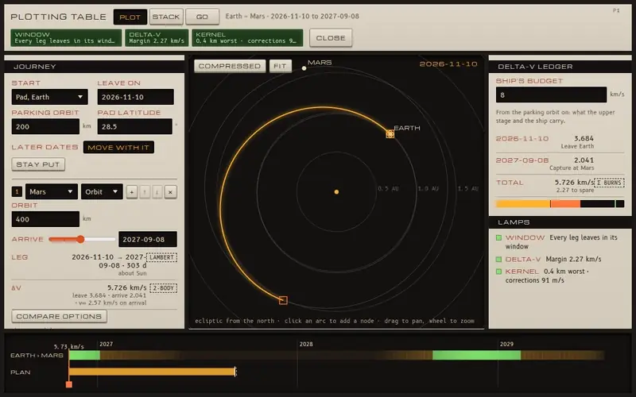

# Journeys: legs, transfers, flybys and the rocket

The PLANNER tab plans a whole journey, not just one hop. You give a start
and any number of waypoints in order. Each leg is solved by patched conics
as you edit, and the n-body kernel flies the whole journey once you let go.
Each leg's transfer options are set side by side, and you can pick one.
The journey's delta-v is then turned into a stack of stages.

The code:
- **`src/physics/transfers.js`:** closed-form transfers and flyby pieces.
- **`src/physics/journey.js`:** legs, chaining, options and drawing.
- **`src/physics/journeyFlight.js`:** the kernel's flight.
- **`src/physics/staging.js`:** the rocket.
- **The app side:** `src/app/journey.ts` holds the store,
  `src/app/journey-panel.tsx` the panel, `src/app/journey.worker.ts` runs
  the kernel off the page's thread, and `src/scene/journeyLayer.ts` draws
  the journey in the scene.

The reference throughout is Curtis, *Orbital Mechanics for Engineering
Students*, 4th edition (Butterworth-Heinemann, 2020) [1]. It is cited by
section, equation and example; staging is chapter 13 there (chapter 11 in
the first two editions).

## A journey

- **The start:** the pad (a parking orbit at a given altitude, reached by
  the rocket below), an orbit, or the selected craft's own state.
- **Each waypoint:** a body and what happens there. The bodies are the
  planets, the Moon, the planets' other twenty major moons (`moons.js`:
  JPL's mean elements, with Horizons' GM and radius) and the named small
  bodies. What can happen:
  - **flyby:** the lowest altitude it may pass at;
  - **orbit:** a circular orbit at an altitude, and a stay;
  - **land:** landing from that orbit, then a stay.
- **Dates:** each waypoint has an arrival date, and leaves when its stay
  ends. A flyby leaves the moment it arrives.

Each leg is solved about the body its two ends share:
- **About the Sun:** two planets or small bodies.
- **About a planet:** the planet and its own moon (Earth to the Moon and
  back), or two moons of one planet.
- **About the Sun, from the planet:** a moon to another planet. The leg runs
  from the moon's planet, and the moon's own escape is patched on (three
  levels of patched conics).
- **An orbit change:** the same body at both ends, with no flyby. This is a
  Hohmann transfer (or bi-elliptic, or phasing) between the two orbits, and
  it sets its own arrival. Later waypoints keep their spacing from it.
- **A return to the same body:** if either end is a flyby, the leg goes
  round the Sun and back on a resonant orbit (Galileo's two years from
  Earth to Earth; below).

### One leg, by patched conics

A leg between two bodies is Lambert's arc between their centres over the
time of flight (orbital.js `lambertRevs`, 0 to 2 revolutions; the cheapest
is kept). The excess velocity at each end is the arc's velocity less the
body's: $\mathbf v_\infty = \mathbf v_\text{arc} - \mathbf v_\text{body}$.
The burns:

- **Leaving a circular orbit of radius $r_p$** (Curtis 8.40, Examples 8.4
  and 8.9):
  $$\Delta v = \sqrt{v_\infty^2 + \frac{2\mu}{r_p}} - \sqrt{\frac{\mu}{r_p}}$$
- **Captured into a circular orbit** (Curtis 8.58, Example 8.10, with
  $e = 0$):
  $$\Delta v = \sqrt{v_\infty^2 + \frac{2\mu}{r_p}} - \sqrt{\frac{\mu(1+e)}{r_p}}$$
- **Landing:** through the atmosphere where there is one (no burn: the
  entry and parachutes are not costed). On an airless body, the capture
  plus the orbit's circular speed, an ideal descent with no losses. Lifting
  off again costs the same, again with no losses.
- **A moon of another planet:** its GM and radius are Horizons'. In the
  kernel only Earth's Moon pulls, so at the others the flight aims at the
  moon itself and its capture is flown as a rendezvous. Titan's atmosphere
  takes a landing, as the planets' do.
- **A small body:** its gravity is a guess, a sphere of its diameter at
  2,000 kg/m³. That is tiny either way, so a capture is a rendezvous, about
  $v_\infty$.
- **A moon left for another planet:** the speed needed at the moon's
  distance from its planet, $\sqrt{v_{\infty,P}^2 + 2\mu_P/a}$, less the
  moon's own $\sqrt{\mu_P/a}$, is the excess speed about the moon.
- **A planet's own moon:** the free end is a point on the parking orbit at
  the planet, in the moon's orbit plane. It is placed where the leg costs
  least, by 36 trial angles and then a golden-section search.

### Resonant returns

Lambert's problem can't do a return to the same body after whole years. Its
two ends are nearly one point, so the plane it finds is the ecliptic,
whatever the flyby needs. Lambert between Galileo's two Earth flybys
gives 5.0 km/s, in the ecliptic, against the 8.9 km/s the flyby brings in.

The leg is instead a resonant orbit (`transfers.js resonantCone`,
`resonantVinf`; Strange and Longuski 2002 [2]). Its period is N/M of the
body's, so the craft comes back to the body after N of the body's orbits
(M of its own):
- **The cone:** with the excess speed $v_\infty$ fixed by the flyby, the
  period fixes the craft's speed at the body's distance by vis-viva, and so
  the angle $\theta$ between the excess velocity and the body's velocity
  $v_B$:
  $$a = \left(\mu\left(\frac{N T_B}{2\pi M}\right)^2\right)^{1/3},\quad v^2 = \mu\left(\frac{2}{r} - \frac{1}{a}\right),\quad \cos\theta = \frac{v^2 - v_B^2 - v_\infty^2}{2 v_B v_\infty}.$$
  The excess velocity lies on a cone of half-angle $\theta$ about $v_B$.
- **The clock angle:** its angle round the cone is free. It is chosen, by
  72 trials and then golden section, so the flybys either side cost least
  (powered flybys from the inbound leg, and to the next leg).
- **The return:** the leg ends when the body comes back nearest where it
  was, within 20 days of N of its periods, rather than at its osculating
  period on the day. The Moon swings the Earth enough for that to be a day
  wrong in two years. The craft's period is set from it, and later
  waypoints keep their spacing.
- **The ratio:** the waypoint's own (`resonance: [N, M]`), else the one
  whose flight time is nearest its date. The leg's options list every
  ratio the excess speed allows (N and M up to 6), each costed with the
  flybys either side.

On Galileo's dates the planner picks 2:1, as flown [3]. It returns on 8 Dec
1992 with the same excess speed it left with, and the two Earth flybys
need 0 and 70 m/s. Lambert between the same dates needed kilometres a
second.

In the kernel, the first aimed correction of a return to the body just
left waits until a quarter of the way round. The aims fly without the
target's gravity, and that target is also the body the craft is still
climbing away from.

### Chaining legs, and the gravity assist

Leg $k+1$ leaves waypoint $k$ at its arrival date (a flyby) or after its
stay. A flyby joins the two legs either side of it. It must turn the
incoming excess velocity $\mathbf v_{\infty,\text{in}}$ (leg $k$'s arrival)
onto the outgoing one (leg $k+1$'s departure). A hyperbola of periapsis
$r_p$ turns the excess velocity by (Curtis 8.75, Example 8.6)
$$\delta = 2\sin^{-1}\frac{1}{e},\qquad e = 1 + \frac{r_p v_\infty^2}{\mu}.$$

When the speeds differ, the flyby is two half-hyperbolas joined at
periapsis, with a burn there for the change of speed (a powered flyby):
$$\delta = \sin^{-1}\frac{1}{e_\text{in}} + \sin^{-1}\frac{1}{e_\text{out}},\qquad
\Delta v_p = \left|\sqrt{v_{\infty,\text{out}}^2 + \frac{2\mu}{r_p}} - \sqrt{v_{\infty,\text{in}}^2 + \frac{2\mu}{r_p}}\right|.$$
The periapsis that makes the turn is found by bisection. If it is below the
waypoint's lowest pass, the flyby passes at that height, and the turn still
missing is a burn at the edge of the sphere of influence,
$2v\sin(\Delta\delta/2)$. The panel flags it.

The aim point is the B vector, in Kizner's B-plane:
- **S:** along the approach.
- **T:** in the ecliptic, $\mathbf S \times \hat z$ normalised.
- **R:** $\mathbf S \times \mathbf T$.
- **Its size:** the aiming radius (Curtis 8.71, Examples 8.5 and 8.6),
  $$B = r_p\sqrt{1 + \frac{2\mu}{r_p v_\infty^2}}.$$
- **Its direction:** the part of $\hat u_\text{in} - \hat u_\text{out}$
  across the approach, the side away from the turn.

`flybyFromB` goes the other way: from an aim point $(B\cdot T, B\cdot R)$ to
the periapsis $r_p = \frac{\mu}{v^2}\left(\sqrt{1 + (Bv^2/\mu)^2} - 1\right)$
and the outgoing excess velocity, turned by $\delta$ about $\mathbf B \times \mathbf S$.

When the legs are solved in order, a leg that leaves a flyby prefers arcs
whose departure excess speed matches the arrival's. A chain of flybys then
picks arcs that join. Each option for such a leg is costed with the flyby
it needs.

## The options for a leg, compared

For each leg, every transfer that applies is listed with its delta-v (every
burn of the leg), its flight time and its departure:

- **Lambert, as scheduled:** the leg at the waypoints' dates.
- **Hohmann** (Curtis 6.2; Example 6.1; 8.13–8.16): two tangent burns
  between circular, coplanar orbits at the bodies' mean distances. Its
  window is the next date when the target leads by
  $\phi_0 = \pi - n_2 t_{12}$. The wait for it is the phase still to
  gain, at the rate $n_2 - n_1$ (Example 8.2 waits 453.8 days at Mars).
  About a planet, the craft can burn anywhere in its parking orbit, so any
  day will do.
- **Bi-elliptic** (Curtis 6.3, Example 6.3): out to a far apoapsis $r_B$,
  then down. About the Sun $r_B$ is three times the outer orbit; about a
  planet it is half the planet's sphere of influence. It is flagged where
  it beats Hohmann, which needs $r_C/r_A$ above 11.94 (Curtis Fig. 6.8). It
  flies two Lambert arcs through the apoapsis point, with a burn there.
- **Hohmann with a plane change** (Curtis 6.21, Examples 6.11 and 6.12):
  the angle between the two orbits is split between the two burns, each
  combined with its speed change,
  $\Delta v = \sqrt{v_1^2 + v_2^2 - 2v_1v_2\cos\Delta i}$. The split that
  costs least is found by golden section. 28° from a 300 km LEO to GEO
  puts 2.18° at the first burn: 4.221 km/s, against 4.245 for all of it at
  GEO.
- **Porkchop optimum:** a grid of departure by flight time, refined by
  Nelder–Mead (shared with `trajsearch.js`).
  - The departures run from the earliest across a synodic period. After a
    flyby the departure is fixed, so only the flight time varies.
  - The flight times run from 0.5 to 1.6 of Hohmann's (for a return to the
    same body, 0.8 to 2.2 of its period).
  - Each cell is the leg's full patched-conic cost: one Lambert solve
    (with up to one revolution about the Sun), or, for a leg to a planet's
    own moon, the trial angles of its free end too.
- **Phasing** (Curtis 6.4, Examples 6.4 and 6.5): for an orbit change that
  keeps its altitude and moves along the orbit by a lead angle. A phasing
  orbit of period $T_2 = T_1 - \Delta t/n$ is flown $n$ times, with a burn
  each way.
- **The gravity assist:** for a leg that ends at a flyby, not an
  alternative but the flyby's numbers: the turn, the periapsis, the B-plane
  aim, the heliocentric change it gives, $|\mathbf v_{\infty,\text{out}} -
  \mathbf v_{\infty,\text{in}}|$, and the burn it needs.

Choosing an option re-times the journey to it. The leg leaves at the
option's departure (the stay before it, or the start date, takes up the
difference) and arrives at its arrival. Later waypoints keep their spacing.
The ideal options (Hohmann, bi-elliptic, plane change) set the dates, and
the leg is then flown as Lambert's arc between those dates on the real
orbits. A new waypoint starts at its leg's porkchop optimum.

## Flying it

The plan is patched conics; the kernel is the n-body truth
(docs/physics/nbody-kernel.md). `planFlight` turns a solved journey into a
schedule, and `flyJourney` flies it. The worker does the same in the app,
and "Fly this journey" gives a new craft the burns the kernel made, as
scripted burns on the same kernel, with its landings. That craft flies in
the kernel's point masses and zonal terms alone, as the headless flight
did, not with the extra fields of `environment.js` (the Moon's mascons,
the Earth's field beyond J2, sunlight): the burns were worked out in that
model, and a descent flown open loop in another one comes down tens of
kilometres away, or into the ground. The craft's readout says so (Model:
Planner's) and its log too, since such a craft ignores drag: left in a low
Earth orbit, it never decays. Each step, in time order:

1. **The start:** at the periapsis of the departure hyperbola in the
   parking orbit (as the planner's launches already do,
   `launch.js departureHyperbola`). For the Moon, the start is on the
   leg's Lambert arc.
2. **Aimed corrections** (`kernelHost.aimTo`, Newton on the end position):
   - **The first:** once the craft is half again clear of the body it left,
     $1.5\,r_\text{SOI}/v_\infty$ after departure.
   - **The second:** three sphere-crossing times out from the target.
   - **What they aim at:** each is flown without the target's own gravity,
     at the B-plane point (the planet's position plus the planned B vector)
     at the planned arrival. The target's pull is the hyperbola, not an
     error to cancel; aiming at the periapsis point itself, with the pull,
     fails, because the craft reaches periapsis early, pulled in.
   - **Newton's start:** the two-body Lambert arc to that point gives the
     first guess, and a step that misses by more is halved.
3. **Two periapsis trims inside the target's sphere:** a burn along the B
   vector, with the radius found by the secant method on the two-body
   hyperbola about the target. The second trim comes halfway to the
   predicted periapsis.
4. **Captures:**
   - **The burn:** retrograde, steered with the velocity, from the
     predicted periapsis (not centred on it; braking before periapsis
     would drop a 6 km/s capture into Mars) down to the circular speed.
   - **The orbit's plane:** the arrival hyperbola's plane holds the next
     departure's excess velocity too, so the parking orbit already contains
     it.
5. **Departures from an orbit:** the burn onto the outgoing asymptote from
   wherever the craft's orbit now is.
   - **The burn:** at each of 72 points round the orbit, a first guess from
     a two-body Lambert arc to a point out along the excess velocity, then
     Newton's method on the three velocity components until the two-body
     hyperbola about the body leaves along exactly that excess velocity.
     The cheapest point's full vector is burned.
   - **Waiting for the plane:** a long stay turns the orbit's plane (a
     planet's J2 precesses the node, about 10° a day at 400 km over Mars).
     So, as a mission would, the departure may wait up to 30 days, in
     half-day steps, for the plane to hold the way out, when that saves
     more than 2 %. The excess velocity is re-solved for the later date (a
     Lambert arc about the leg's central body to the planned arrival).
6. **Home through the air:** the aim is at the planned arc half an hour
   before the end, so no trial run meets the ground first. The kernel's
   perigee after that point is its own (the Moon's and the Sun's pulls over
   the days home move it by about 100 km), so for a landing two trims after
   the point bring it to the planned entry height, about 60 m/s home from
   the Moon.
7. **Landings** (`landing.js`):
   - **Through an atmosphere:** the drag-free path is flown to its
     perigee, at the waypoint's height (120 km at Earth), and the craft is
     set down on the ground beneath it. The entry itself (heat shield,
     parachutes) is not flown, as the plan does not cost it. A path that
     meets the ground before its perigee is a crash.
   - **On an airless body**, from the low orbit the capture left:
     - **The descent orbit:** retrograde, onto the ellipse down to 15 km,
       the first burn of a Hohmann transfer (17 m/s from 100 km over the
       Moon).
     - **The braking burn:** from that periapsis, steered against the
       velocity. Its thrust is found by bisection so that the speed is gone
       1.5 km up, on a two-body run from the craft's own state two minutes
       before (the Earth's pull and the Moon's J2 move the periapsis by
       kilometres over the half orbit).
     - **Across the ground:** the braking stops the craft in space, and the
       ground beneath moves with the body's spin (4.6 m/s on the Moon's
       equator), so a sideways burn matches it.
     - **The last fall and stop:** a fall, then thrust straight up at 2.5
       times the surface gravity until the craft is coming down at 1.5 m/s
       a metre up, where the engine is cut so it settles on. The fall's
       length is found by bisection.
     - **Touchdown:** the kernel's impact, at the point where the step
       crossed the ground (two-body from the step's start, bisection on the
       time). Faster than 10 m/s over the ground is a crash
       (`landing.js TOUCHDOWN_SPEED`; the flown descents touch down under
       3).
   - **On a body without the kernel's gravity** (a small body, a moon other
     than ours): set down from the rendezvous.
   - **The stay:** the craft is held at the body-fixed site, turning with
     the body (`orientation.js` axes), and its path follows the site.
   - **In the app** (`Craft.addLandings`): the craft flies the planned
     burns, and an impact on the landing's body within an hour of the
     planned touchdown is the landing only if it is slower than 10 m/s over
     the ground, where the craft crossed it (stepped back from the end of
     the kernel's step, which can be 100 m down). Faster, it is a crash.
     For an entry, or a descent that never quite touches, the craft is put
     on the planned site at its time only if it is where the plan has it:
     a descent within 100 m of the ground and as slow, an entry no higher
     than its planned perigee and 50 km. Otherwise the landing is missed
     and the craft flies on. A landed craft is not stepped; it is drawn at
     the site until its liftoff. Like every craft, it keeps its state
     across a clock jump: set the clock back before the touchdown, and it
     stays on the ground until its liftoff time.
8. **Lifting off:** three hours before the departure, from the site's
   state (the body's spin included):
   - **The plane:** the one holding the site and the next departure's
     excess velocity, turned the way the body spins.
   - **The climb:** ten seconds tilted from the vertical towards the way
     the orbit goes, then prograde (a gravity turn), both at five times the
     surface gravity, until the coast's apoapsis is the parking orbit. The
     tilt is chosen for the least delta-v: a scan from 2° to 86°, then a
     golden-section search.
   - **Circularising:** at the apoapsis, from the craft's own state. The
     departure from that orbit is step 5.
9. **Leaving a moon for another planet:** the plan's excess velocity is
   the planet's. The flight finds the velocity about the planet, at the
   moon's place, whose two-body hyperbola leaves on that asymptote (Newton,
   as in step 5, from five first guesses, the solution nearest the moon's
   own velocity kept). Less the moon's velocity, that is the excess
   velocity about the moon, and step 5 flies it. The first aim waits until
   the craft is clear of the planet.

The burns are finite, at 20 m/s² (3 km/s in two and a half minutes). The
closest approach to each waypoint is watched over a window about its date.
The osculating conic between samples gives the periapsis itself.

What the kernel does not yet fly: a plane change between two orbits about
one body (planned, not flown).

**The phase of a moon left for a planet.** The plan takes the moon as
moving the way out (the speed needed at its distance less its own, as
scalars), which is its best case. The flight leaves when the plan says,
from where the moon then is. Leaving lunar orbit for Mars on 31 Oct 2026,
the Moon's velocity is 65° off the way out, and the burn is 2,243 m/s
against the plan's 1,652. Waiting does not help here: the Moon comes round
in 27 days, but by then the re-solved way to Mars is faster.

**The descent and the ascent flown cost more than the plan's ideal**
(the low orbit's circular speed), by the gravity losses a real descent
pays: over the Moon from 100 km, 1,854 m/s down and 1,764 up, against
1,634.

What the flight costs beyond the plan is its corrections. Most of them
are on long legs home to a planet: the cruise aims fly without the
target's own gravity (its pull near arrival is the hyperbola), so they
leave out its far-field tug too, and the last aim takes it up. On the Mars
round trip that is about 115 m/s of its 185.

## The rocket it needs

`staging.js` sizes the stack for the journey's delta-v. It adds the climb
from the pad to the parking orbit when the journey starts there
(`rocket.js deltaVToOrbit`: the circular speed, less the Earth's turn
along the azimuth, plus 1.5 km/s of losses). Every burn of the journey is
the stack's, and the payload is what arrives.

Optimal staging is Curtis §13.6, in `rocket.js optimalStaging`. Given each
stage's exhaust speed $c_i = I_{sp,i} g_0$ and structural ratio
$\varepsilon_i$, the Lagrange multiplier $\eta$ solves (13.84)
$$\sum_i c_i \ln\frac{c_i\eta - 1}{c_i\varepsilon_i\eta} = \Delta v,$$
and then the stage mass ratios and masses follow, top down:
$$n_i = \frac{c_i\eta - 1}{c_i\varepsilon_i\eta},\qquad m_i = \frac{n_i - 1}{1 - n_i\varepsilon_i}\,m_\text{above}.$$

`sizeLauncher` tries one to four stages:
- **The stages:** stage 1 of one technology, the rest of another.
- **The pick:** the fewest stages whose liftoff mass is within 10 % of the
  lightest, since each stage beyond that adds engines and separations for
  little saving.
- **When none is possible:** a count is beyond what its stages can give
  ($\sum c_i \ln(1/\varepsilon_i)$), or its optimum would leave a stage
  empty, so fewer stages do it better ("no gain").

Against real launchers (`launcherFor`): a launcher's stack (`launchers.js`,
the ROCKET tab's presets) by the rocket equation with each stage's vacuum
Isp gives the payload a delta-v. That is set against the job, the climb
with its 1.5 km/s of losses plus the journey. Bisection on the payload
gives the most it could carry. It is a delta-v comparison: thrust, drag
and a booster's landing reserve enter only through the stage figures.

The stage technologies:
- **Isp:** Curtis Table 6.1's typical values: solid 290 s, nitric acid and
  MMH 310 s, LOX and LH2 455 s.
- **Structural ratio:** 0.1, the lower limit Curtis §13.4 gives for
  current materials.

Both can be edited, and they are not any one vehicle's. Real launchers come
to the ROCKET tab separately, and `staging.js` is where its comparison will
read from.

With identical stages, the Lagrange optimum is restricted staging (Curtis
13.56):
$$v_{bo} = N c \ln\frac{1}{\pi^{1/N}(1-\varepsilon) + \varepsilon}.$$
The tests check both against Examples 13.4 and 13.5.

## Shaping it by hand

In the sky, the journey can be shaped with the pointer. Every change
re-solves it by patched conics at once, and the kernel flies it again when
the pointer is let go.

- **A burn node:** a click on a leg's dashed arc adds one there.
  - Dragging its reticle slides it along the arc to the point nearest the
    pointer.
  - Selected, it grows three pairs of tabs on stalks along its local axes:
    prograde and retrograde (P+, P−), normal and anti-normal (N+, N−),
    radial out and in (R+, R−).
  - Dragging a tab along its stalk adds delta-v that way, 1 m/s a pixel
    (0.1 with Shift).
  - The × tab or Delete removes it. Nodes at the same time add up.
- **A node's frame** (`nodeFrame`), the same as the app's manoeuvre
  nodes, about the leg's central body:
  - $\hat T = \mathbf v / v$;
  - $\hat N = \mathbf r \times \mathbf v / |\mathbf r \times \mathbf v|$;
  - $\hat R = \hat T \times \hat N$, radial outward.
- **A leg with nodes is flown free** (`shapeLeg`):
  - it leaves on its Lambert arc, and Kepler's two-body motion
    (`propagate`) takes it from node to node, each burn added there;
  - it arrives wherever that takes it at the arrival date;
  - the miss from the waypoint is shown, and the leg counts as reaching
    the waypoint inside its sphere of influence;
  - the arrival is costed with the velocity it has.
  
  A node with no burn leaves the leg as it was. **Aim last node** sets the
  last node's burn to the Lambert arc from its place to the waypoint, so
  the leg reaches it again.
- **A flyby's aim:** selecting a flyby's mark shows a ring on a stalk out
  from the planet, toward its B vector.
  - Dragging the ring out or in scales $|B|$ (doubling over a stalk's
    length), raising or lowering the pass.
  - Dragging it round turns the B vector about the approach.
  - With the aim set by hand, the flyby is unpowered: $r_p$ from $B$, and
    the turn $\delta$ about $\mathbf B \times \mathbf S$
    (`flybyFromB`).
  - The leg after it is flown free from it, downstream legs included
    through each flyby they reach.
  - **Planner aims the flyby** goes back to the joining powered flyby.
- **In the kernel:** a leg's node burns are flown as planned vectors, and
  the aimed corrections begin after the last of them. A hand-shaped leg
  that misses its waypoint is brought to it by the corrections, and their
  total is shown.

The handles are the app's own: a node is a square reticle with a diamond
inside, and its tabs are small raised panel tags with engraved legends on
stalks, after the guarded toggles of 1970s flight panels. They are not
drawn from any game's interface.

## The plotting table

The journey gets a full-screen room of its own, the plotting table
(`src/app/plot-table.tsx`). It opens from the PLANNER tab ("Open the
plotting table") or the `#plot` link; Escape closes it. While it is open
the sky stops drawing (`OrreryScene.setPaused`), and the clock and the
mission run on.

Its PLOT station has five parts:
- **The editor:** the journey's editor from the PLANNER tab, on the left.
- **The scope:** the journey from above the ecliptic, about the Sun (or
  about its planet, for a journey that never leaves one).
  - What it shows: range rings, the visited bodies' orbits and their
    places on the time cursor's date, the arcs, the burns, the kernel's
    flown path, and the craft.
  - "Compressed" squeezes the radius (its square root about the centre),
    so the inner and outer planets fit together.
  - A click on an arc adds a burn node there, and dragging a node slides
    it along its leg.
  - The selected node has spring-loaded tabs: P+ P−, R+ R− along their
    directions on the scope, N+ N− to the side (the scope looks down on
    the plane). Pulling a tab adds delta-v at a rate that grows as the
    square of the pull, up to 240 m/s a second at the stalk's full length.
    Letting go stops it, and the wheel over a tab adds 1 m/s (0.1 with
    Shift).
  - The same numbers can be typed in the ledger.
- **The lamps** (below), in the station's head and listed in full on the
  right.
- **The delta-v ledger:** every burn against the ship's budget (from the
  parking orbit on), with the margin.
- **The timeline:**
  - each leg's window profile as a strip, green where the date fits what
    the budget leaves that leg, amber where it does not; clicking a date
    leaves on it, at that date's best flight time;
  - the plan's legs, stays and burns;
  - the time cursor, which the scope follows.

## STACK and GO

The table's other two stations:
- **STACK** (`src/app/plot-stack.tsx`): the rocket the journey needs (below).
  - Its stages are drawn as a stack.
  - A delta-v waterfall sets the journey's parts (the climb, then each
    burn) beside the stages that pay for them. Where a stage ends mid-burn,
    the next finishes it.
  - The published launchers from `launchers.js` (Saturn V as flown on
    Apollo 11, Falcon 9 with and without the booster landing, and Electron)
    are set against the same job, read-only: what each gives the payload,
    and the most it could carry (`staging.js launcherFor`).
- **GO** (`src/app/plot-go.tsx`): a go/no-go poll, one row for each of the
  following:
  - **trajectory:** the kernel flew it to every waypoint within 50 km,
    without hitting anything, and with corrections under 250 m/s or a
    tenth of the plan;
  - **windows** and **delta-v:** from the lamps;
  - **flybys:** none underground;
  - **vehicle:** a stack exists, and which real launchers could fly it;
  - **launch.**

  When every row reads GO, "Commit to the orrery" jumps the clock to the
  departure (BACK undoes it), gives a new craft the kernel's burns, and
  follows it.

The PLANNER tab is now a summary of the journey (route, dates, delta-v
and lamps) with the key to the table. The porkchop and NASA's list are in
the table, under the journey's editor. A `?plan=` link opens the table
with that porkchop computed.

## The flags

`src/physics/feasibility.js` answers whether the journey can be flown, and
if not, when. It works from the window profile of each leg that can choose
its departure (`legProfile`). That profile is the cheapest delta-v for
each departure date, from when the leg can first leave, across 1.25
synodic periods (at most 1,100 days), in 8-day steps. Each date's best
flight time is found from 0.5 to 1.6 times Hohmann's. A leg after a flyby
has no profile: the flyby fixes its departure. The worker computes the
profiles when an edit settles.

The lamps (`assess`), each lit only when it means something:
- **Window** (caution): the leg furthest above its cheapest date, where
  that is more than 10 % or 0.2 km/s dearer and more than 3 days away.
  It says when to leave and what that costs instead.
- **Wait** (caution): the longest stay over 30 days.
- **Delta-v:** the total against the budget, with the margin, or by how
  much it is over.
- **No window** (warning): a leg with no date in its profile under what
  the budget leaves it (the budget less every other burn).
- **Miss** (warning): a shaped leg that ends outside its target's sphere
  of influence.
- **Flyby:** a pass that needs to go lower than its floor (caution), or
  whose periapsis is underground (warning).
- **Kernel:** the worst miss of the n-body flight, and its corrections.

The Mars round trip in the tests shows the point. It arrives on 7 Sep 2027
and plans to leave 30 days later. The window lamp says the cheapest date
home is 9 Sep 2028, 368 days after arriving, at 2.00 km/s, instead of
20.1 km/s. The delta-v lamp says that is over an 8 km/s budget. With a
5 km/s budget, no date home fits at all. Curtis's Example 8.2, on circular
orbits, waits 454 days.

## In the scene

- **Each leg's arc:** a dashed pale-amber line about its central body,
  placed at that body each frame. A leg about Earth moves with Earth.
- **The kernel's flown path:** a thin solid amber line about the journey's
  frame (the Sun, or Earth for a journey that never leaves it).
- **Each burn:** an open square reticle with a centre dot (orange for a
  capture or landing, dashed for a flyby), with its delta-v in a window
  tag. Burn nodes and flyby aims are the shaping marks above.

## Validation (`journey.test.mjs`)

| Check | Reference | Result |
| --- | --- | --- |
| Hohmann from an elliptical orbit's perigee | Curtis Ex 6.1 | 1.7225 + 1.3297 = 3.0522 km/s; 1,291.3 kg of propellant |
| Bi-elliptic against Hohmann | Ex 6.3 | 4.0285 km/s in 5.66 d against 4.0463 in 65,942 s |
| Where bi-elliptic wins | Fig. 6.8 | never below rC/rA 11.94; any rB above 15.58 |
| Phasing | Ex 6.4, 6.5 | 0.4970 km/s, T₂ 8,756.3 s; GEO drift 22.5 m/s |
| Plane change, either end and split | Ex 6.11, 6.12 | 4.2448, 6.3908; 2.1751° and 4.2207 km/s |
| Synodic period, Hohmann window, wait at Mars | Ex 8.1, 8.2 | 778.65 d (Ex 8.1 prints 777.9; its own figures and Ex 8.2 give 778.65); 258.8 d, 44.56°, 453.8 d |
| Departure, optimal capture, aiming radius | Ex 8.4, 8.5, 8.9, 8.10 | to the book's four figures |
| Venus flyby, dark side and sunlit | Ex 8.6 | 103.6°, 18,343 km, 31.78 and 37.27 km/s after |
| A Lambert leg on real ephemerides | Ex 8.8 | v∞ 3.1620 and 2.8847 km/s (book 3.1656, 2.8852 on its Algorithm 8.1 ephemeris) |
| B-plane round trip; a flyby needing no burn | geometry | 10⁻⁹ |
| Restricted and optimal staging | Ex 13.4, 13.5 | 5.657, 7.407, 7.928 km/s; 200,000 kg and the stage masses to the book's figures |
| Legs chained, stays, orbit changes, options, choosing one | the journey's own rules | all hold |
| Jupiter's orbit to Europa, then to Ganymede | geometry; Europa at 671,100 km and 13.74 km/s | legs about Jupiter; within 1 % and 2 % |
| Mariner 10, flown by the kernel (NASA's dates) | the plan | Venus 0.4 km, Mercury 0.1 km off the planned periapsis |
| Earth to Mars, captured | the plan | 1.4 km |
| Round the Moon and home | the plan | Moon 17 km; home 3 km from the aimed point |
| Earth orbit, Moon orbit for 3 days, home | the plan | Moon 0.9 km; home 0.5 km |
| A burn node with no burn; a node's frame | Lambert's arc; geometry | on target to 1 m, the same delta-v; orthonormal, radial out |
| A 200 m/s node halfway to Mars, then aimed | Lambert from the node | misses by 3.28 million km; aimed, on target to 1 m |
| Mariner 10's Venus aim set by hand to the plan's B point | the planned flyby | the same periapsis, unpowered; Mercury missed by 194,000 km without its 29 m/s |
| An aimed node on the way to Mars, flown | the plan | Mars 1.4 km off the planned periapsis |
| The 2:1 resonance cone at 8.9 km/s about a circular 1 AU orbit | geometry | a = 2^(2/3) AU, 61.98°, back in two years; every clock angle on the cone and back to the start (two-body) |
| Galileo's Earth to Earth (8 Dec 1990 to 8 Dec 1992) | NASA's dates: PDS mission catalogue [4] | 2:1 chosen, back within a day of 8 Dec 1992, 8.871 out and 8.864 km/s back; Earth flybys 0 and 70 m/s |
| Galileo's whole route flown by the kernel | the plan | Venus 2.0, Earth 0.9 and 13.5 km off; Jupiter 3,900 km off a 270,000 km periapsis (1.4 %); corrections 1.1 km/s over six years |
| The return window from Mars (arrive 7 Sep 2027) | Curtis Ex 8.2 (454 d on circular orbits) | 9 Sep 2028, 368 d later, 2.00 km/s; each profile point is the leg solved there |
| The lamps: leaving Mars after 30 days, at 8 and 5 km/s; leaving at the window | the rules above | window and delta-v lamps lit, then no window; at the window, green with a 368-day wait |
| Saturn V, Apollo 11's 45.7 t to 185 km and on to the Moon (TLI 3.13 km/s) | the flight | needs 12.03, gives 12.87 km/s: it can, with 0.84 to spare |
| Falcon 9 expendable, 22.8 t to 200 km; Electron, 300 kg to 500 km | the user's guides | 8.88 needed, 9.43 given; Electron 0.02 km/s short with its kick stage carried as payload (it burns, in fact) |
| A year in Mars orbit, then home, flown | the plan | departs 13 d late for the turned plane, 2,058 m/s against 2,000; Mars 0.4 km, Earth 22 km; corrections 182 m/s |
| The descent orbit burn, 100 to 15 km over the Moon | a Hohmann transfer's first burn (Curtis 6.2) | equal to 10⁻¹² |
| An entry periapsis at 3 km/s over Mars | geometry (h = R v_R cos γ) | the hyperbola meets the ground at 12° to 10⁻⁹ |
| Braking from 15 km over the Moon; the ascent to 100 km (two-body) | stops where asked; more than the speed taken off or given | 1.5 km up, 1,762 m/s for 1,692; 1,763 m/s for 1,634 |
| Earth orbit, down to the Moon for 3 days, up, home through the air, flown | the plan | down at 2.8 m/s, 1,854 m/s for the descent; up for 1,764; home 1.9 km from the aimed point, the entry perigee 118 km for 120 |
| The same, flown live by the app's Craft | the headless flight | down on the Moon, held, up, down at Earth, never crashed |
| A Craft meeting the Moon at 1 km/s near a planned touchdown; one still in orbit at it | the 10 m/s limit | a crash, not a landing; the landing missed, flying on |
| Earth orbit, a week in lunar orbit, then Mars, flown | the plan | leaves the Moon for 2,243 m/s (plan 1,652: the Moon's phase); Mars 1.4 km off; corrections 149 m/s |

## Limits

- **Patched conics:** the planets' centres are the ends of each leg, and
  the Sun alone pulls along it. The kernel's corrections close the gap,
  and the flown journey's corrections are part of its delta-v as flown.
- **Resonant returns:** circular-orbit physics on the real ephemeris. The
  flown return comes within about 9,000 km of the planet in two years, and
  the kernel's aims take up the rest.
- **Landings:** the plan does not cost the entry through an atmosphere, or
  the losses of an ascent or a descent; the flight pays the losses, and
  sets a craft entering an atmosphere down beneath its perigee without
  flying the entry. Terrain is a sphere (the Earth's, the WGS-84
  ellipsoid).
- **A moon left for a planet:** the plan is the moon's best phase; the
  flight pays for the phase it gets.
- **The ideal options:** Hohmann, bi-elliptic and plane change use mean
  circular orbits. "As scheduled" and the porkchop optimum use the real
  ones.

## References

[1] H. D. Curtis, *Orbital Mechanics for Engineering Students*, 4th ed. Oxford, U.K.: Butterworth-Heinemann (Elsevier), 2020. Chapters 6, 8 and 13, by section, equation and example as cited above.

[2] N. J. Strange and J. M. Longuski, "Graphical method for gravity-assist trajectory design," *J. Spacecr. Rockets*, vol. 39, no. 1, pp. 9–16, 2002, doi: 10.2514/2.3800. The resonant orbit and its cone of excess velocities.

[3] NASA, "Galileo in depth." [Online]. Available: https://solarsystem.nasa.gov/missions/galileo/in-depth. Launch on 18 Oct 1989, the flybys and arrival at Jupiter on 7 Dec 1995.

[4] NASA Planetary Data System, "Galileo mission catalogue." [Online]. Available: https://pds.nasa.gov/data/go-l-nims-3-tube-v1.0/go_1103/catalog/mission.cat. The Venus and Earth flyby times and altitudes.
