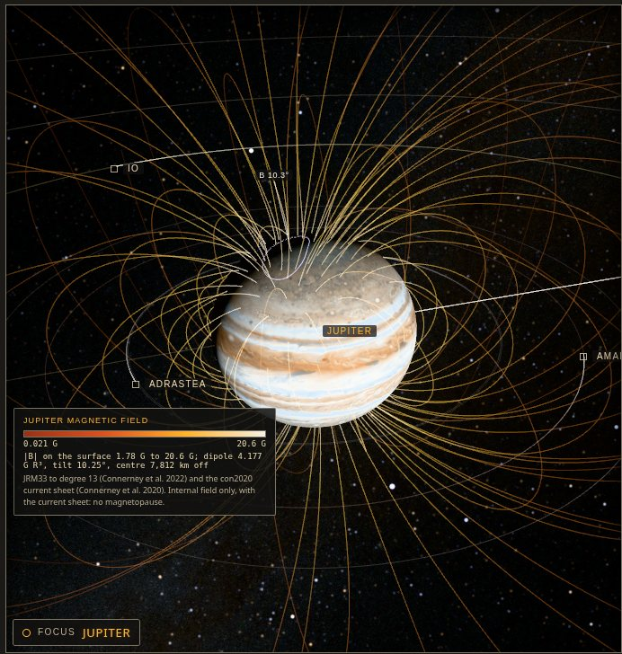
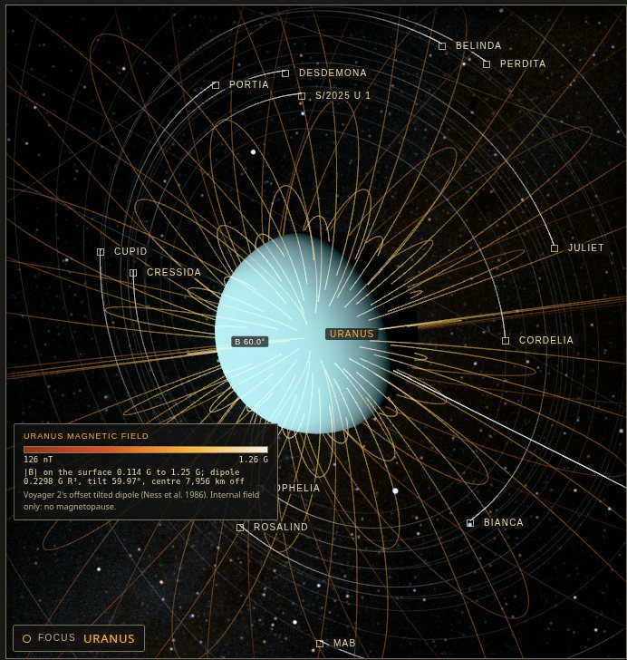
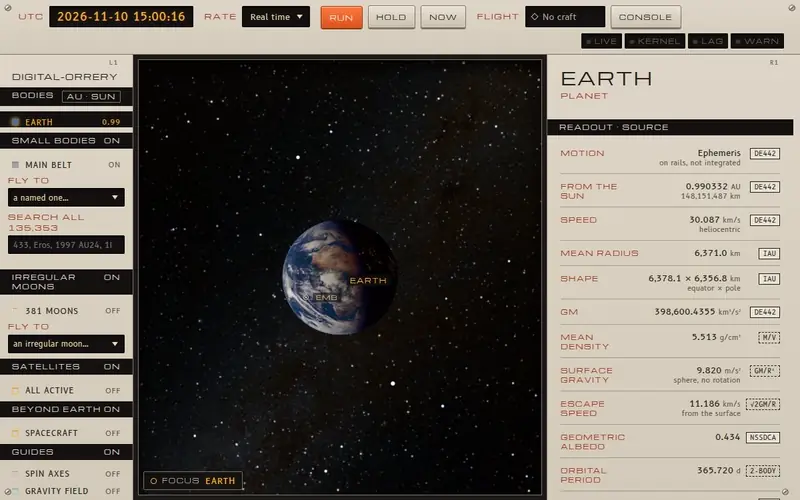

# Magnetic fields and auroras

Three switches in the rail's **Guides** section, all off until switched on:

- **Magnetic fields** draws field lines traced through each planet's
  measured internal field, Ganymede's included. The lines are shaded by
  field strength, and the dipole's axis runs through the dipole's own
  centre. Mars, which has no global field, shows its magnetised crust.
- **Auroras** draws:
  - the Earth's auroral ovals;
  - Jupiter's and Saturn's main ovals;
  - the footprints of Io, Europa, Ganymede and Enceladus;
  - Uranus's, Neptune's and Ganymede's auroral zones;
  - Mars's aurora over its crustal fields.
- **Radiation belts** draws the belts of the Earth, Jupiter, Saturn,
  Uranus and Neptune, as shells along their L-shells in each planet's own
  field.

Venus, the Moon, Pluto and the other moons have no field of their own to
draw. Mercury's and Ganymede's are too small to hold stable belts.

| Earth | Jupiter | Uranus |
| --- | --- | --- |
|  |  |  |

Code: `src/physics/magnetic.js` (the field models and the tracer),
`src/physics/aurora.js` (the ovals and the moons' footprints),
`src/physics/ovation.js` (NOAA's live map), `src/physics/belts.js` (the
radiation belts) and `src/physics/marsCrustal.js` (Mars's crust), tested
in `magnetic.test.mjs` and `aurora.test.mjs`; `src/scene/magnetic.ts` draws them. The coefficients
come from `npm run fetch:magnetic` (`magnetic.fetch.mjs`), which writes
`src/physics/magnetic.data.js`, `public/data/kp.json`, Mars's map
`public/data/mars-crustal-br.bin` and its coefficients'
test fixture.

## The field models

| Body | Model | Reference radius |
| --- | --- | --- |
| Earth | IGRF-14 at the date, to degree 13 [1] | 6,371.2 km |
| Jupiter | JRM33 to degree 13 [2], plus the con2020 current sheet [3] | 71,492 km |
| Saturn | Cassini 11, axisymmetric, to degree 11 [4], [5] | 60,268 km |
| Uranus | Voyager 2's offset tilted dipole [6] | 25,559 km |
| Neptune | Voyager 2's offset tilted dipole [7] | 24,765 km |
| Mercury | MESSENGER's offset dipole [8] | 2,440 km |
| Ganymede | Juno and Galileo's dipole [9] | 2,634.1 km |
| Mars | its crust, Langlais et al., to degree 134 [10] | 3,393.5 km |

Each is evaluated in the body's fixed frame
([orientation](orientation.md)): X toward 0° longitude, Z toward the IAU
north pole, east longitude positive. Jupiter's IAU prime meridian is
System III (1965), the frame JRM33 and con2020 are written in.

### Spherical harmonics

The internal field is the gradient of a potential with Schmidt
semi-normalised Gauss coefficients $g_n^m, h_n^m$ (nT):

$$
V(r, \theta, \phi) = a \sum_{n=1}^{N} \left(\frac{a}{r}\right)^{n+1}
\sum_{m=0}^{n} \left(g_n^m \cos m\phi + h_n^m \sin m\phi\right) P_n^m(\cos\theta),
\qquad \mathbf B = -\nabla V,
$$

so that

$$
B_r = \sum_n (n+1) \left(\tfrac{a}{r}\right)^{n+2} \sum_m (g \cos m\phi + h \sin m\phi) P_n^m, \quad
B_\theta = -\sum_n \left(\tfrac{a}{r}\right)^{n+2} \sum_m (g \cos m\phi + h \sin m\phi) \frac{dP_n^m}{d\theta},
$$

$$
B_\phi = \frac{1}{\sin\theta} \sum_n \left(\tfrac{a}{r}\right)^{n+2} \sum_m m\,(g \sin m\phi - h \cos m\phi) P_n^m.
$$

The Schmidt functions come by the usual recursions [11]:
$P_n^n = \sqrt{(2n-1)/2n}\,\sin\theta\,P_{n-1}^{n-1}$ (with $P_1^1 = \sin\theta$), and

$$
P_n^m = \frac{(2n-1)\cos\theta\,P_{n-1}^m - \sqrt{(n-1)^2 - m^2}\,P_{n-2}^m}{\sqrt{n^2 - m^2}},
$$

with the same recursions differentiated for $dP_n^m/d\theta$.

**IGRF-14.** The coefficients are linear between the five-yearly epochs
(1900 to 2025, degree 10 before 2000). After 2025 they follow the 2025–30
secular variation, held at 2030 after that. The app takes the quarter-year
and retraces the Earth's lines when the year changes.

**JRM33** is published to degree 30. Its authors call the coefficients
well resolved to degree 13 and useful to degree 18 [2]. The app uses 13,
the conservative choice.

### The dipole, its tilt and its centre

The degree-1 terms are a dipole of moment $\mathbf m = (g_1^1, h_1^1, g_1^0)$
(nT $a^3$). Its tilt from the spin axis is $\arccos(|g_1^0| / |\mathbf m|)$. The
quadrupole puts its best centre off the planet's, the eccentric dipole of
Fraser-Smith [12]:

$$
L_0 = 2 g_1^0 g_2^0 + \sqrt3\,(g_1^1 g_2^1 + h_1^1 h_2^1), \quad
L_1 = -g_1^1 g_2^0 + \sqrt3\,(g_1^0 g_2^1 + g_1^1 g_2^2 + h_1^1 h_2^2),
$$

$$
L_2 = -h_1^1 g_2^0 + \sqrt3\,(g_1^0 h_2^1 - h_1^1 g_2^2 + g_1^1 h_2^2), \quad
E = \frac{L_0 g_1^0 + L_1 g_1^1 + L_2 h_1^1}{4 B_0^2},
$$

and the centre is $a\,(L_1 - g_1^1 E,\ L_2 - h_1^1 E,\ L_0 - g_1^0 E) / 3B_0^2$, with
$B_0^2 = (g_1^0)^2 + (g_1^1)^2 + (h_1^1)^2$. The axis is drawn through that
centre, so the offset shows:

| Body | Tilt | Centre off the planet's | Source of the offset |
| --- | --- | --- | --- |
| Earth (2026) | 9.1° | 610 km | IGRF-14's quadrupole |
| Jupiter | 10.25° | 7,800 km | JRM33's quadrupole |
| Saturn | 0° | 2,250 km north | Cassini 11's quadrupole |
| Uranus | 60° | 7,900 km (0.31 $R_U$) | fitted by Voyager |
| Neptune | 46.8° | 13,500 km (0.55 $R_N$) | fitted by Voyager |
| Mercury | 0° | 479 km north (0.196 $R_M$) | fitted by MESSENGER |

### Uranus and Neptune

The Voyager magnetometer team fitted each planet with a single dipole off
its centre [6], [7]. Garrett et al. tabulate the fits as Cartesian
components [13], [14]:

- **Uranus:** moment (0.133, −0.148, 0.115) G $R_U^3$ (0.230 G $R_U^3$,
  60° from the pole toward 48° W), centre (−0.020, 0.020, −0.310) $R_U$.
- **Neptune:** moment (0.0177, −0.0953, 0.0910) G $R_N^3$ (0.133 G
  $R_N^3$, 46.8° toward 79.5° W), centre (0.17, 0.46, −0.24) $R_N$.

Its field is $\mathbf B = [3(\mathbf m \cdot \mathbf r)\mathbf r - \mathbf m r^2] / r^5$ with $\mathbf r$
from the dipole's centre.

Voyager's Uranus frame has Z along the spin's angular momentum, the pole
that faced the Sun in 1986 (right ascension 77.3°, declination +15.2°)
[13]. The IAU's north pole is the other one (257.3°, −15.2°) [15], so the
fit is turned 180° about X into the IAU frame: $(x, y, z) \to (x, -y, -z)$.
The field lines then leave the IAU southern hemisphere, and the dipole sits
0.31 $R_U$ toward the IAU north.

Neither planet's rotation period is known well enough to carry Voyager's
longitudes to today: an error of 0.01 h in 17 h, over 40 years, is about
200 turns. So the tilt and the offset are Voyager's, but the longitude the
dipole leans toward is drawn as if the IAU's prime meridian were Voyager's.
It is a convention, not a measurement.

### Mercury

MESSENGER found Mercury's field to be an axial dipole of 190 nT $R_M^3$,
its moment southward like the Earth's, centred 479 km north of the
planet's centre [8]. It is drawn as that offset dipole, so its field
lines bunch toward the north. The same offset written as harmonics,
$g_n^0 = n\,g_1^0 z_0^{n-1}$, gives the $-190$, $-74.6$, $-22.0$ and $-5.7$ nT
that libinternalfield lists for the model [16].

### Ganymede

Ganymede is the only moon with a dynamo of its own. Weber et al. fitted
Juno's 2021 flyby together with Galileo's six [9]: $g_1^0 = -716.4$,
$g_1^1 = 56.0$, $h_1^1 = 27.0$ nT. That is 719 nT at the equator, tilted
5° from the spin axis and pointing against Jupiter's field. Kivelson et
al.'s Galileo-only fit [17] agrees within 0.8° in direction and 1% in
strength. Its lines are drawn from the dipole alone. The real field closes
only near the moon, inside Jupiter's own field: a magnetosphere about two
Ganymede radii across, which is not drawn.

### Jupiter's current sheet

The magnetodisc's currents stretch Jupiter's field lines outward beyond a
few $R_J$. con2020 [3] models them as an annular disc of azimuthal current,
from $r_0$ = 7.8 to $r_1$ = 51.4 $R_J$ and $D$ = 3.6 $R_J$ half-thick, of
strength $\mu_0 I_0 / 2$ = 139.6 nT, with its normal tilted 9.3° toward
155.8° E. It adds a radial current $I_\rho$ = 16.7 MA, whose field is
azimuthal:

$$
B_\phi = \mp 2.7975 \frac{I_\rho}{\rho} \ \text{nT}\ (I_\rho \text{ in MA}, \rho \text{ in } R_J),
$$

reversing across the sheet and scaled by $|z|/D$ inside it.

The disc is a semi-infinite sheet from $r_0$ less one from $r_1$, each from
Edwards et al.'s analytic forms [18]. Their eqs. 9a–b hold inside the inner
edge and 13a–b beyond it, and the two are blended by
$\tanh((\rho - a)/1\,R_J)$, as the con2020 community code does. Those
approximate the original model's Bessel-function integrals [19] to a few
nT near $\rho = r_0$.

### Mars's crust

Mars has no global field now, but its ancient crust stayed magnetised,
most strongly in the southern highlands. Langlais et al. fitted MGS's and
MAVEN's measurements to degree 134, about 160 km [10]. On their
3,393.5 km sphere, the radial field runs from −8,520 to 11,260 nT.

`npm run fetch:magnetic` sums the coefficients on a 720 × 360 grid, a
latitude row at a time as for the gravity maps. It stores each cell as one
signed byte on an asinh scale, $127\,\mathrm{asinh}(B_r/50\,\mathrm{nT}) / \mathrm{asinh}(240)$:
259 kB in `public/data/mars-crustal-br.bin`. The map is drawn on a shell
just above Mars: blue inward, amber outward, with a legend.

The sum reproduces the paper's range to 2 nT on a 0.25° grid. The
strongest point is at 48° S, 175° E, over Terra Cimmeria and Sirenum.

### Field lines

The lines start on the planet's surface, the IAU ellipsoid (Jupiter's at
1/15.4 flattening, Saturn's 1-bar spheroid), along rays from the dipole's
centre:

- at magnetic latitudes 15° to 74° (by body) in the hemisphere the field
  lines leave;
- at 12 magnetic longitudes, alternate rows staggered by half a step;
- plus the two highest rows in the other hemisphere, kept only where their
  lines are open.

Each is traced both ways by RK4 along the unit field direction
$d\mathbf x/ds = \pm \mathbf B/|\mathbf B|$, with steps 3% of the distance from the
centre. A line stops at the surface (bisected to it), beyond 12 (Earth), 16
(Uranus, Neptune), 20 (Saturn) or 40 (Jupiter) radii, or after 3,000 steps.

The tracing happens 3 ms a frame, focused body first, until done: about
100 lines a body, under a second. The lines are fixed in the body's frame,
so after that they only turn with it.

**Strength** is shaded along the console's own ramp (the porkchop's):
sheen where the field is strongest at the surface, through phosphor amber
and key orange, to engraving 1,000 times weaker. The lines are brighter
where stronger. The legend gives the surface range, the dipole moment, tilt
and offset, and the source.

**What is left out:** the solar wind. These are the planets' own fields,
with no magnetopause, bow shock or tail. Earth's real lines past about
8 $R_E$ on the day side end at the magnetopause; the night side's are
drawn out into a tail. Only Jupiter has its current sheet.

## Auroras

### The Earth's ovals

Starkov's model [20] gives the poleward and equatorward edges of the
auroral oval, and the equatorward edge of the diffuse aurora. Each is a
corrected geomagnetic (CGM) colatitude against magnetic local time $t$
(hours), as Sigernes et al. give it [21]:

$$
\theta(t) = A_0 + A_1 \cos[15(t + \alpha_1)] + A_2 \cos[15(2t + \alpha_2)] + A_3 \cos[15(3t + \alpha_3)],
$$

with the arguments in degrees. Each $A_i$ and $\alpha_i$ is
$b_0 + b_1 x + b_2 x^2 + b_3 x^3$ in $x = \log_{10}|AL|$, from their Table 1. The
auroral electrojet index comes from Kp through Starkov's fit [22]:

$$
AL = 18 - 12.3\,Kp + 27.2\,Kp^2 - 2\,Kp^3 \ \text{nT}.
$$

At Kp 3 the oval's equatorward edge is at 63.8° at midnight, and the oval
spans 73.3–75.7° at noon.

The cubic dips between Kp 0 and 0.23 and peaks at 655 nT near Kp 8.8. So
the ovals stop growing at the very largest storms, which the model was not
fitted to.

**Kp** is the planetary index for the three-hour interval, from GFZ
Potsdam's definitive and quicklook values [23], as CelesTrak's
`SW-All.csv` carries them. After that come NOAA's 45-day predictions. The
file is the one the atmosphere's space weather comes from
([environment](environment.md)), read from the same cache. Past the
table's end Kp 2o is assumed, and the tag says so.

**CGM to geographic.** CGM coordinates [24] are found by following the
IGRF field line from a point to the centred dipole's equator, then back
down the dipole's own field line to the ground. The app runs this the
other way:

1. A CGM latitude $\lambda$ crosses the dipole equator at $r = a / \cos^2\lambda$.
2. The IGRF line traced down from there meets the ground at the
   geographic point.

This runs once per year of IGRF, on a grid 2° in latitude (50–82°) by 10°
in longitude in both hemispheres, a few milliseconds a frame, and
bilinear between. CGM longitude 0 is the meridian through the geographic
south pole [12]. Magnetic local time is $12 + (\phi - \phi_\odot)/15$ hours,
with $\phi_\odot$ the Sun's longitude in the centred dipole's frame.

**Drawing.** The oval is stacked sheets from 100 to 310 km up. Green
(557.7 nm) is brightest near 110–150 km, where Sigernes et al. place the
emission peak [21]. Red (630.0 nm) is brightest above about 200 km. Two
rows between the diffuse edge and the oval glow faintly. The oval is
brightest before magnetic midnight and brighter with Kp, and fades out
where the Sun is up.

The brightness is an illustration: Starkov's model places the edges, not
the intensity.

### Live aurora: NOAA's OVATION Prime map

When the app's clock is within three hours of now, it fetches NOAA Space
Weather Prediction Center's live aurora map [25]. The map is the
OVATION Prime model [26], [27], driven by the solar wind measured
upstream at L1. It gives the probability of visible aurora (%) on a 1°
geographic grid, for a forecast time half an hour to an hour and a half
ahead.

The app uses the map from half an hour before its solar-wind time to an
hour after its forecast time, and asks for a new one at most every five
minutes. NOAA publishes only the latest map, so any other time falls back
to Starkov's oval.

The map is drawn as four sheets from 105 to 250 km up, in the Earth's own
frame. Brightness follows the probability (full at 40% and above), green
below and red above as before, faded where the Sun is up. Cells under
about 4% are left out. The tag names the forecast time and sits at the
map's brightest northern point.

The map is geographic and changes only every few minutes, so it is built
once per map. It costs nothing measurable a frame: the layer's update
takes 0.1 ms.

### Jupiter and Saturn

Both giants' main ovals shine mostly in the ultraviolet, so they are drawn
in a pale violet false colour, on both day and night sides:

- **Jupiter's main emission** maps to about 20–30 $R_J$ in the
  magnetodisc [28]. It is drawn as the band between the footprints of
  field lines from 20 and 30 $R_J$ in the magnetic equator, traced through
  JRM33 and con2020. The northern band reaches down to about 55° near
  180–200° W (57° at 200° W), the long-known "kidney" shape that the field's northern
  anomaly gives it.
- **The moons' footprints.** Io, Europa and Ganymede each leave a spot
  where their field lines meet Jupiter, and Enceladus one on Saturn
  [29]. Each moon's field line, at 5.9, 9.4, 15.0 and 3.95 planet
  radii, is traced to both hemispheres every 5° of its System III
  longitude and interpolated for the moon's place now.
  - **Lead angle:** the spot sits downstream of that footprint by the
    angle the moon's Alfvén wave falls behind on its way down. Hue et al.
    fitted it from Juno-UVS against the moon's System III west longitude
    $\lambda$ [30]:
    $\delta = a_0 + a_1 \cos w\lambda + b_1 \sin w\lambda\,(+\,a_2 \cos 2w\lambda + b_2 \sin 2w\lambda)$.
    It averages about 4° for Io, 6–7° for Europa and 12–13° for Ganymede,
    north and south.
  - **Tail:** behind each spot runs a tail over the footprints of the
    moon's earlier longitudes. Jupiter turns faster than its moons orbit,
    so the plasma a moon disturbed lies at larger east longitudes. Io's
    tail is drawn over 60°, the others' over 20°.
  - Enceladus has no fitted lead angle, so its spot sits at its footprint.
- **Saturn's main oval** is drawn at 14–16° colatitude from the southern
  pole, the medians of Badman et al.'s HST statistics [31]. The northern
  oval is that band's conjugate along Cassini 11's field lines. It comes
  out 13.3° from the north pole, smaller because the field is offset north.

### Uranus and Neptune

JWST found Neptune's infrared aurora in 2023, the first since Voyager's
faint ultraviolet glimpses. The southern emission lay between 30° and 60°
S and 200° and 280° W, and mapped to L-shells from under 3 to 20 $R_N$
(3–5 in the north) [32]. Uranus's aurora has been seen by Hubble as
spots near its magnetic poles, rotating with the planet [33].

Both are drawn as the band between the footprints of field lines from 3
and 20 radii in the magnetic equator, traced through Voyager's dipoles.
The band is brightest mid-way and fainter than the gas giants' ovals.
Through Voyager's Neptune dipole, the southern zone falls at 24–48° S and
259–291° W. JWST's latitudes match; the longitudes rest on the Voyager
convention above. Uranus's is drawn the same way: a mapped oval has not
been published.

### Ganymede and Mars

**Ganymede's** oxygen aurora, seen by Hubble, is confined to latitudes
above ±40°, along the boundary of its open field lines [34]. It is drawn
as a band from 40° to 48° in each hemisphere. The boundary moves poleward
on the trailing hemisphere, where Jupiter's plasma presses, and that
shift is not drawn.

**Mars's** discrete aurora was first seen by SPICAM, over the strong
crustal fields of the south [35]. Mars Global Surveyor found the
auroral electrons where crustal field lines open to space, the cusps
between crustal loops [36]. With the auroras on, the night side glows
violet where the map's radial field is strong, from about 400 nT to full
by 3,500 nT, as a stand-in for those cusps. Mars's diffuse and proton
auroras, which follow the Sun's storms rather than the crust, are not
drawn.

## Radiation belts

Energetic particles are trapped on closed field lines, bouncing between
mirror points and drifting round the planet, so a belt fills a band of
L-shells. Each belt is drawn as three shells across its band: 36 field
lines round each, traced from the magnetic equator at that L through the
planet's own field, and joined into a surface. The shells glow most where
seen edge-on, so the belt reads as a volume. Its brightness is a smooth
bump, zero at the band's edges and one at its peak, fading away from the
magnetic equator, where trapped particles crowd. That shape is drawn, not
measured.

| Body | Belt | L (peak) | Source |
| --- | --- | --- | --- |
| Earth | inner, protons and electrons | 1.2–2 (1.5) | "$L \lesssim 2$", the slot at L 2–3 [37] |
| Earth | outer, electrons | 3–6.6 (4.6) | "$L \gtrsim 3$", its heart at L 4.6, strong at geosynchronous orbit, L 6.6 [37] |
| Jupiter | ions and electrons | 1.2–6 (3) | trapping from 1.2 $R_J$; MeV electrons peak near L 3 and fall about tenfold by L 6 [38] |
| Saturn | innermost, protons | 1.03–1.22 (1.12) | between the planet and the D ring [38], [39] |
| Saturn | electrons | 2.27–7 (2.5) | outside the A ring, peaking near L 2.5, gone by L 7 [38] |
| Uranus | electrons | 4.5–10.4 (4.7) | most intense at Voyager 2's closest L, 4.67, and swept by Miranda, Ariel and Umbriel out to Umbriel's L, 10.4 [40]; inside 4.67 was not sampled |
| Neptune | ions and electrons | 1.2–14.4 (centred) | out to Triton's L-shell, which bounds them [41]; where they peak within is not drawn from data |

Because the shells are traced through the real field, the Earth's inner
belt follows the dipole's tilt and offset. It comes lowest, about 980 km
up at L 1.25, over the South Atlantic: the South Atlantic Anomaly.
Saturn's rings and moons cut its belts into segments; the gaps at the
moons' orbits are not drawn.

**Cost.** Each shell is its own mesh, and pixels too faint to see are
discarded before blending, which was most of the belts' cost at Earth on
an integrated GPU. On the Intel GPU at the Earth, with the belts on, a
frame takes 15.7 ms against 14.6–15.2 ms off; before this change it was
26 ms against 18. A shell also fades out as the camera comes inside it,
since from within, a belt is only a haze over the whole view.

## Validation

`magnetic.test.mjs`:

- **IGRF against NOAA.** NOAA NCEI's Geomag 7.0 calculator ships its 20
  sample points run on IGRF-13 [42]. The same sum on the same coefficients
  gives X, Y, Z, H and F within 0.054 nT of them, under the printout's
  0.1 nT, and D and I within its minute. The points cover 2015–2024.5,
  0–30,000 ft, geodetic and geocentric.
  - IGRF-14 holds IGRF-13's definitive 2015 model unchanged, and at the
    two 2015.0 points it gives NOAA's numbers to 0.04 nT.
  - Its 2025 geomagnetic north pole comes out at 80.8° N, 72.8° W.
- **IGRF-14 after 2025 against NOAA's online calculator** [43]. Four
  points were read on 18 November 2026:
  - Brisbane, 2026.5;
  - Tromsø, 2027.2, at 10 km;
  - Boulder, 2025.4, at 1.6 km;
  - the South Atlantic, 2028.0, at 400 km.

  Two of them fall on the 2025–30 secular variation. All agree within
  0.05 nT and 0.0001°. The calculator counts 1 January as day 0.
- **JRM33 against its paper [2].** The dipole is 4.1766 G $R_J^3$
  (paper 4.177), tilted 10.250° (10.25) toward 196.379° W (196.38).
  - On the 1/15.4 surface the field runs 1.77–21.9 G. The paper gives
    "just under 2" to "almost 22" G, to degree 18.
  - Io's footprints at 144 longitudes fall within 1.17° of arc of the
    paper's own Tables S2 and S3 (JRM33 to degree 18 with con2020), rms
    0.34°.
  - $|B|$ along the footprint peaks at 19.8 G north and 12.3 G south. The
    paper gives about 20 and 12.
- **Cassini 11 against its paper [5].** The file the app reads,
  libinternalfield's transcription [16], matches Cao et al.'s Table 5. The eccentric dipole sits 2,254 km north, against the magnetic
  equator's 2,300 km northward shift they measured.
- **Uranus and Neptune** match Ness's moments, tilts and offsets. Uranus's
  OTD moment is within 4.9° of the dipole of Connerney's Q3 model [44]
  turned the same way, whose tilt is 58.6°.
- **The sums and the tracer:**
  - Degree-1 harmonics equal the closed-form dipole.
  - The IGRF sum is curl- and divergence-free to $10^{-9}$.
  - A dipole line from latitude $\lambda$ reaches $L = 1/\cos^2\lambda$ to
    $10^{-4}$ and lands at $-\lambda$.
  - Seeds lie on the spheroid.
  - Footprints from further out land nearer the dipole's poles.
- **Europa's and Ganymede's footprints** fall within 1.07° and 1.89° of
  arc of the paper's Tables S2 and S3 [2], rms 0.34° and 0.43°.
- **Ganymede:** Weber et al.'s dipole is 719 nT, tilted 4.96°, and lies
  0.8° from Kivelson et al.'s Galileo fit, 713 nT [9], [17].
- **Mars:** the sum of Langlais et al.'s coefficients gives the radial
  field from −8,522 to 11,261 nT on a 0.25° grid [10] (paper: −8,520
  to 11,260), strongest at 47.9° S, 174.6° E. The app's byte map holds it
  within 2.4% of $|B_r| + 70$ nT.
- **Uranus:** belts are drawn for the five planets that hold them.
  Uranus's L = 5 shell crosses its magnetic equator between 4.75 and 5.26
  $R_U$ from the planet's centre, the offset dipole's doing.
- **Mercury** is MESSENGER's 190 nT $R_M^3$ dipole, 479 km north [8].
  Its harmonic expansion matches libinternalfield's terms to 0.06 nT, and
  their eccentric dipole sits 479 km north.
- **Radiation belts:**
  - A centred dipole's L = 4 shell reaches 4.000000 at the equator and
    meets the surface at 59.997° (60°).
  - IGRF-14's L = 1.25 shell is lowest, 984 km up, at 11° S, 60° W, over
    the South Atlantic.

`aurora.test.mjs`:

- **Starkov's table.** The 84 coefficients match Sigernes et al.'s Table
  1, as the PDF's text gives it. Eqs. 1 and 3 hold.
- **The paper's own description:**
  - The Kp 3 oval is wider at midnight (8.1°) than at noon (2.4°).
  - The equatorward edge moves steadily equatorward with Kp.
  - The diffuse edge lies equatorward of the oval at every hour.
- **What is not checked:** we found no published table of boundary
  latitudes against Kp to hold the evaluated ovals to. Kp 3's 63.8°
  midnight edge sits where Feldstein's ovals put moderate activity.
- **Kp** through the 10–11 May 2024 storm matches CelesTrak's rows,
  including the 9o at 00 UT on the 11th.
- **CGM:**
  - On a pure centred dipole it maps to itself within 0.004°.
  - Longitude 0 runs through the geographic south pole.
  - Tromsø comes out at CGM 67.2° N in 2025.
- **Saturn's oval** maps from 15° south to 13.3° north.
- **Jupiter's main emission** lies poleward of Io's footprint: a mean
  73.3° against 66.2° magnetic latitude.
- **Lead angles** [30]: the Table 1 fits average 4.26°/4.14° (Io,
  north/south), 5.75°/7.06° (Europa) and 12.33°/13.02° (Ganymede). The
  paper gives 4.3/4.1, 5.8/7.0 and 12.3/13.0. Io's stays between 1.8° and
  7.2°.
- **Enceladus's footprints** land at 65.2° N and 62.2° S. The northern one
  sits nearer the pole because Cassini 11's field is offset north.
- **Starkov's oval against NOAA's live map.** This is an independent
  check of the oval, IGRF-14, CGM and Kp together. A saved OVATION Prime
  map [25] (forecast 03:09 UTC, 18 November 2026) is compared with
  Starkov's oval for that hour's Kp (3−). On the night side, 18 to 06 MLT,
  the map's mean probability is:
  - north: 19.6% mid-oval, 7.7% six degrees equatorward and 1.0% six
    degrees poleward;
  - south: 15.2%, 7.1% and 0.8%.
- **Neptune's zone** (L 3–20) falls at 24–48° S, mean 35° S, inside
  JWST's 30–60° S [32]. Its 259–291° W, against JWST's 200–280° W,
  rests on the Voyager longitude convention.

## References

[1] International Association of Geomagnetism and Aeronomy, Working Group V-MOD, "International Geomagnetic Reference Field: the 14th generation (IGRF-14), coefficients 1900–2030," NOAA NCEI, Dec. 2024. [Online]. Available: https://www.ngdc.noaa.gov/IAGA/vmod/coeffs/igrf14coeffs.txt

[2] J. E. P. Connerney *et al.*, "A new model of Jupiter's magnetic field at the completion of Juno's Prime Mission," *J. Geophys. Res. Planets*, vol. 127, no. 2, Art. no. e2021JE007055, 2022, doi: 10.1029/2021JE007055. Supporting Tables S1–S3: https://authors.library.caltech.edu/records/dds0z-2vx98

[3] J. E. P. Connerney, S. Timmins, M. Herceg, and J. L. Joergensen, "A Jovian magnetodisc model for the Juno era," *J. Geophys. Res. Space Phys.*, vol. 125, no. 10, Art. no. e2020JA028138, 2020, doi: 10.1029/2020JA028138.

[4] M. K. Dougherty *et al.*, "Saturn's magnetic field revealed by the Cassini Grand Finale," *Science*, vol. 362, no. 6410, Art. no. eaat5434, 2018, doi: 10.1126/science.aat5434.

[5] H. Cao *et al.*, "The landscape of Saturn's internal magnetic field from the Cassini Grand Finale," *Icarus*, vol. 344, Art. no. 113541, 2020, doi: 10.1016/j.icarus.2019.113541. Table 5. Preprint: arXiv:1911.06952.

[6] N. F. Ness *et al.*, "Magnetic fields at Uranus," *Science*, vol. 233, no. 4759, pp. 85–89, 1986, doi: 10.1126/science.233.4759.85.

[7] N. F. Ness *et al.*, "Magnetic fields at Neptune," *Science*, vol. 246, no. 4936, pp. 1473–1478, 1989, doi: 10.1126/science.246.4936.1473.

[8] B. J. Anderson *et al.*, "Low-degree structure in Mercury's planetary magnetic field," *J. Geophys. Res. Planets*, vol. 117, no. E12, Art. no. 2012JE004159, 2012, doi: 10.1029/2012JE004159. (Not opened; its abstract's 190 nT $R_M^3$ and 479 ± 6 km.)

[9] T. Weber *et al.*, "Updated spherical harmonic magnetic field moments of Ganymede from the Juno flyby," *Geophys. Res. Lett.*, vol. 49, no. 23, Art. no. e2022GL098633, 2022, doi: 10.1029/2022GL098633. (Its coefficients as libinternalfield transcribes them.)

[10] B. Langlais, E. Thébault, A. Houliez, M. E. Purucker, and R. J. Lillis, "A new model of the crustal magnetic field of Mars using MGS and MAVEN," *J. Geophys. Res. Planets*, vol. 124, no. 6, pp. 1542–1569, 2019, doi: 10.1029/2018JE005854. Full text via NTRS 20190026599. (Coefficients via libinternalfield.)

[11] R. A. Langel, "The main field," in *Geomagnetism*, vol. 1, J. A. Jacobs, Ed. London, U.K.: Academic Press, 1987, pp. 249–512.

[12] A. C. Fraser-Smith, "Centered and eccentric geomagnetic dipoles and their poles, 1600–1985," *Rev. Geophys.*, vol. 25, no. 1, pp. 1–16, 1987, doi: 10.1029/RG025i001p00001.

[13] H. B. Garrett *et al.*, "The JPL Uranian Radiation Model (UMOD)," Jet Propulsion Laboratory, Pasadena, CA, USA, JPL Publication 15-7, 2015. Tables 1–3. [Online]. Available: https://ntrs.nasa.gov/citations/20160009378

[14] H. B. Garrett *et al.*, "The JPL Neptune Radiation Model (NMOD)," Jet Propulsion Laboratory, Pasadena, CA, USA, JPL Publication 17-2, 2017. Table 1. [Online]. Available: https://ntrs.nasa.gov/citations/20170006886

[15] B. A. Archinal *et al.*, "Report of the IAU Working Group on Cartographic Coordinates and Rotational Elements: 2015," *Celest. Mech. Dyn. Astron.*, vol. 130, no. 3, Art. no. 22, 2018, doi: 10.1007/s10569-017-9805-5.

[16] M. James, "libinternalfield," GitHub, MIT licence. [Online]. Available: https://github.com/mattkjames7/libinternalfield (Cassini 11's coefficient file).

[17] M. G. Kivelson, K. K. Khurana, and M. Volwerk, "The permanent and inductive magnetic moments of Ganymede," *Icarus*, vol. 157, no. 2, pp. 507–522, 2002, doi: 10.1006/icar.2002.6834.

[18] T. M. Edwards, E. J. Bunce, and S. W. H. Cowley, "A note on the vector potential of Connerney et al.'s model of the equatorial current sheet in Jupiter's magnetosphere," *Planet. Space Sci.*, vol. 49, no. 10–11, pp. 1115–1123, 2001, doi: 10.1016/S0032-0633(00)00164-1.

[19] J. E. P. Connerney, M. H. Acuña, and N. F. Ness, "Modeling the Jovian current sheet and inner magnetosphere," *J. Geophys. Res.*, vol. 86, no. A10, pp. 8370–8384, 1981, doi: 10.1029/JA086iA10p08370.

[20] G. V. Starkov, "Mathematical model of the auroral boundaries," *Geomagn. Aeron.*, vol. 34, no. 3, pp. 331–336, 1994. (Not opened; its coefficients as [16] gives them.)

[21] F. Sigernes *et al.*, "Real time aurora oval forecasting — SvalTrackII," *Opt. Pura Apl.*, vol. 44, no. 4, pp. 599–603, 2011. Eqs. 1–3, Table 1. [Online]. Available: https://folk.uib.no/st07350/papers/sigernes2011OPA599.pdf

[22] G. V. Starkov, "Statistical dependences between the magnetic activity indices," *Geomagn. Aeron.*, vol. 34, no. 1, pp. 101–103, 1994. (Not opened; its fit as [16] gives it.)

[23] J. Matzka, C. Stolle, Y. Yamazaki, O. Bronkalla, and A. Morschhauser, "The geomagnetic Kp index and derived indices of geomagnetic activity," *Space Weather*, vol. 19, no. 5, Art. no. e2020SW002641, 2021, doi: 10.1029/2020SW002641.

[24] G. Gustafsson, N. E. Papitashvili, and V. O. Papitashvili, "A revised corrected geomagnetic coordinate system for Epochs 1985 and 1990," *J. Atmos. Terr. Phys.*, vol. 54, no. 11–12, pp. 1609–1631, 1992, doi: 10.1016/0021-9169(92)90167-J.

[25] NOAA Space Weather Prediction Center, "Aurora - 30 minute forecast," ovation_aurora_latest.json. [Online]. Available: https://www.swpc.noaa.gov/products/aurora-30-minute-forecast (data: https://services.swpc.noaa.gov/json/ovation_aurora_latest.json). US Government work.

[26] P. T. Newell, T. Sotirelis, and S. Wing, "Diffuse, monoenergetic, and broadband aurora: The global precipitation budget," *J. Geophys. Res. Space Phys.*, vol. 114, no. A9, Art. no. 2009JA014326, 2009, doi: 10.1029/2009JA014326.

[27] P. T. Newell *et al.*, "OVATION Prime-2013: Extension of auroral precipitation model to higher disturbance levels," *Space Weather*, vol. 12, no. 6, pp. 368–379, 2014, doi: 10.1002/2014SW001056.

[28] J. T. Clarke *et al.*, "Jupiter's aurora," in *Jupiter: The Planet, Satellites and Magnetosphere*, F. Bagenal, T. E. Dowling, and W. B. McKinnon, Eds. Cambridge, U.K.: Cambridge Univ. Press, 2004, ch. 26, pp. 639–670. (The 20–30 $R_J$ mapping as later papers cite it.)

[29] W. R. Pryor *et al.*, "The auroral footprint of Enceladus on Saturn," *Nature*, vol. 472, no. 7343, pp. 331–333, 2011, doi: 10.1038/nature09928.

[30] V. Hue *et al.*, "The Io, Europa, and Ganymede auroral footprints at Jupiter in the ultraviolet: Positions and equatorial lead angles," *J. Geophys. Res. Space Phys.*, vol. 128, no. 5, Art. no. e2023JA031363, 2023, doi: 10.1029/2023JA031363. Table 1. Preprint: arXiv:2304.14949.

[31] S. V. Badman *et al.*, "A statistical analysis of the location and width of Saturn's southern auroras," *Ann. Geophys.*, vol. 24, no. 12, pp. 3533–3545, 2006, doi: 10.5194/angeo-24-3533-2006.

[32] H. Melin *et al.*, "Discovery of H3+ and infrared aurorae at Neptune with JWST," *Nat. Astron.*, vol. 9, no. 5, pp. 666–671, 2025, doi: 10.1038/s41550-025-02507-9.

[33] L. Lamy *et al.*, "The aurorae of Uranus past equinox," *J. Geophys. Res. Space Phys.*, vol. 122, no. 4, pp. 3997–4008, 2017, doi: 10.1002/2017JA023918. (Not opened; its abstract.)

[34] P. D. Feldman *et al.*, "HST/STIS ultraviolet imaging of polar aurora on Ganymede," *Astrophys. J.*, vol. 535, no. 2, pp. 1085–1090, 2000, doi: 10.1086/308889. (As Milby et al. 2024, arXiv:2409.06055, summarise it.)

[35] J.-L. Bertaux *et al.*, "Discovery of an aurora on Mars," *Nature*, vol. 435, no. 7043, pp. 790–794, 2005, doi: 10.1038/nature03603.

[36] D. A. Brain *et al.*, "On the origin of aurorae on Mars," *Geophys. Res. Lett.*, vol. 33, no. 1, Art. no. 2005GL024782, 2006, doi: 10.1029/2005GL024782.

[37] G. D. Reeves and I. A. Daglis, "Geospace magnetic storms and the Van Allen radiation belts," in *Waves, Particles, and Storms in Geospace*, G. Balasis, I. A. Daglis, and I. R. Mann, Eds. Oxford, U.K.: Oxford Univ. Press, 2016, ch. 3, doi: 10.1093/acprof:oso/9780198705246.003.0004.

[38] E. Roussos and P. Kollmann, "The radiation belts of Jupiter and Saturn," in *Magnetospheres in the Solar System*, Geophys. Monogr. Ser., vol. 259. Washington, DC, USA: AGU/Wiley, 2021, pp. 499–514, doi: 10.1002/9781119815624.ch32. Preprint: arXiv:2006.14682.

[39] E. Roussos *et al.*, "A radiation belt of energetic protons located between Saturn and its rings," *Science*, vol. 362, no. 6410, Art. no. eaat1962, 2018, doi: 10.1126/science.aat1962.

[40] J. F. Cooper and E. C. Stone, "Electron signatures of satellite sweeping in the magnetosphere of Uranus," *J. Geophys. Res. Space Phys.*, vol. 96, no. A5, pp. 7803–7821, 1991, doi: 10.1029/90JA02629. (Not opened; its abstract.)

[41] B. H. Mauk *et al.*, "The magnetosphere of Neptune: Hot plasmas and energetic particles," *J. Geophys. Res. Space Phys.*, vol. 96, no. S01, pp. 19061–19084, 1991, doi: 10.1029/91JA01820. (Not opened; its abstract.)

[42] NOAA National Centers for Environmental Information, "Geomag 7.0" (geomag70_linux.tar.gz: sample_coords.txt, sample_out_IGRF13.txt, IGRF13.COF). [Online]. Available: https://www.ngdc.noaa.gov/IAGA/vmod/igrf.html

[43] NOAA National Centers for Environmental Information, "Magnetic Field Calculator," model IGRF (IGRF2025). [Online]. Available: https://www.ngdc.noaa.gov/geomag/calculators/magcalc.shtml#igrfwmm (read 18 Nov. 2026).

[44] J. E. P. Connerney, M. H. Acuña, and N. F. Ness, "The magnetic field of Uranus," *J. Geophys. Res.*, vol. 92, no. A13, pp. 15329–15336, 1987, doi: 10.1029/JA092iA13p15329.
