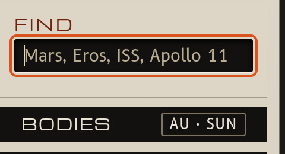
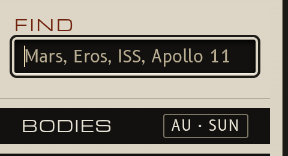
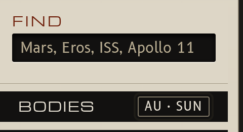
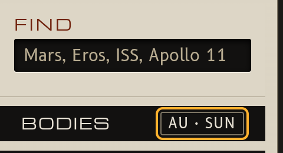
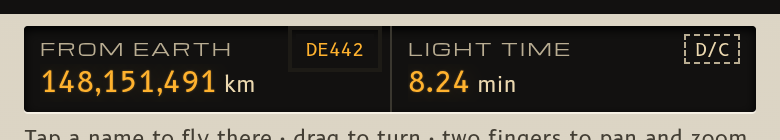
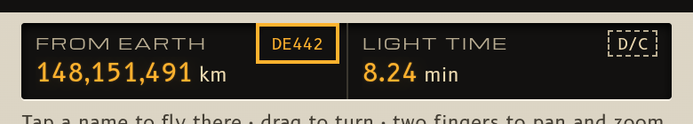
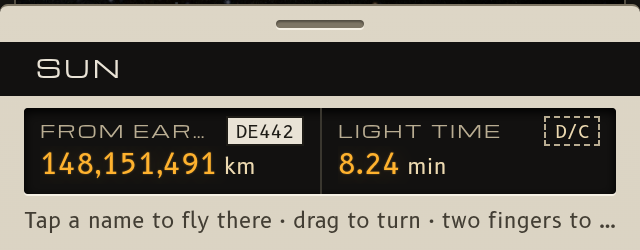
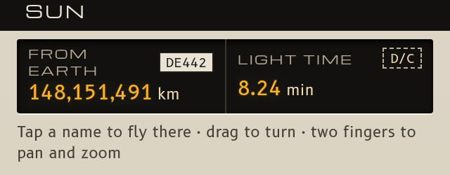
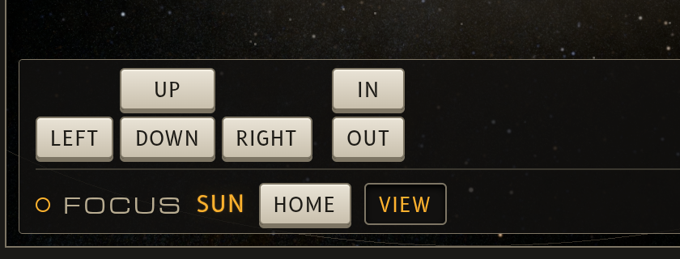
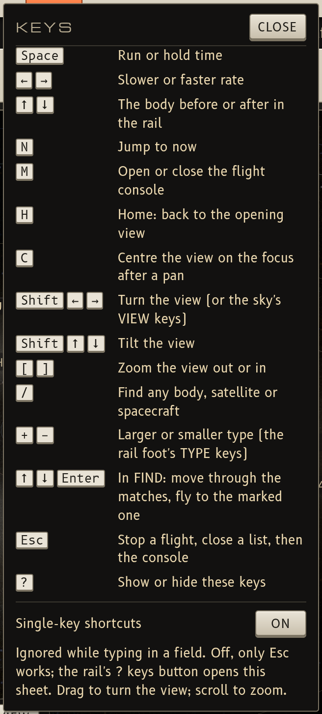

# Accessibility audit: the console against WCAG 2.2 AA

The first accessibility audit of the console, in November 2026. It covers
the header band, the body rail and FIND, the data plates and their source
tags, the flight console's MISSION, PLANNER and ROCKET tabs, the plotting
table (`#plot`), the `?` key sheet and the phone's sheet. The target is
WCAG 2.2 level AA [1], with DESIGN.md's own panel rule on top: contrast of
6:1 or better, from NASA-STD-3001 (DESIGN.md, "What real panels do").

## Method

- **A scripted probe in headless Chromium** on the laptop's NVIDIA GPU
  (through `scripts/lib/chromium.mjs`, so the sky renders), in 15 states:
  the desktop at 1,280 × 800 with each console tab, the key sheet, an open
  source tag and the plotting table; a phone at 390 × 844 at peek, half,
  full and with the console; 320 × 640 (WCAG's reflow width); 640 × 400 at
  2× (1,280 px at 200 % zoom), alone and with the console; and
  `prefers-reduced-motion: reduce`. In each state it:
  - walks the Tab order to its end. For each stop it records Chromium's
    own accessible role, name and states (`pressed`, `checked`, `expanded`,
    `selected`), the focus ring's style, the ring's contrast against what
    it is drawn on, and whether the control is on screen and not covered;
  - lists every interactive node in the accessibility tree with no name;
  - measures the contrast of every visible run of text against the fill
    behind it (each stop of a gradient counted, the worst kept), as the
    6:1 rule asks, not just WCAG's 4.5:1;
  - finds anything wider than the viewport, and any target under
    24 × 24 px that fails the spacing exception of SC 2.5.8;
  - counts the changes in every live region over six seconds with time
    running, to see whether the clock floods a screen reader;
  - lists the animations still running.
- **Scripted keyboard checks:** Space on a switch; the arrows on a radio
  and a tab; Esc in the console, the key sheet, a source tag, FIND's list,
  the plotting table and the phone sheet; where focus goes when each closes;
  FIND as a combobox; Tab through the plotting table and down the half
  sheet; turning and zooming the view without a pointer.
- **impeccable's `audit`** [2] for the code-level review: semantics,
  ARIA, motion and the theming tokens.
- **Not run:** Deque's Axe plugin [3] is installed, but its server did not
  connect during the audit, and axe-core was not added as a dependency, so
  no axe rule set was run (see Still open). No
  screen reader was used: names and roles were read from Chromium's own
  accessibility tree, which is what NVDA, JAWS and VoiceOver are given on
  Chromium.

## Findings

Severity is impeccable's: P1 is a WCAG AA failure or a real block for a
keyboard or screen-reader user, P2 a lesser failure or a best practice
that matters here, P3 polish. "Panel rule" marks a value that passes WCAG
but not DESIGN.md's 6:1.

| # | Sev. | Where | Finding | WCAG 2.2 | Fix | Status |
| --- | --- | --- | --- | --- | --- | --- |
| 1 | P1 | Plotting table | It is announced as a modal dialog, but focus stayed where it was when the table opened, and Tab walked all 60 or so controls of the console hidden under it. Closing it left focus nowhere. | 2.4.3 Focus Order (A); 2.4.11 Focus Not Obscured, Minimum (AA); 4.1.2 Name, Role, Value (A) | Opening moves focus to the selected station's key; the rest of the page is `inert` while it is open, so Tab and a screen reader stay inside it; closing hands focus back to what opened it. It is named by its title, as the modal dialog pattern has it [7]. | Fixed |
| 2 | P1 | FIND, the rail's FLY TO lists, every number field and list in the console | The focus ring on fields was RUN's orange: 2.5:1 to 2.8:1 on the panel. An earlier fix made rings ink, but a field rule still set orange. | 2.4.7 Focus Visible (AA); 1.4.11 Non-text Contrast (AA); panel rule | Fields take the panel's ink ring, 10.7:1. | Fixed |
| 3 | P1 | The rail's AU · SUN key; the source tags in the phone's peek | Both sit on black (a nomenclature strip, the peek's readout window), where the ink ring read 1.1:1, so focus there could not be seen. | 2.4.7 (AA); 1.4.11 (AA) | Rings on the strips and in the peek are phosphor, as they already were over the key sheet and FIND's list: 10.5:1. | Fixed |
| 4 | P1 | Phone sheet, at half | The body does not scroll at half, so Tab from the console's tabs went on to keys below the screen's edge (6-DOF, POINT MASS, ARM). | 2.4.11 (AA) | Focus landing below what half shows opens the sheet fully, and the control is scrolled into view. | Fixed |
| 5 | P1 | Plotting table | Every focus ring in the table was phosphor, as if the whole table were black, but its keys and fields sit on beige panels, where phosphor read 1.1:1. Found by the probe's second run, once the table opened. | 2.4.7 (AA); 1.4.11 (AA) | Ink on the table's panels (10.7:1); phosphor only on its black scope, timeline, stack and GO board. | Fixed |
| 6 | P1 | The sky | Turning and zooming the view needed a drag, the wheel or a pinch. Nothing turned it from the keyboard, and nothing zoomed it with a single tap. | 2.1.1 Keyboard (A); 2.5.1 Pointer Gestures (A); 2.5.7 Dragging Movements (AA) | Shift and the arrows turn and tilt the view 15° a press, `[` and `]` zoom out and in, and a VIEW key on the view plate opens a pad of word keys (UP, DOWN, LEFT, RIGHT, IN, OUT), each a single press. The key sheet lists them. | Fixed |
| 7 | P1 | The console's single-key shortcuts | Space, the arrows, N, M, H, C, /, ?, + and − act from anywhere, with no way to turn them off. A speech-input user's words or a stray key could fire them. | 2.1.4 Character Key Shortcuts (A) | The `?` sheet has a SINGLE-KEY SHORTCUTS switch (`role=switch`), kept for the browser. Off, only Esc works; the rail's `? keys` button still opens the sheet to turn them back on. | Fixed |
| 8 | P2 | Every focused key | Space on a focused control ran or held the clock and swallowed the press, so a layer's switch could not be toggled with Space, a switch's own key. The arrows on a focused radio or tab also changed the rate or the body, and Up on the sheet's latch moved the body as well as the sheet. | 2.1.1 (A), kept only by Enter; ARIA switch and radio keys [4] | Space belongs to the focused control. A key a control has handled is left alone by the shortcuts. | Fixed |
| 9 | P2 | RUN and HOLD, TYPE, the console's tabs, the plotting table's stations, the panels' latching keys | The radio groups and tab lists took no arrow keys (the UX review's finding 11). | ARIA radio and tabs patterns [4], [5] | One listener (`arrow-groups.ts`) gives every radio group and tab list the arrows (Left and Right for tabs) and Home and End, choosing as it moves and wrapping at the ends. | Fixed |
| 10 | P2 | The console's tabs; the plotting table's stations | Each tab named a panel with `aria-controls` that was not drawn (only the chosen one is), and the table's panels had no name. | 1.3.1 Info and Relationships (A); 4.1.2 (A) | Only the chosen tab names its panel; each panel is labelled by its tab. | Fixed |
| 11 | P2 | The sky | The canvas had no text alternative, and the page had no main landmark. | 1.1.1 Non-text Content (A); 2.4.1 Bypass Blocks (A) | The canvas is an image with a label saying what it shows and where its contents can be read; the sky is the page's `main`, "Sky". | Fixed |
| 12 | P2 | The header's lamps | Each lamp's state (LIVE: on) was an `aria-label` on a plain span, which ARIA does not let a generic element carry and some screen readers skip. | 4.1.2 (A); ARIA 1.2 [6] | The state is hidden text inside the lamp ("Live, on"). | Fixed |
| 13 | P2 | The master alarm | A craft crashing lit WARN and flashed ACK, but nothing told a screen reader. | 4.1.3 Status Messages (AA) | An alert reads the warning once as it sounds ("Warning: …"). | Fixed |
| 14 | P2 | FIND | The list's matches were not counted for a screen reader; only "No match" was said. | 4.1.3 (AA) | The status says how many matches there are ("5 matches"), for screen readers only. | Fixed |
| 15 | P2 | Phone at 320 px | The clock's seconds ran under RUN, and the peek's labels ("FROM EAR…") and the touch hint were cut with an ellipsis. | 1.4.10 Reflow (AA) | Under 360 px the clock and band keys are narrower; the peek's labels and the hint wrap. | Fixed |
| 16 | P3 | LAUNCH, unavailable | The disabled primary key's legend read 5.9:1. Disabled controls are exempt from WCAG's contrast minimum. | Panel rule | A flat, sunk face like any unavailable key: 6.0:1. | Fixed |
| 17 | P3 | Every radio group and tab list | Each radio and tab is still its own Tab stop. The pattern has one Tab stop per group, with a roving `tabindex`. | ARIA radio and tabs patterns [4], [5] | Needs `tabIndex` set in each group's component. | Open |
| 18 | P3 | Names | Chromium includes `text-transform` in accessible names, so names come out in capitals ("MERCURY 0.31"). Screen readers read them as words. | — | None needed. | Kept |

## What passed

- **The live clock does not flood a screen reader.** The clock is a
  `<time>` labelled UTC and in no live region. Over six seconds with time
  running, every live region on the page changed 0 times, in every state.
  The view plate's polite region speaks only when the view changes.
- **Contrast.** In every state, every run of text on the panels and in the
  windows read 6.58:1 or better (43 to 73 text styles a state), except
  LAUNCH before its fix (finding 16). The sky's labels sit on dark plates. (The probe
  reports "PLAN" in the plotting table's timeline and the phone's view plate
  as low, but both are false readings: an SVG fill, and a plate drawn over
  the sky but placed in the sheet's markup.)
- **Reduced motion.** With `prefers-reduced-motion: reduce` no CSS
  animation runs. Camera flights jump, the phone sheet jumps between stops,
  the guides and field lines stop drifting, and ACK does not flash.
- **200 % zoom.** At 1,280 px and 200 % the console takes the phone layout,
  with no sideways scroll, and the console scrolls in the sheet.
- **Target size.** No control under 24 × 24 px fails the spacing exception
  (SC 2.5.8) in any state.
- **Content on hover or focus.** The source tags' detail opens on hover and
  focus, can be hovered, stays until dismissed, and Esc closes it with
  focus kept on the tag (SC 1.4.13).
- **FIND is a combobox.** It has `role=combobox`, `aria-expanded`,
  `aria-controls` and `aria-activedescendant` over a grouped listbox; the
  arrows mark, Enter flies and Esc closes the list.
- **Names and states.** RUN and HOLD are a radio group; the phone's RUN is a
  toggle (`aria-pressed`); the layers are switches (`aria-checked`);
  CONSOLE and the sheet's latch have `aria-expanded`, and the latch names
  the sheet's stop; AU · SUN is `aria-pressed`. No interactive node is
  unnamed in any state.
- **Esc unwinds in order:** a tag's detail, then FIND's list, then a flight,
  then the phone sheet, then the console. Focus goes back to CONSOLE when the
  console closes, and to where it was when the key sheet closes.
- **Keyboard reach.** Every control is reachable by Tab, with no trap. The
  sky's markers take no focus, but the rail and FIND reach every body, moon,
  satellite and landing site they mark.

## Checked after the fixes

The probe and the keyboard checks were run again on a build with the
fixes:

| Check | Before | After |
| --- | --- | --- |
| Space on a focused switch | Held time; the switch stayed on | Toggles the switch; time runs on |
| → on a focused TYPE key | Rate went from real time to 10 s/s | Moves to and chooses TYPE 2; the rate is unchanged |
| → on the MISSION tab | Nothing | Chooses PLANNER |
| FIND's status after typing "mar" | Empty | "12 matches" |
| Shift+← and `]` | Nothing | The view turns 15° and zooms in by 1.25 |
| VIEW pad: UP, then OUT | No such keys | The view tilts and zooms out |
| The `?` sheet's switch off, then M | No switch | M does nothing |
| Plotting table opens | Focus stayed on the page | Focus is on the PLOT station key |
| Tab four times in the table | HOLD, under the table | Inside the table |
| Tab 30 times down the phone's half sheet | 25 stops off screen | 0 (it opens fully) |
| Focus ring on FIND | Orange, 2.8:1 | Ink, 10.7:1 |
| Focus ring on AU · SUN and the peek's tags | Ink on black, 1.1:1 | Phosphor, 10.5:1 |
| Focus rings in the plotting table | Phosphor on beige, 1.1:1 | Ink, 10.7:1 |
| The keyboard checks in all | 14 of 27 pass | 26 of 27 pass; the 27th was the probe's own mistake (below) |

The one check left marked as failing was the probe's own: after the
plotting table's last control, Tab moves to the browser's toolbar, since
everything under the table is inert. The probe read that as leaving the
table. It is the intended path, and the next Tab comes back to the table's
first control (the probe's Tab walk, below).

The probe on the fixed build, in all 15 states: no interactive node
unnamed; every focus ring at 10.5:1 or better, read against what it sits
on;
no text on the panels under 6:1 but the two false readings above; nothing
wider than the viewport, at 320 px included; no undersized target without
spacing; no live region changing while time runs. With the plotting table
open, Tab visits its 16 controls, then the browser's toolbar, then the
table's first key again; nothing under the table takes focus. With the
key sheet open, Tab goes on past it (it is not modal) and two stops are
under it; that passes SC 2.4.11, since the user opened the sheet and Esc
closes it without moving focus.

Before and after, focused by Tab (left before, right after):

| | Before | After |
| --- | --- | --- |
| FIND |  |  |
| AU · SUN on its strip |  |  |
| The phone's peek |  |  |
| 320 px band |  |  |
| 320 px peek |  |  |

The VIEW pad open on the view plate, and the key sheet with its switch:

## Still open

- **An axe pass.** The Axe plugin's server failed to connect, and
  axe-core (MPL-2.0) was not added as a dev dependency without the owner's
  say. With
  it, the probe can inject `axe.min.js` and run the `wcag2a`, `wcag2aa`,
  `wcag21aa` and `wcag22aa` rule sets in each state.
- **A screen-reader pass** with NVDA on Firefox and VoiceOver on iOS, which
  the think-aloud kit's protocol ([think-aloud/](think-aloud/README.md))
  can take.
- **Text spacing (SC 1.4.12)** was not tested.
- **One Tab stop per group** (finding 17).

## References

[1] W3C, "Web Content Accessibility Guidelines (WCAG) 2.2," W3C Recommendation, Dec. 12, 2024. [Online]. Available: https://www.w3.org/TR/WCAG22/

[2] P. Bakaus, "Impeccable: audit," design skill for coding agents. [Online]. Available: https://github.com/pbakaus/impeccable

[3] Deque Systems, "axe-core: accessibility engine for automated web UI testing." [Online]. Available: https://github.com/dequelabs/axe-core

[4] W3C WAI, "Radio Group Pattern," in *ARIA Authoring Practices Guide (APG)*. [Online]. Available: https://www.w3.org/WAI/ARIA/apg/patterns/radio/

[5] W3C WAI, "Tabs Pattern," in *ARIA Authoring Practices Guide (APG)*. [Online]. Available: https://www.w3.org/WAI/ARIA/apg/patterns/tabs/

[6] W3C, "Accessible Rich Internet Applications (WAI-ARIA) 1.2," W3C Recommendation, Jun. 6, 2023, §5.4 (roles that prohibit naming: generic). [Online]. Available: https://www.w3.org/TR/wai-aria-1.2/

[7] W3C WAI, "Dialog (Modal) Pattern," in *ARIA Authoring Practices Guide (APG)*. [Online]. Available: https://www.w3.org/WAI/ARIA/apg/patterns/dialog-modal/
