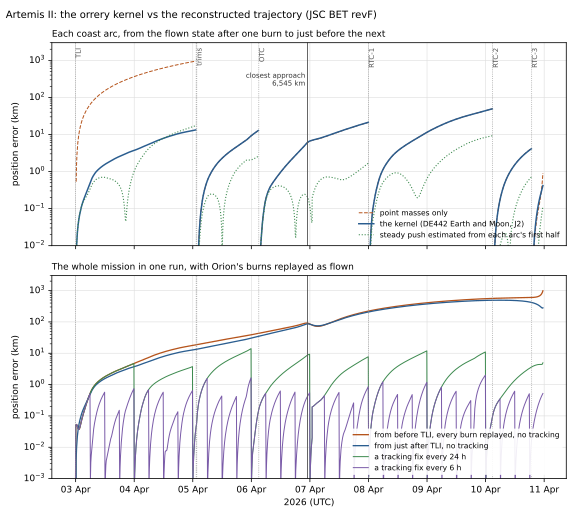

# Artemis II: the kernel against the flown trajectory

Artemis II flew Orion around the Moon from 2 to 10 April 2026. JSC's flight
navigation team reconstructed the flight from GPS, Deep Space Network and
other tracking. Their best estimated trajectory (BET revF) was cleared for
public release on 1 July 2026, and NAIF converted it into an SPK.

These checks fly Orion with the app's own kernel and compare the result with
that trajectory: first each coast between burns, then the whole mission in
one run. The kernel gained Earth's and the Moon's J2, DE442's Earth and
Moon, and a time-scale fix because of these checks. `npm test` runs it; the
numbers below are from November 2026.



## The reference

- **Trajectory:** NAIF's
  [`art002_rec_260402_260410_jsc_bet_revf.bsp`](https://naif.jpl.nasa.gov/pub/naif/ARTEMIS/kernels/spk/)
  (5.7 MB) and its gap-fill file (50 kB). It holds Orion (NAIF ID −24)
  relative to Earth in J2000, from Orion's separation from the upper
  stage at 01:58 UTC on 2 April to entry interface at 23:53 UTC on
  10 April.
- **What JSC's fit models:** gravity from the Earth, Moon, Sun and Jupiter,
  the burns, life-support vents, thruster firings and solar radiation
  pressure.
- **Uncertainty:** the file's covariance puts JSC's 1σ position uncertainty
  at 0.2–1 km in the coast arcs.
- **Sampling:** `c/artemis2_ref.c` samples Orion's state every 10 minutes
  with CSPICE, along with DE442's Moon at the same instants. It writes
  `src/physics/fixtures/artemis2_bet.json` (263 kB), so the check needs
  neither SPICE nor the kernels to run.

## The burns: ours against NASA's

The SPK breaks into six continuous segments at burns. `c/artemis2_ref.c`
also samples a window around each burn every 5 s
(`src/physics/fixtures/artemis2_burns.json`, 341 kB).
- **Measuring:** for each 5-second interval, the flown state is carried
  across it by the kernel's gravity. What it falls short of the next flown
  state is that interval's thrust. Intervals above 0.3 mm/s² belong to a
  burn.
- **Δv:** the sum of a burn's intervals, from `artemis2.lib.mjs`.

| Burn | Mid-burn (UTC) | Δv measured | NASA | Direction (prograde, in-plane, normal) |
| --- | --- | --- | --- | --- |
| Translunar injection | 2 Apr 23:52:51 | 387.71 m/s (1,272.0 ft/s) over 350.3 s | 1,274 ft/s planned; 5 min 49 s planned, 5 min 50 s flown; ignition 23:49 UTC | 0.951, 0.063, −0.304 |
| Trim | 5 Apr 01:23 | 0.75 m/s (2.4 ft/s) over about 5 min | not in NASA's posts | −0.01, 0.84, −0.55 |
| Trim | 5 Apr 01:39 | 1.14 m/s (3.7 ft/s) over about 7 min | not in NASA's posts | −0.13, 0.85, −0.51 |
| Outbound correction | 6 Apr 03:03 | 3.15 m/s (10.3 ft/s) | 17.5 s at 03:03 UTC; Δv not published | 0.05, −0.48, 0.88 |
| Return correction 1 | 8 Apr 00:03 | 0.48 m/s (1.6 ft/s) | 15 s, 1.6 ft/s, at 00:03 UTC | −0.18, −0.44, −0.88 |
| Return correction 2 | 10 Apr 02:54 | 1.614 m/s (5.3 ft/s) | 9 s, 5.3 ft/s, at 02:53 UTC | −0.05, −0.84, 0.53 |
| Return correction 3 | 10 Apr 18:54 | 1.273 m/s (4.2 ft/s) | 8 s, 4.2 ft/s (secondary source only) | 0.21, 0.68, −0.70 |

The direction is in Orion's local frame about Earth at mid-burn: along its
velocity, in the orbit plane, and along the orbit normal.

What this shows:
- **Every Δv NASA published is matched to its last digit.** The injection
  burn's 1,272.0 ft/s is 0.16 % under the planned 1,274 ft/s; NASA gave
  only the planned figure.
- **The injection burn's 350.3 s matches the 5 min 50 s flown.**
- **Burns shorter than a minute can't be timed from this data.** The SPK's
  interpolation spreads them over about a minute (52–113 s here, against
  NASA's 8–17.5 s), so their Δv is exact but their duration is not.
- **The two trims on 5 April** are slow (about 9 mm/s², several minutes
  each) and absent from NASA's posts. They may be attitude-control or
  piloting activity.

**How the injection burn was steered.** Through the whole burn the thrust
stayed within about a degree of one direction in the local frame: 95 %
prograde, 6 % in-plane, 30 % normal. In inertial space it turned by about
15°.

**The engine.** The acceleration rose from 1.04 to 1.18 m/s² as
propellant burned. Fitted to the rocket equation, a(t) = a₀ / (1 − t/τ), it
gives:
- an exhaust velocity of 3,089 m/s, an Isp of 315.0 s;
- a mass ratio over the burn of 0.882.

NASA gives the OMS-E main engine as 26.7 kN at a nominal Isp of 315.1 s
([Artemis I engine performance](https://ntrs.nasa.gov/api/citations/20240003648/downloads/382_BELAIR_ARTEMIS_I_ENGINE_PERFORMANCE_FINAL.pdf)).
- **The fit is sensitive to sampling:** 308 s from 10-second data, 327 s
  from 2-second data. So treat 315 s as consistent with NASA, not as a
  measurement of it.
- **Mass:** at the rated thrust, an ignition acceleration of 1.042 m/s²
  implies Orion weighed about 25.6 t. That's an inference, not a
  published figure.

NASA's figures come from its mission blog:
- [the injection burn's plan](https://www.nasa.gov/blogs/missions/2026/04/02/artemis-ii-flight-update-perigee-raise-burn-complete/);
- [the outbound correction](https://www.nasa.gov/blogs/missions/2026/04/05/artemis-ii-flight-day-5-correction-burn-complete/);
- [return correction 1](https://www.nasa.gov/blogs/missions/2026/04/07/artemis-ii-flight-day-7-first-return-correction-burn-complete/);
- [return correction 2](https://www.nasa.gov/blogs/missions/2026/04/10/artemis-ii-flight-day-9-second-return-correction-burn-complete/).

The injection burn's 5 min 50 s is
[Space.com's](https://www.space.com/space-exploration/artemis/artemis-2-astronauts-head-for-moon-translunar-injection-burn).
Return correction 3's figures are from
[SpaceTech Chronicles](https://spacetechchronicles.com/artemis-ii-live-tracker/)
only.

## The checks

All of them use `advance()` from `nbody.js`, the same integrator the app uses
for spacecraft:
- Encke's method near Earth and the Moon;
- the Sun and planets, with DE442's own Earth and Moon (the app's
  [Chebyshev table](../physics/ephemerides-and-gm.md#de442-in-the-app));
- Earth's J2 (EGM2008) and the Moon's (GRAIL).

Orion's heliocentric state is its flown geocentric state plus the app's
Earth.

### 1. Coast arcs

Each arc starts from the flown state 10 minutes after one burn and runs to
just before the next. A second run with point masses only shows what J2 is
worth.

| Arc | Days | The kernel: error at end | Point masses only |
| --- | --- | --- | --- |
| Outbound, after translunar injection | 2.05 | 13 km, 0.14 m/s | 957 km, 7.7 m/s |
| Outbound, to the correction | 1.04 | 13 km | 13 km |
| Lunar flyby | 1.86 | 21 km | 21 km |
| Return | 2.10 | 49 km | 49 km |
| Return, between corrections | 0.65 | 4.1 km | 4.2 km |
| Final approach to entry | 0.18 | 0.4 km | 0.9 km |

**Closest approach to the Moon,** from the flown state 20 hours before:

| | Altitude above the 1,737.4 km mean radius | Time (UTC, 6 April) |
| --- | --- | --- |
| Flown (BET) | 6,545.0 km | 23:00:49 |
| The kernel | 6,543.5 km | 23:00:45 |

The flown altitude matches the 6,545 km NASA announced.

### 2. The gravity model alone

What is left in the arcs above is almost all a steady push in the real
flight. Fitting one constant acceleration to an arc's first half and
predicting the second half separates the two:

| Arc | Push (µm/s²) | Error at end, push estimated | Without |
| --- | --- | --- | --- |
| Outbound, after translunar injection | 1.3 | 17 km | 13 km |
| Outbound, to the correction | 3.4 | 2.6 km | 13 km |
| Lunar flyby | 1.9 | 1.7 km | 21 km |
| Return | 3.3 | 9.2 km | 49 km |
| Return, between corrections | 3.2 | 0.7 km | 4.1 km |
| Final approach to entry | 3.0 | 0.1 km | 0.4 km |

What this shows:
- **The gravity is right to a few kilometres** over one to two days,
  through the lunar flyby included.
- **The first arc is the exception.** Its push isn't steady just after the
  injection burn, probably from venting after the burn.
- **The DE442 Moon matters.** Repeating this with astronomy-engine's Moon,
  the flyby arc ends 48.7 km off instead of 3.6 km.

### 3. The whole mission with Orion's burns

This is the test of flying Artemis II yourself.
- **The run:** one run to entry interface, with every burn replayed as
  flown, each 5-second interval in turn as a finite burn, steered in the
  local frame.
- **What's left out:** nothing is fitted, the steady push isn't modelled,
  and there's no tracking.

| Start | Lunar flyby | Entry interface (10 April, 23:29 UTC) |
| --- | --- | --- |
| Just after the injection burn | 6,540.2 km, 60 s early | 279 km off: 30 s early, 152 km to the side |
| Ten minutes before the injection burn (2 April, 23:39:59.7), flying it too | 6,506.4 km, 45 s early | 4,327 km off: 560 s early, 245 km to the side |
| Flown | 6,545.0 km at 23:00:49 | |

**Replaying the injection burn.** Just after it, the replayed burn is
0.01 km and 0.030 m/s from the flown state.
- **Flown in one fixed direction** (its mean, on the fitted rocket
  profile), it ends 2.5 km and 2.1 m/s off instead. Steering matters,
  even though the burn never strayed more than about a degree.
- **What 0.03 m/s grows into:** about 40 km of flyby altitude four days
  later, and 4,300 km at entry, eight days later. That is why missions plan
  correction burns, and why NASA could skip the first outbound ones.

The burn's data starts ten minutes before ignition, with 4.3 m/s of
smaller thrust (settling pulses of up to a seventh of the main engine's),
which the replay flies too.

Two corrections were made in getting here:
- **Steps inside a steered burn are capped at 0.25 s,** in the app's kernel
  as well. The symplectic integrator follows a thrust that turns with the
  velocity only to first order. Against RK4 at 0.01 s, 5-second steps were
  0.13 m/s off per minute of burning near perigee; 0.25-second steps are
  0.0065 m/s off.
- **Each interval's thrust is expressed in the orbital frame at its
  midpoint,** where the mean of a thrust turning with the frame points. It
  was at the interval's start, and near perigee the frame turns 0.24° in
  half an interval.

An earlier version of this table started "before the injection burn" at
the first 10-minute sample after 23:40, which is three seconds after
ignition, and gave a flyby of 6,550.6 km. That was too kind; the row above
starts before any of the burn's thrust.

### 4. Tracking fixes

A navigation team keeps a craft on course by measuring where it is. Here
the craft is reset to the flown state every few hours, as if by a tracking
fix. In between it flies on the kernel with the burns replayed. The run
starts before the injection burn.

| A fix every | Between fixes: median, worst | Lunar flyby | At entry interface |
| --- | --- | --- | --- |
| 24 h | 2.2 km, 14 km | 6,542.9 km | 5.0 km |
| 12 h | 0.5 km, 5 km | 6,544.4 km | 1.1 km |
| 6 h | 0.1 km, 2 km | 6,545.2 km | 0.5 km |
| 3 h | under 0.1 km, 1 km | 6,545.0 km | 0.2 km |

With a fix every 12 hours the simulator never strays more than 5 km from
the real flight. It reaches entry interface within about a kilometre.
What remains between fixes is the steady push that check 2 measured.

The fixes are perfect here: the flown state itself. A real fix would carry
the tracking's own error, about 0.2–1 km in this phase going by JSC's
covariance.

### 5. In the app

The app flies the same mission:
- **Loading:** from **Real missions** on the MISSION tab, or with
  `?mission=artemis2`. Adding `&t=…` starts inside the mission, and
  `&fix=12` adds tracking fixes every 12 h.
- **The file:** `public/missions/artemis2.json` (298 kB), written by
  `artemis2.export.mjs`. It holds the start state, the burns as 5-second
  intervals, and the flown trajectory. That is sampled every 10 minutes,
  every minute near Earth and every 5 s through each burn, so
  interpolation never bridges a burn. With the samples thinned to every
  other one, interpolation stays within 11 m near Earth.
- **The check:** the validation flies that file through the app's own
  Craft model and kernel host in one-minute frames. It reproduces the
  replay's flyby (6,506.8 km against 6,506.4 km) at every frame size from
  0.25 s to one request, and with a fix every 12 h it is 1.3 km off at
  entry.

### 6. Our own plan

Can the simulator plan Artemis II itself, without NASA's trajectory, and
arrive at the same flight? `src/physics/artemis2.design.mjs` (run with
`npm run design:artemis2`, about 20 s) designs the injection burn from:
- **One input from the data:** the orbit Orion was in ten minutes before
  the burn, which is what the launch delivered.
- **NASA's published figures, nothing else:**
  - **The flyby:** 4,067 miles (6,545.2 km) above the Moon at 7:00:46 pm
    EDT on 6 April (23:00:46 UTC), during the loss of signal behind the
    Moon
    ([NASA](https://www.nasa.gov/blogs/missions/2026/04/06/artemis-ii-flight-day-6-crew-wraps-historic-lunar-flyby/),
    [CBS](https://www.cbsnews.com/live-updates/artemis-moon-lunar-flyby/)).
  - **Entry interface:** 400,000 ft at 7:53 pm EDT on 10 April (23:53 UTC)
    ([NASA](https://www.nasa.gov/blogs/missions/2026/04/09/artemis-ii-flight-day-9-crew-prepares-to-come-home/)).
  - **The engine:** 26.7 kN at an Isp of 315.1 s
    ([NASA](https://ntrs.nasa.gov/api/citations/20240003648/downloads/382_BELAIR_ARTEMIS_I_ENGINE_PERFORMANCE_FINAL.pdf)).
    NASA's planned 1,274 ft/s in 5 min 49 s then fixes Orion's mass at
    ignition: 25,536 kg.

**The method:**
1. **B-plane targeting.** The burn is three Δv components, held in the
   orbital frame as a finite burn. Newton solves them so that the approach
   to the Moon, 18 hours out, passes a chosen aim point at the chosen time.
   The first guess is Lambert's two-body transfer to the Moon's centre.
2. **The family of free returns.** Once the flyby altitude and time are
   met, the aim point's angle is the only freedom left. Marching that angle
   shows only a narrow band, 184–186°, brings Orion home. The rest fly past
   Earth, some by 450,000 km. Within the band, the entry angle runs from
   steep (−20°) to skipping off the atmosphere. The member that reaches
   entry interface at NASA's time is found by bisection. The aim point's
   distance and time are then corrected until the true flyby, not its
   osculating estimate, meets NASA's.
3. **Ignition time.** NASA gives it to the minute. The design takes the
   time that needs the least Δv, 23:50:23 UTC. The minimum is shallow:
   igniting at 23:49:00 would cost 10 m/s more, and at 23:49:50 only 1.3.

| | Our plan | NASA's plan | Flown |
| --- | --- | --- | --- |
| Injection burn | 1,270.7 ft/s (387.32 m/s) | 1,274 ft/s | 1,272.0 ft/s, plus 14 ft/s of settling thrust before ignition |
| Duration | 348.2 s | 5 min 49 s | 350.3 s |
| Ignition (UTC) | 23:50:23 | about 23:49 | 23:49:50 |
| Direction (prograde, in-plane, normal) | 0.958, 0.112, −0.264 | | 0.951, 0.063, −0.304: 3.6° away |
| Lunar flyby | 6,545.5 km at 23:00:45 | 6,545.2 km at 23:00:46 | 6,545.0 km at 23:00:49 |
| Farthest from Earth | 413,145 km | 252,756 mi (406,771 km) from the surface, about 413,140 km from the centre | 413,145 km |
| Entry interface (UTC) | 23:53:00 | 23:53 | 23:53:24 (the data's end, 129.7 km up) |
| Entry angle | −7.31° | not published | −6.24° |
| Speed at entry, relative to the rotating Earth | 10.633 km/s | about 23,864 mph (10.668 km/s) | 10.626 km/s |
| Entry interface over | 17.1°N, 147.8°W | | 18.4°N, 146.1°W (about 230 km away) |

Planned only from NASA's published targets, the simulator's Artemis II
stays within 182 km of the real one for the whole eight days. Its
injection burn is within 0.3 % of NASA's plan, and it reaches the same
farthest point from Earth to the kilometre.

The remaining differences have clear sources:
- **The real flight was corrected in flight,** with about 8 m/s of burns,
  and felt the steady push.
- **The real injection burn** lit about 35 s before our minimum-Δv time,
  after 4.3 m/s of settling thrust.
- **The entry angle:** our plan meets the entry time but chooses its angle
  freely. NASA's entry angle wasn't published, so it couldn't be a target.

## What the errors come from

1. **Earth's J2, now in the kernel.**
   - Translunar injection fired at about 200 km altitude. The first arc
     starts 9,000 km from Earth's centre, where Earth's flattening pulls
     at about 5 mm/s².
   - With point masses only, the first two hours put 7.7 m/s of error into
     the velocity, which grows to 957 km in two days.
   - See [the kernel](../physics/nbody-kernel.md#oblateness-j2).
2. **The Moon, now DE442's.**
   - astronomy-engine's Moon is 9–13 km from DE442's, mostly closer to
     Earth. The app now takes the Moon (and Earth) from DE442 itself,
     within a metre.
   - Measured against the gravity alone (check 2), the flyby went from
     49 km to 3.6 km off.
3. **A steady push the app can't know.** The flown trajectory shows
   1.3–3.4 µm/s² beyond gravity: about 0.1 N on Orion.
   - Solar pressure on Orion is about 0.02 µm/s², a hundred times smaller,
     and it pushes away from the Sun. This push always leans toward the
     Sun: its cosine with the Sun's direction is 0.3–0.8 in every arc.
   - So it is most likely venting or uneven thermal radiation while Orion
     holds Sun-relative attitudes. JSC's fit models both from Orion's logs.
   - A simulator can't predict it without those logs. It is what remains
     in checks 1 and 3.
4. **Time, found and fixed by this check.**
   - astronomy-engine extrapolated TT − UT as 75.2 s for 2026, against the
     true 69.2 s, so every body was computed 6 s late.
   - TT − UTC now comes from the leap-second table (`timescale.js`), and
     the DE442 table runs on TDB derived the same way.

## Calibration: what does not help

The remaining error is the steady push. These experiments asked whether
anything in the app's reach removes it. `src/physics/artemis2.calibrate.mjs`
reproduces them; it is not part of `npm test`.

**More bodies.** The kernel already has the Sun, all eight planets and the
Moon. What another body adds to a craft near Earth is its tide. At Orion's
farthest from Earth (411,000 km) during the mission, the largest is
Jupiter's, 2.3×10⁻⁴ µm/s². Venus, Mercury and Saturn are under 3×10⁻⁵ and
the rest smaller. All are thousands of times smaller than the push, so
neither more bodies, nor asteroids, nor relativity would change the
result.

**More of Earth's gravity.** Earth's next zonal harmonics, J3 and J4
(EGM2008), are the only gravity terms of the push's size, and only close to
Earth. Added (as the gradient of the potential), they change the final
approach from 0.418 to 0.417 km and the first arc from 13.3 to 14.7 km. That
is no help, so they are not in the kernel.

**An empirical push model.** Navigation teams model unknown forces as an
estimated acceleration. Four forms were tried, each estimated by least
squares:
- constant in inertial axes;
- along the Sun line only;
- constant in a Sun–ecliptic frame;
- along the Sun line plus along Earth's radial.

| Fitted on one arc, predicting the next | No model | Inertial | Sunward | Sun frame | Sun + Earth-radial |
| --- | --- | --- | --- | --- | --- |
| Outbound → flyby | 21 km | 20 | 21 | 19 | 21 |
| Flyby → return | 49 km | 26 | 46 | 26 | 33 |
| Return → between corrections | 4.1 km | 6.3 | 4.1 | 6.3 | 3.8 |
| Between corrections → final approach | 0.4 km | 0.7 | 0.4 | 0.7 | 0.7 |

No form helps consistently, because the push's direction changes from one
arc to the next. Each arc's push leans toward the Sun, but its other
components vary, as Orion's attitude does between burns.

Fitted on the whole mission up to 5 or 6 April and then flown on to entry
with the burns, each form ends 1,700–2,800 km off, against 238 km with none.
The lunar flyby magnifies any small error in the push, so an estimate from
before the flyby does not carry past it.

**So the gravity model is complete for this mission.** What remains is
Orion itself, venting and firing thrusters as its attitude changes, which
JSC's fit takes from Orion's logs. A real mission holds kilometres by
re-measuring its position from tracking every few hours, not with a better
force model. Doing better here would mean using the flown data during the
flight, as orbit determination does. That is a different feature from a
predictive simulator.

## Regression checks

`artemis2.validate.mjs` runs in `npm test`, and fails if:
- the flyby arc's closest approach moves more than 3 km or 30 s from the
  flown one;
- any coast arc ends more than 60 km off, or the first more than 25 km;
- any arc, with its push estimated, ends more than 20 km off;
- the injection burn's Δv strays more than 0.5 % from NASA's 1,274 ft/s,
  or its duration more than 5 s from 350 s;
- return corrections 1 and 2 stray more than 0.1 ft/s from NASA's figures;
- the replayed injection burn lands more than 0.05 m/s from the flown
  state;
- the whole mission from before the injection burn misses the flyby
  altitude by more than 60 km (the injection burn's 0.03 m/s grows to
  about 40 km);
- with a fix every 12 hours, the craft ends more than 5 km off at entry, or
  strays more than 1,000 km;
- the app's Moon strays more than 5 m from DE442;
- the app's own path, flying the mission file, misses the replay's flyby
  by more than 2 km, or (with a fix every 12 h) ends more than 5 km off at
  entry or strays more than 10 km;
- our saved plan, flown again, misses NASA's flyby by more than 1 km or
  5 s, or the entry time by more than 5 s;
- our plan's burn strays more than 1 % from 1,274 ft/s or 3 s from 349 s,
  or ignites more than 2 minutes from 23:49;
- our plan strays more than 300 km from the flown path, or its farthest
  point from Earth is more than 10 km from the flown one.

## Regenerate

With the kernels in `python/data/kernels/` (see `c/README.md`) and the two
Artemis II SPKs in `python/data/kernels/spk/missions/artemis2/`:

```bash
cmake --build c/build
c/build/artemis2_ref src/physics/fixtures/artemis2_bet.json 600
c/build/artemis2_ref src/physics/fixtures/artemis2_near.json 60 \
  2026-04-03T00:05:00 2026-04-03T03:00:00  2026-04-10T19:05:00 2026-04-10T23:54:00
c/build/artemis2_ref src/physics/fixtures/artemis2_burns.json 5 \
  2026-04-02T23:40:00 2026-04-03T00:05:00  2026-04-05T01:15:00 2026-04-05T01:50:00 \
  2026-04-06T02:55:00 2026-04-06T03:15:00  2026-04-07T23:55:00 2026-04-08T00:15:00 \
  2026-04-10T02:45:00 2026-04-10T03:05:00  2026-04-10T18:45:00 2026-04-10T19:05:00
node src/physics/artemis2.validate.mjs
node src/physics/artemis2.export.mjs     # the app's mission file
node src/physics/artemis2.design.mjs     # our own plan, and its mission file
```

## Next

- Let a user load this mission in the app, fly it with these burns, and
  watch the residual grow.
- Noisy tracking fixes, drawn from JSC's covariance, instead of perfect
  ones.
- More missions: Artemis I, and Apollo from NAIF's reconstructions.
